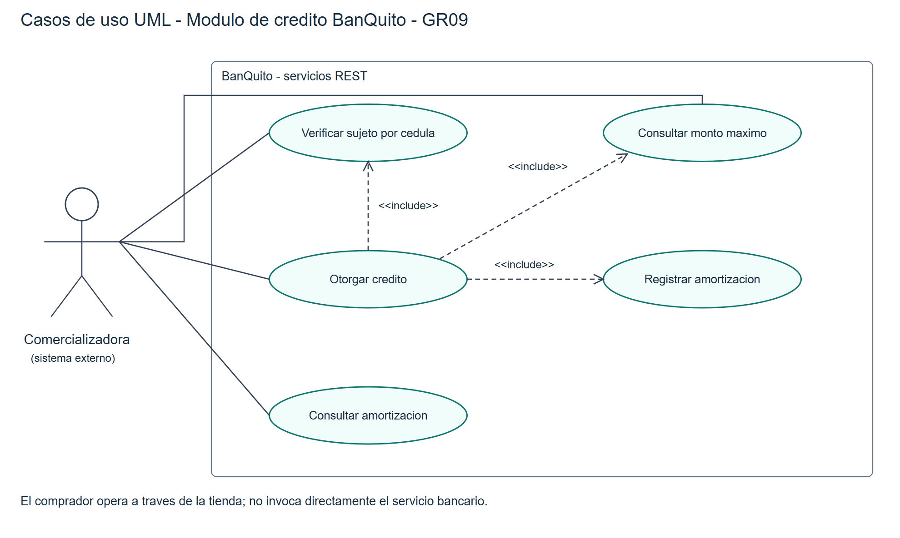
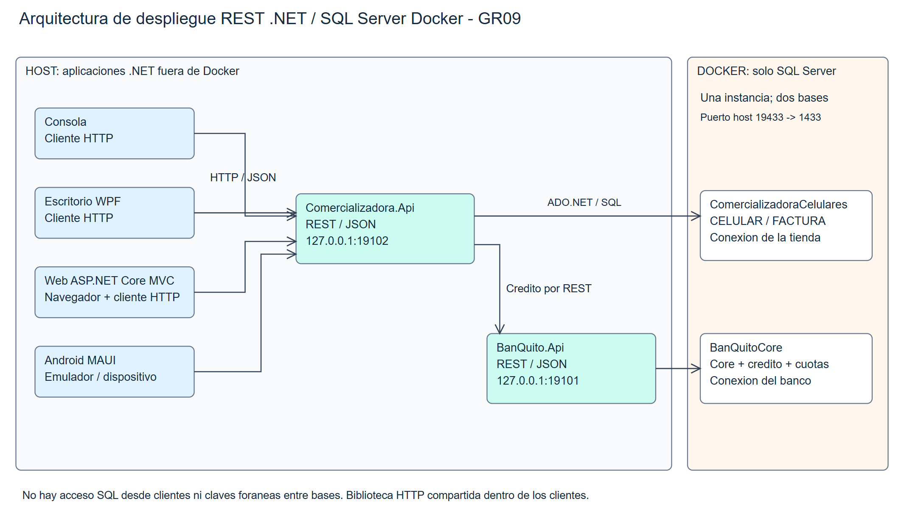
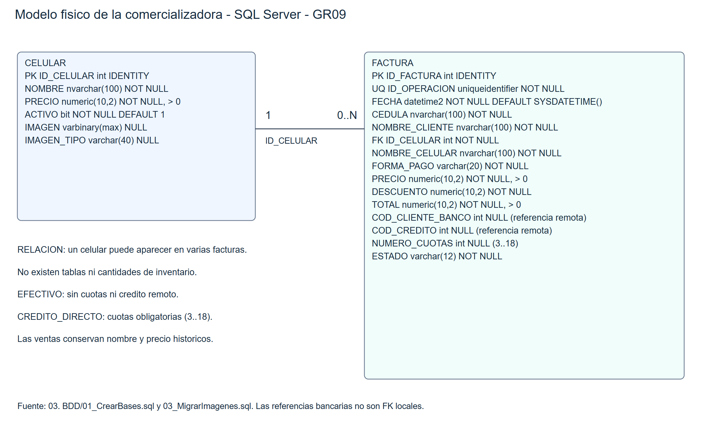

# Especificación de casos de uso detallados

## CU01 Mantener catálogo
| Campo | Descripción |
| Actor | Operador comercial |
| Objetivo | Crear, consultar, editar o desactivar un celular sin inventario. |
| Precondición | API de tienda disponible. |
| Flujo principal | El operador introduce nombre y precio positivo; el cliente envía la solicitud; la tienda valida y persiste; se actualiza el catálogo. |
| Alternativas | Datos inválidos: rechazo sin alta. Desactivación conserva facturas. |
| Postcondición | Catálogo actualizado y sin alteración del historial. |

## CU02 Verificar sujeto de crédito
| Campo | Descripción |
| Actor | Comercializadora |
| Objetivo | Evaluar al solicitante por su cédula. |
| Precondición | Core bancario disponible con clientes, cuentas y movimientos. |
| Flujo principal | Recibir cédula; localizar cliente; obtener movimientos; verificar depósito del último mes, edad masculina y ausencia de crédito activo; devolver decisión y motivo. |
| Alternativas | Cliente inexistente, hombre menor de 25, sin depósito o crédito activo: sujetoCredito=false. Entrada inválida: 400; SQL indisponible: 503. |
| Postcondición | Decisión informativa sin crear préstamo; otorgamiento vuelve a verificar. |

## CU03 Consultar monto máximo
| Campo | Descripción |
| Actor | Comercializadora |
| Objetivo | Obtener límite por código del cliente. |
| Precondición | Cliente identificado. |
| Flujo principal | Leer movimientos de tres meses; promediar depósitos y retiros; calcular max(0,diferencia × 35% × 6); devolver monto. |
| Alternativas | Código inexistente: rechazo. Sin movimientos se consideran promedios cero. Enunciado contradictorio al 30% documentado. |
| Postcondición | Monto consultado sin registrar crédito. |

## CU04 Otorgar crédito
| Campo | Descripción |
| Actor | Comercializadora |
| Objetivo | Registrar crédito y plan de amortización. |
| Precondición | Cliente elegible, precio positivo y plazo válido. |
| Flujo principal | Recibir código, precio, cuotas y referencia; resolver reintento; bloquear/verificar estado; validar máximo; calcular cuotas; persistir crédito y amortización en transacción. |
| Alternativas | Plazo fuera de 3–18, monto superior o cliente no elegible: rechazo. Referencia repetida con datos distintos: conflicto. Error SQL: rollback. |
| Postcondición | Crédito activo y cuotas completas, o ningún registro nuevo si falla. |

## CU05 Venta en efectivo
| Campo | Descripción |
| Actor | Operador comercial |
| Objetivo | Facturar con descuento del 42%. |
| Precondición | Celular activo y comprador identificado. |
| Flujo principal | Seleccionar producto; mostrar lista/descuento/total; confirmar; enviar IdOperacion; validar precio; registrar factura aprobada; mostrar detalle. |
| Alternativas | Precio cambió: conflicto y actualizar catálogo. Repetir IdOperacion con los mismos datos devuelve la factura original. |
| Postcondición | Factura aprobada: 450 - 189 = 261. |

## CU06 Venta a crédito
| Campo | Descripción |
| Actor | Operador comercial |
| Objetivo | Comprar con autorización bancaria remota. |
| Precondición | Celular activo y banco disponible. |
| Flujo principal | Introducir comprador y cuotas; consultar elegibilidad; confirmar; crear operación pendiente; solicitar crédito a BanQuito; recibir aprobación; marcar factura aprobada y mostrar plan. |
| Alternativas | Rechazo bancario no se muestra como aprobación. Falla temporal conserva referencia para consulta/reintento. |
| Postcondición | Factura aprobada asociada al crédito remoto o estado que permite resolver la operación. |

## CU07 Consultar amortización
| Campo | Descripción |
| Actor | Comercializadora / operador |
| Objetivo | Recuperar plan de un crédito otorgado. |
| Precondición | Factura a crédito aprobada con referencia bancaria. |
| Flujo principal | Seleccionar factura; tienda invoca GET de amortización bancario; devolver cuotas persistidas; cliente muestra fecha, pago, interés, capital y saldo. |
| Alternativas | Factura sin crédito aprobado: conflicto. Banco no disponible: error comprensible, sin inventar cuotas. |
| Postcondición | Plan mostrado con saldo final cero; no se modifican datos. |

## CU08 Buscar y abrir factura
| Campo | Descripción |
| Actor | Operador comercial |
| Objetivo | Consultar historial por cédula. |
| Precondición | Existencia opcional de facturas. |
| Flujo principal | Introducir cédula; buscar; seleccionar resultado; mostrar detalle y, si corresponde, amortización. |
| Alternativas | Sin resultados: mensaje informativo. Factura inexistente: rechazo. |
| Postcondición | Consulta sin cambios de datos. |

## Reglas comunes y evidencia
Crédito: 3–18 cuotas, 16,5% anual, máximo al 35% documentado frente al 30% de la fórmula impresa. La última cuota absorbe redondeos. Contratos REST y datos reales se verifican en EVIDENCIA_API_QA.json; cuatro clientes en los registros individuales. El diagrama bancario se entrega en SVG editable y PNG, generado por VBS sin COM; los modelos PowerDesigner anteriores se conservan.

## Figura: Casos de uso bancarios

## Figura: Arquitectura REST y Docker

## Figura: Modelo físico comercializadora

