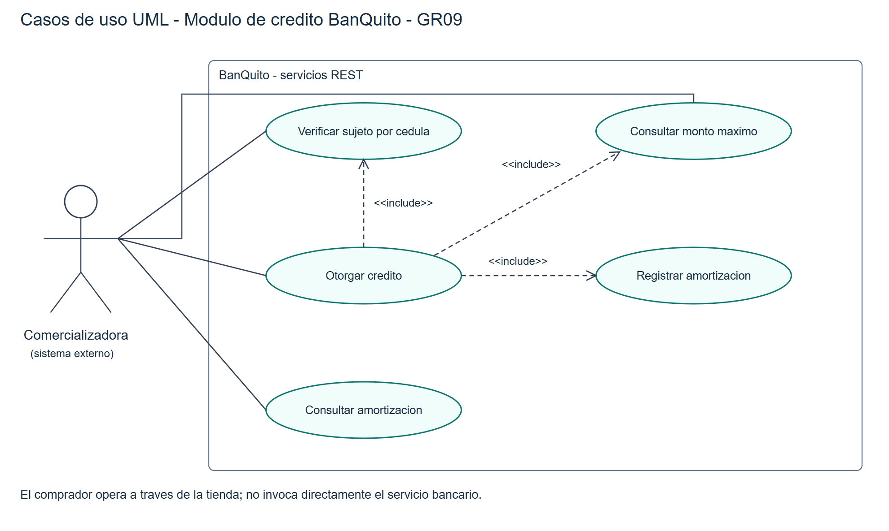
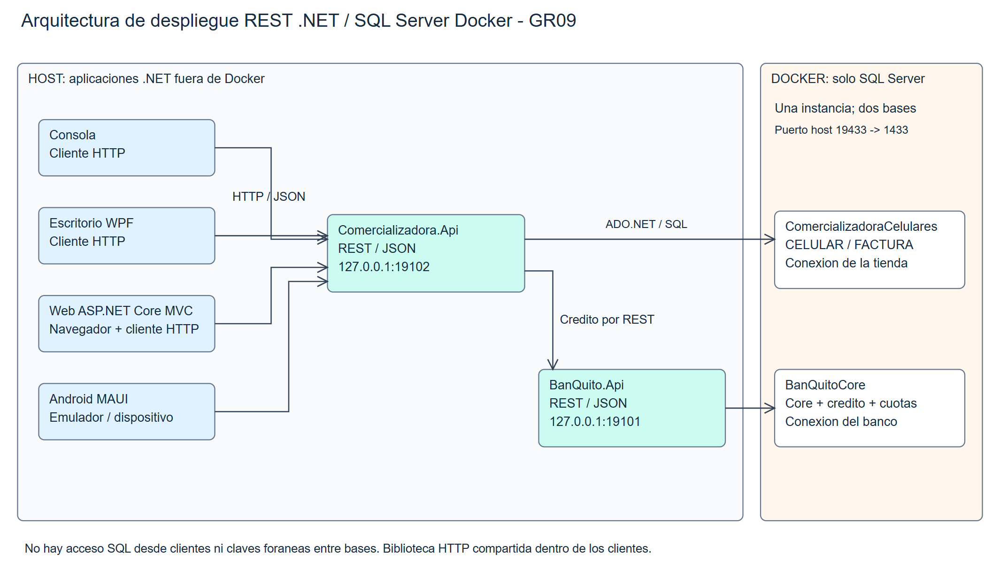
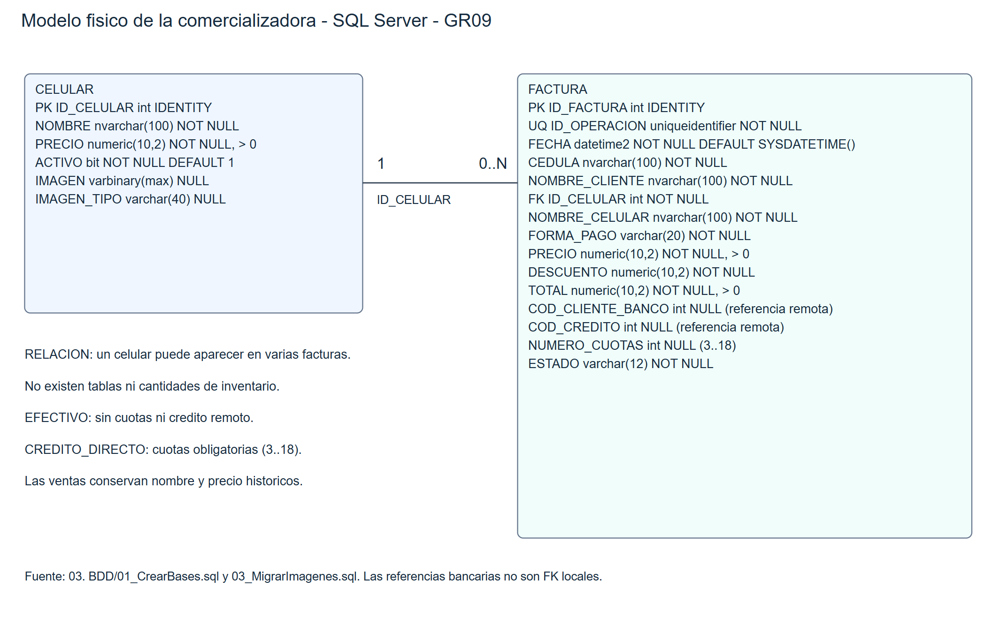

# Especificación de requerimientos de software
## 1. Introducción y propósito
Definir requisitos verificables de la comercializadora de celulares y del módulo de crédito BanQuito. La fuente de evaluación es ExamenComplexivoPractivo_CELULARES.docx. Grupo 09, NRC 36884.
## 2. Alcance
Dos aplicaciones web independientes con API REST .NET 10. La comercializadora mantiene catálogo y facturación; BanQuito evalúa y registra préstamos. Consola, WPF, ASP.NET Core MVC y Android MAUI consumen la API de tienda. Solo SQL Server se ejecuta en Docker; cada aplicación tiene su propia base. No existe inventario ni se implementa el Core bancario completo.
## 3. Actores y entorno
El operador administra catálogo, registra compras y consulta facturas. El comprador proporciona identidad y plazo. La comercializadora es el actor consumidor de los servicios bancarios. Las aplicaciones se comunican por HTTP/JSON y acceden a SQL Server con ADO.NET parametrizado.
## 4. Requisitos funcionales
| Código | Requisito | Aceptación |
| RF01 | Mantener catálogo sin existencias | Crear, consultar, editar y desactivar; conservar historial |
| RF02 | Facturar efectivo | Precio 450, descuento 189, total 261; factura aprobada |
| RF03 | Verificar sujeto por cédula | Cliente existente, depósito reciente, edad masculina y sin crédito activo |
| RF04 | Consultar máximo por código | Promedios de depósitos/retiros de tres meses; porcentaje documentado |
| RF05 | Otorgar crédito | Cliente, precio y cuotas; validar monto y registrar crédito y cuotas |
| RF06 | Consultar amortización | Servicio bancario, pasarela de tienda y cuatro clientes |
| RF07 | Consultar facturas | Búsqueda por cédula, detalle y estado de aprobación |
| RF08 | Evitar duplicados | Repetir identificador conserva factura/crédito; cambios producen conflicto |
## 5. Reglas bancarias
El solicitante debe ser cliente del banco y tener al menos un depósito en el último mes. Los hombres deben tener 25 años cumplidos. No se permite otro crédito activo. Se promedian los depósitos y retiros individuales de los últimos tres meses.
Máximo = max(0, (promedio depósitos - promedio retiros) × 0,35 × 6). El texto del examen dice 35% y la fórmula impresa dice 30%; se conserva 35% como decisión explícita, pendiente del criterio docente.
El precio puede ser igual al máximo. El plazo está entre 3 y 18 meses inclusive. La tasa mensual es 0,165 / 12. Cuota = capital × tasa / (1 - (1 + tasa)^(-meses)). La última cuota absorbe centavos de redondeo para cerrar saldo cero.
## 6. Datos y restricciones
ComercializadoraCelulares contiene CELULAR y FACTURA. BanQuitoCore contiene CLIENTE, CUENTA, MOVIMIENTO, CREDITO y AMORTIZACION. Ambas bases están aisladas lógicamente dentro de una instancia SQL Server Docker. La referencia del crédito es remota; no hay clave foránea entre bases.
Las semillas proporcionan 5 clientes, 5 cuentas y 50 movimientos. Las imágenes opcionales JPEG, PNG o WebP de hasta 5 MiB se almacenan en CELULAR; no suman puntos adicionales en la rúbrica.
## 7. Requisitos no funcionales
| Área | Condición verificable |
| Integridad | Crédito y amortización se confirman en una transacción; efectivo es transaccional |
| Comunicación | Clientes sin acceso SQL; API independientes con contratos HTTP |
| Errores | Rechazos y fallas de conexión no se presentan como aprobación |
| Reproducibilidad | Compose solo para SQL, scripts locales y secretos excluidos de Git |
| Presentación | Interfaces legibles y temas; web sin desbordamiento horizontal a 390 px |
## 8. Evidencias de aceptación
39 pruebas unitarias aprobadas; 53 comprobaciones HTTP QA; 14 comprobaciones consola/MVC; 10 WPF y 9 recorridos Android. La prueba posterior en Chrome aprobó 13 comprobaciones e identificó/corrigió la lectura cultural de decimales MVC.
Las evidencias están en 05. DOCUMENTACION/EVIDENCIA_*.json y evidencias/. La compilación y los resultados de QA no certifican un despliegue productivo ni sustituyen la defensa ante el tribunal.
## 9. Limitaciones y referencias
PowerDesigner está instalado pero su licencia de evaluación está vencida. No se afirma haber regenerado modelos editables durante esta revisión. Conservar sus fuentes existentes y ejecutar los VBS cuando haya licencia válida. Referencias: enunciado local, código del repositorio, pruebas y registros QA.

## Figura: Casos de uso bancarios

## Figura: Arquitectura REST y Docker

## Figura: Modelo físico comercializadora

