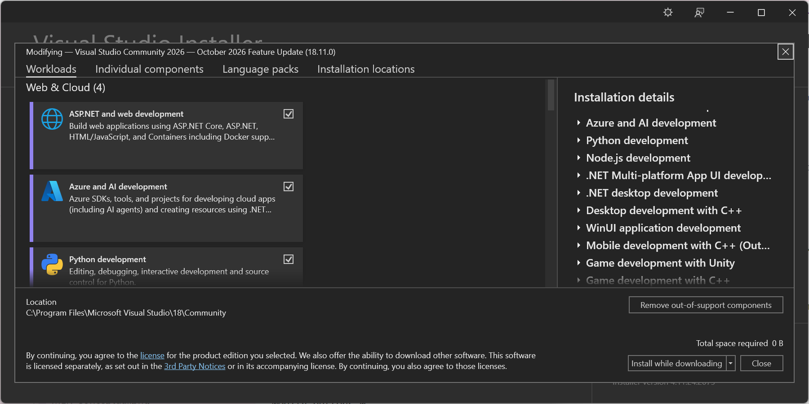
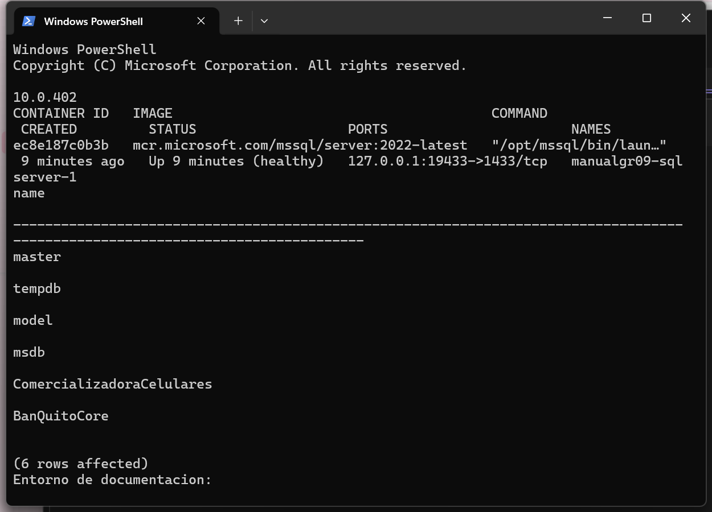
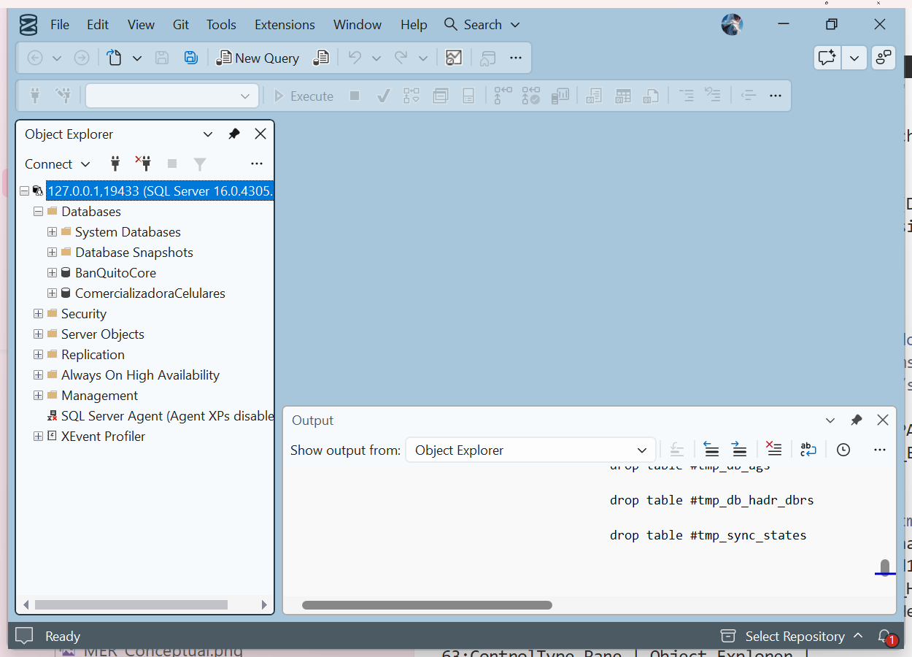
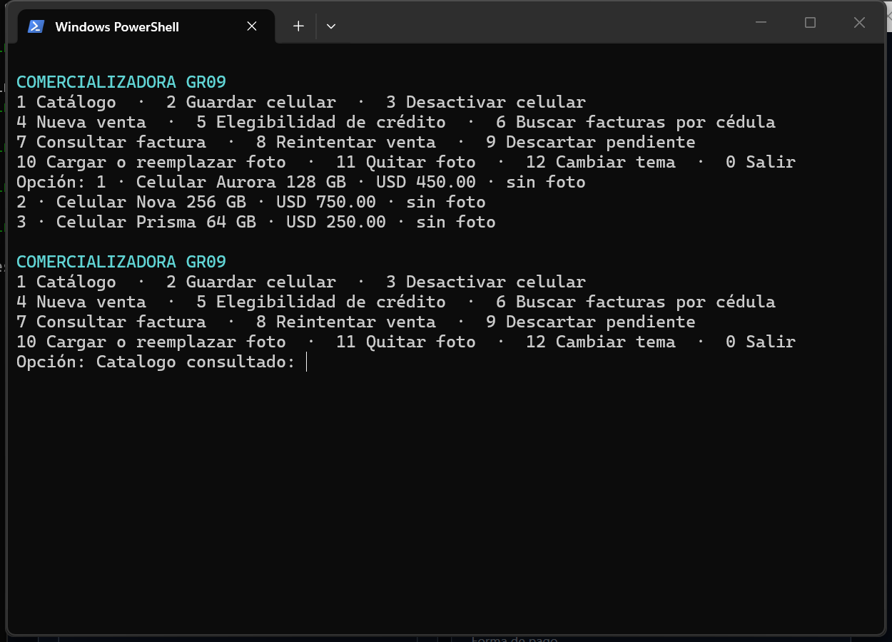
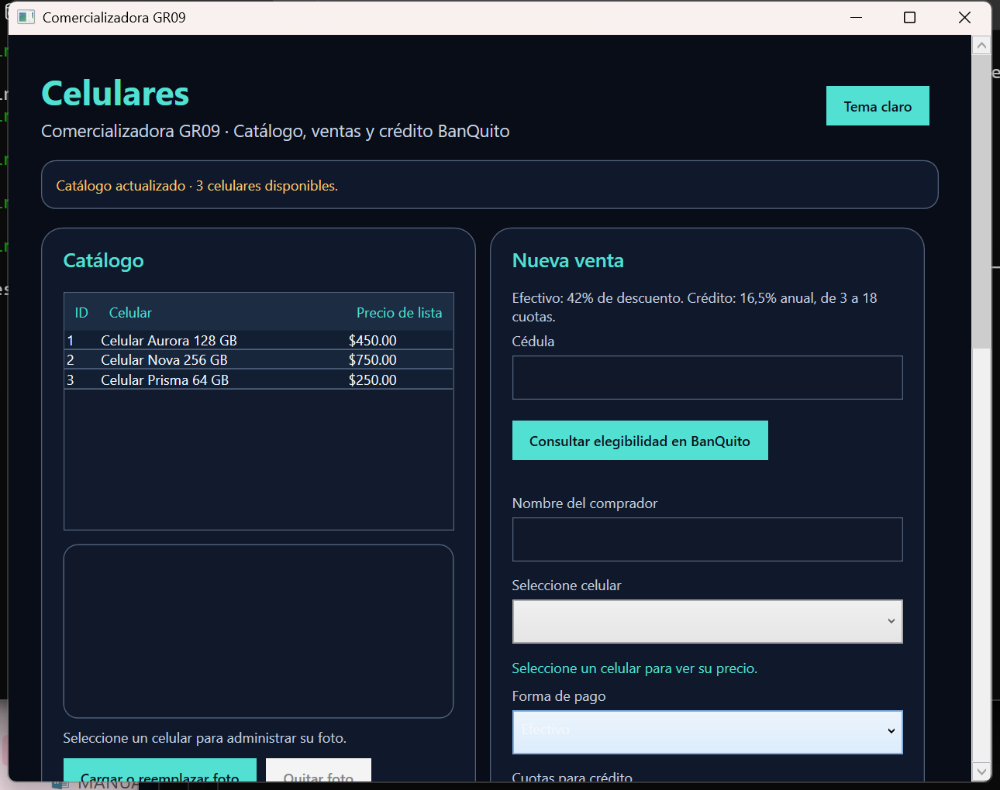
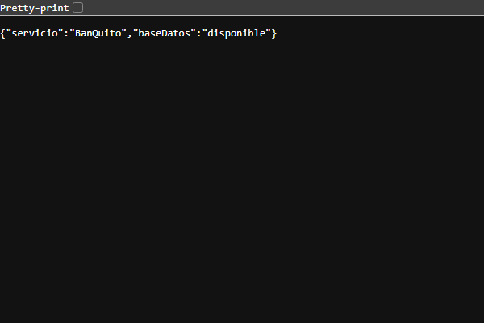
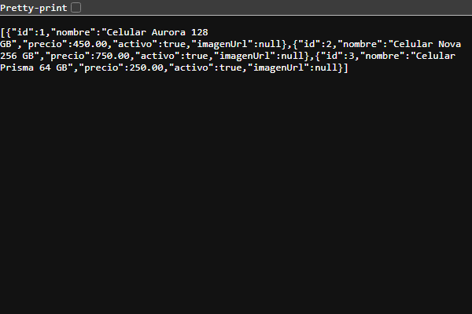
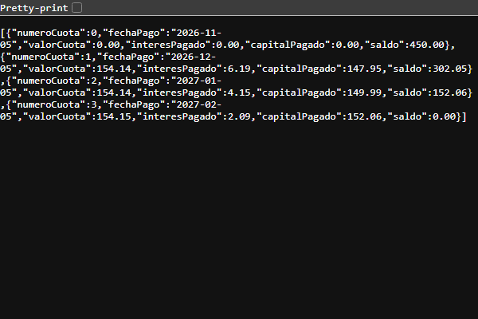
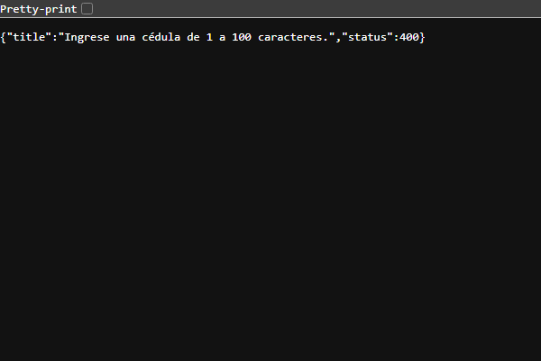

# Manual técnico: comercializadora de celulares y BanQuito

## Introducción y objetivos
El sistema permite administrar un catálogo de celulares, emitir facturas y solicitar financiamiento a BanQuito mediante servicios HTTP. Ofrece cuatro aplicaciones cliente: consola, escritorio WPF, web ASP.NET Core MVC y móvil .NET MAUI para Android. Este manual explica la preparación del entorno, la organización del código, la persistencia, los contratos de comunicación y los procedimientos necesarios para ejecutar y mantener la solución.

El objetivo general es proporcionar una guía técnica reproducible para instalar, configurar y comprender la comercializadora y el servicio bancario. Los objetivos específicos son describir las responsabilidades de cada componente, documentar las estructuras de datos y reglas de negocio, detallar la ejecución de los cuatro clientes y establecer criterios para comprobar su funcionamiento.

El documento está dirigido a desarrolladores, responsables de instalación y estudiantes que necesiten continuar el proyecto. Los comandos se ejecutan desde la raíz de `examen-arq-1`, en PowerShell, salvo que se indique otra ubicación. Grupo 09 · NRC 36884. Autores: Gabriel Omar Murillo Medina y Julio Enrique Viche Castillo. Tutor: Ing. Eduardo Mauricio Campaña Ortega.

## Alcance y reglas del sistema
La comercializadora registra nombre, precio, estado e imagen opcional de cada celular. Cada factura corresponde a un comprador y un celular. La desactivación retira el producto del catálogo de venta y conserva sus referencias históricas. El sistema no administra cantidades, bodegas ni movimientos de inventario.

Existen dos modalidades de pago. En efectivo, el servidor aplica un descuento del 42 % sobre el precio de lista. En crédito directo, BanQuito evalúa al cliente y financia el precio de lista en un plazo de 3 a 18 meses, con una tasa anual del 16,5 %. La tabla de amortización corresponde al crédito y se consulta desde la factura.

BanQuito mantiene clientes, cuentas, movimientos, créditos y cuotas en su propia base de datos. La implementación cubre la evaluación y el otorgamiento requeridos por el ejercicio; no incorpora un sistema bancario completo, pagos posteriores de cuotas, transferencias ni autenticación de usuarios. Los nombres `APROBADA`, `PENDIENTE` y `RECHAZADA` que aparecen en los contratos representan estados de una factura.

## Fundamentos de arquitectura y persistencia
REST describe restricciones para organizar interacciones entre componentes distribuidos a través de recursos e interfaces uniformes (Fielding, 2000; Fielding y Taylor, 2002). En este proyecto, los recursos comerciales se identifican mediante rutas HTTP, los intercambios de datos utilizan JSON y los clientes delegan la lógica de negocio a las API. La referencia teórica orienta el diseño; el comportamiento concreto se define en los controladores y servicios del repositorio.

La separación entre presentación, lógica de aplicación y acceso a datos facilita identificar responsabilidades y modificar una capa sin trasladar reglas a las interfaces (Fowler, 2002). Los controladores HTTP reciben solicitudes; los servicios coordinan consultas, transacciones y llamadas remotas; las clases de dominio calculan descuentos, elegibilidad y amortización.

El modelo relacional organiza los datos en relaciones y permite expresar restricciones de integridad (Codd, 1970). En la implementación, las claves primarias, foráneas, restricciones e índices de SQL Server protegen las relaciones entre entidades. Las transacciones delimitan cambios que deben conservar coherencia dentro de cada base; el aislamiento y la concurrencia son aspectos centrales de los sistemas de bases de datos (Silberschatz et al., 2019).

## Estructura del proyecto
La distribución de carpetas separa análisis, modelos de datos, código y documentación. Abrir la carpeta completa permite conservar las referencias relativas de los proyectos. El repositorio no incluye un archivo de solución `.sln`; Visual Studio puede abrir cada `.csproj` y cargar sus referencias.

| Carpeta | Contenido y finalidad |
|---|---|
| `01. UML` | ERS, especificaciones de casos de uso y modelos UML de PowerDesigner. |
| `02. MER` | Modelos de datos y exportaciones del esquema relacional. |
| `03. BDD` | Creación de bases, tablas, migración de imágenes y datos iniciales. |
| `04. SERVIDOR` | API de tienda, API bancaria, dominios, contratos, inicializadores y pruebas. |
| `04. COMPARTIDO` | Cliente HTTP y controlador común de las cuatro interfaces. |
| `04. CLICON` | Aplicación de consola. |
| `04. CLIESC` | Aplicación WPF para Windows. |
| `04. CLIWEB` | Aplicación ASP.NET Core MVC. |
| `04. CLIMOV` | Aplicación .NET MAUI para Android. |
| `05. DOCUMENTACION` | Manual, presentación, fuentes y registros de pruebas. |
| `scripts` | Herramientas de comprobación y generación documental. |

## Arquitectura y comunicación
Los cuatro clientes consumen exclusivamente Comercializadora.Api. Esta API resuelve catálogo y facturación en `ComercializadoraCelulares`; para las operaciones de crédito llama por HTTP a BanQuito.Api. El banco consulta y modifica `BanQuitoCore`. Las API son procesos independientes y no comparten ensamblados de dominio ni acceden directamente a la base de la otra aplicación.

En el entorno local, Docker ejecuta únicamente SQL Server. Las dos API y los clientes se ejecutan en Windows. Ambas bases residen en el mismo motor, pero conservan esquemas y responsabilidades independientes. La referencia de crédito guardada en una factura es un identificador remoto; no es una clave foránea entre bases.

| Componente | Dirección local | Consumidor |
|---|---|---|
| BanQuito.Api | `http://127.0.0.1:19101/` | API comercializadora. |
| Comercializadora.Api | `http://127.0.0.1:19102/` | Consola, WPF, web MVC y móvil. |
| Web MVC | `http://127.0.0.1:19103/` | Navegador. |
| SQL Server | `127.0.0.1,19433` | Las API en el host. |
| Tienda desde Android Emulator | `http://10.0.2.2:19102/` | Aplicación MAUI en el emulador. |

La exportación siguiente representa la separación entre clientes, servicios y persistencia. Para interpretar su despliegue, considerar que el contenedor aloja el motor y los demás procesos se ejecutan en el host.


## Instalación y configuración de herramientas
### Preparación paso a paso
1. Abrir el instalador de Visual Studio y seleccionar Modificar sobre la instalación disponible. Activar ASP.NET y desarrollo web, desarrollo de escritorio .NET y desarrollo de aplicaciones multiplataforma .NET MAUI. Esperar a que termine antes de abrir proyectos.
2. Instalar el SDK compatible con global.json y abrir una terminal nueva. Ejecutar los comandos de comprobación siguientes; anotar la versión que devuelve el equipo y cualquier diferencia de parche.
3. Abrir Docker Desktop, esperar el estado de motor iniciado y seleccionar contenedores Linux. Comprobar docker version y docker compose version.
4. Abrir la carpeta raíz del repositorio. En Visual Studio seleccionar Archivo > Abrir > Proyecto o solución y elegir el .csproj del componente que se va a estudiar. Las referencias a proyectos deben resolverse conservando sus carpetas.
5. Para Android, abrir el administrador de SDK desde las herramientas de Android e instalar las herramientas de plataforma y una imagen de emulador. Comprobar adb devices después de iniciar el emulador.
6. Si se usa SSMS, instalarlo como cliente de administración y abrir una conexión al puerto indicado en el capítulo de SQL Server. El motor se ejecutará en Docker.

### SDK .NET y entorno de desarrollo
La captura del instalador muestra la carga ASP.NET seleccionada y, en los detalles de instalación, las cargas .NET MAUI y desarrollo de escritorio .NET. La vista se abrió para inspeccionar la configuración; no se aplicaron cambios.



Instalar el SDK .NET compatible con `global.json`, que solicita la versión `10.0.401` con avance a parches de la misma banda. Comprobar que `dotnet` está disponible en la terminal. Un runtime por sí solo no permite compilar los proyectos.

```powershell
dotnet --info
dotnet --list-sdks
```

Para trabajar desde Visual Studio, disponer de las cargas de ASP.NET y desarrollo web, escritorio .NET y .NET MAUI. Abrir Archivo > Abrir > Proyecto o solución y seleccionar el `.csproj` correspondiente. La compilación por terminal permite trabajar sin depender de las pantallas del IDE.

### Docker Desktop y SQL Server
Instalar Docker Desktop, iniciar su motor y seleccionar contenedores Linux. El archivo `compose.yaml` utiliza SQL Server 2022 Developer. No se necesita instalar una instancia SQL Server nativa para el procedimiento de este manual. SQL Server Management Studio es una herramienta opcional para consultar el motor; no sustituye al contenedor.

```powershell
docker version
docker compose version
```

### Android y herramientas auxiliares
Para compilar y ejecutar el móvil, instalar la carga MAUI y las herramientas Android, incluidas las herramientas de plataforma y un emulador. El proyecto declara `net10.0-android`, Microsoft.Maui.Controls `10.0.110` y versión mínima de Android API 23. Revisar las cargas instaladas con `dotnet workload list` y, si falta la correspondiente, instalarla con `dotnet workload install maui`.

Las herramientas documentales se instalan con `python -m pip install -r scripts/requirements-documentacion.txt` dentro de un entorno virtual. Los recorridos de navegador requieren además Playwright y su navegador instalado. Estas dependencias son auxiliares y no son requisitos de ejecución de las API.

### Comprobación del entorno instalado
La captura muestra SDK 10.0.402, contenedor healthy y la consulta SQL de las bases. Se utilizó sqlcmd, no SSMS.



## Configuración local del repositorio
### Rutas de compilación y dependencias
`Directory.Build.props` configura C# 14, nulabilidad y rutas de salida. En este repositorio, las salidas predeterminadas se dirigen a `D:\tools\CelularGR09` y los paquetes a `D:\NuGet\packages`. Si el equipo no dispone de esa unidad, pasar rutas locales a MSBuild. El siguiente ejemplo prepara argumentos reutilizables en la sesión de PowerShell:

```powershell
$buildArgs = @(
  "-p:CelularBuildRoot=$env:LOCALAPPDATA\CelularesGR09\build",
  "-p:CelularPackagesRoot=$env:LOCALAPPDATA\CelularesGR09\packages"
)
```

Usar esos mismos argumentos en las compilaciones, pruebas y ejecuciones del equipo. `NuGet.Config` contiene la ruta de caché original; `CelularPackagesRoot` se transmite como `RestorePackagesPath` desde `Directory.Build.props`. Las referencias a proyectos se resuelven dentro del repositorio, por lo que debe conservarse su estructura.

### Archivo de entorno
Crear `.env` a partir de `.env.example` solo si todavía no existe. Abrirlo en un editor y asignar localmente `MSSQL_SA_PASSWORD`. Mantener una contraseña válida para SQL Server. `.env` no forma parte de los entregables ni debe mostrarse en capturas.

```powershell
if (!(Test-Path .env)) { Copy-Item .env.example .env }
notepad .env
```

### Orden de arranque
Iniciar primero SQL Server y sus bases; después BanQuito.Api, Comercializadora.Api y finalmente el cliente seleccionado. Ejecutar `./PrepararEntorno.ps1 -IniciarApis` automatiza el contenedor, los cinco scripts SQL y el arranque de las API cuando `dotnet` y las rutas predeterminadas están disponibles. Para controlar los procesos en terminales separadas o usar rutas de compilación distintas, seguir el procedimiento manual de los capítulos siguientes.

## Instalación y configuración de SQL Server
El servicio `sqlserver` publica el puerto interno `1433` en `127.0.0.1:19433`. El volumen `celulares_sql` conserva las bases entre reinicios. La edición Developer está destinada al entorno académico de desarrollo. El archivo de composición incorpora una comprobación de salud mediante `sqlcmd`.

| Parámetro | Configuración |
|---|---|
| Imagen del motor | `mcr.microsoft.com/mssql/server:2022-latest` |
| Servicio de Compose | `sqlserver` |
| Puerto desde Windows | `127.0.0.1,19433` |
| Puerto del motor en el contenedor | `1433` |
| Volumen persistente | `celulares_sql:/var/opt/mssql` |
| Contraseña | Variable local `MSSQL_SA_PASSWORD` |
| Bases de aplicación | `ComercializadoraCelulares` y `BanQuitoCore` |

### Preparar e inicializar
Desde la raíz ejecutar el script sin modificadores para crear o completar las bases y cargar los datos semilla:

```powershell
./PrepararEntorno.ps1
docker compose ps
docker compose logs --tail 80 sqlserver
```

El script ejecuta `docker compose up -d --wait` y detiene el proceso si el contenedor no queda disponible o un script SQL produce un error. Si el puerto `19433` está ocupado, revisar su uso antes de iniciar. El cambio de puerto exige ajustar tanto `compose.yaml` como las cadenas de conexión de las dos API.

### Consultar con SQL Server Management Studio
La siguiente captura muestra una conexión real de SSMS 22 al servidor de prueba, con las bases BanQuitoCore y ComercializadoraCelulares expandidas en el Explorador de objetos.



En SSMS seleccionar Motor de base de datos e introducir `127.0.0.1,19433`. Para esta configuración local, usar autenticación SQL Server con usuario `sa` y la contraseña definida en `.env`. La conexión del proyecto cifra el transporte y confía en el certificado del contenedor mediante `TrustServerCertificate=True`. Revisar en el Explorador de objetos las dos bases y las tablas de `dbo`.

Para detener el entorno conservando su información, utilizar `docker compose stop`. Para reanudarlo, utilizar `docker compose up -d --wait`. No eliminar el volumen persistente como procedimiento de reinicio.

## Creación y carga de las bases de datos
### Procedimiento de inspección en SSMS
1. Iniciar el contenedor mediante el procedimiento del capítulo anterior y comprobar que su estado de salud sea healthy.
2. Abrir SSMS, seleccionar Motor de base de datos e introducir el servidor local y puerto 19433, usuario sa y la contraseña del archivo de entorno.
3. Expandir Bases de datos y actualizar el Explorador de objetos. Localizar ComercializadoraCelulares y BanQuitoCore.
4. Expandir Tablas en cada base y contrastar nombres, columnas y claves con las tablas del modelo y los cinco listados SQL del anexo.
5. Abrir Nueva consulta y ejecutar la consulta de cantidades siguiente. Conservar la salida del propio equipo para documentar la instalación. Las cantidades de una base usada pueden diferir de la carga inicial.

Los scripts contienen instrucciones condicionales para crear objetos que falten y evitar duplicar los datos semilla identificados por sus claves. Ejecutarlos en el orden siguiente. La migración de imágenes también forma parte de una instalación nueva y debe aplicarse sobre una base existente antes de usar fotografías.

| Orden | Script | Responsabilidad |
|---|---|---|
| 1 | `03. BDD/01_CrearBases.sql` | Crear ComercializadoraCelulares, CELULAR y FACTURA. |
| 2 | `03. BDD/03_MigrarImagenes.sql` | Incorporar columnas opcionales de imagen si faltan. |
| 3 | `03. BDD/02_DatosPrueba.sql` | Insertar el catálogo inicial de tres celulares. |
| 4 | `03. BDD/BanQuito/BanQuito_01_CrearBase.sql` | Crear BanQuitoCore, tablas, claves e índices bancarios. |
| 5 | `03. BDD/BanQuito/BanQuito_02_DatosPrueba.sql` | Insertar cinco clientes, cinco cuentas y cincuenta movimientos. |

La fecha de los movimientos semilla se calcula con respecto al día de ejecución. Como las inserciones no reemplazan movimientos existentes, ejecutar nuevamente la carga días después no actualiza sus fechas. Esto afecta los criterios de último mes y últimos tres meses; para repetir escenarios, utilizar una base de pruebas nueva.

La consulta siguiente permite revisar las cantidades existentes desde SSMS. Los valores iniciales solo corresponden a una instalación limpia; una base utilizada puede contener más registros.

```sql
SELECT COUNT(*) AS Celulares
FROM ComercializadoraCelulares.dbo.CELULAR;
SELECT COUNT(*) AS Clientes FROM BanQuitoCore.dbo.CLIENTE;
SELECT COUNT(*) AS Cuentas FROM BanQuitoCore.dbo.CUENTA;
SELECT COUNT(*) AS Movimientos FROM BanQuitoCore.dbo.MOVIMIENTO;
```

Los cinco scripts completos se incluyen en el anexo. Su ejecución automatizada utiliza las herramientas SQL del contenedor; los inicializadores de administración del repositorio conservan configuraciones de instalaciones anteriores y no son necesarios para el flujo Docker descrito aquí.

## Modelo de datos de la comercializadora
`CELULAR` contiene los productos del catálogo. `FACTURA` referencia al celular y conserva una copia del nombre y precio utilizados en la operación. Esta copia permite consultar el contenido de la venta aunque el catálogo cambie después. Las restricciones SQL y las validaciones de dominio controlan los valores comerciales.

| Tabla | Identificación y datos | Reglas principales |
|---|---|---|
| CELULAR | ID_CELULAR, NOMBRE, PRECIO, ACTIVO, IMAGEN y tipo MIME. | Identificador identity; precio positivo; foto opcional. |
| FACTURA | ID_FACTURA, ID_OPERACION, FECHA, comprador, producto, pago, precio, descuento y total. | ID_OPERACION único; referencia al celular; valores monetarios persistidos. |
| FACTURA: crédito | COD_CLIENTE_BANCO, COD_CREDITO, NUMERO_CUOTAS y ESTADO. | Referencias remotas; cuotas entre 3 y 18 para crédito; control del estado de la operación. |

Los importes se almacenan como valores decimales; el servidor utiliza `decimal` y parámetros SQL con precisión y escala explícitas para los montos. La API valida fotografías JPEG, PNG o WebP de hasta 5 MiB y almacena los bytes y el tipo MIME en la misma base. No se utiliza un directorio público para guardar archivos subidos.


## Modelo de datos de BanQuito
BanQuito mantiene la relación de clientes con sus cuentas y movimientos. Un crédito pertenece a un cliente y contiene su tabla de amortización. Las relaciones bancarias se resuelven dentro de `BanQuitoCore`; la API comercial no consulta estas tablas.

| Tabla | Claves y contenido |
|---|---|
| CLIENTE | COD_CLIENTE como clave; cédula única, nombre, género y nacimiento. |
| CUENTA | NUM_CUENTA como clave; referencia a CLIENTE y saldo. |
| MOVIMIENTO | COD_MOVIMIENTO como clave; referencia a CUENTA, tipo DEP/RET, valor y fecha. |
| CREDITO | COD_CREDITO como clave; referencia a CLIENTE, referencia de venta, monto, plazo, tasa, fecha y estado. |
| AMORTIZACION | Clave compuesta COD_CREDITO y NUMERO_CUOTA; fecha, cuota, interés, capital y saldo. |

El índice único filtrado de crédito por cliente con estado `ACTIVO` impide registrar dos créditos activos simultáneos. La referencia de venta también es única para identificar reintentos. El índice de movimientos por cuenta y fecha apoya las consultas de períodos. Una fila de amortización con número cero representa el saldo inicial y no una cuota cobrada.

## Aplicación servidor: organización y configuración
### Proyectos y responsabilidades
`Comercializadora.Api` publica los controladores de celulares, crédito y facturas. `ServicioCatalogo` realiza las operaciones del catálogo; `ServicioFacturas` coordina la venta; `ServicioBanQuito` encapsula las llamadas bancarias. `Comercializadora.Dominio` contiene las reglas de facturación e imágenes y `Celulares.Contratos` define solicitudes y respuestas comerciales.

`BanQuito.Api` publica la evaluación y el otorgamiento. `ServicioCredito` coordina la persistencia y `BanQuito.Dominio/ReglasCredito.cs` implementa la elegibilidad, el máximo y la amortización. Sus contratos pertenecen a `BanQuito.Contratos`. La comunicación entre API utiliza HTTP, sin referencias de proyecto hacia el dominio contrario.

### Registro de servicios y acceso a datos
En `Program.cs` se registran controladores y servicios mediante inyección de dependencias. Los servicios comerciales y bancarios se crean con alcance de solicitud. El cliente HTTP hacia BanQuito obtiene la URL de `Servicios:BanQuitoUrl` y establece un tiempo máximo de 10 segundos. Las interfaces usan un cliente HTTP compartido con tiempo máximo de 30 segundos.

El acceso a SQL Server usa ADO.NET y `Microsoft.Data.SqlClient`, no Entity Framework Core. Los servicios abren conexiones asíncronas, ejecutan comandos parametrizados y liberan conexiones, lectores y transacciones con `await using`. La separación entre operaciones HTTP y reglas de dominio permite probar los cálculos sin ejecutar una interfaz.

### Configuración de conexión
`appsettings.json` declara direcciones y bases, pero no incluye la contraseña. El valor completo de `ConnectionStrings:BaseDatos` debe llegar por configuración local, por ejemplo con la variable `ConnectionStrings__BaseDatos`. `Servicios__BanQuitoUrl` permite sobrescribir la dirección bancaria. El doble guion bajo representa los niveles de configuración en variables de entorno.

Los proyectos web tienen marco `net10.0` y declaran `Microsoft.Data.SqlClient` `7.1.1`. Los archivos de configuración y las referencias reales de las API se reproducen en el anexo.


## Compilación y ejecución de las API
### Abrir y revisar los proyectos
1. Abrir BanQuito.Api.csproj y expandir las referencias a contratos y dominio. Revisar Program.cs, appsettings.json, CreditoController y ServicioCredito siguiendo sus listados completos.
2. Abrir Comercializadora.Api.csproj y revisar las referencias a contratos, dominio y los tres servicios. Identificar la configuración HTTP hacia BanQuito.
3. Restaurar y compilar los proyectos con los comandos siguientes. Si aparece un error de paquete, ruta o SDK, detener el arranque y resolverlo antes de continuar.
4. Ejecutar primero el banco y después la comercializadora. Consultar api/salud de ambos y conservar el código HTTP y el cuerpo recibido.
5. Para una operación funcional, consultar catálogo y elegibilidad antes de registrar una factura. Comparar la factura con el precio del catálogo y las reglas de efectivo o crédito. Ejecutar las operaciones de prueba sobre bases aisladas.

### Compilar
En una terminal PowerShell situada en la raíz, definir `$buildArgs` como se explicó en la configuración local. `dotnet build` restaura los paquetes necesarios y compila las referencias de cada proyecto.

```powershell
dotnet build "04. SERVIDOR/BanQuito.Api/BanQuito.Api.csproj" @buildArgs
dotnet build "04. SERVIDOR/Comercializadora.Api/Comercializadora.Api.csproj" @buildArgs
```

### Iniciar BanQuito en una terminal
Leer únicamente la variable requerida del archivo local. La contraseña se incorpora a la configuración del proceso, sin escribirla en el comando como un valor literal. Mantener la terminal abierta mientras se utiliza la aplicación.

```powershell
$linea = Get-Content .env |
  Where-Object { $_ -match '^MSSQL_SA_PASSWORD=' } |
  Select-Object -First 1
if (!$linea) { throw 'Falta MSSQL_SA_PASSWORD en .env' }
$claveSql = $linea.Substring('MSSQL_SA_PASSWORD='.Length)
$env:ConnectionStrings__BaseDatos =
  "Server=127.0.0.1,19433;Database=BanQuitoCore;User Id=sa;Password=$claveSql;Encrypt=True;TrustServerCertificate=True"
dotnet run --project "04. SERVIDOR/BanQuito.Api/BanQuito.Api.csproj" @buildArgs
```

### Iniciar la comercializadora en otra terminal
En la nueva terminal, volver a definir `$buildArgs` y cargar `$linea` y `$claveSql` con las instrucciones anteriores. Elegir la base de tienda antes de ejecutar su proyecto; cada proceso hereda la configuración de su propia terminal.

```powershell
$env:ConnectionStrings__BaseDatos =
  "Server=127.0.0.1,19433;Database=ComercializadoraCelulares;User Id=sa;Password=$claveSql;Encrypt=True;TrustServerCertificate=True"
$env:Servicios__BanQuitoUrl = 'http://127.0.0.1:19101/'
dotnet run --project "04. SERVIDOR/Comercializadora.Api/Comercializadora.Api.csproj" @buildArgs
```

### Comprobar disponibilidad
En una tercera terminal ejecutar las consultas de salud. Cada ruta comprueba la conexión con la base de su API. La salud de la tienda no comprueba por sí sola la integración bancaria.

```powershell
Invoke-RestMethod 'http://127.0.0.1:19101/api/salud'
Invoke-RestMethod 'http://127.0.0.1:19102/api/salud'
Invoke-RestMethod 'http://127.0.0.1:19102/api/celulares'
```

Para detener una API ejecutada en primer plano, usar Ctrl+C en su terminal. Al finalizar, cerrar la sesión o retirar las variables locales con `Remove-Item Env:ConnectionStrings__BaseDatos -ErrorAction SilentlyContinue`. Evitar iniciar varias instancias sobre el mismo puerto.

## Código fuente de la comercializadora

Este capítulo documenta los archivos propios del componente. Leer primero la estructura y la ejecución descritas en el manual. Los listados son texto seleccionable y reproducen el código del repositorio; no son capturas del IDE.

### 04. SERVIDOR/Administracion/Administracion.csproj

Finalidad: Declara el marco de destino, los paquetes y las referencias entre proyectos. Restaurar sus dependencias antes de compilar; las referencias relativas requieren conservar la organización del repositorio.

Listado completo de `04. SERVIDOR/Administracion/Administracion.csproj`:

```xml

<Project Sdk="Microsoft.NET.Sdk">
  <PropertyGroup><TargetFramework>net10.0</TargetFramework><OutputType>Exe</OutputType></PropertyGroup>
  <ItemGroup>
    <PackageReference Include="Microsoft.Data.SqlClient" Version="7.1.1" />
    <PackageReference Include="System.Security.Cryptography.Pkcs" Version="10.0.13" />
  </ItemGroup>
</Project>

```

### 04. SERVIDOR/Administracion/Program.cs

Finalidad: Punto de entrada del ejecutable. Configura dependencias y pone en marcha el flujo del componente; revisar los argumentos y la dirección del servicio antes de ejecutarlo.

Relaciones declaradas: Microsoft.Data.SqlClient, System.Text.RegularExpressions.

Listado completo de `04. SERVIDOR/Administracion/Program.cs`:

```csharp

using Microsoft.Data.SqlClient;
using System.Text.RegularExpressions;
if (args.Length < 2 || args[0] != "--aplicar")
{
    Console.Error.WriteLine("Uso: Administracion --aplicar ruta-script.sql [otro-script.sql]");
    return 2;
}
var conexion = Environment.GetEnvironmentVariable("CELULARES_SQL_MASTER") ??
    @"Server=.\SQLEXPRESS;Database=master;Integrated Security=True;Encrypt=True;TrustServerCertificate=True;Connect Timeout=8";
try
{
    await using var db = new SqlConnection(conexion);
    await db.OpenAsync();
    foreach (var ruta in args.Skip(1))
    {
        var sql = await File.ReadAllTextAsync(ruta);
        foreach (var lote in Regex.Split(sql, @"^\s*GO\s*$", RegexOptions.Multiline | RegexOptions.IgnoreCase))
        {
            if (string.IsNullOrWhiteSpace(lote)) continue;
            await using var cmd = new SqlCommand(lote, db) { CommandTimeout = 120 };
            await cmd.ExecuteNonQueryAsync();
        }
        Console.WriteLine($"Aplicado: {Path.GetFileName(ruta)}");
    }
    return 0;
}
catch (Exception ex) when (ex is SqlException or IOException)
{
    Console.Error.WriteLine($"No se pudo inicializar SQL Server: {ex.Message}");
    return 1;
}

```

### 04. SERVIDOR/Comercializadora.Api/Comercializadora.Api.csproj

Finalidad: Declara el marco de destino, los paquetes y las referencias entre proyectos. Restaurar sus dependencias antes de compilar; las referencias relativas requieren conservar la organización del repositorio.

Relaciones declaradas: ..\Comercializadora.Dominio\Comercializadora.Dominio.csproj, ..\Contratos\Celulares.Contratos.csproj.

Listado completo de `04. SERVIDOR/Comercializadora.Api/Comercializadora.Api.csproj`:

```xml

<Project Sdk="Microsoft.NET.Sdk.Web">
  <PropertyGroup>
    <TargetFramework>net10.0</TargetFramework>
  </PropertyGroup>
  <ItemGroup>
    <PackageReference Include="Microsoft.Data.SqlClient" Version="7.1.1" />
    <PackageReference Include="System.Security.Cryptography.Pkcs" Version="10.0.13" />
    <ProjectReference Include="..\Comercializadora.Dominio\Comercializadora.Dominio.csproj" />
    <ProjectReference Include="..\Contratos\Celulares.Contratos.csproj" />
  </ItemGroup>
</Project>

```

### 04. SERVIDOR/Comercializadora.Api/Controllers/CelularesController.cs

Finalidad: Expone consultas y mantenimiento del catálogo y sus imágenes. Delega las operaciones de persistencia en ServicioCatalogo.

Recorrido del archivo: revisar las operaciones CelularesController, Listar, Obtener, Crear, Actualizar, Eliminar, Imagen, GuardarImagen, QuitarImagen. Las llamadas del listado muestran el orden de validación, consulta y actualización; conservar las firmas al modificar sus consumidores.

Relaciones declaradas: Celulares.Contratos, Comercializadora.Api.Servicios, Comercializadora.Dominio, Microsoft.AspNetCore.Mvc.

Listado completo de `04. SERVIDOR/Comercializadora.Api/Controllers/CelularesController.cs`:

```csharp

using Celulares.Contratos;
using Comercializadora.Api.Servicios;
using Comercializadora.Dominio;
using Microsoft.AspNetCore.Mvc;

namespace Comercializadora.Api.Controllers;

[ApiController]
[Route("api/celulares")]
public class CelularesController(ServicioCatalogo servicio) : ControllerBase
{
    [HttpGet]
    public Task<IReadOnlyList<Celular>> Listar(CancellationToken ct) => servicio.Listar(ct);

    [HttpGet("{id:int}")]
    public Task<Celular> Obtener(int id, CancellationToken ct) => servicio.Obtener(id, ct);

    [HttpPost]
    public async Task<ActionResult<Celular>> Crear(GuardarCelular solicitud, CancellationToken ct)
    {
        var celular = await servicio.Crear(solicitud, ct);
        return CreatedAtAction(nameof(Obtener), new { id = celular.Id }, celular);
    }

    [HttpPut("{id:int}")]
    public Task<Celular> Actualizar(int id, GuardarCelular solicitud, CancellationToken ct) =>
        servicio.Actualizar(id, solicitud, ct);

    [HttpDelete("{id:int}")]
    public async Task<IActionResult> Eliminar(int id, CancellationToken ct)
    {
        await servicio.Eliminar(id, ct);
        return NoContent();
    }

    [HttpGet("{id:int}/imagen")]
    public async Task<IActionResult> Imagen(int id, CancellationToken ct)
    {
        var imagen = await servicio.ObtenerImagen(id, ct);
        Response.Headers.XContentTypeOptions = "nosniff";
        Response.Headers.CacheControl = "no-store";
        return File(imagen.Datos, imagen.Tipo);
    }

    [HttpPut("{id:int}/imagen"), RequestSizeLimit(ReglasImagenCelular.MaximoBytes + 64 * 1024)]
    public async Task<IActionResult> GuardarImagen(int id, [FromForm] IFormFile? archivo, CancellationToken ct)
    {
        if (archivo is null) throw new ErrorNegocio("Seleccione una imagen.", 400);
        if (archivo.Length is 0 or > ReglasImagenCelular.MaximoBytes)
            throw new ErrorNegocio("La imagen debe pesar entre 1 byte y 5 MB.", 400);
        await using var flujo = new MemoryStream((int)archivo.Length);
        await archivo.CopyToAsync(flujo, ct);
        var datos = flujo.ToArray();
        var tipo = ReglasImagenCelular.Validar(datos, archivo.ContentType);
        await servicio.GuardarImagen(id, datos, tipo, ct);
        return NoContent();
    }

    [HttpDelete("{id:int}/imagen")]
    public async Task<IActionResult> QuitarImagen(int id, CancellationToken ct)
    {
        await servicio.QuitarImagen(id, ct);
        return NoContent();
    }
}

```

### 04. SERVIDOR/Comercializadora.Api/Controllers/CreditoController.cs

Finalidad: Recibe la consulta de elegibilidad de los clientes y la remite a BanQuito mediante ServicioBanQuito.

Recorrido del archivo: revisar las operaciones CreditoController, Elegibilidad. Las llamadas del listado muestran el orden de validación, consulta y actualización; conservar las firmas al modificar sus consumidores.

Relaciones declaradas: Celulares.Contratos, Comercializadora.Api.Servicios, Microsoft.AspNetCore.Mvc.

Listado completo de `04. SERVIDOR/Comercializadora.Api/Controllers/CreditoController.cs`:

```csharp

using Celulares.Contratos;
using Comercializadora.Api.Servicios;
using Microsoft.AspNetCore.Mvc;

namespace Comercializadora.Api.Controllers;

[ApiController]
[Route("api/credito")]
public class CreditoController(ServicioBanQuito banco) : ControllerBase
{
    [HttpGet("elegibilidad")]
    public Task<EvaluacionCredito> Elegibilidad([FromQuery] string? cedula, CancellationToken ct)
    {
        var limpia = cedula?.Trim() ?? "";
        if (limpia.Length is < 1 or > 100)
            throw new ErrorNegocio("Ingrese una cédula de 1 a 100 caracteres.", 400);
        return banco.Evaluar(limpia, ct);
    }
}

```

### 04. SERVIDOR/Comercializadora.Api/Controllers/FacturasController.cs

Finalidad: Recibe nuevas ventas y consultas de facturas y cuotas. ServicioFacturas coordina los cambios locales y el crédito bancario.

Recorrido del archivo: revisar las operaciones FacturasController, ListarPorCedula, Obtener, Crear, Amortizacion. Las llamadas del listado muestran el orden de validación, consulta y actualización; conservar las firmas al modificar sus consumidores.

Relaciones declaradas: Celulares.Contratos, Comercializadora.Api.Servicios, Microsoft.AspNetCore.Mvc.

Listado completo de `04. SERVIDOR/Comercializadora.Api/Controllers/FacturasController.cs`:

```csharp

using Celulares.Contratos;
using Comercializadora.Api.Servicios;
using Microsoft.AspNetCore.Mvc;

namespace Comercializadora.Api.Controllers;

[ApiController]
[Route("api/facturas")]
public class FacturasController(ServicioFacturas servicio) : ControllerBase
{
    [HttpGet]
    public Task<IReadOnlyList<Factura>> ListarPorCedula([FromQuery] string? cedula, CancellationToken ct) =>
        servicio.ListarPorCedula(cedula, ct);

    [HttpGet("{id:int}")]
    public Task<Factura> Obtener(int id, CancellationToken ct) => servicio.Obtener(id, ct);

    [HttpPost]
    public async Task<ActionResult<Factura>> Crear(SolicitudFactura solicitud, CancellationToken ct)
    {
        var factura = await servicio.Crear(solicitud, ct);
        return CreatedAtAction(nameof(Obtener), new { id = factura.Id }, factura);
    }

    [HttpGet("{id:int}/amortizacion")]
    public Task<IReadOnlyList<Cuota>> Amortizacion(int id, CancellationToken ct) =>
        servicio.Amortizacion(id, ct);
}

```

### 04. SERVIDOR/Comercializadora.Api/Program.cs

Finalidad: Inicializa la API, registra controladores y servicios, configura errores HTTP y publica la comprobación de salud.

Relaciones declaradas: Celulares.Contratos, Comercializadora.Api.Servicios, Microsoft.AspNetCore.Diagnostics, Microsoft.AspNetCore.Mvc, Microsoft.Data.SqlClient, System.Net.Http.

Listado completo de `04. SERVIDOR/Comercializadora.Api/Program.cs`:

```csharp

using Celulares.Contratos;
using Comercializadora.Api.Servicios;
using Microsoft.AspNetCore.Diagnostics;
using Microsoft.AspNetCore.Mvc;
using Microsoft.Data.SqlClient;
using System.Net.Http;

var builder = WebApplication.CreateBuilder(args);
builder.Services.AddControllers();
builder.Services.AddScoped<ServicioCatalogo>();
builder.Services.AddScoped<ServicioFacturas>();
builder.Services.AddHttpClient<ServicioBanQuito>((services, client) =>
{
    var configuracion = services.GetRequiredService<IConfiguration>();
    var direccion = configuracion["Servicios:BanQuitoUrl"] ?? "http://127.0.0.1:19101/";
    if (!direccion.EndsWith('/')) direccion += "/";
    client.BaseAddress = new Uri(direccion, UriKind.Absolute);
    client.Timeout = TimeSpan.FromSeconds(10);
});

var app = builder.Build();
app.UseExceptionHandler(handler => handler.Run(async context =>
{
    var error = context.Features.Get<IExceptionHandlerFeature>()!.Error;
    var estado = error is ErrorNegocio negocio ? negocio.Estado :
        error is SqlException sql && sql.Number is 2601 or 2627 ? 409 :
        error is SqlException or HttpRequestException ? 503 : 500;
    var titulo = error is ErrorNegocio negocioError ? negocioError.Message :
        estado == 409 ? "La operación ya existe o entra en conflicto." :
        estado == 503 ? "La base de datos o BanQuito no está disponible." :
        "Error interno del servicio.";
    app.Logger.LogError(error, "Error de la API Comercializadora");
    context.Response.StatusCode = estado;
    await context.Response.WriteAsJsonAsync(new ProblemDetails { Status = estado, Title = titulo });
}));

app.MapControllers();
app.MapGet("/api/salud", async (ServicioCatalogo servicio, CancellationToken ct) =>
{
    await servicio.ComprobarConexion(ct);
    return Results.Ok(new { servicio = "Comercializadora", baseDatos = "disponible" });
});
app.Run();

```

### 04. SERVIDOR/Comercializadora.Api/Servicios/ServicioBanQuito.cs

Finalidad: Encapsula las solicitudes HTTP del servidor comercial al banco y traduce sus respuestas y errores.

Recorrido del archivo: revisar las operaciones ServicioBanQuito, Evaluar, Otorgar, OtorgarParaFactura, Amortizacion. Las llamadas del listado muestran el orden de validación, consulta y actualización; conservar las firmas al modificar sus consumidores.

Relaciones declaradas: System.Net.Http.Json, System.Text.Json, Celulares.Contratos, Microsoft.AspNetCore.Mvc.

Listado completo de `04. SERVIDOR/Comercializadora.Api/Servicios/ServicioBanQuito.cs`:

```csharp

using System.Net.Http.Json;
using System.Text.Json;
using Celulares.Contratos;
using Microsoft.AspNetCore.Mvc;

namespace Comercializadora.Api.Servicios;

public class ServicioBanQuito(HttpClient cliente)
{
    public Task<EvaluacionCredito> Evaluar(string cedula, CancellationToken ct) =>
        Solicitar<EvaluacionCredito>(
            () => cliente.GetAsync($"api/credito/elegibilidad?cedula={Uri.EscapeDataString(cedula)}", ct), ct);

    public Task<Credito> Otorgar(SolicitudCredito solicitud, CancellationToken ct) =>
        Solicitar<Credito>(() => cliente.PostAsJsonAsync("api/creditos", solicitud, ct), ct);

    public async Task<Credito> OtorgarParaFactura(Factura factura, CancellationToken ct)
    {
        var evaluacion = await Evaluar(factura.Cedula, ct);
        if (evaluacion.CodigoCliente is not int codigoCliente)
            throw new ErrorNegocio(string.IsNullOrWhiteSpace(evaluacion.Motivo)
                ? "BanQuito no identificó al cliente." : evaluacion.Motivo, 409);

        // El banco resuelve primero la referencia idempotente y vuelve a validar créditos nuevos.
        var credito = await Otorgar(new SolicitudCredito
        {
            CodigoCliente = codigoCliente,
            PrecioTelefono = factura.Total,
            NumeroCuotas = factura.NumeroCuotas ?? throw new ErrorNegocio("Faltan las cuotas del crédito.", 500),
            ReferenciaVenta = factura.IdOperacion
        }, ct);
        if (credito.CodigoCliente != codigoCliente || credito.Monto != factura.Total ||
            credito.NumeroCuotas != factura.NumeroCuotas)
            throw new ErrorNegocio("BanQuito devolvió datos de crédito que no coinciden con la factura.", 502);
        return credito;
    }

    public async Task<IReadOnlyList<Cuota>> Amortizacion(int creditoId, CancellationToken ct)
    {
        var cuotas = await Solicitar<Cuota[]>(
            () => cliente.GetAsync($"api/creditos/{creditoId}/amortizacion", ct), ct);
        return cuotas;
    }

    private static async Task<T> Solicitar<T>(Func<Task<HttpResponseMessage>> enviar, CancellationToken ct)
    {
        try
        {
            using var respuesta = await enviar();
            if (!respuesta.IsSuccessStatusCode)
            {
                string? titulo = null;
                try
                {
                    var problema = await respuesta.Content.ReadFromJsonAsync<ProblemDetails>(cancellationToken: ct);
                    titulo = problema?.Title;
                }
                catch (JsonException)
                {
                    // La respuesta puede no estar en formato ProblemDetails.
                }

                var estado = (int)respuesta.StatusCode >= 500 ? 503 : 409;
                throw new ErrorNegocio(titulo is null ? "BanQuito rechazó la operación." : $"BanQuito: {titulo}", estado);
            }

            return await respuesta.Content.ReadFromJsonAsync<T>(cancellationToken: ct) ??
                throw new ErrorNegocio("BanQuito devolvió una respuesta vacía.", 502);
        }
        catch (ErrorNegocio)
        {
            throw;
        }
        catch (HttpRequestException)
        {
            throw new ErrorNegocio("No fue posible comunicarse con BanQuito.", 503);
        }
        catch (TaskCanceledException) when (!ct.IsCancellationRequested)
        {
            throw new ErrorNegocio("BanQuito no respondió dentro del tiempo esperado.", 503);
        }
    }
}

```

### 04. SERVIDOR/Comercializadora.Api/Servicios/ServicioCatalogo.cs

Finalidad: Administra productos e imágenes en SQL Server. Abre conexiones, parametriza comandos y transforma las filas en contratos de respuesta.

Recorrido del archivo: revisar las operaciones ServicioCatalogo, Abrir, Comando, Leer, ComprobarConexion, Listar, Obtener, Crear, Actualizar, GuardarImagen, QuitarImagen, Eliminar, NombreValido, PrecioValido. Las llamadas del listado muestran el orden de validación, consulta y actualización; conservar las firmas al modificar sus consumidores.

Relaciones declaradas: System.Data, Celulares.Contratos, Microsoft.Data.SqlClient.

Listado completo de `04. SERVIDOR/Comercializadora.Api/Servicios/ServicioCatalogo.cs`:

```csharp

using System.Data;
using Celulares.Contratos;
using Microsoft.Data.SqlClient;

namespace Comercializadora.Api.Servicios;

public class ServicioCatalogo(IConfiguration configuracion)
{
    private async Task<SqlConnection> Abrir(CancellationToken ct)
    {
        var cadena = configuracion.GetConnectionString("BaseDatos") ??
            throw new InvalidOperationException("Falta ConnectionStrings:BaseDatos.");
        var db = new SqlConnection(cadena);
        try { await db.OpenAsync(ct); return db; }
        catch { await db.DisposeAsync(); throw; }
    }

    private static SqlCommand Comando(SqlConnection db, string texto, params (string Nombre, object? Valor)[] valores)
    {
        var cmd = new SqlCommand(texto, db);
        foreach (var (nombre, valor) in valores)
        {
            if (valor is decimal dinero)
            {
                var parametro = cmd.Parameters.Add(nombre, SqlDbType.Decimal);
                parametro.Precision = 10; parametro.Scale = 2; parametro.Value = dinero;
            }
            else cmd.Parameters.AddWithValue(nombre, valor ?? DBNull.Value);
        }
        return cmd;
    }

    private static Celular Leer(SqlDataReader lector)
    {
        var id = lector.GetInt32(0);
        return new(id, lector.GetString(1), lector.GetDecimal(2), lector.GetBoolean(3),
            lector.GetBoolean(4) ? $"/api/celulares/{id}/imagen" : null);
    }

    public async Task ComprobarConexion(CancellationToken ct)
    {
        await using var db = await Abrir(ct);
    }

    public async Task<IReadOnlyList<Celular>> Listar(CancellationToken ct)
    {
        await using var db = await Abrir(ct);
        await using var cmd = new SqlCommand("SELECT ID_CELULAR,NOMBRE,PRECIO,ACTIVO,CAST(CASE WHEN IMAGEN IS NULL THEN 0 ELSE 1 END AS bit) FROM dbo.CELULAR WHERE ACTIVO=1 ORDER BY NOMBRE,ID_CELULAR", db);
        await using var lector = await cmd.ExecuteReaderAsync(ct);
        var celulares = new List<Celular>();
        while (await lector.ReadAsync(ct)) celulares.Add(Leer(lector));
        return celulares;
    }

    public async Task<Celular> Obtener(int id, CancellationToken ct)
    {
        await using var db = await Abrir(ct);
        await using var cmd = Comando(db,
            "SELECT ID_CELULAR,NOMBRE,PRECIO,ACTIVO,CAST(CASE WHEN IMAGEN IS NULL THEN 0 ELSE 1 END AS bit) FROM dbo.CELULAR WHERE ID_CELULAR=@id", ("@id", id));
        await using var lector = await cmd.ExecuteReaderAsync(ct);
        if (!await lector.ReadAsync(ct)) throw new ErrorNegocio("Celular inexistente.", 404);
        return Leer(lector);
    }

    public async Task<Celular> Crear(GuardarCelular solicitud, CancellationToken ct)
    {
        var nombre = NombreValido(solicitud.Nombre);
        PrecioValido(solicitud.Precio);
        await using var db = await Abrir(ct);
        await using var cmd = Comando(db, """
            INSERT dbo.CELULAR(NOMBRE,PRECIO,ACTIVO)
            OUTPUT INSERTED.ID_CELULAR
            VALUES(@nombre,@precio,@activo)
            """, ("@nombre", nombre), ("@precio", solicitud.Precio), ("@activo", solicitud.Activo));
        var id = Convert.ToInt32(await cmd.ExecuteScalarAsync(ct));
        return new(id, nombre, solicitud.Precio, solicitud.Activo);
    }

    public async Task<Celular> Actualizar(int id, GuardarCelular solicitud, CancellationToken ct)
    {
        var nombre = NombreValido(solicitud.Nombre);
        PrecioValido(solicitud.Precio);
        await using (var db = await Abrir(ct))
        {
            await using var cmd = Comando(db, """
                UPDATE dbo.CELULAR SET NOMBRE=@nombre,PRECIO=@precio,ACTIVO=@activo
                WHERE ID_CELULAR=@id
                """, ("@nombre", nombre), ("@precio", solicitud.Precio), ("@activo", solicitud.Activo), ("@id", id));
            if (await cmd.ExecuteNonQueryAsync(ct) == 0) throw new ErrorNegocio("Celular inexistente.", 404);
        }
        return await Obtener(id, ct);
    }

    public async Task GuardarImagen(int id, byte[] datos, string tipo, CancellationToken ct)
    {
        await using var db = await Abrir(ct);
        await using var cmd = new SqlCommand("UPDATE dbo.CELULAR SET IMAGEN=@imagen,IMAGEN_TIPO=@tipo WHERE ID_CELULAR=@id", db);
        cmd.Parameters.Add("@imagen", SqlDbType.VarBinary, -1).Value = datos;
        cmd.Parameters.Add("@tipo", SqlDbType.VarChar, 40).Value = tipo;
        cmd.Parameters.Add("@id", SqlDbType.Int).Value = id;
        if (await cmd.ExecuteNonQueryAsync(ct) == 0) throw new ErrorNegocio("Celular inexistente.", 404);
    }

    public async Task<(byte[] Datos, string Tipo)> ObtenerImagen(int id, CancellationToken ct)
    {
        await using var db = await Abrir(ct);
        await using var cmd = Comando(db, "SELECT IMAGEN,IMAGEN_TIPO FROM dbo.CELULAR WHERE ID_CELULAR=@id", ("@id", id));
        await using var lector = await cmd.ExecuteReaderAsync(ct);
        if (!await lector.ReadAsync(ct)) throw new ErrorNegocio("Celular inexistente.", 404);
        if (lector.IsDBNull(0)) throw new ErrorNegocio("El celular no tiene una imagen cargada.", 404);
        if (lector.IsDBNull(1)) throw new ErrorNegocio("El tipo de imagen almacenado no es válido.", 500);
        return ((byte[])lector[0], lector.GetString(1));
    }

    public async Task QuitarImagen(int id, CancellationToken ct)
    {
        await using var db = await Abrir(ct);
        await using var cmd = Comando(db,
            "UPDATE dbo.CELULAR SET IMAGEN=NULL,IMAGEN_TIPO=NULL WHERE ID_CELULAR=@id", ("@id", id));
        if (await cmd.ExecuteNonQueryAsync(ct) == 0) throw new ErrorNegocio("Celular inexistente.", 404);
    }

    public async Task Eliminar(int id, CancellationToken ct)
    {
        await using var db = await Abrir(ct);
        await using var cmd = Comando(db, "UPDATE dbo.CELULAR SET ACTIVO=0 WHERE ID_CELULAR=@id", ("@id", id));
        if (await cmd.ExecuteNonQueryAsync(ct) == 0) throw new ErrorNegocio("Celular inexistente.", 404);
    }

    private static string NombreValido(string? nombre)
    {
        if (string.IsNullOrWhiteSpace(nombre)) throw new ErrorNegocio("El nombre del celular es obligatorio.", 400);
        var limpio = nombre.Trim();
        if (limpio.Length > 100) throw new ErrorNegocio("El nombre admite hasta 100 caracteres.", 400);
        return limpio;
    }

    private static void PrecioValido(decimal precio)
    {
        if (precio <= 0m || precio > 99999999.99m)
            throw new ErrorNegocio("El precio debe ser positivo y no superar 99999999.99.", 400);
        if (precio != decimal.Round(precio, 2, MidpointRounding.AwayFromZero))
            throw new ErrorNegocio("El precio admite dos decimales.", 400);
    }
}

```

### 04. SERVIDOR/Comercializadora.Api/Servicios/ServicioFacturas.cs

Finalidad: Coordina la venta local y la solicitud bancaria; conserva el identificador de operación para recuperar ventas interrumpidas y evitar duplicarlas.

Recorrido del archivo: revisar las operaciones ServicioFacturas, ConsultaFactura, DatosSolicitud, Abrir, Comando, Leer, Preparar, LeerPor, ValidarReintento, ListarPorCedula, Crear, ObtenerOCrear, ObtenerPorOperacion, Obtener, Amortizacion, MarcarAprobada, MarcarRechazada. Las llamadas del listado muestran el orden de validación, consulta y actualización; conservar las firmas al modificar sus consumidores.

Relaciones declaradas: System.Data, Celulares.Contratos, Comercializadora.Dominio, Microsoft.Data.SqlClient.

Listado completo de `04. SERVIDOR/Comercializadora.Api/Servicios/ServicioFacturas.cs`:

```csharp

using System.Data;
using Celulares.Contratos;
using Comercializadora.Dominio;
using Microsoft.Data.SqlClient;

namespace Comercializadora.Api.Servicios;

public class ServicioFacturas(IConfiguration configuracion, ServicioBanQuito banco)
{
    private const string ProyeccionFactura = """
        ID_FACTURA,ID_OPERACION,FECHA,CEDULA,NOMBRE_CLIENTE,ID_CELULAR,NOMBRE_CELULAR,
        FORMA_PAGO,PRECIO,DESCUENTO,TOTAL,COD_CREDITO,NUMERO_CUOTAS,ESTADO
        """;

    private static string ConsultaFactura(string? top = null) =>
        $"SELECT {top} {ProyeccionFactura} FROM dbo.FACTURA";

    private sealed record DatosSolicitud(Guid IdOperacion, string Cedula, string NombreCliente,
        int IdCelular, string FormaPago, int? NumeroCuotas, decimal? PrecioEsperado);

    private async Task<SqlConnection> Abrir(CancellationToken ct)
    {
        var cadena = configuracion.GetConnectionString("BaseDatos") ??
            throw new InvalidOperationException("Falta ConnectionStrings:BaseDatos.");
        var db = new SqlConnection(cadena);
        try
        {
            await db.OpenAsync(ct);
            return db;
        }
        catch
        {
            await db.DisposeAsync();
            throw;
        }
    }

    private static SqlCommand Comando(SqlConnection db, SqlTransaction? tx, string texto,
        params (string Nombre, object? Valor)[] valores)
    {
        var cmd = new SqlCommand(texto, db, tx);
        foreach (var (nombre, valor) in valores)
        {
            if (valor is decimal dinero)
            {
                var parametro = cmd.Parameters.Add(nombre, SqlDbType.Decimal);
                parametro.Precision = 10;
                parametro.Scale = 2;
                parametro.Value = dinero;
            }
            else
            {
                cmd.Parameters.AddWithValue(nombre, valor ?? DBNull.Value);
            }
        }
        return cmd;
    }

    private static Factura Leer(SqlDataReader lector) => new(
        lector.GetInt32(0), lector.GetGuid(1), lector.GetDateTime(2), lector.GetString(3),
        lector.GetString(4), lector.GetInt32(5), lector.GetString(6), lector.GetString(7),
        lector.GetDecimal(8), lector.GetDecimal(9), lector.GetDecimal(10),
        lector.IsDBNull(11) ? null : lector.GetInt32(11),
        lector.IsDBNull(12) ? null : lector.GetInt32(12), lector.GetString(13));

    private static DatosSolicitud Preparar(SolicitudFactura solicitud)
    {
        if (solicitud.IdOperacion == Guid.Empty) throw new ErrorNegocio("IdOperacion no puede estar vacío.", 400);
        var cedula = solicitud.Cedula?.Trim() ?? "";
        var nombre = solicitud.NombreCliente?.Trim() ?? "";
        var forma = solicitud.FormaPago?.Trim() ?? "";
        if (cedula.Length == 0 || cedula.Length > 100) throw new ErrorNegocio("La cédula es obligatoria y admite hasta 100 caracteres.", 400);
        if (nombre.Length == 0 || nombre.Length > 100) throw new ErrorNegocio("El nombre del cliente es obligatorio y admite hasta 100 caracteres.", 400);

        if (forma == "EFECTIVO" && solicitud.NumeroCuotas is not null)
            throw new ErrorNegocio("Una venta en efectivo no admite número de cuotas.", 400);
        if (forma == "CREDITO_DIRECTO" && solicitud.NumeroCuotas is not (>= 3 and <= 18))
            throw new ErrorNegocio("El crédito directo requiere entre 3 y 18 cuotas.", 400);
        if (forma is not ("EFECTIVO" or "CREDITO_DIRECTO"))
            throw new ErrorNegocio("FormaPago debe ser EFECTIVO o CREDITO_DIRECTO.", 400);

        return new(solicitud.IdOperacion, cedula, nombre, solicitud.IdCelular, forma,
            solicitud.NumeroCuotas, solicitud.PrecioEsperado);
    }

    private static async Task<Factura?> LeerPor(SqlConnection db, SqlTransaction? tx, string columna,
        object valor, bool bloquear, CancellationToken ct)
    {
        var pista = bloquear ? " WITH (UPDLOCK,HOLDLOCK)" : "";
        await using var cmd = Comando(db, tx, ConsultaFactura() + pista + $" WHERE {columna}=@valor", ("@valor", valor));
        await using var lector = await cmd.ExecuteReaderAsync(ct);
        return await lector.ReadAsync(ct) ? Leer(lector) : null;
    }

    private static void ValidarReintento(Factura factura, DatosSolicitud solicitud)
    {
        ReglasFacturacion.ValidarPrecioEsperado(factura.Precio, solicitud.PrecioEsperado);
        if (!string.Equals(factura.Cedula, solicitud.Cedula, StringComparison.Ordinal) ||
            !string.Equals(factura.NombreCliente, solicitud.NombreCliente, StringComparison.Ordinal) ||
            factura.IdCelular != solicitud.IdCelular || factura.FormaPago != solicitud.FormaPago ||
            factura.NumeroCuotas != solicitud.NumeroCuotas)
            throw new ErrorNegocio("IdOperacion ya está asociada a una solicitud diferente.", 409);
    }

    public async Task<IReadOnlyList<Factura>> ListarPorCedula(string? cedula, CancellationToken ct)
    {
        var limpia = cedula?.Trim() ?? "";
        if (limpia.Length is < 1 or > 100)
            throw new ErrorNegocio("Ingrese una cédula de 1 a 100 caracteres.", 400);

        await using var db = await Abrir(ct);
        await using var cmd = Comando(db, null,
            ConsultaFactura("TOP (50)") + " WHERE CEDULA=@cedula ORDER BY FECHA DESC,ID_FACTURA DESC",
            ("@cedula", limpia));
        await using var lector = await cmd.ExecuteReaderAsync(ct);
        var facturas = new List<Factura>();
        while (await lector.ReadAsync(ct)) facturas.Add(Leer(lector));
        return facturas;
    }

    public async Task<Factura> Crear(SolicitudFactura entrada, CancellationToken ct)
    {
        var solicitud = Preparar(entrada);
        var factura = await ObtenerOCrear(solicitud, ct);
        ValidarReintento(factura, solicitud);

        if (factura.FormaPago == "EFECTIVO" || factura.Estado == "APROBADA") return factura;
        if (factura.Estado == "RECHAZADA")
            throw new ErrorNegocio("La operación ya fue rechazada por BanQuito.", 409);

        try
        {
            var credito = await banco.OtorgarParaFactura(factura, ct);
            return await MarcarAprobada(factura.IdOperacion, credito.CodigoCliente, credito.Id, ct);
        }
        catch (ErrorNegocio error) when (error.Estado is >= 400 and < 500)
        {
            await MarcarRechazada(factura.IdOperacion, ct);
            throw;
        }
    }

    private async Task<Factura> ObtenerOCrear(DatosSolicitud solicitud, CancellationToken ct)
    {
        try
        {
            await using var db = await Abrir(ct);
            await using var tx = (SqlTransaction)await db.BeginTransactionAsync(IsolationLevel.Serializable, ct);
            var existente = await LeerPor(db, tx, "ID_OPERACION", solicitud.IdOperacion, true, ct);
            if (existente is not null)
            {
                ValidarReintento(existente, solicitud);
                await tx.CommitAsync(ct);
                return existente;
            }

            decimal precio;
            string nombreCelular;
            await using (var cmd = Comando(db, tx, """
                SELECT NOMBRE,PRECIO FROM dbo.CELULAR WITH (UPDLOCK,HOLDLOCK)
                WHERE ID_CELULAR=@id AND ACTIVO=1
                """, ("@id", solicitud.IdCelular)))
            {
                await using var lector = await cmd.ExecuteReaderAsync(ct);
                if (!await lector.ReadAsync(ct)) throw new ErrorNegocio("Celular inexistente o inactivo.", 404);
                nombreCelular = lector.GetString(0);
                precio = lector.GetDecimal(1);
            }
            ReglasFacturacion.ValidarPrecioEsperado(precio, solicitud.PrecioEsperado);

            var total = solicitud.FormaPago == "EFECTIVO" ? ReglasFacturacion.TotalEfectivo(precio) : precio;
            var descuento = precio - total;
            var estado = solicitud.FormaPago == "EFECTIVO" ? "APROBADA" : "PENDIENTE";
            await using (var cmd = Comando(db, tx, """
                INSERT dbo.FACTURA(ID_OPERACION,CEDULA,NOMBRE_CLIENTE,ID_CELULAR,NOMBRE_CELULAR,
                    FORMA_PAGO,PRECIO,DESCUENTO,TOTAL,COD_CLIENTE_BANCO,COD_CREDITO,NUMERO_CUOTAS,ESTADO)
                OUTPUT INSERTED.ID_FACTURA
                VALUES(@operacion,@cedula,@cliente,@celular,@nombreCelular,@forma,@precio,@descuento,
                    @total,NULL,NULL,@cuotas,@estado)
                """, ("@operacion", solicitud.IdOperacion), ("@cedula", solicitud.Cedula),
                ("@cliente", solicitud.NombreCliente), ("@celular", solicitud.IdCelular),
                ("@nombreCelular", nombreCelular), ("@forma", solicitud.FormaPago), ("@precio", precio),
                ("@descuento", descuento), ("@total", total), ("@cuotas", solicitud.NumeroCuotas), ("@estado", estado)))
            {
                await cmd.ExecuteScalarAsync(ct);
            }
            await tx.CommitAsync(ct);
            return await ObtenerPorOperacion(solicitud.IdOperacion, ct) ??
                throw new ErrorNegocio("No se pudo leer la factura recién creada.", 500);
        }
        catch (SqlException error) when (error.Number is 2601 or 2627)
        {
            var existente = await ObtenerPorOperacion(solicitud.IdOperacion, ct);
            if (existente is null) throw;
            ValidarReintento(existente, solicitud);
            return existente;
        }
    }

    private async Task<Factura?> ObtenerPorOperacion(Guid id, CancellationToken ct)
    {
        await using var db = await Abrir(ct);
        return await LeerPor(db, null, "ID_OPERACION", id, false, ct);
    }

    public async Task<Factura> Obtener(int id, CancellationToken ct)
    {
        await using var db = await Abrir(ct);
        return await LeerPor(db, null, "ID_FACTURA", id, false, ct) ??
            throw new ErrorNegocio("Factura inexistente.", 404);
    }

    public async Task<IReadOnlyList<Cuota>> Amortizacion(int id, CancellationToken ct)
    {
        var factura = await Obtener(id, ct);
        if (factura.FormaPago != "CREDITO_DIRECTO" || factura.Estado != "APROBADA" || factura.CreditoId is null)
            throw new ErrorNegocio("La factura no tiene un crédito aprobado.", 409);
        return await banco.Amortizacion(factura.CreditoId.Value, ct);
    }

    private async Task<Factura> MarcarAprobada(Guid operacion, int codigoCliente, int creditoId, CancellationToken ct)
    {
        await using var db = await Abrir(ct);
        await using var cmd = Comando(db, null, """
            UPDATE dbo.FACTURA SET ESTADO='APROBADA',COD_CLIENTE_BANCO=@cliente,COD_CREDITO=@credito
            WHERE ID_OPERACION=@operacion AND ESTADO='PENDIENTE'
            """, ("@cliente", codigoCliente), ("@credito", creditoId), ("@operacion", operacion));
        if (await cmd.ExecuteNonQueryAsync(ct) == 0)
        {
            var actual = await LeerPor(db, null, "ID_OPERACION", operacion, false, ct);
            if (actual is not { Estado: "APROBADA" } || actual.CreditoId != creditoId)
                throw new ErrorNegocio("La factura dejó de estar pendiente.", 409);
            return actual;
        }
        return await LeerPor(db, null, "ID_OPERACION", operacion, false, ct) ??
            throw new ErrorNegocio("No se pudo leer la factura aprobada.", 500);
    }

    private async Task MarcarRechazada(Guid operacion, CancellationToken ct)
    {
        await using var db = await Abrir(ct);
        await using var cmd = Comando(db, null,
            "UPDATE dbo.FACTURA SET ESTADO='RECHAZADA' WHERE ID_OPERACION=@operacion AND ESTADO='PENDIENTE'",
            ("@operacion", operacion));
        await cmd.ExecuteNonQueryAsync(ct);
    }
}

```

### 04. SERVIDOR/Comercializadora.Api/appsettings.json

Finalidad: Declara las direcciones y parámetros de configuración. La cadena efectiva de SQL Server se completa mediante configuración del entorno; no incorporar contraseñas a este archivo.

Listado completo de `04. SERVIDOR/Comercializadora.Api/appsettings.json`:

```json

{
  "Urls": "http://127.0.0.1:19102",
  "ConnectionStrings": {
    "BaseDatos": "Server=127.0.0.1,19433;Database=ComercializadoraCelulares;User Id=sa;Encrypt=True;TrustServerCertificate=True;Connect Timeout=8"
  },
  "Servicios": {
    "BanQuitoUrl": "http://127.0.0.1:19101/"
  },
  "Logging": {
    "LogLevel": {
      "Default": "Information",
      "Microsoft.AspNetCore": "Warning"
    }
  }
}

```

### 04. SERVIDOR/Comercializadora.Dominio/Comercializadora.Dominio.csproj

Finalidad: Declara el marco de destino, los paquetes y las referencias entre proyectos. Restaurar sus dependencias antes de compilar; las referencias relativas requieren conservar la organización del repositorio.

Relaciones declaradas: ..\Contratos\Celulares.Contratos.csproj.

Listado completo de `04. SERVIDOR/Comercializadora.Dominio/Comercializadora.Dominio.csproj`:

```xml

<Project Sdk="Microsoft.NET.Sdk">
  <PropertyGroup>
    <TargetFramework>net10.0</TargetFramework>
    <Nullable>enable</Nullable>
    <ImplicitUsings>enable</ImplicitUsings>
  </PropertyGroup>
  <ItemGroup>
    <ProjectReference Include="..\Contratos\Celulares.Contratos.csproj" />
  </ItemGroup>
</Project>

```

### 04. SERVIDOR/Comercializadora.Dominio/ReglasFacturacion.cs

Finalidad: Centraliza descuentos y condiciones de facturación para que las interfaces no decidan el importe persistido.

Recorrido del archivo: revisar las operaciones ValidarPrecioEsperado, TotalEfectivo. Las llamadas del listado muestran el orden de validación, consulta y actualización; conservar las firmas al modificar sus consumidores.

Relaciones declaradas: Celulares.Contratos.

Listado completo de `04. SERVIDOR/Comercializadora.Dominio/ReglasFacturacion.cs`:

```csharp

using Celulares.Contratos;

namespace Comercializadora.Dominio;

public static class ReglasFacturacion
{
    public static void ValidarPrecioEsperado(decimal precioActual, decimal? precioEsperado)
    {
        if (precioEsperado is null) return;
        if (precioEsperado <= 0m || precioEsperado > 99999999.99m ||
            precioEsperado != decimal.Round(precioEsperado.Value, 2, MidpointRounding.AwayFromZero))
            throw new ErrorNegocio("El precio seleccionado debe ser positivo y admitir hasta dos decimales.", 400);
        if (precioActual != precioEsperado)
            throw new ErrorNegocio("El precio del celular cambió. Actualice el catálogo antes de confirmar la venta.", 409);
    }

    public static decimal TotalEfectivo(decimal precio)
    {
        if (precio <= 0m) throw new ErrorNegocio("El precio debe ser positivo.", 400);
        return decimal.Round(precio * 0.58m, 2, MidpointRounding.AwayFromZero);
    }
}

```

### 04. SERVIDOR/Comercializadora.Dominio/ReglasImagenCelular.cs

Finalidad: Valida tamaño y contenido de imágenes antes de su almacenamiento.

Recorrido del archivo: revisar las operaciones Validar. Las llamadas del listado muestran el orden de validación, consulta y actualización; conservar las firmas al modificar sus consumidores.

Relaciones declaradas: Celulares.Contratos.

Listado completo de `04. SERVIDOR/Comercializadora.Dominio/ReglasImagenCelular.cs`:

```csharp

using Celulares.Contratos;

namespace Comercializadora.Dominio;

public static class ReglasImagenCelular
{
    public const int MaximoBytes = 5 * 1024 * 1024;

    public static string Validar(ReadOnlySpan<byte> datos, string? tipo)
    {
        if (datos.Length is 0 or > MaximoBytes) throw new ErrorNegocio("La imagen debe pesar entre 1 byte y 5 MB.", 400);
        var valido = tipo?.ToLowerInvariant() switch
        {
            "image/jpeg" => datos.Length >= 3 && datos[0] == 0xff && datos[1] == 0xd8 && datos[2] == 0xff,
            "image/png" => datos.Length >= 8 && datos[..8].SequenceEqual(new byte[] { 137, 80, 78, 71, 13, 10, 26, 10 }),
            "image/webp" => datos.Length >= 12 && datos[..4].SequenceEqual("RIFF"u8) && datos.Slice(8, 4).SequenceEqual("WEBP"u8),
            _ => false
        };
        if (!valido) throw new ErrorNegocio("Use una imagen JPEG, PNG o WebP válida.", 400);
        return tipo!.ToLowerInvariant();
    }
}

```

### 04. SERVIDOR/Contratos/Celulares.Contratos.csproj

Finalidad: Declara el marco de destino, los paquetes y las referencias entre proyectos. Restaurar sus dependencias antes de compilar; las referencias relativas requieren conservar la organización del repositorio.

Listado completo de `04. SERVIDOR/Contratos/Celulares.Contratos.csproj`:

```xml

<Project Sdk="Microsoft.NET.Sdk"><PropertyGroup><TargetFramework>net10.0</TargetFramework></PropertyGroup></Project>

```

### 04. SERVIDOR/Contratos/Modelos.cs

Finalidad: Define los registros de solicitud y respuesta del componente. Sus propiedades y tipos forman el contrato que deben respetar consumidores y productores.

Recorrido del archivo: revisar las operaciones EvaluacionCredito, Cuota, Credito, Celular, Factura, ErrorNegocio. Las llamadas del listado muestran el orden de validación, consulta y actualización; conservar las firmas al modificar sus consumidores.

Relaciones declaradas: System.ComponentModel.DataAnnotations, System.Text.Json.Serialization.

Listado completo de `04. SERVIDOR/Contratos/Modelos.cs`:

```csharp

using System.ComponentModel.DataAnnotations;
using System.Text.Json.Serialization;

namespace Celulares.Contratos;

public record EvaluacionCredito(bool SujetoCredito, int? CodigoCliente, string Nombre, string Motivo, decimal MontoMaximo);
public record Cuota(int NumeroCuota, DateOnly FechaPago, decimal ValorCuota, decimal InteresPagado, decimal CapitalPagado, decimal Saldo);
public record Credito(int Id, int CodigoCliente, decimal Monto, int NumeroCuotas, DateOnly Fecha, string Estado, IReadOnlyList<Cuota> Cuotas);
public record Celular(int Id, string Nombre, decimal Precio, bool Activo, string? ImagenUrl = null);
public class GuardarCelular
{
    [Required, StringLength(100)] public string Nombre { get; set; } = "";
    [Range(typeof(decimal), "0.01", "99999999.99", ParseLimitsInInvariantCulture = true)] public decimal Precio { get; set; }
    public bool Activo { get; set; } = true;
}
public class SolicitudCredito
{
    [Range(1, int.MaxValue)] public int CodigoCliente { get; set; }
    [Range(typeof(decimal), "0.01", "99999999.99", ParseLimitsInInvariantCulture = true)] public decimal PrecioTelefono { get; set; }
    [Range(3, 18)] public int NumeroCuotas { get; set; }
    public Guid ReferenciaVenta { get; set; } = Guid.NewGuid();
}
public class SolicitudFactura
{
    public Guid IdOperacion { get; set; } = Guid.NewGuid();
    [Required, StringLength(100)] public string Cedula { get; set; } = "";
    [Required, StringLength(100)] public string NombreCliente { get; set; } = "";
    [Range(1, int.MaxValue)] public int IdCelular { get; set; }
    [Required, RegularExpression("^(EFECTIVO|CREDITO_DIRECTO)$")] public string FormaPago { get; set; } = "EFECTIVO";
    public int? NumeroCuotas { get; set; }
    [Range(typeof(decimal), "0.01", "99999999.99", ParseLimitsInInvariantCulture = true)] public decimal? PrecioEsperado { get; set; }
}
public record Factura(int Id, Guid IdOperacion, DateTime Fecha, string Cedula, string NombreCliente,
    int IdCelular, string Celular, string FormaPago, decimal Precio, decimal Descuento,
    decimal Total, int? CreditoId, int? NumeroCuotas, string Estado)
{
    [JsonIgnore] public string Etiqueta => $"{Id} · {Fecha:yyyy-MM-dd} · {Celular} · ${Total:F2} · {Estado}";
}
public class ErrorNegocio(string mensaje, int estado = 409) : Exception(mensaje)
{
    public int Estado { get; } = estado;
}

```

### 04. SERVIDOR/Pruebas/Comercializadora.Pruebas.csproj

Finalidad: Declara el marco de destino, los paquetes y las referencias entre proyectos. Restaurar sus dependencias antes de compilar; las referencias relativas requieren conservar la organización del repositorio.

Relaciones declaradas: ..\Comercializadora.Dominio\Comercializadora.Dominio.csproj, ..\Comercializadora.Api\Comercializadora.Api.csproj, ..\..\04. COMPARTIDO\Celulares.Cliente\Celulares.Cliente.csproj.

Listado completo de `04. SERVIDOR/Pruebas/Comercializadora.Pruebas.csproj`:

```xml

<Project Sdk="Microsoft.NET.Sdk">
  <PropertyGroup>
    <TargetFramework>net10.0</TargetFramework>
    <IsTestProject>true</IsTestProject>
    <IsPackable>false</IsPackable>
  </PropertyGroup>
  <ItemGroup>
    <PackageReference Include="Microsoft.NET.Test.Sdk" Version="17.14.1" />
    <PackageReference Include="xunit" Version="2.9.3" />
    <PackageReference Include="xunit.runner.visualstudio" Version="3.1.5"><PrivateAssets>all</PrivateAssets></PackageReference>
    <ProjectReference Include="..\Comercializadora.Dominio\Comercializadora.Dominio.csproj" />
    <ProjectReference Include="..\Comercializadora.Api\Comercializadora.Api.csproj" />
    <ProjectReference Include="..\..\04. COMPARTIDO\Celulares.Cliente\Celulares.Cliente.csproj" />
  </ItemGroup>
</Project>

```

### 04. SERVIDOR/Pruebas/PrecioClienteTests.cs

Finalidad: Especifica casos de comprobación del comportamiento: las entradas y aserciones del listado describen el resultado esperado, no acreditan una ejecución nueva.

Recorrido del archivo: revisar las operaciones AceptaAmbosSeparadoresDecimales, RechazaFormatoAmbiguoOCantidadInvalida. Las llamadas del listado muestran el orden de validación, consulta y actualización; conservar las firmas al modificar sus consumidores.

Relaciones declaradas: Celulares.Cliente.Controladores, Xunit.

Listado completo de `04. SERVIDOR/Pruebas/PrecioClienteTests.cs`:

```csharp

using Celulares.Cliente.Controladores;
using Xunit;

namespace Comercializadora.Pruebas;

public class PrecioClienteTests
{
    [Theory]
    [InlineData("100.50", 100.50)]
    [InlineData("100,50", 100.50)]
    public void AceptaAmbosSeparadoresDecimales(string entrada, double esperado) =>
        Assert.Equal((decimal)esperado, ControladorTienda.InterpretarPrecio(entrada));

    [Theory]
    [InlineData("1.234,50")]
    [InlineData("1.234")]
    [InlineData("0")]
    public void RechazaFormatoAmbiguoOCantidadInvalida(string entrada) =>
        Assert.Throws<ArgumentException>(() => ControladorTienda.InterpretarPrecio(entrada));
}

```

### 04. SERVIDOR/Pruebas/PrecioEsperadoTests.cs

Finalidad: Especifica casos de comprobación del comportamiento: las entradas y aserciones del listado describen el resultado esperado, no acreditan una ejecución nueva.

Recorrido del archivo: revisar las operaciones PermitePrecioEsperadoCoincidente, PermiteClienteAntiguoSinPrecioEsperado, RechazaPrecioDeCatalogoDesactualizado, RechazaPrecioEsperadoInvalido. Las llamadas del listado muestran el orden de validación, consulta y actualización; conservar las firmas al modificar sus consumidores.

Relaciones declaradas: Celulares.Contratos, Comercializadora.Dominio, Xunit.

Listado completo de `04. SERVIDOR/Pruebas/PrecioEsperadoTests.cs`:

```csharp

using Celulares.Contratos;
using Comercializadora.Dominio;
using Xunit;

namespace Comercializadora.Pruebas;

public class PrecioEsperadoTests
{
    [Fact]
    public void PermitePrecioEsperadoCoincidente() =>
        ReglasFacturacion.ValidarPrecioEsperado(499.99m, 499.99m);

    [Fact]
    public void PermiteClienteAntiguoSinPrecioEsperado() =>
        ReglasFacturacion.ValidarPrecioEsperado(499.99m, null);

    [Fact]
    public void RechazaPrecioDeCatalogoDesactualizado()
    {
        var error = Assert.Throws<ErrorNegocio>(() =>
            ReglasFacturacion.ValidarPrecioEsperado(500m, 499.99m));

        Assert.Equal(409, error.Estado);
    }

    [Theory]
    [InlineData(0)]
    [InlineData(-1)]
    [InlineData(1.001)]
    public void RechazaPrecioEsperadoInvalido(decimal esperado) =>
        Assert.Equal(400, Assert.Throws<ErrorNegocio>(() =>
            ReglasFacturacion.ValidarPrecioEsperado(esperado, esperado)).Estado);
}

```

### 04. SERVIDOR/Pruebas/ReglasFacturacionTests.cs

Finalidad: Especifica casos de comprobación del comportamiento: las entradas y aserciones del listado describen el resultado esperado, no acreditan una ejecución nueva.

Recorrido del archivo: revisar las operaciones EfectivoDescuenta42PorCiento, VistaPreviaEfectivoCoincideConElServidor. Las llamadas del listado muestran el orden de validación, consulta y actualización; conservar las firmas al modificar sus consumidores.

Relaciones declaradas: Comercializadora.Dominio, Celulares.Cliente.Controladores, Xunit.

Listado completo de `04. SERVIDOR/Pruebas/ReglasFacturacionTests.cs`:

```csharp

using Comercializadora.Dominio;
using Celulares.Cliente.Controladores;
using Xunit;

namespace Comercializadora.Pruebas;

public class ReglasFacturacionTests
{
    [Fact]
    public void EfectivoDescuenta42PorCiento() =>
        Assert.Equal(58m, ReglasFacturacion.TotalEfectivo(100m));

    [Fact]
    public void VistaPreviaEfectivoCoincideConElServidor() =>
        Assert.Equal(ReglasFacturacion.TotalEfectivo(101.99m), ControladorTienda.TotalEfectivo(101.99m));
}

```

### 04. SERVIDOR/Pruebas/ReglasImagenCelularTests.cs

Finalidad: Especifica casos de comprobación del comportamiento: las entradas y aserciones del listado describen el resultado esperado, no acreditan una ejecución nueva.

Recorrido del archivo: revisar las operaciones AceptaFirmasJpegPngYWebp, RechazaTipoOSignaturaFalsa, LimitaTamanoA5Mb. Las llamadas del listado muestran el orden de validación, consulta y actualización; conservar las firmas al modificar sus consumidores.

Relaciones declaradas: Comercializadora.Dominio, Xunit.

Listado completo de `04. SERVIDOR/Pruebas/ReglasImagenCelularTests.cs`:

```csharp

using Comercializadora.Dominio;
using Xunit;

namespace Comercializadora.Pruebas;

public class ReglasImagenCelularTests
{
    [Fact]
    public void AceptaFirmasJpegPngYWebp()
    {
        Assert.Equal("image/jpeg", ReglasImagenCelular.Validar(new byte[] { 0xff, 0xd8, 0xff }, "image/jpeg"));
        Assert.Equal("image/png", ReglasImagenCelular.Validar(new byte[] { 137, 80, 78, 71, 13, 10, 26, 10 }, "image/png"));
        Assert.Equal("image/webp", ReglasImagenCelular.Validar("RIFF0000WEBP"u8, "image/webp"));
    }

    [Fact]
    public void RechazaTipoOSignaturaFalsa() =>
        Assert.Throws<Celulares.Contratos.ErrorNegocio>(() => ReglasImagenCelular.Validar("<svg/>"u8, "image/svg+xml"));

    [Fact]
    public void LimitaTamanoA5Mb() =>
        Assert.Throws<Celulares.Contratos.ErrorNegocio>(() =>
            ReglasImagenCelular.Validar(new byte[ReglasImagenCelular.MaximoBytes + 1], "image/png"));
}

```

### 04. SERVIDOR/Pruebas/ReintentoCreditoTests.cs

Finalidad: Especifica casos de comprobación del comportamiento: las entradas y aserciones del listado describen el resultado esperado, no acreditan una ejecución nueva.

Recorrido del archivo: revisar las operaciones ReintentoRecuperaCreditoExistenteAunqueYaEsteActivo, ClienteInexistenteNoSolicitaCredito, BancoSigueRechazandoCreditoNuevoNoElegible, CrearServicio, FacturaPendiente, BancoSimulado, SendAsync. Las llamadas del listado muestran el orden de validación, consulta y actualización; conservar las firmas al modificar sus consumidores.

Relaciones declaradas: System.Net, System.Net.Http.Json, Celulares.Contratos, Comercializadora.Api.Servicios, Xunit.

Listado completo de `04. SERVIDOR/Pruebas/ReintentoCreditoTests.cs`:

```csharp

using System.Net;
using System.Net.Http.Json;
using Celulares.Contratos;
using Comercializadora.Api.Servicios;
using Xunit;

namespace Comercializadora.Pruebas;

public class ReintentoCreditoTests
{
    [Fact]
    public async Task ReintentoRecuperaCreditoExistenteAunqueYaEsteActivo()
    {
        var operacion = Guid.NewGuid();
        var manejador = new BancoSimulado(async (solicitud, numero) =>
        {
            if (numero == 1)
                return Respuesta(new EvaluacionCredito(false, 7, "Cliente", "Ya tiene un crédito activo.", 0m));

            var credito = await solicitud.Content!.ReadFromJsonAsync<SolicitudCredito>();
            Assert.Equal(operacion, credito!.ReferenciaVenta);
            return Respuesta(new Credito(11, 7, 100m, 6, new DateOnly(2026, 1, 1), "ACTIVO", []));
        });
        var servicio = CrearServicio(manejador);

        var resultado = await servicio.OtorgarParaFactura(FacturaPendiente(operacion), CancellationToken.None);

        Assert.Equal(11, resultado.Id);
        Assert.Equal(2, manejador.Llamadas);
    }

    [Fact]
    public async Task ClienteInexistenteNoSolicitaCredito()
    {
        var manejador = new BancoSimulado((_, _) => Task.FromResult(
            Respuesta(new EvaluacionCredito(false, null, "", "Cliente inexistente.", 0m))));

        var error = await Assert.ThrowsAsync<ErrorNegocio>(() =>
            CrearServicio(manejador).OtorgarParaFactura(FacturaPendiente(Guid.NewGuid()), CancellationToken.None));

        Assert.Equal(409, error.Estado);
        Assert.Equal(1, manejador.Llamadas);
    }

    [Fact]
    public async Task BancoSigueRechazandoCreditoNuevoNoElegible()
    {
        var manejador = new BancoSimulado((_, numero) => Task.FromResult(numero == 1
            ? Respuesta(new EvaluacionCredito(false, 7, "Cliente", "No cumple la edad.", 0m))
            : new HttpResponseMessage(HttpStatusCode.Conflict)));

        var error = await Assert.ThrowsAsync<ErrorNegocio>(() =>
            CrearServicio(manejador).OtorgarParaFactura(FacturaPendiente(Guid.NewGuid()), CancellationToken.None));

        Assert.Equal(409, error.Estado);
        Assert.Equal(2, manejador.Llamadas);
    }

    private static ServicioBanQuito CrearServicio(BancoSimulado manejador) =>
        new(new HttpClient(manejador) { BaseAddress = new Uri("http://localhost/") });

    private static Factura FacturaPendiente(Guid operacion) =>
        new(1, operacion, DateTime.UtcNow, "0102030405", "Cliente", 1, "Teléfono",
            "CREDITO_DIRECTO", 100m, 0m, 100m, null, 6, "PENDIENTE");

    private static HttpResponseMessage Respuesta<T>(T cuerpo) =>
        new(HttpStatusCode.OK) { Content = JsonContent.Create(cuerpo) };

    private sealed class BancoSimulado(Func<HttpRequestMessage, int, Task<HttpResponseMessage>> responder) : HttpMessageHandler
    {
        public int Llamadas { get; private set; }

        protected override Task<HttpResponseMessage> SendAsync(HttpRequestMessage solicitud, CancellationToken ct) =>
            responder(solicitud, ++Llamadas);
    }
}

```

## Contratos REST de la comercializadora
Las solicitudes con cuerpo JSON usan `Content-Type: application/json`. Las fotos usan `multipart/form-data` con el campo `archivo`. El identificador `{id}` de las rutas siguientes corresponde al recurso indicado; una factura y un crédito poseen identificadores diferentes.

| Método | Recurso | Función |
|---|---|---|
| GET | `/api/celulares` | Listar el catálogo activo. |
| GET | `/api/celulares/{id}` | Consultar un celular. |
| POST | `/api/celulares` | Crear un celular con nombre, precio y estado. |
| PUT | `/api/celulares/{id}` | Actualizar sus datos. |
| DELETE | `/api/celulares/{id}` | Desactivar el celular. |
| GET / PUT / DELETE | `/api/celulares/{id}/imagen` | Descargar, cargar o retirar la foto. |
| GET | `/api/credito/elegibilidad?cedula=...` | Consultar al banco a través de la tienda. |
| POST | `/api/facturas` | Registrar la venta con su identificador de operación. |
| GET | `/api/facturas?cedula=...` | Consultar hasta 50 facturas de la cédula. |
| GET | `/api/facturas/{id}` | Recuperar una factura. |
| GET | `/api/facturas/{id}/amortizacion` | Consultar las cuotas de su crédito. |

`SolicitudFactura` incluye `IdOperacion`, `Cedula`, `NombreCliente`, `IdCelular`, `FormaPago`, `NumeroCuotas` y `PrecioEsperado`. Los valores de `FormaPago` son `EFECTIVO` y `CREDITO_DIRECTO`. Una venta en efectivo no admite cuotas; una venta a crédito requiere un número entre 3 y 18. El servidor valida el precio del catálogo frente al precio informado por el cliente para evitar confirmar una venta con un precio desactualizado.

Las altas de catálogo y factura devuelven HTTP 201 con la ubicación del recurso. La desactivación y los cambios de imagen responden 204. Las consultas devuelven datos JSON, excepto la descarga de imagen, que devuelve sus bytes con el MIME correspondiente.

## Código fuente de BanQuito

Este capítulo documenta los archivos propios del componente. Leer primero la estructura y la ejecución descritas en el manual. Los listados son texto seleccionable y reproducen el código del repositorio; no son capturas del IDE.

### 04. SERVIDOR/BanQuito.Administracion/BanQuito.Administracion.csproj

Finalidad: Declara el marco de destino, los paquetes y las referencias entre proyectos. Restaurar sus dependencias antes de compilar; las referencias relativas requieren conservar la organización del repositorio.

Listado completo de `04. SERVIDOR/BanQuito.Administracion/BanQuito.Administracion.csproj`:

```xml

<Project Sdk="Microsoft.NET.Sdk">
<PropertyGroup><TargetFramework>net10.0</TargetFramework><OutputType>Exe</OutputType></PropertyGroup>
<ItemGroup><PackageReference Include="Microsoft.Data.SqlClient" Version="7.1.1" /><PackageReference Include="System.Security.Cryptography.Pkcs" Version="10.0.13" /></ItemGroup>
</Project>

```

### 04. SERVIDOR/BanQuito.Administracion/Program.cs

Finalidad: Punto de entrada del ejecutable. Configura dependencias y pone en marcha el flujo del componente; revisar los argumentos y la dirección del servicio antes de ejecutarlo.

Relaciones declaradas: Microsoft.Data.SqlClient, System.Text.RegularExpressions.

Listado completo de `04. SERVIDOR/BanQuito.Administracion/Program.cs`:

```csharp

using Microsoft.Data.SqlClient;
using System.Text.RegularExpressions;
if (args.Length < 2 || args[0] != "--aplicar")
{
    Console.Error.WriteLine("Uso: Administracion --aplicar ruta-script.sql [otro-script.sql]");
    return 2;
}
var conexion = Environment.GetEnvironmentVariable("BANQUITO_SQL_MASTER") ??
    @"Server=.\SQLEXPRESS;Database=master;Integrated Security=True;Encrypt=True;TrustServerCertificate=True;Connect Timeout=8";
try
{
    await using var db = new SqlConnection(conexion);
    await db.OpenAsync();
    foreach (var ruta in args.Skip(1))
    {
        var sql = await File.ReadAllTextAsync(ruta);
        foreach (var lote in Regex.Split(sql, @"^\s*GO\s*$", RegexOptions.Multiline | RegexOptions.IgnoreCase))
        {
            if (string.IsNullOrWhiteSpace(lote)) continue;
            await using var cmd = new SqlCommand(lote, db) { CommandTimeout = 120 };
            await cmd.ExecuteNonQueryAsync();
        }
        Console.WriteLine($"Aplicado: {Path.GetFileName(ruta)}");
    }
    return 0;
}
catch (Exception ex) when (ex is SqlException or IOException)
{
    Console.Error.WriteLine($"No se pudo inicializar SQL Server: {ex.Message}");
    return 1;
}

```

### 04. SERVIDOR/BanQuito.Api/BanQuito.Api.csproj

Finalidad: Declara el marco de destino, los paquetes y las referencias entre proyectos. Restaurar sus dependencias antes de compilar; las referencias relativas requieren conservar la organización del repositorio.

Relaciones declaradas: ..\BanQuito.Dominio\BanQuito.Dominio.csproj, ..\BanQuito.Contratos\BanQuito.Contratos.csproj.

Listado completo de `04. SERVIDOR/BanQuito.Api/BanQuito.Api.csproj`:

```xml

<Project Sdk="Microsoft.NET.Sdk.Web">
<PropertyGroup><TargetFramework>net10.0</TargetFramework></PropertyGroup>
<ItemGroup><PackageReference Include="Microsoft.Data.SqlClient" Version="7.1.1" /><PackageReference Include="System.Security.Cryptography.Pkcs" Version="10.0.13" />
<ProjectReference Include="..\BanQuito.Dominio\BanQuito.Dominio.csproj" />
<ProjectReference Include="..\BanQuito.Contratos\BanQuito.Contratos.csproj" /></ItemGroup>
</Project>

```

### 04. SERVIDOR/BanQuito.Api/Controllers/CreditoController.cs

Finalidad: Expone elegibilidad, monto máximo, otorgamiento y consulta de crédito y cuotas. Delega la evaluación y persistencia en ServicioCredito.

Recorrido del archivo: revisar las operaciones CreditoController, Elegibilidad, MontoMaximo, Otorgar, Obtener, Amortizacion. Las llamadas del listado muestran el orden de validación, consulta y actualización; conservar las firmas al modificar sus consumidores.

Relaciones declaradas: BanQuito.Api.Servicios, BanQuito.Contratos, Microsoft.AspNetCore.Mvc.

Listado completo de `04. SERVIDOR/BanQuito.Api/Controllers/CreditoController.cs`:

```csharp

using BanQuito.Api.Servicios;
using BanQuito.Contratos;
using Microsoft.AspNetCore.Mvc;
namespace BanQuito.Api.Controllers;

[ApiController]
public class CreditoController(ServicioCredito servicio) : ControllerBase
{
    [HttpGet("api/credito/elegibilidad")]
    public Task<EvaluacionCredito> Elegibilidad([FromQuery] string cedula, CancellationToken ct) =>
        servicio.Evaluar(cedula.Trim(), ct);

    [HttpGet("api/credito/clientes/{codigoCliente:int}/monto-maximo")]
    public async Task<object> MontoMaximo(int codigoCliente, CancellationToken ct) =>
        new { codigoCliente, montoMaximo = await servicio.MontoMaximo(codigoCliente, ct) };

    [HttpPost("api/creditos")]
    public Task<Credito> Otorgar(SolicitudCredito solicitud, CancellationToken ct) =>
        servicio.Otorgar(solicitud, ct);

    [HttpGet("api/creditos/{id:int}")]
    public Task<Credito> Obtener(int id, CancellationToken ct) => servicio.Obtener(id, ct);

    [HttpGet("api/creditos/{id:int}/amortizacion")]
    public async Task<IReadOnlyList<Cuota>> Amortizacion(int id, CancellationToken ct) =>
        (await servicio.Obtener(id, ct)).Cuotas;
}

```

### 04. SERVIDOR/BanQuito.Api/Program.cs

Finalidad: Inicializa la API, registra controladores y servicios, configura errores HTTP y publica la comprobación de salud.

Relaciones declaradas: BanQuito.Contratos, BanQuito.Dominio, BanQuito.Api.Servicios, Microsoft.AspNetCore.Diagnostics, Microsoft.AspNetCore.Mvc, Microsoft.Data.SqlClient.

Listado completo de `04. SERVIDOR/BanQuito.Api/Program.cs`:

```csharp

using BanQuito.Contratos;
using BanQuito.Dominio;
using BanQuito.Api.Servicios;
using Microsoft.AspNetCore.Diagnostics;
using Microsoft.AspNetCore.Mvc;
using Microsoft.Data.SqlClient;

var builder = WebApplication.CreateBuilder(args);
builder.Services.AddControllers();
builder.Services.AddSingleton(TimeProvider.System);
builder.Services.AddScoped<ServicioCredito>();
var app = builder.Build();
app.UseExceptionHandler(handler => handler.Run(async context =>
{
    var error = context.Features.Get<IExceptionHandlerFeature>()!.Error;
    var estado = error is ErrorNegocio n ? n.Estado :
        error is SqlException sql && sql.Number is 2601 or 2627 ? 409 : error is SqlException ? 503 : 500;
    var mensaje = error is ErrorNegocio ? error.Message :
        estado == 409 ? "La operación entra en conflicto con un crédito existente." :
        estado == 503 ? "La base de datos no está disponible. Revisar el servicio SQL Server." : "Error interno del servicio.";
    app.Logger.LogError(error, "Error de crédito");
    context.Response.StatusCode = estado;
    await context.Response.WriteAsJsonAsync(new ProblemDetails { Status = estado, Title = mensaje });
}));
app.MapControllers();
app.MapGet("/api/salud", async (ServicioCredito servicio, CancellationToken ct) =>
{
    await servicio.ComprobarConexion(ct);
    return Results.Ok(new { servicio = "BanQuito", baseDatos = "disponible" });
});
app.Run();

```

### 04. SERVIDOR/BanQuito.Api/Servicios/ServicioCredito.cs

Finalidad: Consulta clientes, movimientos y créditos bancarios; evalúa elegibilidad, calcula el límite y registra crédito y cuotas dentro de una transacción.

Recorrido del archivo: revisar las operaciones ServicioCredito, Abrir, Cmd, ComprobarConexion, Cliente, Contexto, Evaluar, MontoMaximo, Obtener, LeerCredito, Otorgar. Las llamadas del listado muestran el orden de validación, consulta y actualización; conservar las firmas al modificar sus consumidores.

Relaciones declaradas: System.Data, BanQuito.Dominio, BanQuito.Contratos, Microsoft.Data.SqlClient.

Listado completo de `04. SERVIDOR/BanQuito.Api/Servicios/ServicioCredito.cs`:

```csharp

using System.Data;
using BanQuito.Dominio;
using BanQuito.Contratos;
using Microsoft.Data.SqlClient;
namespace BanQuito.Api.Servicios;

public class ServicioCredito(IConfiguration config, TimeProvider reloj)
{
    private DateOnly Hoy => DateOnly.FromDateTime(reloj.GetLocalNow().DateTime);
    private async Task<SqlConnection> Abrir(CancellationToken ct)
    {
        var db = new SqlConnection(config.GetConnectionString("BaseDatos") ?? throw new InvalidOperationException("Falta ConnectionStrings:BaseDatos."));
        try { await db.OpenAsync(ct); return db; }
        catch { await db.DisposeAsync(); throw; }
    }
    private static SqlCommand Cmd(SqlConnection db, SqlTransaction? tx, string sql, params (string, object)[] valores)
    {
        var cmd = new SqlCommand(sql, db, tx);
        foreach (var (nombre, valor) in valores)
        {
            var p = cmd.Parameters.AddWithValue(nombre, valor);
            if (valor is decimal) { p.SqlDbType = SqlDbType.Decimal; p.Precision = 10; p.Scale = 2; }
        }
        return cmd;
    }
    public async Task ComprobarConexion(CancellationToken ct) { await using var db = await Abrir(ct); }

    private static async Task<ClienteBanco?> Cliente(SqlConnection db, SqlTransaction? tx, string filtro, object valor, bool bloquear, CancellationToken ct)
    {
        await using var cmd = Cmd(db, tx,
            "SELECT COD_CLIENTE,CEDULA,NOMBRE,GENERO,FECHA_NACIMIENTO FROM dbo.CLIENTE " +
            (bloquear ? "WITH (UPDLOCK,HOLDLOCK) " : "") + "WHERE " + filtro + "=@valor", ("@valor", valor));
        await using var r = await cmd.ExecuteReaderAsync(ct);
        return await r.ReadAsync(ct) ? new(r.GetInt32(0), r.GetString(1), r.GetString(2), r.GetString(3), DateOnly.FromDateTime(r.GetDateTime(4))) : null;
    }
    private async Task<EvaluacionCredito> Contexto(SqlConnection db, SqlTransaction? tx, ClienteBanco? cliente, DateOnly hoy, CancellationToken ct)
    {
        if (cliente is null) return ReglasCredito.Evaluar(null, [], false, hoy);
        var movimientos = new List<Movimiento>();
        await using (var cmd = Cmd(db, tx, """
            SELECT m.TIPO,m.VALOR,m.FECHA FROM dbo.MOVIMIENTO m
            JOIN dbo.CUENTA c ON c.NUM_CUENTA=m.NUM_CUENTA
            WHERE c.COD_CLIENTE=@cliente AND m.FECHA BETWEEN @desde AND @hasta
            """, ("@cliente", cliente.CodigoCliente), ("@desde", hoy.AddMonths(-3).ToDateTime(TimeOnly.MinValue)), ("@hasta", hoy.ToDateTime(TimeOnly.MinValue))))
        {
            await using var r = await cmd.ExecuteReaderAsync(ct);
            while (await r.ReadAsync(ct)) movimientos.Add(new(r.GetString(0), r.GetDecimal(1), DateOnly.FromDateTime(r.GetDateTime(2))));
        }
        await using var activo = Cmd(db, tx, "SELECT COUNT(*) FROM dbo.CREDITO WHERE COD_CLIENTE=@cliente AND ESTADO='ACTIVO'", ("@cliente", cliente.CodigoCliente));
        var tieneActivo = Convert.ToInt32(await activo.ExecuteScalarAsync(ct)) > 0;
        return ReglasCredito.Evaluar(cliente, movimientos, tieneActivo, hoy);
    }
    public async Task<EvaluacionCredito> Evaluar(string cedula, CancellationToken ct)
    {
        if (string.IsNullOrWhiteSpace(cedula) || cedula.Length > 100) throw new ErrorNegocio("La cédula es obligatoria y admite hasta 100 caracteres.", 400);
        await using var db = await Abrir(ct);
        return await Contexto(db, null, await Cliente(db, null, "CEDULA", cedula, false, ct), Hoy, ct);
    }
    public async Task<decimal> MontoMaximo(int codigo, CancellationToken ct)
    {
        await using var db = await Abrir(ct);
        var cliente = await Cliente(db, null, "COD_CLIENTE", codigo, false, ct) ?? throw new ErrorNegocio("Cliente inexistente.", 404);
        return (await Contexto(db, null, cliente, Hoy, ct)).MontoMaximo;
    }
    public async Task<Credito> Obtener(int id, CancellationToken ct)
    {
        await using var db = await Abrir(ct);
        return await LeerCredito(db, null, "COD_CREDITO", id, ct) ?? throw new ErrorNegocio("Crédito inexistente.", 404);
    }
    private static async Task<Credito?> LeerCredito(SqlConnection db, SqlTransaction? tx, string filtro, object valor, CancellationToken ct)
    {
        int id, cliente, meses; decimal monto; DateOnly fecha; string estado;
        await using (var cmd = Cmd(db, tx, "SELECT COD_CREDITO,COD_CLIENTE,MONTO,NUMERO_CUOTAS,FECHA,ESTADO FROM dbo.CREDITO WHERE " + filtro + "=@valor", ("@valor", valor)))
        {
            await using var r = await cmd.ExecuteReaderAsync(ct);
            if (!await r.ReadAsync(ct)) return null;
            id = r.GetInt32(0); cliente = r.GetInt32(1); monto = r.GetDecimal(2); meses = r.GetInt32(3);
            fecha = DateOnly.FromDateTime(r.GetDateTime(4)); estado = r.GetString(5);
        }
        var cuotas = new List<Cuota>();
        await using (var cmd = Cmd(db, tx, """
            SELECT NUMERO_CUOTA,FECHA_PAGO,VALOR_CUOTA,INTERES_PAGADO,CAPITAL_PAGADO,SALDO
            FROM dbo.AMORTIZACION WHERE COD_CREDITO=@id ORDER BY NUMERO_CUOTA
            """, ("@id", id)))
        {
            await using var r = await cmd.ExecuteReaderAsync(ct);
            while (await r.ReadAsync(ct))
                cuotas.Add(new(r.GetInt32(0), DateOnly.FromDateTime(r.GetDateTime(1)), r.GetDecimal(2), r.GetDecimal(3), r.GetDecimal(4), r.GetDecimal(5)));
        }
        return new(id, cliente, monto, meses, fecha, estado, cuotas);
    }
    public async Task<Credito> Otorgar(SolicitudCredito solicitud, CancellationToken ct)
    {
        if (solicitud.PrecioTelefono != ReglasCredito.Dinero(solicitud.PrecioTelefono)) throw new ErrorNegocio("El precio admite dos decimales.", 400);
        var hoy = Hoy;
        var tabla = ReglasCredito.Amortizar(solicitud.PrecioTelefono, solicitud.NumeroCuotas, hoy);
        await using var db = await Abrir(ct);
        await using var tx = (SqlTransaction)await db.BeginTransactionAsync(IsolationLevel.Serializable, ct);
        var cliente = await Cliente(db, tx, "COD_CLIENTE", solicitud.CodigoCliente, true, ct) ?? throw new ErrorNegocio("Cliente inexistente.", 404);
        var existente = await LeerCredito(db, tx, "REFERENCIA_VENTA", solicitud.ReferenciaVenta, ct);
        if (existente is not null)
        {
            if (existente.CodigoCliente != solicitud.CodigoCliente || existente.Monto != solicitud.PrecioTelefono || existente.NumeroCuotas != solicitud.NumeroCuotas)
                throw new ErrorNegocio("La referencia ya corresponde a otro crédito.");
            await tx.CommitAsync(ct);
            return existente;
        }
        var evaluacion = await Contexto(db, tx, cliente, hoy, ct);
        if (!evaluacion.SujetoCredito) throw new ErrorNegocio(evaluacion.Motivo);
        if (solicitud.PrecioTelefono > evaluacion.MontoMaximo) throw new ErrorNegocio("El precio supera el monto máximo aprobado.");
        int id;
        await using (var cmd = Cmd(db, tx, """
            INSERT dbo.CREDITO(COD_CLIENTE,REFERENCIA_VENTA,MONTO,NUMERO_CUOTAS,TASA_ANUAL,FECHA,ESTADO)
            OUTPUT INSERTED.COD_CREDITO VALUES(@cliente,@referencia,@monto,@meses,0.165,@fecha,'ACTIVO')
            """, ("@cliente", cliente.CodigoCliente), ("@referencia", solicitud.ReferenciaVenta),
            ("@monto", solicitud.PrecioTelefono), ("@meses", solicitud.NumeroCuotas), ("@fecha", hoy.ToDateTime(TimeOnly.MinValue))))
            id = Convert.ToInt32(await cmd.ExecuteScalarAsync(ct));
        foreach (var cuota in tabla)
        {
            await using var cmd = Cmd(db, tx, """
                INSERT dbo.AMORTIZACION VALUES(@id,@numero,@fecha,@valor,@interes,@capital,@saldo)
                """, ("@id", id), ("@numero", cuota.NumeroCuota), ("@fecha", cuota.FechaPago.ToDateTime(TimeOnly.MinValue)),
                ("@valor", cuota.ValorCuota), ("@interes", cuota.InteresPagado), ("@capital", cuota.CapitalPagado), ("@saldo", cuota.Saldo));
            await cmd.ExecuteNonQueryAsync(ct);
        }
        await tx.CommitAsync(ct);
        return new(id, cliente.CodigoCliente, solicitud.PrecioTelefono, solicitud.NumeroCuotas, hoy, "ACTIVO", tabla);
    }
}

```

### 04. SERVIDOR/BanQuito.Api/appsettings.json

Finalidad: Declara las direcciones y parámetros de configuración. La cadena efectiva de SQL Server se completa mediante configuración del entorno; no incorporar contraseñas a este archivo.

Listado completo de `04. SERVIDOR/BanQuito.Api/appsettings.json`:

```json

{
  "Urls": "http://127.0.0.1:19101",
  "ConnectionStrings": {
    "BaseDatos": "Server=127.0.0.1,19433;Database=BanQuitoCore;User Id=sa;Encrypt=True;TrustServerCertificate=True;Connect Timeout=8"
  },
  "Logging": {
    "LogLevel": {
      "Default": "Information",
      "Microsoft.AspNetCore": "Warning"
    }
  }
}

```

### 04. SERVIDOR/BanQuito.Contratos/BanQuito.Contratos.csproj

Finalidad: Declara el marco de destino, los paquetes y las referencias entre proyectos. Restaurar sus dependencias antes de compilar; las referencias relativas requieren conservar la organización del repositorio.

Listado completo de `04. SERVIDOR/BanQuito.Contratos/BanQuito.Contratos.csproj`:

```xml

<Project Sdk="Microsoft.NET.Sdk">
  <PropertyGroup>
    <TargetFramework>net10.0</TargetFramework>
    <Nullable>enable</Nullable>
    <ImplicitUsings>enable</ImplicitUsings>
  </PropertyGroup>
</Project>

```

### 04. SERVIDOR/BanQuito.Contratos/Modelos.cs

Finalidad: Define los registros de solicitud y respuesta del componente. Sus propiedades y tipos forman el contrato que deben respetar consumidores y productores.

Recorrido del archivo: revisar las operaciones ClienteBanco, Movimiento, EvaluacionCredito, Cuota, Credito. Las llamadas del listado muestran el orden de validación, consulta y actualización; conservar las firmas al modificar sus consumidores.

Relaciones declaradas: System.ComponentModel.DataAnnotations.

Listado completo de `04. SERVIDOR/BanQuito.Contratos/Modelos.cs`:

```csharp

using System.ComponentModel.DataAnnotations;

namespace BanQuito.Contratos;

public record ClienteBanco(int CodigoCliente, string Cedula, string Nombre, string Genero, DateOnly FechaNacimiento);
public record Movimiento(string Tipo, decimal Valor, DateOnly Fecha);
public record EvaluacionCredito(bool SujetoCredito, int? CodigoCliente, string Nombre, string Motivo, decimal MontoMaximo);
public record Cuota(int NumeroCuota, DateOnly FechaPago, decimal ValorCuota, decimal InteresPagado, decimal CapitalPagado, decimal Saldo);
public record Credito(int Id, int CodigoCliente, decimal Monto, int NumeroCuotas, DateOnly Fecha, string Estado, IReadOnlyList<Cuota> Cuotas);

public class SolicitudCredito
{
    [Range(1, int.MaxValue)] public int CodigoCliente { get; set; }
    [Range(typeof(decimal), "0.01", "99999999.99", ParseLimitsInInvariantCulture = true)] public decimal PrecioTelefono { get; set; }
    [Range(3, 18)] public int NumeroCuotas { get; set; }
    public Guid ReferenciaVenta { get; set; } = Guid.NewGuid();
}

```

### 04. SERVIDOR/BanQuito.Dominio/BanQuito.Dominio.csproj

Finalidad: Declara el marco de destino, los paquetes y las referencias entre proyectos. Restaurar sus dependencias antes de compilar; las referencias relativas requieren conservar la organización del repositorio.

Relaciones declaradas: ..\BanQuito.Contratos\BanQuito.Contratos.csproj.

Listado completo de `04. SERVIDOR/BanQuito.Dominio/BanQuito.Dominio.csproj`:

```xml

<Project Sdk="Microsoft.NET.Sdk">
  <PropertyGroup><TargetFramework>net10.0</TargetFramework></PropertyGroup>
  <ItemGroup><ProjectReference Include="..\BanQuito.Contratos\BanQuito.Contratos.csproj" /></ItemGroup>
</Project>

```

### 04. SERVIDOR/BanQuito.Dominio/ErrorNegocio.cs

Finalidad: Representa un rechazo de negocio y su estado HTTP para que el límite del servicio entregue una respuesta consistente.

Recorrido del archivo: revisar las operaciones ErrorNegocio. Las llamadas del listado muestran el orden de validación, consulta y actualización; conservar las firmas al modificar sus consumidores.

Listado completo de `04. SERVIDOR/BanQuito.Dominio/ErrorNegocio.cs`:

```csharp

namespace BanQuito.Dominio;

public class ErrorNegocio(string mensaje, int estado = 409) : Exception(mensaje)
{
    public int Estado { get; } = estado;
}

```

### 04. SERVIDOR/BanQuito.Dominio/ReglasCredito.cs

Finalidad: Implementa las fórmulas y condiciones del dominio bancario. Revisar tasas, plazos, elegibilidad y redondeo antes de modificar sus cálculos.

Recorrido del archivo: revisar las operaciones Evaluar, MontoMaximo, Amortizar, Dinero. Las llamadas del listado muestran el orden de validación, consulta y actualización; conservar las firmas al modificar sus consumidores.

Relaciones declaradas: BanQuito.Contratos.

Listado completo de `04. SERVIDOR/BanQuito.Dominio/ReglasCredito.cs`:

```csharp

using BanQuito.Contratos;
namespace BanQuito.Dominio;
public static class ReglasCredito
{
    public static EvaluacionCredito Evaluar(ClienteBanco? cliente, IReadOnlyList<Movimiento> movimientos, bool creditoActivo, DateOnly hoy)
    {
        if (cliente is null) return new(false, null, "", "El solicitante no es cliente del banco.", 0m);
        var edad = hoy.Year - cliente.FechaNacimiento.Year;
        if (cliente.FechaNacimiento.AddYears(edad) > hoy) edad--;
        var motivo = string.Equals(cliente.Genero, "M", StringComparison.OrdinalIgnoreCase) && edad < 25 ? "El cliente masculino debe tener 25 años cumplidos."
            : !movimientos.Any(m => string.Equals(m.Tipo, "DEP", StringComparison.OrdinalIgnoreCase) && m.Fecha >= hoy.AddMonths(-1) && m.Fecha <= hoy)
                ? "No hay depósitos en el último mes."
            : creditoActivo ? "El cliente ya tiene un crédito activo." : "";
        return new(motivo.Length == 0, cliente.CodigoCliente, cliente.Nombre,
            motivo.Length == 0 ? "El cliente es sujeto de crédito." : motivo, MontoMaximo(movimientos, hoy));
    }

    public static decimal MontoMaximo(IReadOnlyList<Movimiento> movimientos, DateOnly hoy)
    {
        var recientes = movimientos.Where(m => m.Fecha >= hoy.AddMonths(-3) && m.Fecha <= hoy).ToArray();
        var depositos = recientes.Where(m => string.Equals(m.Tipo, "DEP", StringComparison.OrdinalIgnoreCase)).Select(m => m.Valor).DefaultIfEmpty(0m).Average();
        var retiros = recientes.Where(m => string.Equals(m.Tipo, "RET", StringComparison.OrdinalIgnoreCase)).Select(m => m.Valor).DefaultIfEmpty(0m).Average();
        return Dinero(Math.Max(0m, (depositos - retiros) * 0.35m * 6m));
    }

    public static IReadOnlyList<Cuota> Amortizar(decimal monto, int meses, DateOnly fecha)
    {
        if (monto < 0.01m || monto > 99999999.99m) throw new ErrorNegocio("El monto debe ser positivo y caber en NUMERIC(10,2).", 400);
        if (meses < 3 || meses > 18) throw new ErrorNegocio("El plazo debe estar entre 3 y 18 meses.", 400);
        monto = Dinero(monto);
        const decimal tasaMensual = 0.165m / 12m;
        var factor = 1m;
        for (var i = 0; i < meses; i++) factor *= 1m + tasaMensual;
        var pago = Dinero(monto * tasaMensual * factor / (factor - 1m));
        var saldo = monto;
        var tabla = new List<Cuota> { new(0, fecha, 0m, 0m, 0m, saldo) };
        for (var i = 1; i <= meses; i++)
        {
            var interes = Dinero(saldo * tasaMensual);
            // La última cuota absorbe centavos de redondeo para cancelar todo el capital.
            var capital = i == meses ? saldo : Math.Min(saldo, Math.Max(0m, pago - interes));
            var valor = capital + interes;
            saldo = Dinero(saldo - capital);
            tabla.Add(new(i, fecha.AddMonths(i), valor, interes, capital, saldo));
        }
        return tabla;
    }

    public static decimal Dinero(decimal valor) => decimal.Round(valor, 2, MidpointRounding.AwayFromZero);
}

```

### 04. SERVIDOR/BanQuito.Pruebas/BanQuito.Pruebas.csproj

Finalidad: Declara el marco de destino, los paquetes y las referencias entre proyectos. Restaurar sus dependencias antes de compilar; las referencias relativas requieren conservar la organización del repositorio.

Relaciones declaradas: ..\BanQuito.Dominio\BanQuito.Dominio.csproj.

Listado completo de `04. SERVIDOR/BanQuito.Pruebas/BanQuito.Pruebas.csproj`:

```xml

<Project Sdk="Microsoft.NET.Sdk">
  <PropertyGroup><TargetFramework>net10.0</TargetFramework><IsTestProject>true</IsTestProject><IsPackable>false</IsPackable></PropertyGroup>
  <ItemGroup>
    <PackageReference Include="Microsoft.NET.Test.Sdk" Version="17.14.1" />
    <PackageReference Include="xunit" Version="2.9.3" />
    <PackageReference Include="xunit.runner.visualstudio" Version="3.1.5"><PrivateAssets>all</PrivateAssets></PackageReference>
    <ProjectReference Include="..\BanQuito.Dominio\BanQuito.Dominio.csproj" />
  </ItemGroup>
</Project>

```

### 04. SERVIDOR/BanQuito.Pruebas/ReglasCreditoTests.cs

Finalidad: Especifica casos de comprobación del comportamiento: las entradas y aserciones del listado describen el resultado esperado, no acreditan una ejecución nueva.

Recorrido del archivo: revisar las operaciones Cliente, MaximoUsa35PorCientoYPromediosPorMovimiento, SinRetirosUsaPromedioCero, DiferenciaNegativaNoProduceCreditoNegativo, ClienteInexistenteNoCalifica, Cumple25HoyCalifica, Cumple25MananaNoCalifica, ReglaEdadMasculinaNoSeExtiendeAMujeres, CreditoActivoRechaza, DepositoEnLimiteMesCuenta, DepositoAntiguoNoCuenta, Ejemplo450En6Meses, PlazosValidosCierranSaldo, PlazosFueraRangoFallan, MontoNoPositivoFalla, MasculinoMinusculaNoEvitaReglaDeEdad, CodigosMinusculaConservanSuSignificado, ValidacionDePrecioFuncionaConDecimalRegional. Las llamadas del listado muestran el orden de validación, consulta y actualización; conservar las firmas al modificar sus consumidores.

Relaciones declaradas: BanQuito.Dominio, BanQuito.Contratos, Xunit.

Listado completo de `04. SERVIDOR/BanQuito.Pruebas/ReglasCreditoTests.cs`:

```csharp

using BanQuito.Dominio;
using BanQuito.Contratos;
using Xunit;

namespace BanQuito.Pruebas;

public class ReglasCreditoTests
{
    private static readonly DateOnly Hoy = new(2026, 10, 23);
    private static ClienteBanco Cliente(string genero = "M", int edad = 25) =>
        new(1, "0102030405", "Cliente de prueba", genero, Hoy.AddYears(-edad));
    private static readonly Movimiento[] Movimientos = [
        new("DEP", 1000m, Hoy.AddDays(-2)), new("DEP", 500m, Hoy.AddMonths(-3)),
        new("RET", 100m, Hoy.AddDays(-4)), new("RET", 200m, Hoy.AddMonths(-2)),
        new("DEP", 99999m, Hoy.AddMonths(-3).AddDays(-1)), new("DEP", 99999m, Hoy.AddDays(1))
    ];

    [Fact] public void MaximoUsa35PorCientoYPromediosPorMovimiento() =>
        Assert.Equal(1260m, ReglasCredito.MontoMaximo(Movimientos, Hoy));
    [Fact] public void SinRetirosUsaPromedioCero() =>
        Assert.Equal(2100m, ReglasCredito.MontoMaximo([new("DEP", 1000m, Hoy)], Hoy));
    [Fact] public void DiferenciaNegativaNoProduceCreditoNegativo() =>
        Assert.Equal(0m, ReglasCredito.MontoMaximo([new("DEP", 10m, Hoy), new("RET", 100m, Hoy)], Hoy));
    [Fact] public void ClienteInexistenteNoCalifica() =>
        Assert.False(ReglasCredito.Evaluar(null, Movimientos, false, Hoy).SujetoCredito);
    [Fact] public void Cumple25HoyCalifica() =>
        Assert.True(ReglasCredito.Evaluar(Cliente(), Movimientos, false, Hoy).SujetoCredito);
    [Fact] public void Cumple25MananaNoCalifica() =>
        Assert.False(ReglasCredito.Evaluar(Cliente() with { FechaNacimiento = Hoy.AddYears(-25).AddDays(1) }, Movimientos, false, Hoy).SujetoCredito);
    [Fact] public void ReglaEdadMasculinaNoSeExtiendeAMujeres() =>
        Assert.True(ReglasCredito.Evaluar(Cliente("F", 23), Movimientos, false, Hoy).SujetoCredito);
    [Fact] public void CreditoActivoRechaza() =>
        Assert.False(ReglasCredito.Evaluar(Cliente(), Movimientos, true, Hoy).SujetoCredito);
    [Fact] public void DepositoEnLimiteMesCuenta() =>
        Assert.True(ReglasCredito.Evaluar(Cliente(), [new("DEP", 100m, Hoy.AddMonths(-1))], false, Hoy).SujetoCredito);
    [Fact] public void DepositoAntiguoNoCuenta() =>
        Assert.False(ReglasCredito.Evaluar(Cliente(), [new("DEP", 100m, Hoy.AddMonths(-1).AddDays(-1))], false, Hoy).SujetoCredito);
    [Fact] public void Ejemplo450En6Meses()
    {
        var tabla = ReglasCredito.Amortizar(450m, 6, Hoy);
        Assert.Equal(7, tabla.Count);
        Assert.Equal(450m, tabla[0].Saldo);
        Assert.Equal(78.65m, tabla[1].ValorCuota);
        Assert.Equal(6.19m, tabla[1].InteresPagado);
        Assert.Equal(0m, tabla[^1].Saldo);
        Assert.Equal(450m, tabla.Sum(c => c.CapitalPagado));
    }
    [Theory] [InlineData(3)] [InlineData(18)] public void PlazosValidosCierranSaldo(int meses)
    {
        var tabla = ReglasCredito.Amortizar(1500m, meses, Hoy);
        Assert.Equal(meses + 1, tabla.Count);
        Assert.Equal(0m, tabla[^1].Saldo);
        Assert.All(tabla, c => Assert.True(c.Saldo >= 0m));
    }
    [Theory] [InlineData(2)] [InlineData(19)] public void PlazosFueraRangoFallan(int meses) =>
        Assert.Throws<ErrorNegocio>(() => ReglasCredito.Amortizar(450m, meses, Hoy));
    [Theory] [InlineData(0)] [InlineData(-5)] public void MontoNoPositivoFalla(decimal monto) =>
        Assert.Throws<ErrorNegocio>(() => ReglasCredito.Amortizar(monto, 6, Hoy));
    [Fact] public void MasculinoMinusculaNoEvitaReglaDeEdad() =>
        Assert.False(ReglasCredito.Evaluar(Cliente("m", 24), Movimientos, false, Hoy).SujetoCredito);
    [Fact] public void CodigosMinusculaConservanSuSignificado()
    {
        Movimiento[] datos = [new("dep", 1000m, Hoy), new("ret", 100m, Hoy)];
        Assert.True(ReglasCredito.Evaluar(Cliente(), datos, false, Hoy).SujetoCredito);
        Assert.Equal(1890m, ReglasCredito.MontoMaximo(datos, Hoy));
    }
    [Fact] public void ValidacionDePrecioFuncionaConDecimalRegional()
    {
        var anterior = System.Globalization.CultureInfo.CurrentCulture;
        try
        {
            System.Globalization.CultureInfo.CurrentCulture = new("es-EC");
            var solicitud = new SolicitudCredito { CodigoCliente = 1, PrecioTelefono = 450m, NumeroCuotas = 6 };
            var errores = new List<System.ComponentModel.DataAnnotations.ValidationResult>();
            Assert.True(System.ComponentModel.DataAnnotations.Validator.TryValidateObject(solicitud,
                new(solicitud), errores, true));
        }
        finally { System.Globalization.CultureInfo.CurrentCulture = anterior; }
    }
}

```

## Contratos REST de BanQuito
El servicio bancario expone la evaluación y las operaciones de crédito. Los cuatro clientes realizan su actividad comercial por la API de tienda; las rutas bancarias permiten documentar y comprobar la integración entre servidores.

| Método | Recurso bancario | Datos y finalidad |
|---|---|---|
| GET | `/api/credito/elegibilidad?cedula=...` | Cédula; devuelve condición, código de cliente, nombre, motivo y máximo. |
| GET | `/api/credito/clientes/{codigoCliente}/monto-maximo` | Código de cliente; devuelve monto máximo. |
| POST | `/api/creditos` | Código, precio del teléfono, cuotas y referencia de venta. |
| GET | `/api/creditos/{id}` | Recupera el crédito y sus cuotas. |
| GET | `/api/creditos/{id}/amortizacion` | Recupera únicamente el plan de pagos. |
| GET | `/api/salud` | Comprueba la conexión con BanQuitoCore. |

`SolicitudCredito` recibe `CodigoCliente`, `PrecioTelefono`, `NumeroCuotas` y `ReferenciaVenta`. La referencia conserva la relación con la solicitud comercial y permite recuperar el mismo crédito ante un reintento. La respuesta contiene identificador, cliente, monto, cuotas, fecha, estado y tabla de amortización.

## Reglas de elegibilidad y monto máximo
### Evaluación del solicitante
`ReglasCredito.Evaluar` comprueba que la persona exista como cliente bancario, que tenga al menos un depósito entre la fecha actual y un mes atrás y que no posea un crédito activo. Para clientes de género masculino exige 25 años cumplidos, calculados con la fecha de nacimiento. Las fechas futuras no participan en la evaluación ni en el cálculo del máximo.

El resultado de la consulta informa la situación al momento de consultar. El otorgamiento vuelve a evaluar las condiciones, ya que otro proceso pudo registrar un crédito entre ambas solicitudes. La restricción de unicidad del crédito activo respalda esta regla en la base de datos.

### Cálculo del monto
El código selecciona los movimientos comprendidos entre la fecha actual y tres meses atrás. Calcula por separado el promedio de los valores de los depósitos y el promedio de los valores de los retiros; si no hay movimientos de un tipo, su promedio se toma como cero. Son promedios por movimiento, no un promedio de totales mensuales.

```text
D = promedio de valores de depósitos del período
R = promedio de valores de retiros del período
Monto máximo = redondear(max(0, (D - R) × 0,35 × 6), 2)
```

Por ejemplo, con D = 1 000,00 y R = 200,00, la diferencia es 800,00 y el máximo resulta 1 680,00. Si los retiros promedios superan a los depósitos, el máximo es cero.

El enunciado presenta una discrepancia: el texto indica 35 % y su fórmula impresa utiliza 30 %. `ReglasCredito.MontoMaximo` implementa `0.35m`. El manual documenta ese valor como decisión del proyecto; un cambio de criterio requiere modificar la regla y sus pruebas, no solo la descripción.

## Facturación, transacciones y reintentos
### Venta en efectivo
El servidor consulta un celular activo, comprueba `PrecioEsperado` si se envió y calcula el total como precio multiplicado por `0.58`. Para un precio de 450,00, el descuento es 189,00 y el total es 261,00. La factura conserva nombre, precio, descuento y total de esa operación. No se solicita un crédito al banco para este pago.

### Venta a crédito
`ServicioFacturas` registra inicialmente la factura con estado `PENDIENTE` dentro de una transacción local. Después solicita el crédito a BanQuito. Al recibir la respuesta, guarda la referencia bancaria y cambia la factura a `APROBADA`. Un rechazo de negocio del banco cambia el estado a `RECHAZADA`; un fallo de comunicación puede dejar la operación pendiente para resolverla con un reintento.

Las transacciones de cada aplicación son locales. La solicitud HTTP al banco y la actualización de la factura no forman una única transacción distribuida. Por ello, perder la respuesta de red no permite concluir que el banco no creó el crédito.

### Idempotencia y concurrencia
El cliente genera un `IdOperacion` por venta y debe conservarlo durante sus reintentos. Una solicitud con el mismo identificador y los mismos datos recupera o completa la operación existente. Si el identificador ya pertenece a datos distintos, el servidor devuelve un conflicto. BanQuito aplica el mismo criterio mediante `ReferenciaVenta`.

La creación comercial utiliza aislamiento Serializable y bloqueos al consultar la operación y el precio. El banco combina transacciones con restricciones de unicidad. Después de una interrupción, consultar las facturas y reintentar con el mismo identificador; crear otro identificador puede registrar otra venta.


## Cálculo y consulta de amortización
`ReglasCredito.Amortizar` calcula pagos mensuales mediante cuota de anualidad. El capital es el precio financiado y el plazo permitido es de 3 a 18 meses. La implementación interpreta la tasa anual del 16,5 % como nominal y la divide entre 12; la tasa mensual utilizada es `0.01375`, equivalente al 1,375 %.

```text
P = capital; n = meses; i = 0,165 / 12
A = P × i × (1 + i)^n / ((1 + i)^n - 1)
Interés del mes = saldo anterior × i
Capital del mes = cuota - interés
Saldo del mes = saldo anterior - capital del mes
```

Los importes se redondean a dos decimales con `MidpointRounding.AwayFromZero`. La última cuota absorbe la diferencia de centavos para cancelar el capital. La fila cero muestra el monto inicial y los vencimientos posteriores se calculan sumando meses a la fecha del crédito.

Ejemplo calculado para capital de 450,00, plazo de tres meses y la tasa del proyecto. Las fechas dependen del día de otorgamiento; se muestran los períodos para explicar el cálculo.

| Período | Cuota | Interés | Capital | Saldo |
|---|---|---|---|---|
| 0 | 0,00 | 0,00 | 0,00 | 450,00 |
| 1 | 154,14 | 6,19 | 147,95 | 302,05 |
| 2 | 154,14 | 4,15 | 149,99 | 152,06 |
| 3 | 154,15 | 2,09 | 152,06 | 0,00 |

La suma de capital debe ser 450,00 y el saldo final cero. El total de la factura a crédito conserva el precio de lista; los intereses se reflejan en las cuotas, cuya suma puede superar ese total. La API comercial obtiene la amortización del banco utilizando el crédito relacionado con la factura.

## Modelado de casos de uso y actividad
Los casos de uso representan la administración del catálogo, la emisión y consulta de facturas y la participación del banco en el financiamiento. El actor de la aplicación interactúa con una interfaz cliente; la evaluación bancaria se integra mediante el servicio remoto.


## Flujo de actividad de venta a crédito
El flujo inicia con la selección del celular y los datos del comprador. La consulta de elegibilidad y monto orienta la solicitud; el banco revalida al otorgar el crédito. El recorrido distingue la autorización de negocio, el rechazo y los pasos necesarios para obtener la factura y su tabla de amortización.

Los modelos editables y las exportaciones PNG se conservan en las carpetas UML y MER. Las figuras incorporadas son exportaciones existentes de PowerDesigner; esta revisión documental no modifica sus modelos.


## Capa compartida de los clientes
`Celulares.Cliente/Servicios/ClienteComercializadora.cs` concentra las solicitudes HTTP, la serialización JSON, la descarga de imágenes y la lectura de errores. `Controladores/ControladorTienda.cs` ofrece las operaciones que utilizan las cuatro interfaces: catálogo, guardado, imágenes, desactivación, facturación, elegibilidad y consultas.

`InterpretarPrecio` acepta punto o coma decimal y rechaza separadores mezclados, precios no positivos o valores con más de dos decimales. El cálculo preliminar en la interfaz facilita mostrar el total; el servidor vuelve a validar y calcular antes de persistir. Los errores HTTP se presentan con el mensaje de negocio recibido, cuando está disponible.

| Cliente | Ubicación de su dirección de API |
|---|---|
| Consola | Variable de entorno `CELULARES_API_URL`; valor predeterminado local. |
| WPF | Configuración de su código de inicio; admite `CELULARES_API_URL`. |
| Web MVC | Clave `CelularesApiUrl` de `appsettings.json` o variable equivalente. |
| Android | `MauiProgram.DireccionServidor`; predeterminado `10.0.2.2:19102`, reemplazable por propiedad de compilación `CelularesApiUrl`. |

La separación evita repetir el contrato HTTP en cada pantalla. Las interfaces no reciben contraseñas SQL ni crean conexiones directas con las bases de datos.

## Código fuente de la capa compartida

Este capítulo documenta los archivos propios del componente. Leer primero la estructura y la ejecución descritas en el manual. Los listados son texto seleccionable y reproducen el código del repositorio; no son capturas del IDE.

### 04. COMPARTIDO/Celulares.Cliente/Celulares.Cliente.csproj

Finalidad: Declara el marco de destino, los paquetes y las referencias entre proyectos. Restaurar sus dependencias antes de compilar; las referencias relativas requieren conservar la organización del repositorio.

Relaciones declaradas: ..\..\04. SERVIDOR\Contratos\Celulares.Contratos.csproj.

Listado completo de `04. COMPARTIDO/Celulares.Cliente/Celulares.Cliente.csproj`:

```xml

<Project Sdk="Microsoft.NET.Sdk">
  <PropertyGroup>
    <TargetFramework>net10.0</TargetFramework>
  </PropertyGroup>
  <ItemGroup>
    <ProjectReference Include="..\..\04. SERVIDOR\Contratos\Celulares.Contratos.csproj" />
  </ItemGroup>
</Project>

```

### 04. COMPARTIDO/Celulares.Cliente/Controladores/ControladorTienda.cs

Finalidad: Comparte la coordinación de operaciones y la conversión de entradas entre las interfaces y el cliente HTTP.

Recorrido del archivo: revisar las operaciones ControladorTienda, InterpretarPrecio, TotalEfectivo, Catalogo, Guardar, SubirImagen, QuitarImagen, DescargarImagen, Eliminar, Facturar, EvaluarCredito, FacturasPorCedula, Factura, Amortizacion. Las llamadas del listado muestran el orden de validación, consulta y actualización; conservar las firmas al modificar sus consumidores.

Relaciones declaradas: Celulares.Cliente.Servicios, Celulares.Contratos, System.Globalization.

Listado completo de `04. COMPARTIDO/Celulares.Cliente/Controladores/ControladorTienda.cs`:

```csharp

using Celulares.Cliente.Servicios;
using Celulares.Contratos;
using System.Globalization;

namespace Celulares.Cliente.Controladores;

public sealed class ControladorTienda(ClienteComercializadora api)
{
    public static decimal InterpretarPrecio(string? texto)
    {
        var valor = texto?.Trim() ?? "";
        if (valor.Contains('.') && valor.Contains(','))
            throw new ArgumentException("Ingrese el precio sin separadores de miles.");
        valor = valor.Replace(',', '.');
        if (!decimal.TryParse(valor, NumberStyles.AllowDecimalPoint, CultureInfo.InvariantCulture, out var precio)
            || precio <= 0 || precio > 99999999.99m || decimal.Round(precio, 2) != precio)
            throw new ArgumentException("Ingrese un precio positivo con máximo dos decimales.");
        return precio;
    }

    public static decimal TotalEfectivo(decimal precio) =>
        decimal.Round(precio * 0.58m, 2, MidpointRounding.AwayFromZero);

    public Task<Celular[]> Catalogo() => api.Listar();
    public Task<Celular> Guardar(int? id, string nombre, decimal precio) =>
        api.Guardar(id, new GuardarCelular { Nombre = nombre.Trim(), Precio = precio, Activo = true });
    public Task SubirImagen(int id, Stream datos, string nombre, string tipo) => api.SubirImagen(id, datos, nombre, tipo);
    public Task QuitarImagen(int id) => api.QuitarImagen(id);
    public Task<byte[]> DescargarImagen(Celular celular) => api.DescargarImagen(celular);
    public Task Eliminar(int id) => api.Eliminar(id);
    public Task<Factura> Facturar(SolicitudFactura solicitud) => api.Facturar(solicitud);
    public Task<EvaluacionCredito> EvaluarCredito(string cedula) => api.EvaluarCredito(cedula);
    public Task<Factura[]> FacturasPorCedula(string cedula) => api.FacturasPorCedula(cedula);
    public Task<Factura> Factura(int id) => api.ObtenerFactura(id);
    public Task<Cuota[]> Amortizacion(int facturaId) => api.Amortizacion(facturaId);
}

```

### 04. COMPARTIDO/Celulares.Cliente/Servicios/ClienteComercializadora.cs

Finalidad: Implementa el contrato HTTP usado por los cuatro clientes: catálogo, imágenes, facturación, elegibilidad y amortización.

Recorrido del archivo: revisar las operaciones ClienteComercializadora, Direccion, Listar, Guardar, SubirImagen, QuitarImagen, DescargarImagen, Eliminar, Facturar, EvaluarCredito, FacturasPorCedula, ObtenerFactura, Amortizacion, ConUrlImagen, Comprobar. Las llamadas del listado muestran el orden de validación, consulta y actualización; conservar las firmas al modificar sus consumidores.

Relaciones declaradas: System.Net.Http.Headers, System.Net.Http.Json, System.Text.Json, Celulares.Contratos.

Listado completo de `04. COMPARTIDO/Celulares.Cliente/Servicios/ClienteComercializadora.cs`:

```csharp

using System.Net.Http.Headers;
using System.Net.Http.Json;
using System.Text.Json;
using Celulares.Contratos;

namespace Celulares.Cliente.Servicios;

public sealed class ClienteComercializadora(HttpClient http)
{
    public static Uri Direccion(string? valor, string predeterminada = "http://127.0.0.1:19102/")
    {
        var texto = string.IsNullOrWhiteSpace(valor) ? predeterminada : valor.Trim();
        if (!Uri.TryCreate(texto.EndsWith('/') ? texto : texto + "/", UriKind.Absolute, out var uri) ||
            (uri.Scheme != Uri.UriSchemeHttp && uri.Scheme != Uri.UriSchemeHttps))
            throw new ArgumentException("La dirección del servidor debe ser una URL HTTP o HTTPS válida.");
        return uri;
    }

    public async Task<Celular[]> Listar(CancellationToken ct = default) =>
        (await Leer<Celular[]>(http.GetAsync("api/celulares", ct), ct)).Select(ConUrlImagen).ToArray();

    public async Task<Celular> Guardar(int? id, GuardarCelular celular, CancellationToken ct = default) =>
        ConUrlImagen(await Leer<Celular>(id is null ? http.PostAsJsonAsync("api/celulares", celular, ct)
            : http.PutAsJsonAsync($"api/celulares/{id}", celular, ct), ct));

    public async Task SubirImagen(int id, Stream datos, string nombre, string tipo, CancellationToken ct = default)
    {
        using var form = new MultipartFormDataContent();
        using var archivo = new StreamContent(datos);
        archivo.Headers.ContentType = new MediaTypeHeaderValue(tipo);
        form.Add(archivo, "archivo", Path.GetFileName(nombre));
        using var respuesta = await http.PutAsync($"api/celulares/{id}/imagen", form, ct);
        await Comprobar(respuesta, ct);
    }

    public async Task QuitarImagen(int id, CancellationToken ct = default)
    {
        using var respuesta = await http.DeleteAsync($"api/celulares/{id}/imagen", ct);
        await Comprobar(respuesta, ct);
    }

    public Task<byte[]> DescargarImagen(Celular celular, CancellationToken ct = default) =>
        celular.ImagenUrl is null ? Task.FromResult(Array.Empty<byte>()) : http.GetByteArrayAsync(celular.ImagenUrl, ct);

    public async Task Eliminar(int id, CancellationToken ct = default)
    {
        using var respuesta = await http.DeleteAsync($"api/celulares/{id}", ct);
        await Comprobar(respuesta, ct);
    }

    public Task<Factura> Facturar(SolicitudFactura factura, CancellationToken ct = default) =>
        Leer<Factura>(http.PostAsJsonAsync("api/facturas", factura, ct), ct);

    public Task<EvaluacionCredito> EvaluarCredito(string cedula, CancellationToken ct = default) =>
        Leer<EvaluacionCredito>(http.GetAsync($"api/credito/elegibilidad?cedula={Uri.EscapeDataString(cedula?.Trim() ?? "")}", ct), ct);

    public Task<Factura[]> FacturasPorCedula(string cedula, CancellationToken ct = default) =>
        Leer<Factura[]>(http.GetAsync($"api/facturas?cedula={Uri.EscapeDataString(cedula?.Trim() ?? "")}", ct), ct);

    public Task<Factura> ObtenerFactura(int id, CancellationToken ct = default) =>
        Leer<Factura>(http.GetAsync($"api/facturas/{id}", ct), ct);

    public Task<Cuota[]> Amortizacion(int id, CancellationToken ct = default) =>
        Leer<Cuota[]>(http.GetAsync($"api/facturas/{id}/amortizacion", ct), ct);

    private Celular ConUrlImagen(Celular celular) => celular.ImagenUrl is null ? celular :
        celular with { ImagenUrl = new Uri(http.BaseAddress!, celular.ImagenUrl).AbsoluteUri };

    private static async Task<T> Leer<T>(Task<HttpResponseMessage> enviar, CancellationToken ct)
    {
        using var respuesta = await enviar;
        await Comprobar(respuesta, ct);
        return await respuesta.Content.ReadFromJsonAsync<T>(cancellationToken: ct)
            ?? throw new InvalidOperationException("El servidor devolvió una respuesta vacía.");
    }

    private static async Task Comprobar(HttpResponseMessage respuesta, CancellationToken ct)
    {
        if (respuesta.IsSuccessStatusCode) return;
        string? mensaje = null;
        try
        {
            using var json = await JsonDocument.ParseAsync(await respuesta.Content.ReadAsStreamAsync(ct), cancellationToken: ct);
            if (json.RootElement.TryGetProperty("title", out var titulo)) mensaje = titulo.GetString();
        }
        catch (JsonException) { }
        throw new InvalidOperationException(mensaje ?? $"El servidor rechazó la operación (HTTP {(int)respuesta.StatusCode}).");
    }
}

```

## Cliente de consola: compilación y operación
### Preparar el proyecto y seguir el código
1. Abrir `04. CLICON/Celulares.Consola/Celulares.Consola.csproj` en Visual Studio y esperar a que se restauren las referencias. Mantener la carpeta de la capa compartida en su ubicación relativa.
2. Expandir el proyecto y localizar Program.cs, ControladorConsola y VistaConsola. El capítulo de código fuente de este cliente incluye cada archivo completo, su función y las relaciones declaradas.
3. Revisar el punto de entrada, después el controlador de presentación y finalmente la vista. Seguir una consulta de catálogo desde el evento o menú hasta ClienteComercializadora y la API.
4. Configurar el destino HTTP según la tabla de direcciones del manual. Iniciar primero SQL Server y ambas API; ejecutar los comandos de compilación y arranque de este capítulo.
5. Recorrer catálogo, modificación de producto, efectivo, crédito y consulta de factura sobre datos aislados. Para documentar cada operación, conservar la entrada y la pantalla que muestra su resultado.

### Estructura y ejecución
`Program.cs` configura `HttpClient` y crea `ControladorConsola`; `VistaConsola` gestiona la lectura de datos y los colores de terminal. Compilar y ejecutar después de iniciar las API. Definir `$buildArgs` si se utilizan rutas locales distintas de las predeterminadas.

```powershell
$env:CELULARES_API_URL = 'http://127.0.0.1:19102/'
dotnet build "04. CLICON/Celulares.Consola/Celulares.Consola.csproj" @buildArgs
dotnet run --project "04. CLICON/Celulares.Consola/Celulares.Consola.csproj" @buildArgs
```

### Opciones del menú
| Opción | Procedimiento |
|---|---|
| 1: Catálogo | Consultar identificador, nombre, precio y disponibilidad de foto. |
| 2: Guardar celular | Dejar ID vacío para crear; ingresar un ID existente para editar; escribir nombre y precio. |
| 3: Desactivar | Elegir un celular y confirmar la desactivación. |
| 4: Nueva venta | Seleccionar celular, comprador y pago; indicar cuotas para crédito; revisar y confirmar. |
| 5: Elegibilidad | Ingresar cédula y consultar condición, motivo y monto máximo. |
| 6 y 7: Facturas | Buscar por cédula o abrir por número; consultar amortización cuando corresponda. |
| 8 y 9: Pendiente | Reintentar la solicitud conservada o descartarla después de consultar su situación. |
| 10 y 11: Fotos | Indicar ID y ruta JPEG, PNG o WebP para cargar; confirmar para retirar la foto. |
| 12 y 0 | Cambiar tema de terminal o finalizar. |

Si falla una venta, la sesión conserva la solicitud pendiente. La opción 8 reutiliza su identificador. Antes de descartarla con la opción 9, consultar las facturas: la interrupción pudo ocurrir después del registro en el servidor.

### Consulta real desde consola
Se ejecutaron las opciones 1 y 0 contra la API de prueba. La salida contiene los tres productos semilla.



## Código fuente del cliente de consola

Este capítulo documenta los archivos propios del componente. Leer primero la estructura y la ejecución descritas en el manual. Los listados son texto seleccionable y reproducen el código del repositorio; no son capturas del IDE.

### 04. CLICON/Celulares.Consola/Celulares.Consola.csproj

Finalidad: Declara el marco de destino, los paquetes y las referencias entre proyectos. Restaurar sus dependencias antes de compilar; las referencias relativas requieren conservar la organización del repositorio.

Relaciones declaradas: ..\..\04. COMPARTIDO\Celulares.Cliente\Celulares.Cliente.csproj.

Listado completo de `04. CLICON/Celulares.Consola/Celulares.Consola.csproj`:

```xml

<Project Sdk="Microsoft.NET.Sdk">
  <PropertyGroup><OutputType>Exe</OutputType><TargetFramework>net10.0</TargetFramework></PropertyGroup>
  <ItemGroup><ProjectReference Include="..\..\04. COMPARTIDO\Celulares.Cliente\Celulares.Cliente.csproj" /></ItemGroup>
</Project>

```

### 04. CLICON/Celulares.Consola/Controladores/ControladorConsola.cs

Finalidad: Conduce el menú y los recorridos de la terminal mediante la vista y el controlador compartido.

Recorrido del archivo: revisar las operaciones ControladorConsola, Ejecutar, MostrarCatalogo, GuardarCelular, DesactivarCelular, GuardarFoto, QuitarFoto, TipoImagen, NuevaVenta, BuscarFacturas, MostrarFactura, EnviarPendiente, Mostrar. Las llamadas del listado muestran el orden de validación, consulta y actualización; conservar las firmas al modificar sus consumidores.

Relaciones declaradas: System.IO, Celulares.Cliente.Controladores, Celulares.Consola.Vistas, Celulares.Contratos.

Listado completo de `04. CLICON/Celulares.Consola/Controladores/ControladorConsola.cs`:

```csharp

using System.IO;
using Celulares.Cliente.Controladores;
using Celulares.Consola.Vistas;
using Celulares.Contratos;

namespace Celulares.Consola.Controladores;

internal sealed class ControladorConsola(ControladorTienda tienda)
{
    private SolicitudFactura? pendiente;

    public async Task Ejecutar()
    {
        Console.Title = "Comercializadora de celulares · GR09";
        VistaConsola.AplicarTema();
        while (true)
        {
            VistaConsola.Encabezado();
            Console.WriteLine("1 Catálogo  ·  2 Guardar celular  ·  3 Desactivar celular");
            Console.WriteLine("4 Nueva venta  ·  5 Elegibilidad de crédito  ·  6 Buscar facturas por cédula");
            Console.WriteLine("7 Consultar factura  ·  8 Reintentar venta  ·  9 Descartar pendiente");
            Console.WriteLine("10 Cargar o reemplazar foto  ·  11 Quitar foto  ·  12 Cambiar tema  ·  0 Salir");
            var opcion = VistaConsola.Texto("Opción");
            if (opcion == "0") return;
            try
            {
                switch (opcion)
                {
                    case "1": await MostrarCatalogo(); break;
                    case "2": await GuardarCelular(); break;
                    case "3": await DesactivarCelular(); break;
                    case "4": await NuevaVenta(); break;
                    case "5": Mostrar(await tienda.EvaluarCredito(VistaConsola.Texto("Cédula"))); break;
                    case "6": await BuscarFacturas(); break;
                    case "7": await MostrarFactura(VistaConsola.Entero("Número de factura")); break;
                    case "8":
                        if (pendiente is null) Console.WriteLine("No hay una venta pendiente en esta sesión.");
                        else await EnviarPendiente();
                        break;
                    case "9":
                        if (pendiente is not null && VistaConsola.Confirmar("La venta pudo registrarse. Consulte antes de descartarla. ¿Continuar?")) pendiente = null;
                        break;
                    case "10": await GuardarFoto(); break;
                    case "11": await QuitarFoto(); break;
                    case "12": VistaConsola.CambiarTema(); break;
                    default: Console.WriteLine("Seleccione una opción del menú."); break;
                }
            }
            catch (Exception error) when (error is ArgumentException or FormatException or InvalidOperationException or HttpRequestException or TaskCanceledException)
            {
                Console.WriteLine("\nNo se pudo completar la operación: " + error.Message);
                if (pendiente is not null) Console.WriteLine("La venta conserva su identificador. Reintente con la opción 8.");
            }
        }
    }

    private async Task MostrarCatalogo()
    {
        var celulares = await tienda.Catalogo();
        if (celulares.Length == 0) { Console.WriteLine("Catálogo vacío."); return; }
        foreach (var celular in celulares) Console.WriteLine($"{celular.Id} · {celular.Nombre} · USD {celular.Precio:F2} · {(celular.ImagenUrl is null ? "sin foto" : "con foto")}");
    }

    private async Task GuardarCelular()
    {
        await MostrarCatalogo();
        var textoId = VistaConsola.Texto("ID existente para editar; vacío para crear");
        int? id = string.IsNullOrWhiteSpace(textoId) ? null :
            int.TryParse(textoId, out var existente) && existente > 0 ? existente : throw new ArgumentException("Ingrese un ID positivo del catálogo.");
        var celular = await tienda.Guardar(id, VistaConsola.Texto("Nombre"), VistaConsola.Dinero("Precio de lista"));
        Console.WriteLine($"Guardado: {celular.Nombre} · ${celular.Precio:F2}");
    }

    private async Task DesactivarCelular()
    {
        await MostrarCatalogo();
        var id = VistaConsola.Entero("ID del celular");
        if (!VistaConsola.Confirmar("¿Desactivar el celular?")) return;
        await tienda.Eliminar(id);
        Console.WriteLine("Celular desactivado.");
    }

    private async Task GuardarFoto()
    {
        var celulares = await tienda.Catalogo();
        foreach (var celular in celulares)
            Console.WriteLine($"{celular.Id} · {celular.Nombre} · {(celular.ImagenUrl is null ? "sin foto" : "con foto")}");
        var id = VistaConsola.Entero("ID del celular");
        var seleccionado = celulares.SingleOrDefault(c => c.Id == id)
            ?? throw new ArgumentException("Seleccione un ID del catálogo mostrado.");
        var ruta = VistaConsola.Texto("Ruta de la foto JPEG, PNG o WebP");
        var tipo = TipoImagen(ruta);
        var archivo = new FileInfo(ruta);
        if (!archivo.Exists) throw new ArgumentException("No se encontró el archivo indicado.");
        if (archivo.Length is 0 or > 5 * 1024 * 1024) throw new ArgumentException("La foto debe pesar hasta 5 MB.");
        await using var flujo = archivo.OpenRead();
        await tienda.SubirImagen(seleccionado.Id, flujo, archivo.Name, tipo);
        Console.WriteLine($"Foto guardada o reemplazada · {seleccionado.Nombre}.");
    }

    private async Task QuitarFoto()
    {
        var celulares = await tienda.Catalogo();
        foreach (var celular in celulares)
            Console.WriteLine($"{celular.Id} · {celular.Nombre} · {(celular.ImagenUrl is null ? "sin foto" : "con foto")}");
        var id = VistaConsola.Entero("ID del celular");
        var seleccionado = celulares.SingleOrDefault(c => c.Id == id)
            ?? throw new ArgumentException("Seleccione un ID del catálogo mostrado.");
        if (seleccionado.ImagenUrl is null) throw new InvalidOperationException("El celular no tiene foto.");
        if (!VistaConsola.Confirmar($"¿Quitar la foto de {seleccionado.Nombre}?")) return;
        await tienda.QuitarImagen(seleccionado.Id);
        Console.WriteLine("Foto eliminada.");
    }

    private static string TipoImagen(string ruta) => Path.GetExtension(ruta).ToLowerInvariant() switch
    {
        ".jpg" or ".jpeg" => "image/jpeg",
        ".png" => "image/png",
        ".webp" => "image/webp",
        _ => throw new ArgumentException("Use una foto JPEG, PNG o WebP.")
    };
    private async Task NuevaVenta()
    {
        if (pendiente is not null) throw new InvalidOperationException("Resuelva la venta pendiente con la opción 8 o 9.");
        var celulares = await tienda.Catalogo();
        if (celulares.Length == 0) throw new InvalidOperationException("Catálogo vacío. Registre un celular antes de vender.");
        foreach (var celular in celulares) Console.WriteLine($"{celular.Id} · {celular.Nombre} · USD {celular.Precio:F2} · {(celular.ImagenUrl is null ? "sin foto" : "con foto")}");
        var id = VistaConsola.Entero("Seleccione ID del celular");
        var seleccionado = celulares.SingleOrDefault(c => c.Id == id)
            ?? throw new ArgumentException("Seleccione un ID del catálogo mostrado.");
        var cedula = VistaConsola.Texto("Cédula");
        var nombre = VistaConsola.Texto("Nombre del comprador");
        var forma = VistaConsola.Texto("Pago: 1 efectivo, 2 crédito");
        if (forma is not ("1" or "2")) throw new ArgumentException("Seleccione 1 o 2.");
        var credito = forma == "2";
        var cuotas = credito ? VistaConsola.Entero("Cuotas (3 a 18)") : (int?)null;
        var total = credito ? seleccionado.Precio : ControladorTienda.TotalEfectivo(seleccionado.Precio);
        Console.WriteLine($"\n{seleccionado.Nombre} · lista ${seleccionado.Precio:F2}");
        Console.WriteLine(credito ? "Crédito: 16,5% anual · plazo 3–18 meses." : $"Efectivo: total ${total:F2} · descuento ${seleccionado.Precio - total:F2}.");
        if (credito)
        {
            var evaluacion = await tienda.EvaluarCredito(cedula);
            Mostrar(evaluacion);
            if (!evaluacion.SujetoCredito || seleccionado.Precio > evaluacion.MontoMaximo)
                throw new InvalidOperationException("El crédito no cumple la elegibilidad o el monto máximo vigente.");
        }

        if (!VistaConsola.Confirmar("¿Confirmar la venta?")) return;
        pendiente = new SolicitudFactura
        {
            Cedula = cedula.Trim(), NombreCliente = nombre.Trim(), IdCelular = seleccionado.Id,
            FormaPago = credito ? "CREDITO_DIRECTO" : "EFECTIVO", NumeroCuotas = cuotas,
            PrecioEsperado = seleccionado.Precio
        };
        await EnviarPendiente();
    }

    private async Task BuscarFacturas()
    {
        var facturas = await tienda.FacturasPorCedula(VistaConsola.Texto("Cédula"));
        if (facturas.Length == 0) { Console.WriteLine("No hay facturas para esa cédula."); return; }
        foreach (var factura in facturas)
            Console.WriteLine($"{factura.Id} · {factura.Fecha:yyyy-MM-dd} · {factura.Celular} · ${factura.Total:F2} · {factura.Estado}");
        await MostrarFactura(VistaConsola.Entero("Seleccione número de factura"));
    }

    private async Task MostrarFactura(int id)
    {
        var factura = await tienda.Factura(id);
        Console.WriteLine($"\nFACTURA {factura.Id} · {factura.Estado}");
        Console.WriteLine($"{factura.NombreCliente} · {factura.Cedula} · {factura.Celular}");
        Console.WriteLine($"{factura.FormaPago} · precio ${factura.Precio:F2} · descuento ${factura.Descuento:F2} · total ${factura.Total:F2}");
        if (factura.FormaPago == "CREDITO_DIRECTO" && factura.Estado == "APROBADA")
            foreach (var cuota in await tienda.Amortizacion(id))
                Console.WriteLine($"Cuota {cuota.NumeroCuota} · {cuota.FechaPago:yyyy-MM-dd} · ${cuota.ValorCuota:F2} · interés ${cuota.InteresPagado:F2} · capital ${cuota.CapitalPagado:F2} · saldo ${cuota.Saldo:F2}");
    }

    private async Task EnviarPendiente()
    {
        var factura = await tienda.Facturar(pendiente!);
        pendiente = null;
        Console.WriteLine($"\nVenta {factura.Estado}: factura {factura.Id} · ${factura.Total:F2}.");
        await MostrarFactura(factura.Id);
    }

    private static void Mostrar(EvaluacionCredito evaluacion) =>
        Console.WriteLine(evaluacion.SujetoCredito
            ? $"BanQuito: elegible · máximo ${evaluacion.MontoMaximo:F2}. Sujeto a aprobación al vender."
            : $"BanQuito: no elegible · {evaluacion.Motivo}");
}

```

### 04. CLICON/Celulares.Consola/Program.cs

Finalidad: Punto de entrada del ejecutable. Configura dependencias y pone en marcha el flujo del componente; revisar los argumentos y la dirección del servicio antes de ejecutarlo.

Relaciones declaradas: Celulares.Cliente.Controladores, Celulares.Cliente.Servicios, Celulares.Consola.Controladores.

Listado completo de `04. CLICON/Celulares.Consola/Program.cs`:

```csharp

using Celulares.Cliente.Controladores;
using Celulares.Cliente.Servicios;
using Celulares.Consola.Controladores;

using var http = new HttpClient
{
    BaseAddress = ClienteComercializadora.Direccion(Environment.GetEnvironmentVariable("CELULARES_API_URL")),
    Timeout = TimeSpan.FromSeconds(30)
};
await new ControladorConsola(new ControladorTienda(new ClienteComercializadora(http))).Ejecutar();

```

### 04. CLICON/Celulares.Consola/Vistas/VistaConsola.cs

Finalidad: Lee datos de terminal y muestra catálogo, facturas, mensajes y cuotas; separa la entrada y salida de la comunicación HTTP.

Recorrido del archivo: revisar las operaciones AplicarTema, CambiarTema, Encabezado, Texto, Entero, Dinero, Confirmar. Las llamadas del listado muestran el orden de validación, consulta y actualización; conservar las firmas al modificar sus consumidores.

Relaciones declaradas: Celulares.Cliente.Controladores.

Listado completo de `04. CLICON/Celulares.Consola/Vistas/VistaConsola.cs`:

```csharp

using Celulares.Cliente.Controladores;

namespace Celulares.Consola.Vistas;

internal static class VistaConsola
{
    private static bool temaClaro;

    public static void AplicarTema()
    {
        if (Console.IsOutputRedirected) return;
        Console.BackgroundColor = temaClaro ? ConsoleColor.White : ConsoleColor.Black;
        Console.ForegroundColor = temaClaro ? ConsoleColor.Black : ConsoleColor.Gray;
    }

    public static void CambiarTema()
    {
        temaClaro = !temaClaro;
        AplicarTema();
        if (!Console.IsOutputRedirected) Console.Clear();
    }

    public static void Encabezado()
    {
        var color = Console.ForegroundColor;
        Console.ForegroundColor = temaClaro ? ConsoleColor.DarkCyan : ConsoleColor.Cyan;
        Console.WriteLine("\nCOMERCIALIZADORA GR09");
        Console.ForegroundColor = color;
    }

    public static string Texto(string etiqueta)
    {
        Console.Write(etiqueta + ": ");
        return Console.ReadLine()?.Trim() ?? "";
    }

    public static int Entero(string etiqueta)
    {
        if (!int.TryParse(Texto(etiqueta), out var valor) || valor <= 0)
            throw new ArgumentException("Ingrese un número entero positivo.");
        return valor;
    }

    public static decimal Dinero(string etiqueta)
    {
        return ControladorTienda.InterpretarPrecio(Texto(etiqueta));
    }

    public static bool Confirmar(string mensaje) =>
        Texto(mensaje + " (s/n)").Equals("s", StringComparison.OrdinalIgnoreCase);
}

```

## Cliente de escritorio WPF: compilación y operación
### Preparar el proyecto y seguir el código
1. Abrir `04. CLIESC/Celulares.Escritorio/Celulares.Escritorio.csproj` en Visual Studio y esperar a que se restauren las referencias. Mantener la carpeta de la capa compartida en su ubicación relativa.
2. Expandir el proyecto y localizar App.xaml, MainWindow.xaml, MainWindow.xaml.cs y ControladorEscritorio. El capítulo de código fuente de este cliente incluye cada archivo completo, su función y las relaciones declaradas.
3. Revisar el punto de entrada, después el controlador de presentación y finalmente la vista. Seguir una consulta de catálogo desde el evento o menú hasta ClienteComercializadora y la API.
4. Configurar el destino HTTP según la tabla de direcciones del manual. Iniciar primero SQL Server y ambas API; ejecutar los comandos de compilación y arranque de este capítulo.
5. Recorrer catálogo, modificación de producto, efectivo, crédito y consulta de factura sobre datos aislados. Para documentar cada operación, conservar la entrada y la pantalla que muestra su resultado.

### Estructura y ejecución
La aplicación de escritorio requiere Windows. `MainWindow.xaml` declara la interfaz, su archivo asociado atiende los eventos y `ControladorEscritorio` conecta las acciones con la capa compartida. La presentación utiliza controles WPF y llamadas asíncronas al servicio comercial.

```powershell
$env:CELULARES_API_URL = 'http://127.0.0.1:19102/'
dotnet build "04. CLIESC/Celulares.Escritorio/Celulares.Escritorio.csproj" @buildArgs
dotnet run --project "04. CLIESC/Celulares.Escritorio/Celulares.Escritorio.csproj" @buildArgs
```

### Recorrido de uso
Al abrir la ventana, consultar el catálogo y seleccionar el celular. Para crear o editar, completar nombre y precio y utilizar la acción de guardar. La selección identifica el registro que se modifica. La administración de fotos permite cargar, reemplazar o quitar la imagen del producto.

En la operación de venta, ingresar los datos del comprador, seleccionar efectivo o crédito y revisar el total. Para crédito, consultar la condición bancaria e indicar el número de cuotas permitido. Confirmar una sola vez y esperar la respuesta. En consultas, buscar las facturas del comprador y seleccionar la operación cuyo detalle o amortización se necesita.

Si aparece un mensaje de conexión, verificar primero la salud de la API de tienda. Si el problema solo afecta crédito, comprobar BanQuito. No modificar datos e iniciar otra venta para resolver un tiempo de espera; consultar el registro y conservar la solicitud pendiente.

### Consulta real desde WPF
La ventana compilada recuperó los tres productos de la API aislada. Esta imagen acredita la consulta del catálogo; no documenta una venta desde WPF.



## Código fuente del cliente WPF

Este capítulo documenta los archivos propios del componente. Leer primero la estructura y la ejecución descritas en el manual. Los listados son texto seleccionable y reproducen el código del repositorio; no son capturas del IDE.

### 04. CLIESC/Celulares.Escritorio/App.xaml

Finalidad: Define el inicio y los recursos de la aplicación cliente; establece la ventana o página inicial y conecta el ciclo de vida con el componente de presentación.

Listado completo de `04. CLIESC/Celulares.Escritorio/App.xaml`:

```xml

<Application x:Class="Celulares.Escritorio.App" xmlns="http://schemas.microsoft.com/winfx/2006/xaml/presentation" xmlns:x="http://schemas.microsoft.com/winfx/2006/xaml" StartupUri="MainWindow.xaml" />

```

### 04. CLIESC/Celulares.Escritorio/App.xaml.cs

Finalidad: Define el inicio y los recursos de la aplicación cliente; establece la ventana o página inicial y conecta el ciclo de vida con el componente de presentación.

Relaciones declaradas: System.Windows.

Listado completo de `04. CLIESC/Celulares.Escritorio/App.xaml.cs`:

```csharp

using System.Windows;
namespace Celulares.Escritorio;
public partial class App : Application { }

```

### 04. CLIESC/Celulares.Escritorio/Celulares.Escritorio.csproj

Finalidad: Declara el marco de destino, los paquetes y las referencias entre proyectos. Restaurar sus dependencias antes de compilar; las referencias relativas requieren conservar la organización del repositorio.

Relaciones declaradas: ..\..\04. COMPARTIDO\Celulares.Cliente\Celulares.Cliente.csproj.

Listado completo de `04. CLIESC/Celulares.Escritorio/Celulares.Escritorio.csproj`:

```xml

<Project Sdk="Microsoft.NET.Sdk">
  <PropertyGroup><OutputType>WinExe</OutputType><TargetFramework>net10.0-windows</TargetFramework><UseWPF>true</UseWPF><EnableWindowsTargeting>true</EnableWindowsTargeting></PropertyGroup>
  <ItemGroup><ProjectReference Include="..\..\04. COMPARTIDO\Celulares.Cliente\Celulares.Cliente.csproj" /></ItemGroup>
</Project>

```

### 04. CLIESC/Celulares.Escritorio/Controladores/ControladorEscritorio.cs

Finalidad: Adapta las acciones de la ventana WPF al controlador compartido.

Recorrido del archivo: revisar las operaciones Catalogo, DescargarImagen, SubirImagen, QuitarImagen, Guardar, Eliminar, EvaluarCredito, FacturasPorCedula, RegistrarVenta, ReintentarVenta, ValidarReintento, NuevaVenta, Factura, Amortizacion, Igual. Las llamadas del listado muestran el orden de validación, consulta y actualización; conservar las firmas al modificar sus consumidores.

Relaciones declaradas: System.Net.Http, Celulares.Cliente.Controladores, Celulares.Cliente.Servicios, Celulares.Contratos.

Listado completo de `04. CLIESC/Celulares.Escritorio/Controladores/ControladorEscritorio.cs`:

```csharp
using System.IO;
using System.Net.Http;
using Celulares.Cliente.Controladores;
using Celulares.Cliente.Servicios;
using Celulares.Contratos;

namespace Celulares.Escritorio.Controladores;

public sealed class ControladorEscritorio
{
    private readonly ControladorTienda tienda;
    private SolicitudFactura? pendiente;

    public bool TieneVentaPendiente => pendiente is not null;

    public ControladorEscritorio(HttpClient http) =>
        tienda = new ControladorTienda(new ClienteComercializadora(http));

    public Task<Celular[]> Catalogo() => tienda.Catalogo();

    public Task<byte[]> DescargarImagen(Celular celular) => tienda.DescargarImagen(celular);

    public Task SubirImagen(int id, Stream datos, string nombre, string tipo) =>
        tienda.SubirImagen(id, datos, nombre, tipo);

    public Task QuitarImagen(int id) => tienda.QuitarImagen(id);

    public Task<Celular> Guardar(int? id, string nombre, decimal precio) =>
        tienda.Guardar(id, nombre, precio);

    public Task Eliminar(int id) => tienda.Eliminar(id);

    public Task<EvaluacionCredito> EvaluarCredito(string cedula) => tienda.EvaluarCredito(cedula);

    public Task<Factura[]> FacturasPorCedula(string cedula) => tienda.FacturasPorCedula(cedula);

    public async Task<Factura> RegistrarVenta(SolicitudFactura solicitud)
    {
        ValidarReintento(solicitud);
        pendiente ??= solicitud;
        var factura = await tienda.Facturar(pendiente);
        pendiente = null;
        return factura;
    }

    public async Task<Factura> ReintentarVenta()
    {
        if (pendiente is null)
            throw new InvalidOperationException("No hay una venta pendiente en esta sesión.");

        var factura = await tienda.Facturar(pendiente);
        pendiente = null;
        return factura;
    }

    public void ValidarReintento(SolicitudFactura solicitud)
    {
        if (pendiente is not null && !Igual(pendiente, solicitud))
            throw new InvalidOperationException("Hay una venta pendiente. Reintente con los mismos datos o inicie una nueva venta.");
    }

    public void NuevaVenta() => pendiente = null;

    public Task<Factura> Factura(int id) => tienda.Factura(id);

    public Task<Cuota[]> Amortizacion(int id) => tienda.Amortizacion(id);

    private static bool Igual(SolicitudFactura izquierda, SolicitudFactura derecha) =>
        izquierda.Cedula == derecha.Cedula &&
        izquierda.NombreCliente == derecha.NombreCliente &&
        izquierda.IdCelular == derecha.IdCelular &&
        izquierda.FormaPago == derecha.FormaPago &&
        izquierda.NumeroCuotas == derecha.NumeroCuotas &&
        izquierda.PrecioEsperado == derecha.PrecioEsperado;
}
```

### 04. CLIESC/Celulares.Escritorio/MainWindow.xaml

Finalidad: Declara la ventana, controles y distribución de la interfaz WPF.

Listado completo de `04. CLIESC/Celulares.Escritorio/MainWindow.xaml`:

```xml

<Window x:Class="Celulares.Escritorio.MainWindow" xmlns="http://schemas.microsoft.com/winfx/2006/xaml/presentation" xmlns:x="http://schemas.microsoft.com/winfx/2006/xaml" Title="Comercializadora GR09" Width="1240" Height="900" MinWidth="860" MinHeight="680" Background="{DynamicResource WindowBrush}" Foreground="{DynamicResource TextBrush}" FontFamily="Segoe UI" Loaded="AlCargar">
  <Window.Resources>
    <SolidColorBrush x:Key="WindowBrush" Color="#080D18"/>
    <SolidColorBrush x:Key="TextBrush" Color="#F5F7FB"/>
    <SolidColorBrush x:Key="MutedBrush" Color="#C6D0E0"/>
    <SolidColorBrush x:Key="AccentBrush" Color="#52E0D2"/>
    <SolidColorBrush x:Key="WarningBrush" Color="#FFCD70"/>
    <SolidColorBrush x:Key="ButtonTextBrush" Color="#09111F"/>
    <SolidColorBrush x:Key="InputBrush" Color="#10182A"/>
    <SolidColorBrush x:Key="GridBrush" Color="#111B2D"/>
    <SolidColorBrush x:Key="RowBrush" Color="#121E32"/>
    <SolidColorBrush x:Key="AltRowBrush" Color="#18263B"/>
    <SolidColorBrush x:Key="HeaderBrush" Color="#1C2C43"/>
    <SolidColorBrush x:Key="PanelBrush" Color="#D1121C30"/>
    <SolidColorBrush x:Key="EdgeBrush" Color="#52627A"/>
    <Style TargetType="TextBox"><Setter Property="Margin" Value="0,5,0,12"/><Setter Property="Padding" Value="10,8"/><Setter Property="MinHeight" Value="38"/><Setter Property="Foreground" Value="{DynamicResource TextBrush}"/><Setter Property="Background" Value="{DynamicResource InputBrush}"/><Setter Property="BorderBrush" Value="{DynamicResource EdgeBrush}"/><Setter Property="CaretBrush" Value="{DynamicResource AccentBrush}"/><Setter Property="FocusVisualStyle" Value="{x:Null}"/></Style>
    <Style TargetType="ComboBox"><Setter Property="Margin" Value="0,5,0,12"/><Setter Property="Padding" Value="8"/><Setter Property="MinHeight" Value="38"/><Setter Property="Foreground" Value="{DynamicResource TextBrush}"/><Setter Property="Background" Value="{DynamicResource InputBrush}"/><Setter Property="BorderBrush" Value="{DynamicResource EdgeBrush}"/></Style>
    <Style TargetType="Button"><Setter Property="Margin" Value="0,6,8,4"/><Setter Property="Padding" Value="15,9"/><Setter Property="Background" Value="{DynamicResource AccentBrush}"/><Setter Property="Foreground" Value="{DynamicResource ButtonTextBrush}"/><Setter Property="FontWeight" Value="SemiBold"/><Setter Property="Cursor" Value="Hand"/><Setter Property="BorderThickness" Value="0"/></Style>
    <Style TargetType="GroupBox"><Setter Property="Foreground" Value="{DynamicResource AccentBrush}"/><Setter Property="Background" Value="{DynamicResource PanelBrush}"/><Setter Property="BorderBrush" Value="{DynamicResource EdgeBrush}"/><Setter Property="BorderThickness" Value="1"/><Setter Property="Padding" Value="18"/><Setter Property="Margin" Value="0,8,12,8"/><Setter Property="Template"><Setter.Value><ControlTemplate TargetType="GroupBox"><Border CornerRadius="18" Background="{TemplateBinding Background}" BorderBrush="{TemplateBinding BorderBrush}" BorderThickness="{TemplateBinding BorderThickness}"><Grid><Grid.RowDefinitions><RowDefinition Height="Auto"/><RowDefinition Height="*"/></Grid.RowDefinitions><TextBlock Text="{TemplateBinding Header}" Margin="18,15,18,5" FontSize="17" FontWeight="SemiBold" Foreground="{TemplateBinding Foreground}"/><ContentPresenter Grid.Row="1" Margin="18,8,18,18"/></Grid></Border></ControlTemplate></Setter.Value></Setter></Style>
    <Style TargetType="DataGrid"><Setter Property="Background" Value="{DynamicResource GridBrush}"/><Setter Property="Foreground" Value="{DynamicResource TextBrush}"/><Setter Property="BorderBrush" Value="{DynamicResource EdgeBrush}"/><Setter Property="RowBackground" Value="{DynamicResource RowBrush}"/><Setter Property="AlternatingRowBackground" Value="{DynamicResource AltRowBrush}"/><Setter Property="GridLinesVisibility" Value="Horizontal"/><Setter Property="HorizontalGridLinesBrush" Value="{DynamicResource EdgeBrush}"/><Setter Property="HeadersVisibility" Value="Column"/><Setter Property="CanUserAddRows" Value="False"/><Setter Property="Margin" Value="0,4,0,12"/><Setter Property="ColumnHeaderStyle"><Setter.Value><Style TargetType="DataGridColumnHeader"><Setter Property="Background" Value="{DynamicResource HeaderBrush}"/><Setter Property="Foreground" Value="{DynamicResource AccentBrush}"/><Setter Property="Padding" Value="9,8"/><Setter Property="BorderBrush" Value="{DynamicResource EdgeBrush}"/></Style></Setter.Value></Setter><Setter Property="CellStyle"><Setter.Value><Style TargetType="DataGridCell"><Setter Property="Padding" Value="8,6"/><Setter Property="BorderThickness" Value="0"/><Setter Property="Foreground" Value="{DynamicResource TextBrush}"/></Style></Setter.Value></Setter></Style>
  </Window.Resources>
  <ScrollViewer VerticalScrollBarVisibility="Auto">
    <StackPanel Margin="28" MaxWidth="1500">
      <Grid Margin="0,0,0,16"><Grid.ColumnDefinitions><ColumnDefinition Width="*"/><ColumnDefinition Width="Auto"/></Grid.ColumnDefinitions><StackPanel><TextBlock Text="Celulares" FontSize="30" FontWeight="Bold" Foreground="{DynamicResource AccentBrush}"/><TextBlock Text="Comercializadora GR09 · Catálogo, ventas y crédito BanQuito" FontSize="15" Foreground="{DynamicResource MutedBrush}" Margin="0,4,0,0"/></StackPanel><Button x:Name="ThemeToggle" Grid.Column="1" Content="Tema claro" Click="CambiarTema" VerticalAlignment="Center"/></Grid>
      <Border Background="{DynamicResource PanelBrush}" BorderBrush="{DynamicResource EdgeBrush}" BorderThickness="1" CornerRadius="12" Padding="12" Margin="0,0,0,8"><TextBlock x:Name="Estado" Text="Listo para conectar con la comercializadora." TextWrapping="Wrap" Foreground="{DynamicResource WarningBrush}" AutomationProperties.LiveSetting="Polite"/></Border>
      <Grid><Grid.ColumnDefinitions><ColumnDefinition Width="*"/><ColumnDefinition Width="*"/></Grid.ColumnDefinitions>
        <GroupBox Header="Catálogo" Grid.Column="0"><StackPanel>
          <DataGrid x:Name="Catalogo" Height="205" IsReadOnly="True" AutoGenerateColumns="False" SelectionChanged="SeleccionarCelular">
            <DataGrid.Columns><DataGridTextColumn Header="ID" Binding="{Binding Id}"/><DataGridTextColumn Header="Celular" Binding="{Binding Nombre}" Width="*"/><DataGridTextColumn Header="Precio de lista" Binding="{Binding Precio, StringFormat={}{0:C2}}"/></DataGrid.Columns>
          </DataGrid>
          <Border Height="150" Margin="0,0,0,8" CornerRadius="12" BorderThickness="1" BorderBrush="{DynamicResource EdgeBrush}" Background="{DynamicResource InputBrush}">
            <Image x:Name="FotoCelular" Stretch="Uniform" Margin="8"/>
          </Border>
          <TextBlock x:Name="FotoEstado" Text="Seleccione un celular para administrar su foto." TextWrapping="Wrap" Foreground="{DynamicResource MutedBrush}" Margin="0,0,0,4"/>
          <WrapPanel><Button Content="Cargar o reemplazar foto" Click="CargarFoto"/><Button x:Name="BotonQuitarFoto" Content="Quitar foto" Click="QuitarFoto" IsEnabled="False"/></WrapPanel>
          <TextBlock Text="Nombre" Foreground="{DynamicResource MutedBrush}"/><TextBox x:Name="NombreCelular" MaxLength="100"/>
          <TextBlock Text="Precio de lista (USD)" Foreground="{DynamicResource MutedBrush}"/><TextBox x:Name="PrecioCelular"/>
          <WrapPanel><Button Content="Nuevo celular" Click="NuevoCelular"/><Button Content="Guardar" Click="GuardarCelular"/><Button Content="Desactivar" Click="DesactivarCelular"/><Button Content="Actualizar catálogo" Click="ActualizarCatalogo"/></WrapPanel>
        </StackPanel></GroupBox>
        <GroupBox Header="Nueva venta" Grid.Column="1"><StackPanel>
          <TextBlock Text="Efectivo: 42% de descuento. Crédito: 16,5% anual, de 3 a 18 cuotas." TextWrapping="Wrap" Foreground="{DynamicResource MutedBrush}" Margin="0,0,0,6"/>
          <TextBlock Text="Cédula" Foreground="{DynamicResource MutedBrush}"/><TextBox x:Name="Cedula" MaxLength="100"/>
          <Button Content="Consultar elegibilidad en BanQuito" Click="EvaluarCredito" HorizontalAlignment="Left"/>
          <TextBlock x:Name="Elegibilidad" TextWrapping="Wrap" Foreground="{DynamicResource AccentBrush}" Margin="0,0,0,8" AutomationProperties.LiveSetting="Polite"/>
          <TextBlock Text="Nombre del comprador" Foreground="{DynamicResource MutedBrush}"/><TextBox x:Name="Comprador" MaxLength="100"/>
          <TextBlock Text="Seleccione celular" Foreground="{DynamicResource MutedBrush}"/><ComboBox x:Name="CelularVenta" DisplayMemberPath="Nombre" SelectedValuePath="Id" SelectionChanged="CelularVentaSeleccion"/>
          <TextBlock x:Name="PrecioSeleccionado" Foreground="{DynamicResource AccentBrush}" Margin="0,0,0,8"/>
          <TextBlock Text="Forma de pago" Foreground="{DynamicResource MutedBrush}"/><ComboBox x:Name="FormaPago" SelectedIndex="0" SelectionChanged="CambioFormaPago"><ComboBoxItem Content="Efectivo" Tag="EFECTIVO"/><ComboBoxItem Content="Crédito directo" Tag="CREDITO_DIRECTO"/></ComboBox>
          <TextBlock Text="Cuotas para crédito" Foreground="{DynamicResource MutedBrush}"/><TextBox x:Name="Cuotas"/>
          <WrapPanel><Button x:Name="BotonVender" Content="Confirmar venta" Click="Vender"/><Button x:Name="BotonReintentar" Content="Reintentar venta" Click="ReintentarVenta"/><Button Content="Nueva venta" Click="NuevaVenta"/></WrapPanel>
        </StackPanel></GroupBox>
      </Grid>
      <GroupBox Header="Facturas y amortización"><StackPanel>
        <TextBlock Text="Busque por la cédula exacta del comprador. Se muestran sus últimas 50 facturas." Foreground="{DynamicResource MutedBrush}" TextWrapping="Wrap"/>
        <WrapPanel><TextBox x:Name="CedulaBusqueda" Width="270" MaxLength="100"/><Button Content="Buscar facturas" Click="BuscarFacturas"/><Button Content="Abrir factura seleccionada" Click="AbrirFactura"/></WrapPanel>
        <DataGrid x:Name="FacturasEncontradas" Height="170" IsReadOnly="True" AutoGenerateColumns="False" SelectionMode="Single">
          <DataGrid.Columns><DataGridTextColumn Header="Factura" Binding="{Binding Id}"/><DataGridTextColumn Header="Fecha" Binding="{Binding Fecha, StringFormat={}{0:yyyy-MM-dd}}"/><DataGridTextColumn Header="Celular" Binding="{Binding Celular}" Width="*"/><DataGridTextColumn Header="Total" Binding="{Binding Total, StringFormat={}{0:C2}}"/><DataGridTextColumn Header="Estado" Binding="{Binding Estado}"/></DataGrid.Columns>
        </DataGrid>
        <TextBlock x:Name="DetalleFactura" TextWrapping="Wrap" Margin="0,8,0,8" Foreground="{DynamicResource TextBrush}"/>
        <DataGrid x:Name="TablaCuotas" Height="210" IsReadOnly="True" AutoGenerateColumns="False">
          <DataGrid.Columns><DataGridTextColumn Header="Cuota" Binding="{Binding NumeroCuota}"/><DataGridTextColumn Header="Fecha" Binding="{Binding FechaPago, StringFormat={}{0:yyyy-MM-dd}}"/><DataGridTextColumn Header="Valor" Binding="{Binding ValorCuota, StringFormat={}{0:C2}}"/><DataGridTextColumn Header="Interés" Binding="{Binding InteresPagado, StringFormat={}{0:C2}}"/><DataGridTextColumn Header="Capital" Binding="{Binding CapitalPagado, StringFormat={}{0:C2}}"/><DataGridTextColumn Header="Saldo" Binding="{Binding Saldo, StringFormat={}{0:C2}}"/></DataGrid.Columns>
        </DataGrid>
      </StackPanel></GroupBox>
    </StackPanel>
  </ScrollViewer>
</Window>

```

### 04. CLIESC/Celulares.Escritorio/MainWindow.xaml.cs

Finalidad: Conecta los eventos de la ventana con el controlador de escritorio y actualiza los controles después de las operaciones asíncronas.

Recorrido del archivo: revisar las operaciones AlCargar, ActualizarCatalogo, CargarCatalogo, SeleccionarCelular, CargarFotoExistente, CargarFoto, QuitarFoto, Imagen, TipoImagen, CambiarTema, CelularVentaSeleccion, CambioFormaPago, ActualizarPrecioVenta, NuevoCelular, GuardarCelular, DesactivarCelular, EvaluarCredito, Vender, ReintentarVenta, NuevaVenta, BuscarFacturas, AbrirFactura, EnviarVenta, EnviarPendiente, MostrarFactura, Mostrar, Entero. Las llamadas del listado muestran el orden de validación, consulta y actualización; conservar las firmas al modificar sus consumidores.

Relaciones declaradas: System.Globalization, System.IO, Microsoft.Win32, System.Windows.Media, System.Windows.Media.Imaging, System.Net.Http, System.Windows, System.Windows.Controls, Celulares.Cliente.Controladores, Celulares.Cliente.Servicios, Celulares.Contratos, Celulares.Escritorio.Controladores.

Listado completo de `04. CLIESC/Celulares.Escritorio/MainWindow.xaml.cs`:

```csharp

using System.Globalization;
using System.IO;
using Microsoft.Win32;
using System.Windows.Media;
using System.Windows.Media.Imaging;
using System.Net.Http;
using System.Windows;
using System.Windows.Controls;
using Celulares.Cliente.Controladores;
using Celulares.Cliente.Servicios;
using Celulares.Contratos;
using Celulares.Escritorio.Controladores;

namespace Celulares.Escritorio;

public partial class MainWindow : Window
{
    private readonly ControladorEscritorio controlador;
    private byte[]? fotoPendiente;
    private string? nombreFotoPendiente;
    private bool temaClaro;

    public MainWindow()
    {
        InitializeComponent();
        var cliente = new HttpClient
        {
            BaseAddress = ClienteComercializadora.Direccion(Environment.GetEnvironmentVariable("CELULARES_API_URL")),
            Timeout = TimeSpan.FromSeconds(30)
        };
        controlador = new ControladorEscritorio(cliente);
    }

    private async void AlCargar(object sender, RoutedEventArgs e) => await CargarCatalogo();
    private async void ActualizarCatalogo(object sender, RoutedEventArgs e) => await CargarCatalogo();

    private async Task CargarCatalogo(int? seleccionarId = null)
    {
        try
        {
            var datos = await controlador.Catalogo();
            Catalogo.ItemsSource = datos;
            CelularVenta.ItemsSource = datos;
            Catalogo.SelectedItem = datos.FirstOrDefault(c => c.Id == seleccionarId);
            Estado.Text = datos.Length == 0 ? "Catálogo vacío. Registre un celular." : $"Catálogo actualizado · {datos.Length} celulares disponibles.";
            if (datos.Length == 0) PrecioSeleccionado.Text = "";
        }
        catch (Exception error) { Estado.Text = "No se pudo conectar con la comercializadora: " + error.Message; }
    }

    private async void SeleccionarCelular(object sender, SelectionChangedEventArgs e)
    {
        if (Catalogo.SelectedItem is not Celular celular) { FotoCelular.Source = fotoPendiente is null ? null : Imagen(fotoPendiente); FotoEstado.Text = fotoPendiente is null ? "Seleccione un celular para administrar su foto." : "Foto lista; se guardará al crear el celular."; BotonQuitarFoto.IsEnabled = fotoPendiente is not null; return; }
        NombreCelular.Text = celular.Nombre;
        PrecioCelular.Text = celular.Precio.ToString("F2", CultureInfo.CurrentCulture);
        await CargarFotoExistente(celular);
    }

    private async Task CargarFotoExistente(Celular celular)
    {
        FotoCelular.Source = null;
        BotonQuitarFoto.IsEnabled = celular.ImagenUrl is not null;
        if (celular.ImagenUrl is null) { FotoEstado.Text = "Este celular aún no tiene foto."; return; }
        try
        {
            var datos = await controlador.DescargarImagen(celular);
            if (Catalogo.SelectedItem is Celular actual && actual.Id == celular.Id) FotoCelular.Source = Imagen(datos);
            FotoEstado.Text = "Foto guardada en SQL Server.";
        }
        catch (Exception error) { FotoEstado.Text = "No se pudo cargar la foto: " + error.Message; }
    }

    private async void CargarFoto(object sender, RoutedEventArgs e)
    {
        var dialogo = new OpenFileDialog { Title = "Seleccione una foto del celular", Filter = "Imágenes (JPEG, PNG, WebP)|*.jpg;*.jpeg;*.png;*.webp", CheckFileExists = true };
        if (dialogo.ShowDialog() != true) return;
        try
        {
            if (new FileInfo(dialogo.FileName).Length > 5 * 1024 * 1024) throw new ArgumentException("La foto debe pesar hasta 5 MB.");
            var datos = await File.ReadAllBytesAsync(dialogo.FileName);
            var tipo = TipoImagen(dialogo.FileName);
            if (datos.Length is 0 or > 5 * 1024 * 1024) throw new ArgumentException("La foto debe pesar hasta 5 MB.");
            if (Catalogo.SelectedItem is Celular celular)
            {
                using var flujo = new MemoryStream(datos);
                await controlador.SubirImagen(celular.Id, flujo, Path.GetFileName(dialogo.FileName), tipo);
                await CargarCatalogo(celular.Id);
                FotoEstado.Text = "Foto guardada o reemplazada.";
                Estado.Text = $"Foto actualizada · {celular.Nombre}.";
            }
            else
            {
                fotoPendiente = datos;
                nombreFotoPendiente = Path.GetFileName(dialogo.FileName);
                FotoCelular.Source = Imagen(datos);
                FotoEstado.Text = "Vista previa. Guarde el celular para subir la foto.";
                BotonQuitarFoto.IsEnabled = true;
            }
        }
        catch (Exception error) { Estado.Text = error.Message; }
    }

    private async void QuitarFoto(object sender, RoutedEventArgs e)
    {
        if (fotoPendiente is not null && Catalogo.SelectedItem is not Celular)
        {
            fotoPendiente = null; nombreFotoPendiente = null; FotoCelular.Source = null;
            FotoEstado.Text = "Foto pendiente descartada."; BotonQuitarFoto.IsEnabled = false; return;
        }
        if (Catalogo.SelectedItem is not Celular celular || celular.ImagenUrl is null) { FotoEstado.Text = "Seleccione un celular con foto."; return; }
        if (MessageBox.Show($"¿Quitar la foto de {celular.Nombre}?", "Quitar foto", MessageBoxButton.YesNo, MessageBoxImage.Question) != MessageBoxResult.Yes) return;
        try { await controlador.QuitarImagen(celular.Id); await CargarCatalogo(celular.Id); Estado.Text = "Foto eliminada."; }
        catch (Exception error) { Estado.Text = error.Message; }
    }

    private static BitmapImage Imagen(byte[] datos)
    {
        using var flujo = new MemoryStream(datos);
        var imagen = new BitmapImage();
        imagen.BeginInit(); imagen.CacheOption = BitmapCacheOption.OnLoad; imagen.StreamSource = flujo;
        imagen.EndInit(); imagen.Freeze();
        return imagen;
    }

    private static string TipoImagen(string ruta) => Path.GetExtension(ruta).ToLowerInvariant() switch
    {
        ".jpg" or ".jpeg" => "image/jpeg",
        ".png" => "image/png",
        ".webp" => "image/webp",
        _ => throw new ArgumentException("Use un archivo JPEG, PNG o WebP.")
    };

    private void CambiarTema(object sender, RoutedEventArgs e)
    {
        temaClaro = !temaClaro;
        var tonos = temaClaro
            ? new Dictionary<string, string> { ["WindowBrush"]="#F3F6FA", ["TextBrush"]="#1B293A", ["MutedBrush"]="#52657A", ["AccentBrush"]="#087F78", ["WarningBrush"]="#76520A", ["ButtonTextBrush"]="#FFFFFF", ["InputBrush"]="#FFFFFF", ["GridBrush"]="#FFFFFF", ["RowBrush"]="#F8FAFC", ["AltRowBrush"]="#EAF0F6", ["HeaderBrush"]="#DFE8F1", ["PanelBrush"]="#EEF3F8", ["EdgeBrush"]="#AAB9CA" }
            : new Dictionary<string, string> { ["WindowBrush"]="#080D18", ["TextBrush"]="#F5F7FB", ["MutedBrush"]="#C6D0E0", ["AccentBrush"]="#52E0D2", ["WarningBrush"]="#FFCD70", ["ButtonTextBrush"]="#09111F", ["InputBrush"]="#10182A", ["GridBrush"]="#111B2D", ["RowBrush"]="#121E32", ["AltRowBrush"]="#18263B", ["HeaderBrush"]="#1C2C43", ["PanelBrush"]="#D1121C30", ["EdgeBrush"]="#52627A" };
        foreach (var (nombre, color) in tonos) Resources[nombre] = new SolidColorBrush((Color)ColorConverter.ConvertFromString(color));
        ThemeToggle.Content = temaClaro ? "Tema oscuro" : "Tema claro";
    }
    private void CelularVentaSeleccion(object sender, SelectionChangedEventArgs e) => ActualizarPrecioVenta();
    private void CambioFormaPago(object sender, SelectionChangedEventArgs e) => ActualizarPrecioVenta();

    private void ActualizarPrecioVenta()
    {
        if (CelularVenta.SelectedItem is not Celular celular || FormaPago.SelectedItem is not ComboBoxItem pago)
        {
            PrecioSeleccionado.Text = "Seleccione un celular para ver su precio.";
            return;
        }

        if (pago.Tag?.ToString() == "EFECTIVO")
        {
            var total = ControladorTienda.TotalEfectivo(celular.Precio);
            PrecioSeleccionado.Text = $"Lista {celular.Precio:C2} · descuento 42% · total {total:C2}";
        }
        else PrecioSeleccionado.Text = $"Crédito {celular.Precio:C2} · 16,5% anual · 3 a 18 cuotas";
    }

    private void NuevoCelular(object sender, RoutedEventArgs e)
    {
        Catalogo.SelectedItem = null;
        NombreCelular.Clear();
        PrecioCelular.Clear();
        Estado.Text = "Nuevo celular. Complete nombre y precio de lista.";
    }

    private async void GuardarCelular(object sender, RoutedEventArgs e)
    {
        try
        {
            var precio = ControladorTienda.InterpretarPrecio(PrecioCelular.Text);
            var id = (Catalogo.SelectedItem as Celular)?.Id;
            var celular = await controlador.Guardar(id, NombreCelular.Text, precio);
            if (fotoPendiente is not null)
            {
                using var flujo = new MemoryStream(fotoPendiente);
                await controlador.SubirImagen(celular.Id, flujo, nombreFotoPendiente ?? "foto.jpg", TipoImagen(nombreFotoPendiente ?? "foto.jpg"));
                fotoPendiente = null; nombreFotoPendiente = null;
            }
            await CargarCatalogo(celular.Id);
            Estado.Text = $"Celular guardado: {celular.Nombre} · {celular.Precio:C2}.";
        }
        catch (Exception error) { Estado.Text = error.Message; }
    }

    private async void DesactivarCelular(object sender, RoutedEventArgs e)
    {
        if (Catalogo.SelectedItem is not Celular celular) { Estado.Text = "Seleccione un celular del catálogo."; return; }
        if (MessageBox.Show($"¿Desactivar {celular.Nombre}?", "Confirmar desactivación", MessageBoxButton.YesNo, MessageBoxImage.Question) != MessageBoxResult.Yes) return;
        try { await controlador.Eliminar(celular.Id); await CargarCatalogo(); Estado.Text = "Celular desactivado."; }
        catch (Exception error) { Estado.Text = error.Message; }
    }

    private async void EvaluarCredito(object sender, RoutedEventArgs e)
    {
        try { Mostrar(await controlador.EvaluarCredito(Cedula.Text)); }
        catch (Exception error) { Elegibilidad.Text = "No se pudo verificar con BanQuito: " + error.Message; }
    }

    private async void Vender(object sender, RoutedEventArgs e)
    {
        BotonVender.IsEnabled = false;
        try
        {
            var reintento = controlador.TieneVentaPendiente;
            if (CelularVenta.SelectedItem is not Celular celular) throw new ArgumentException("Seleccione un celular del catálogo.");
            var forma = (FormaPago.SelectedItem as ComboBoxItem)?.Tag?.ToString() ?? "EFECTIVO";
            int? cuotas = forma == "CREDITO_DIRECTO" ? Entero(Cuotas.Text) : null;
            var actual = new SolicitudFactura
            {
                Cedula = Cedula.Text.Trim(), NombreCliente = Comprador.Text.Trim(), IdCelular = celular.Id,
                FormaPago = forma, NumeroCuotas = cuotas, PrecioEsperado = celular.Precio
            };
            controlador.ValidarReintento(actual);

            if (forma == "CREDITO_DIRECTO" && !reintento)
            {
                var evaluacion = await controlador.EvaluarCredito(actual.Cedula);
                Mostrar(evaluacion);
                if (!evaluacion.SujetoCredito || celular.Precio > evaluacion.MontoMaximo)
                    throw new InvalidOperationException("Crédito no elegible o precio superior al máximo de BanQuito.");
            }

            var total = forma == "EFECTIVO" ? ControladorTienda.TotalEfectivo(celular.Precio) : celular.Precio;
            if (MessageBox.Show($"{celular.Nombre}\n{forma}\nTotal: {total:C2}\n\n¿Confirmar venta?", "Confirmar venta", MessageBoxButton.YesNo, MessageBoxImage.Question) != MessageBoxResult.Yes) return;
            await EnviarVenta(actual);
        }
        catch (Exception error) { Estado.Text = "No se pudo completar la venta: " + error.Message; }
        finally { BotonVender.IsEnabled = true; }
    }

    private async void ReintentarVenta(object sender, RoutedEventArgs e)
    {
        if (!controlador.TieneVentaPendiente) { Estado.Text = "No hay una venta pendiente en esta sesión."; return; }
        BotonReintentar.IsEnabled = false;
        try { await EnviarPendiente(); }
        catch (Exception error) { Estado.Text = "La venta sigue pendiente. Reintente con los mismos datos: " + error.Message; }
        finally { BotonReintentar.IsEnabled = true; }
    }

    private void NuevaVenta(object sender, RoutedEventArgs e)
    {
        if (controlador.TieneVentaPendiente && MessageBox.Show("La venta pudo registrarse. Reintente o consulte sus facturas antes de descartarla. ¿Descartar esta referencia?", "Venta pendiente", MessageBoxButton.YesNo, MessageBoxImage.Warning) != MessageBoxResult.Yes) return;
        controlador.NuevaVenta();
        Cedula.Clear(); Comprador.Clear(); Cuotas.Clear(); CelularVenta.SelectedItem = null;
        Elegibilidad.Text = "";
        Estado.Text = "Nueva venta lista.";
    }

    private async void BuscarFacturas(object sender, RoutedEventArgs e)
    {
        try
        {
            var facturas = await controlador.FacturasPorCedula(CedulaBusqueda.Text);
            FacturasEncontradas.ItemsSource = facturas;
            Estado.Text = facturas.Length == 0 ? "No hay facturas para esa cédula." : $"{facturas.Length} facturas encontradas. Seleccione una para ver detalle.";
        }
        catch (Exception error) { Estado.Text = error.Message; }
    }

    private async void AbrirFactura(object sender, RoutedEventArgs e)
    {
        if (FacturasEncontradas.SelectedItem is not Factura factura) { Estado.Text = "Busque y seleccione una factura."; return; }
        try { await MostrarFactura(factura.Id); Estado.Text = $"Factura {factura.Id} consultada."; }
        catch (Exception error) { Estado.Text = error.Message; }
    }

    private async Task EnviarVenta(SolicitudFactura solicitud)
    {
        var factura = await controlador.RegistrarVenta(solicitud);
        await MostrarFactura(factura.Id);
        Estado.Text = $"Factura {factura.Id} · {factura.Estado} · total {factura.Total:C2}.";
    }

    private async Task EnviarPendiente()
    {
        var factura = await controlador.ReintentarVenta();
        await MostrarFactura(factura.Id);
        Estado.Text = $"Factura {factura.Id} · {factura.Estado} · total {factura.Total:C2}.";
    }

    private async Task MostrarFactura(int id)
    {
        var factura = await controlador.Factura(id);
        DetalleFactura.Text = $"FACTURA {factura.Id} · {factura.Estado}\n{factura.NombreCliente} · {factura.Cedula} · {factura.Celular}\n{factura.FormaPago} · precio {factura.Precio:C2} · descuento {factura.Descuento:C2} · total {factura.Total:C2}";
        TablaCuotas.ItemsSource = factura.FormaPago == "CREDITO_DIRECTO" && factura.Estado == "APROBADA"
            ? await controlador.Amortizacion(id) : [];
    }

    private void Mostrar(EvaluacionCredito evaluacion) => Elegibilidad.Text = evaluacion.SujetoCredito
        ? $"BanQuito: elegible · máximo {evaluacion.MontoMaximo:C2}. La venta vuelve a validar el crédito."
        : $"BanQuito: no elegible · {evaluacion.Motivo}";

    private static int Entero(string? valor) => int.TryParse(valor, out var numero) && numero is >= 3 and <= 18
        ? numero : throw new ArgumentException("Ingrese entre 3 y 18 cuotas.");
}

```

## Cliente web MVC: compilación y funcionamiento
### Preparar el proyecto y seguir el código
1. Abrir `04. CLIWEB/Celulares.Web/Celulares.Web.csproj` en Visual Studio y esperar a que se restauren las referencias. Mantener la carpeta de la capa compartida en su ubicación relativa.
2. Expandir el proyecto y localizar Program.cs, TiendaController, modelos de presentación, vistas Razor y recursos web. El capítulo de código fuente de este cliente incluye cada archivo completo, su función y las relaciones declaradas.
3. Revisar el punto de entrada, después el controlador de presentación y finalmente la vista. Seguir una consulta de catálogo desde el evento o menú hasta ClienteComercializadora y la API.
4. Configurar el destino HTTP según la tabla de direcciones del manual. Iniciar primero SQL Server y ambas API; ejecutar los comandos de compilación y arranque de este capítulo.
5. Recorrer catálogo, modificación de producto, efectivo, crédito y consulta de factura sobre datos aislados. Para documentar cada operación, conservar la entrada y la pantalla que muestra su resultado.

### Creación lógica y estructura
`Program.cs` registra MVC, el cliente HTTP y `ControladorTienda`. `TiendaController` procesa catálogo, imágenes, venta, elegibilidad y consultas. `Views/Tienda/Index.cshtml` presenta el catálogo y formularios; `Factura.cshtml` muestra el detalle y las cuotas. `_Layout.cshtml`, `site.css` y `tema.js` definen estructura visual y cambio de tema.

El controlador utiliza tokens antifalsificación en las acciones de formulario que modifican información. Los campos numéricos se procesan con `FormularioInvariante` para mantener el punto decimal que envía HTML. El navegador se comunica con MVC; la aplicación web ejecuta las llamadas a la API comercial.

### Compilación y ejecución
Verificar en `appsettings.json` que `CelularesApiUrl` apunte a la tienda. Iniciar la web en otra terminal y abrir `http://127.0.0.1:19103/`.

```powershell
dotnet build "04. CLIWEB/Celulares.Web/Celulares.Web.csproj" @buildArgs
dotnet run --project "04. CLIWEB/Celulares.Web/Celulares.Web.csproj" @buildArgs
```

### Catálogo y mantenimiento
Usar el formulario de catálogo para registrar un nombre y un precio positivo. Seleccionar la edición de un producto para modificar sus datos. La desactivación retira el celular de las opciones de venta. La carga de foto envía el archivo al servidor, que valida tamaño, MIME y firma; retirar una foto no elimina el celular.

Las capturas muestran la distribución existente en los temas claro y oscuro. Se incluyen como referencia de interfaz y no como una certificación de pruebas.


## Cliente web: facturación y consultas
Para vender en efectivo, seleccionar un celular, ingresar cédula y nombre, elegir efectivo y revisar el descuento. Al confirmar, la web abre el detalle de factura. Verificar que el precio base, descuento y total correspondan al producto elegido.

Para crédito, consultar la elegibilidad del comprador, revisar el monto máximo y establecer entre 3 y 18 cuotas. La confirmación solicita la operación al banco mediante la tienda. La vista de factura muestra la referencia de crédito y la amortización cuando el financiamiento está registrado.

La búsqueda por cédula recupera las operaciones del comprador; abrir una factura permite revisar sus datos históricos. Si se interrumpe la solicitud de venta, conservar los datos y el identificador del formulario al reintentar. La consulta bancaria previa no sustituye la validación al otorgar.


## Cliente web: distribución adaptable
La hoja de estilos reorganiza los paneles de catálogo y venta para pantallas estrechas. Los campos de precio y cuotas deben mantenerse legibles, y la tabla de amortización debe poder consultarse sin perder sus columnas. Los temas claro y oscuro cambian la presentación de la interfaz.

La captura existente de 390 píxeles de ancho se presenta en seis tramos consecutivos para que puedan leerse los formularios y el detalle. Los tramos pertenecen al mismo recorrido vertical; no representan seis aplicaciones ni seis resultados de prueba.


## Código fuente del cliente web MVC

Este capítulo documenta los archivos propios del componente. Leer primero la estructura y la ejecución descritas en el manual. Los listados son texto seleccionable y reproducen el código del repositorio; no son capturas del IDE.

### 04. CLIWEB/Celulares.Web/Celulares.Web.csproj

Finalidad: Declara el marco de destino, los paquetes y las referencias entre proyectos. Restaurar sus dependencias antes de compilar; las referencias relativas requieren conservar la organización del repositorio.

Relaciones declaradas: ..\..\04. COMPARTIDO\Celulares.Cliente\Celulares.Cliente.csproj.

Listado completo de `04. CLIWEB/Celulares.Web/Celulares.Web.csproj`:

```xml

<Project Sdk="Microsoft.NET.Sdk.Web">
  <PropertyGroup><TargetFramework>net10.0</TargetFramework></PropertyGroup>
  <ItemGroup><ProjectReference Include="..\..\04. COMPARTIDO\Celulares.Cliente\Celulares.Cliente.csproj" /></ItemGroup>
</Project>

```

### 04. CLIWEB/Celulares.Web/Controllers/TiendaController.cs

Finalidad: Recibe formularios MVC, valida la operación solicitada y selecciona la vista o redirección; las llamadas remotas se realizan desde el servidor web.

Recorrido del archivo: revisar las operaciones TiendaController, Index, Guardar, GuardarImagen, QuitarImagen, Eliminar, Vender, Elegibilidad, BuscarFacturas, Factura, Mostrar, EsErrorEsperado, Mensaje. Las llamadas del listado muestran el orden de validación, consulta y actualización; conservar las firmas al modificar sus consumidores.

Relaciones declaradas: Celulares.Cliente.Controladores, Celulares.Contratos, Celulares.Web.Modelos, Microsoft.AspNetCore.Mvc.

Listado completo de `04. CLIWEB/Celulares.Web/Controllers/TiendaController.cs`:

```csharp

using Celulares.Cliente.Controladores;
using Celulares.Contratos;
using Celulares.Web.Modelos;
using Microsoft.AspNetCore.Mvc;

namespace Celulares.Web.Controllers;

public class TiendaController(ControladorTienda tienda) : Controller
{
    [HttpGet]
    public Task<IActionResult> Index() => Mostrar(new SolicitudFactura(), null);

    [HttpPost, ValidateAntiForgeryToken]
    public async Task<IActionResult> Guardar(int? id, string nombre, decimal precio)
    {
        try
        {
            if (!ModelState.IsValid || string.IsNullOrWhiteSpace(nombre) || precio <= 0)
                throw new ArgumentException("Ingrese nombre y precio positivo.");
            await tienda.Guardar(id, nombre, precio);
            TempData["Mensaje"] = "Celular guardado.";
        }
        catch (Exception error) when (EsErrorEsperado(error)) { TempData["Error"] = Mensaje(error); }
        return RedirectToAction(nameof(Index));
    }

    [HttpPost, ValidateAntiForgeryToken, RequestSizeLimit(5 * 1024 * 1024 + 64 * 1024)]
    public async Task<IActionResult> GuardarImagen(int id, IFormFile? archivo)
    {
        if (archivo is null || archivo.Length is 0 or > 5 * 1024 * 1024)
        {
            TempData["Error"] = "Seleccione una imagen de hasta 5 MB.";
            return RedirectToAction(nameof(Index));
        }

        try
        {
            await using var flujo = archivo.OpenReadStream();
            await tienda.SubirImagen(id, flujo, Path.GetFileName(archivo.FileName), archivo.ContentType);
            TempData["Mensaje"] = "Foto del celular guardada.";
        }
        catch (Exception error) when (EsErrorEsperado(error)) { TempData["Error"] = Mensaje(error); }
        return RedirectToAction(nameof(Index));
    }

    [HttpPost, ValidateAntiForgeryToken]
    public async Task<IActionResult> QuitarImagen(int id)
    {
        try { await tienda.QuitarImagen(id); TempData["Mensaje"] = "Foto del celular eliminada."; }
        catch (Exception error) when (EsErrorEsperado(error)) { TempData["Error"] = Mensaje(error); }
        return RedirectToAction(nameof(Index));
    }
    [HttpPost, ValidateAntiForgeryToken]
    public async Task<IActionResult> Eliminar(int id)
    {
        try { await tienda.Eliminar(id); TempData["Mensaje"] = "Celular desactivado."; }
        catch (Exception error) when (EsErrorEsperado(error)) { TempData["Error"] = Mensaje(error); }
        return RedirectToAction(nameof(Index));
    }

    [HttpPost, ValidateAntiForgeryToken]
    public async Task<IActionResult> Vender([Bind(Prefix = "Venta")] SolicitudFactura venta)
    {
        if (!ModelState.IsValid) return await Mostrar(venta, "Revise los datos de la venta.");
        try
        {
            var factura = await tienda.Facturar(venta);
            return RedirectToAction(nameof(Factura), new { id = factura.Id });
        }
        catch (Exception error) when (EsErrorEsperado(error))
        {
            return await Mostrar(venta, Mensaje(error) + " Si se cortó la conexión, reintente sin cambiar los datos.");
        }
    }

    [HttpGet]
    public async Task<IActionResult> Elegibilidad([FromQuery] string cedula)
    {
        try { return Json(await tienda.EvaluarCredito(cedula)); }
        catch (Exception error) when (EsErrorEsperado(error))
        {
            var estado = error is HttpRequestException or TaskCanceledException ? 503 : 400;
            return StatusCode(estado, new { mensaje = Mensaje(error) });
        }
    }

    [HttpPost, ValidateAntiForgeryToken]
    public async Task<IActionResult> BuscarFacturas(string? cedula)
    {
        try
        {
            var busqueda = cedula?.Trim() ?? "";
            var facturas = await tienda.FacturasPorCedula(busqueda);
            return View("Index", new PaginaTienda
            {
                Catalogo = await tienda.Catalogo(), Facturas = facturas,
                CedulaBusqueda = busqueda, Venta = new SolicitudFactura()
            });
        }
        catch (Exception error) when (EsErrorEsperado(error))
        {
            return await Mostrar(new SolicitudFactura(), Mensaje(error));
        }
    }

    [HttpGet]
    public async Task<IActionResult> Factura(int id)
    {
        try
        {
            var factura = await tienda.Factura(id);
            var cuotas = factura.FormaPago == "CREDITO_DIRECTO" && factura.Estado == "APROBADA"
                ? await tienda.Amortizacion(id) : [];
            return View(new PaginaFactura(factura, cuotas));
        }
        catch (Exception error) when (EsErrorEsperado(error))
        {
            TempData["Error"] = Mensaje(error);
            return RedirectToAction(nameof(Index));
        }
    }

    private async Task<IActionResult> Mostrar(SolicitudFactura venta, string? error)
    {
        Celular[] catalogo = [];
        try { catalogo = await tienda.Catalogo(); }
        catch (Exception e) when (EsErrorEsperado(e)) { error ??= Mensaje(e); }
        return View("Index", new PaginaTienda { Catalogo = catalogo, Venta = venta, Error = error });
    }

    private static bool EsErrorEsperado(Exception error) =>
        error is InvalidOperationException or ArgumentException or HttpRequestException or TaskCanceledException;

    private static string Mensaje(Exception error) => error is HttpRequestException or TaskCanceledException
        ? "No se pudo conectar con la comercializadora. Compruebe que el servidor esté iniciado."
        : error.Message;
}

```

### 04. CLIWEB/Celulares.Web/Modelos/FormularioInvariante.cs

Finalidad: Normaliza campos de formularios para evitar que la configuración regional cambie la interpretación de precios.

Recorrido del archivo: revisar las operaciones CreateValueProviderAsync. Las llamadas del listado muestran el orden de validación, consulta y actualización; conservar las firmas al modificar sus consumidores.

Relaciones declaradas: System.Globalization, Microsoft.AspNetCore.Mvc.ModelBinding.

Listado completo de `04. CLIWEB/Celulares.Web/Modelos/FormularioInvariante.cs`:

```csharp

using System.Globalization;
using Microsoft.AspNetCore.Mvc.ModelBinding;

namespace Celulares.Web.Modelos;

// Mantiene el punto decimal de input[type=number] sin cambiar el idioma de la UI.
internal sealed class FormularioInvariante : IValueProviderFactory
{
    public async Task CreateValueProviderAsync(ValueProviderFactoryContext context)
    {
        var request = context.ActionContext.HttpContext.Request;
        if (!request.HasFormContentType) return;
        var form = await request.ReadFormAsync(request.HttpContext.RequestAborted);
        context.ValueProviders.Add(new FormValueProvider(BindingSource.Form, form, CultureInfo.InvariantCulture));
    }
}

```

### 04. CLIWEB/Celulares.Web/Modelos/PaginasTienda.cs

Finalidad: Agrupa los modelos de presentación que reciben las vistas de catálogo y facturas.

Recorrido del archivo: revisar las operaciones PaginaFactura. Las llamadas del listado muestran el orden de validación, consulta y actualización; conservar las firmas al modificar sus consumidores.

Relaciones declaradas: Celulares.Contratos.

Listado completo de `04. CLIWEB/Celulares.Web/Modelos/PaginasTienda.cs`:

```csharp

using Celulares.Contratos;

namespace Celulares.Web.Modelos;

public sealed class PaginaTienda
{
    public IReadOnlyList<Celular> Catalogo { get; init; } = [];
    public IReadOnlyList<Factura> Facturas { get; init; } = [];
    public SolicitudFactura Venta { get; init; } = new();
    public string? CedulaBusqueda { get; init; }
    public string? Error { get; init; }
}

public sealed record PaginaFactura(Factura Factura, IReadOnlyList<Cuota> Cuotas);

```

### 04. CLIWEB/Celulares.Web/Program.cs

Finalidad: Punto de entrada del ejecutable. Configura dependencias y pone en marcha el flujo del componente; revisar los argumentos y la dirección del servicio antes de ejecutarlo.

Relaciones declaradas: Celulares.Cliente.Controladores, Celulares.Cliente.Servicios.

Listado completo de `04. CLIWEB/Celulares.Web/Program.cs`:

```csharp

using Celulares.Cliente.Controladores;
using Celulares.Cliente.Servicios;

var builder = WebApplication.CreateBuilder(args);
builder.Services.AddControllersWithViews(options =>
{
    // Los campos numéricos HTML y JavaScript envían decimales con punto.
    var index = options.ValueProviderFactories.ToList().FindIndex(f =>
        f is Microsoft.AspNetCore.Mvc.ModelBinding.FormValueProviderFactory);
    if (index >= 0) options.ValueProviderFactories[index] = new Celulares.Web.Modelos.FormularioInvariante();
});
builder.Services.AddHttpClient<ClienteComercializadora>(cliente =>
{
    cliente.BaseAddress = ClienteComercializadora.Direccion(builder.Configuration["CelularesApiUrl"]);
    cliente.Timeout = TimeSpan.FromSeconds(30);
});
builder.Services.AddTransient<ControladorTienda>();
var app = builder.Build();
app.UseStaticFiles();
app.UseRouting();
app.MapControllerRoute("default", "{controller=Tienda}/{action=Index}/{id?}");
app.Run();

```

### 04. CLIWEB/Celulares.Web/Views/Shared/_Layout.cshtml

Finalidad: Define la estructura HTML común y los recursos compartidos de las páginas MVC.

Listado completo de `04. CLIWEB/Celulares.Web/Views/Shared/_Layout.cshtml`:

```html

<!doctype html>
<html lang="es">
<head>
    <meta charset="utf-8" />
    <meta name="viewport" content="width=device-width, initial-scale=1" />
    <meta name="theme-color" content="#080d18" />
    <meta name="description" content="Comercializadora de celulares GR09. Catálogo, facturación y crédito BanQuito." />
    <title>Celulares · GR09</title>
    <script>try { document.documentElement.dataset.theme = localStorage.getItem("celulares-tema") || "oscuro"; } catch { document.documentElement.dataset.theme = "oscuro"; }</script>
    <link rel="stylesheet" href="~/css/site.css" />
</head>
<body>
    <header><a asp-controller="Tienda" asp-action="Index">CELULARES <span>GR09</span></a><div class="header-actions"><span>Comercializadora · REST</span><button class="theme-toggle" id="theme-toggle" type="button" aria-label="Cambiar a tema claro" aria-pressed="false">Tema claro</button></div></header>
    <main>@RenderBody()</main>
    <script src="~/js/tema.js" defer></script>
    @await RenderSectionAsync("Scripts", required: false)
</body>
</html>

```

### 04. CLIWEB/Celulares.Web/Views/Tienda/Factura.cshtml

Finalidad: Renderiza el detalle de la factura y las cuotas del crédito cuando están disponibles.

Listado completo de `04. CLIWEB/Celulares.Web/Views/Tienda/Factura.cshtml`:

```html

@model PaginaFactura
<a class="back-link" asp-action="Index">← Volver a celulares</a>
<section class="hero invoice-hero"><div><span class="eyebrow">COMPROBANTE · @Model.Factura.Fecha.ToString("yyyy-MM-dd")</span><h1>Factura #@Model.Factura.Id</h1><p>La operación quedó registrada en la comercializadora.</p></div><span class="badge state-badge">@Model.Factura.Estado</span></section>
<section class="panel invoice-detail">
    <div class="invoice-grid">
        <div><span class="eyebrow">COMPRADOR</span><p><strong>@Model.Factura.NombreCliente</strong><br />Cédula @Model.Factura.Cedula</p></div>
        <div><span class="eyebrow">CELULAR</span><p><strong>@Model.Factura.Celular</strong><br />@Model.Factura.FormaPago</p></div>
    </div>
    <div class="amounts"><p>Precio de lista <strong>@Model.Factura.Precio.ToString("C2")</strong></p><p>Descuento <strong>@Model.Factura.Descuento.ToString("C2")</strong></p><p class="grand-total">Total <strong>@Model.Factura.Total.ToString("C2")</strong></p></div>
    @if (Model.Factura.FormaPago == "CREDITO_DIRECTO" && Model.Cuotas.Count > 0) {
        <div class="section-heading"><span class="eyebrow">PLAN DE PAGOS</span><h2>Amortización</h2></div>
        <div class="table-wrap"><table><thead><tr><th>Cuota</th><th>Fecha</th><th>Valor</th><th>Interés</th><th>Capital</th><th>Saldo</th></tr></thead><tbody>
        @foreach (var cuota in Model.Cuotas) { <tr><td>@cuota.NumeroCuota</td><td>@cuota.FechaPago.ToString("yyyy-MM-dd")</td><td>@cuota.ValorCuota.ToString("C2")</td><td>@cuota.InteresPagado.ToString("C2")</td><td>@cuota.CapitalPagado.ToString("C2")</td><td>@cuota.Saldo.ToString("C2")</td></tr> }
        </tbody></table></div>
    } else if (Model.Factura.FormaPago == "CREDITO_DIRECTO" && Model.Factura.Estado == "PENDIENTE") {
        <p class="notice" role="status">El crédito está pendiente de confirmación de BanQuito. Consulte la factura nuevamente.</p>
    } else if (Model.Factura.FormaPago == "CREDITO_DIRECTO" && Model.Factura.Estado == "RECHAZADA") {
        <p class="notice error" role="alert">BanQuito rechazó la venta. No se emitió un crédito.</p>
    }
</section>

```

### 04. CLIWEB/Celulares.Web/Views/Tienda/Index.cshtml

Finalidad: Renderiza catálogo, edición, venta y búsqueda de facturas a partir del modelo MVC.

Listado completo de `04. CLIWEB/Celulares.Web/Views/Tienda/Index.cshtml`:

```html

@model PaginaTienda
<section class="hero">
    <div><span class="eyebrow">Comercializadora GR09</span><h1>Tu próximo celular, con cuentas claras.</h1><p>Selecciona del catálogo, revisa el pago y confirma cuando esté listo.</p></div>
    <div class="hero-mark" aria-hidden="true">09</div>
</section>
@if (Model.Error is not null || TempData["Error"] is not null) { <p class="notice error" role="alert">@(Model.Error ?? TempData["Error"])</p> }
@if (TempData["Mensaje"] is not null) { <p class="notice success" role="status">@TempData["Mensaje"]</p> }

<div class="grid">
    <section class="panel">
        <div class="section-heading"><h2>Celulares disponibles</h2></div>
        @if (Model.Catalogo.Count == 0) { <div class="empty"><strong>Catálogo vacío</strong><p>Registra un celular para comenzar.</p></div> }
        else {
            <div class="catalog-list">
            @foreach (var celular in Model.Catalogo) {
                <article class="catalog-item">
                    <div class="product-photo">
                        @if (celular.ImagenUrl is not null) {  }
                        else { <div class="photo-placeholder" data-photo-placeholder><span aria-hidden="true">＋</span><strong>Sin foto</strong><small>JPG, PNG o WebP · máximo 5 MB</small></div> }
                    </div>
                    <div class="catalog-copy">
                        <span class="catalog-id">CELULAR · @celular.Id.ToString("D3")</span><h3>@celular.Nombre</h3><strong class="price">@celular.Precio.ToString("C2")</strong>
                        <details class="photo-editor"><summary>@(celular.ImagenUrl is null ? "Cargar foto" : "Cambiar foto")</summary>
                            <form asp-action="GuardarImagen" method="post" enctype="multipart/form-data" data-guard-submit data-image-form>
                                <input type="hidden" name="id" value="@celular.Id" />
                                <label for="foto-@celular.Id">Foto del celular</label>
                                <input id="foto-@celular.Id" name="archivo" type="file" accept="image/jpeg,image/png,image/webp" required />
                                <small>Se guarda en SQL Server. Formatos JPEG, PNG y WebP.</small>
                                <button type="submit">@(celular.ImagenUrl is null ? "Guardar foto" : "Reemplazar foto")</button>
                            </form>
                            @if (celular.ImagenUrl is not null) {
                                <form asp-action="QuitarImagen" method="post" data-guard-submit data-confirm="¿Eliminar la foto de @celular.Nombre?">
                                    <input type="hidden" name="id" value="@celular.Id" /><button class="secondary" type="submit">Quitar foto</button>
                                </form>
                            }
                        </details>
                        <div class="catalog-actions">
                            <button class="secondary edit" type="button" data-id="@celular.Id" data-name="@celular.Nombre" data-price="@celular.Precio.ToString(System.Globalization.CultureInfo.InvariantCulture)">Editar datos</button>
                            <form asp-action="Eliminar" method="post" data-guard-submit data-confirm="¿Desactivar @celular.Nombre?">
                                <input type="hidden" name="id" value="@celular.Id" /><button class="ghost" type="submit">Desactivar</button>
                            </form>
                        </div>
                    </div>
                </article>
            }
            </div>
        }
        <details class="admin-form"><summary>Agregar o editar celular</summary>
            <form asp-action="Guardar" method="post" data-guard-submit>
                <input id="catalogoId" name="id" type="hidden" />
                <label for="nombreCelular">Nombre</label><input id="nombreCelular" name="nombre" maxlength="100" autocomplete="off" required />
                <label for="precioCelular">Precio de lista · USD</label><input id="precioCelular" name="precio" type="number" min="0.01" max="99999999.99" step="0.01" inputmode="decimal" required />
                <div class="inline-actions"><button type="submit">Guardar celular</button><button id="limpiarCatalogo" class="secondary" type="button">Nuevo</button></div>
            </form>
        </details>
    </section>

    <section class="panel sale-panel">
        <div class="section-heading"><h2>Nueva venta</h2></div>
        <p class="helper">Efectivo: 42% de descuento. Crédito directo: tasa anual 16,5%, plazo de 3 a 18 cuotas.</p>
        <form asp-action="Vender" method="post" data-guard-submit data-confirm="¿Confirmar la venta con estos datos?">
            <div asp-validation-summary="All" class="error" role="alert"></div>
            <input asp-for="Venta.IdOperacion" type="hidden" />
            <input asp-for="Venta.PrecioEsperado" type="hidden" />
            <label asp-for="Venta.Cedula">Cédula del comprador</label><input asp-for="Venta.Cedula" maxlength="100" autocomplete="off" required />
            <button id="consultarCredito" class="secondary" type="button">Consultar elegibilidad en BanQuito</button>
            <p id="resultadoCredito" class="credit-result" role="status" aria-live="polite"></p>
            <label asp-for="Venta.NombreCliente">Nombre del comprador</label><input asp-for="Venta.NombreCliente" maxlength="100" autocomplete="name" required />
            <label asp-for="Venta.IdCelular">Celular</label>
            <select asp-for="Venta.IdCelular" id="celularVenta" required>
                <option value="">Selecciona un celular</option>
                @foreach (var c in Model.Catalogo) { <option value="@c.Id" data-precio="@c.Precio.ToString(System.Globalization.CultureInfo.InvariantCulture)">@c.Nombre · @c.Precio.ToString("C2")</option> }
            </select>
            <div id="resumenPrecio" class="price-summary" role="status" aria-live="polite">Elige un celular para ver el total.</div>
            <label asp-for="Venta.FormaPago">Forma de pago</label>
            <select asp-for="Venta.FormaPago" id="formaPago"><option value="EFECTIVO">Efectivo</option><option value="CREDITO_DIRECTO">Crédito directo</option></select>
            <div id="grupoCuotas"><label asp-for="Venta.NumeroCuotas">Número de cuotas</label><input asp-for="Venta.NumeroCuotas" id="numeroCuotas" type="number" min="3" max="18" inputmode="numeric" /></div>
            <button class="primary wide" type="submit">Confirmar venta</button>
        </form>
    </section>

    <section class="panel invoices-panel">
        <div class="section-heading"><h2>Historial de compra</h2></div>
        <p class="helper">Busca las últimas 50 facturas con la cédula exacta del comprador.</p>
        <form asp-action="BuscarFacturas" method="post" data-guard-submit>
            <label for="cedulaBusqueda">Cédula</label><input id="cedulaBusqueda" name="cedula" value="@Model.CedulaBusqueda" maxlength="100" autocomplete="off" required />
            <button type="submit">Buscar facturas</button>
        </form>
        @if (Model.CedulaBusqueda is not null) {
            @if (Model.Facturas.Count == 0) { <p class="empty-inline" role="status">No hay facturas para esta cédula.</p> }
            else {
                <div class="table-wrap"><table><thead><tr><th>Factura</th><th>Fecha</th><th>Celular</th><th>Total</th><th>Estado</th><th></th></tr></thead><tbody>
                @foreach (var factura in Model.Facturas) { <tr><td>#@factura.Id</td><td>@factura.Fecha.ToString("yyyy-MM-dd")</td><td>@factura.Celular</td><td>@factura.Total.ToString("C2")</td><td><span class="badge">@factura.Estado</span></td><td><a asp-action="Factura" asp-route-id="@factura.Id">Ver detalle</a></td></tr> }
                </tbody></table></div>
            }
        }
    </section>
</div>

@section Scripts {
<script>
(() => {
    const catalogoId = document.getElementById('catalogoId');
    const nombre = document.getElementById('nombreCelular');
    const precio = document.getElementById('precioCelular');
    document.querySelectorAll('.edit').forEach(button => button.addEventListener('click', () => {
        catalogoId.value = button.dataset.id;
        nombre.value = button.dataset.name;
        precio.value = button.dataset.price;
        document.querySelector('.admin-form').open = true;
        nombre.focus();
    }));
    document.getElementById('limpiarCatalogo').addEventListener('click', () => {
        catalogoId.value = ''; nombre.value = ''; precio.value = ''; nombre.focus();
    });

    document.querySelectorAll('[data-image-form]').forEach(form => {
        const input = form.querySelector('input[type="file"]');
        const card = form.closest('.catalog-item');
        input.addEventListener('change', () => {
            const file = input.files?.[0];
            if (!file) return;
            if (!['image/jpeg', 'image/png', 'image/webp'].includes(file.type) || file.size > 5 * 1024 * 1024) {
                input.value = '';
                window.alert('Seleccione JPEG, PNG o WebP de hasta 5 MB.');
                return;
            }
            const preview = card.querySelector('[data-photo-preview]');
            const placeholder = card.querySelector('[data-photo-placeholder]');
            preview.src = URL.createObjectURL(file);
            preview.hidden = false;
            if (placeholder) placeholder.hidden = true;
        });
    });
    const celular = document.getElementById('celularVenta');
    const pago = document.getElementById('formaPago');
    const cuotas = document.getElementById('numeroCuotas');
    const precioEsperado = document.getElementById('Venta_PrecioEsperado');
    const resumen = document.getElementById('resumenPrecio');
    const moneda = new Intl.NumberFormat('es-EC', { style: 'currency', currency: 'USD' });
    function actualizarPrecio() {
        const option = celular.selectedOptions[0];
        const valor = Number(option?.dataset.precio);
        if (!valor) { precioEsperado.value = ''; resumen.textContent = 'Elige un celular para ver el total.'; return; }
        precioEsperado.value = valor.toFixed(2);
        if (pago.value === 'EFECTIVO') {
            const total = Math.round(valor * 0.58 * 100) / 100;
            resumen.textContent = `Precio ${moneda.format(valor)} · descuento 42% · total ${moneda.format(total)}`;
        } else resumen.textContent = `Precio financiado ${moneda.format(valor)} · interés anual 16,5% · 3 a 18 cuotas.`;
    }
    function actualizarPago() {
        const esCredito = pago.value === 'CREDITO_DIRECTO';
        cuotas.disabled = !esCredito; cuotas.required = esCredito;
        document.getElementById('grupoCuotas').hidden = !esCredito;
        actualizarPrecio();
    }
    celular.addEventListener('change', actualizarPrecio);
    pago.addEventListener('change', actualizarPago);
    actualizarPago();

    document.getElementById('consultarCredito').addEventListener('click', async event => {
        const boton = event.currentTarget;
        const resultado = document.getElementById('resultadoCredito');
        const cedula = document.getElementById('Venta_Cedula').value.trim();
        if (!cedula) { resultado.textContent = 'Ingrese la cédula para consultar.'; document.getElementById('Venta_Cedula').focus(); return; }
        boton.disabled = true; resultado.textContent = 'Consultando BanQuito…';
        try {
            const response = await fetch(`@Url.Action("Elegibilidad", "Tienda")?cedula=${encodeURIComponent(cedula)}`, { headers: { 'Accept': 'application/json' } });
            const data = await response.json();
            if (!response.ok) throw new Error(data.mensaje || 'No se pudo comunicar con BanQuito.');
            resultado.textContent = data.sujetoCredito
                ? `Elegible · máximo ${moneda.format(data.montoMaximo)}. BanQuito vuelve a validar al confirmar.`
                : `No elegible · ${data.motivo}`;
            resultado.dataset.state = data.sujetoCredito ? 'ok' : 'bad';
        } catch (error) { resultado.textContent = error.message; resultado.dataset.state = 'bad'; }
        finally { boton.disabled = false; }
    });

    document.querySelectorAll('form[data-guard-submit]').forEach(form => form.addEventListener('submit', event => {
        if (!form.reportValidity()) { event.preventDefault(); return; }
        if (form.dataset.confirm && !window.confirm(form.dataset.confirm)) { event.preventDefault(); return; }
        const button = form.querySelector('button[type="submit"]');
        if (button) { button.disabled = true; button.dataset.original = button.textContent; button.textContent = 'Procesando…'; }
    }));
})();
</script>
}

```

### 04. CLIWEB/Celulares.Web/Views/_ViewImports.cshtml

Finalidad: Importa espacios de nombres y auxiliares de etiquetas usados por Razor.

Listado completo de `04. CLIWEB/Celulares.Web/Views/_ViewImports.cshtml`:

```html

@using Celulares.Web.Modelos
@addTagHelper *, Microsoft.AspNetCore.Mvc.TagHelpers

```

### 04. CLIWEB/Celulares.Web/Views/_ViewStart.cshtml

Finalidad: Selecciona el diseño compartido para las vistas Razor.

Listado completo de `04. CLIWEB/Celulares.Web/Views/_ViewStart.cshtml`:

```html

@{ Layout = "_Layout"; }

```

### 04. CLIWEB/Celulares.Web/appsettings.json

Finalidad: Declara las direcciones y parámetros de configuración. La cadena efectiva de SQL Server se completa mediante configuración del entorno; no incorporar contraseñas a este archivo.

Listado completo de `04. CLIWEB/Celulares.Web/appsettings.json`:

```json

{
  "Urls": "http://127.0.0.1:19103",
  "CelularesApiUrl": "http://127.0.0.1:19102/"
}

```

### 04. CLIWEB/Celulares.Web/wwwroot/css/site.css

Finalidad: Define distribución, temas y adaptación de la interfaz web a pantallas estrechas.

Listado completo de `04. CLIWEB/Celulares.Web/wwwroot/css/site.css`:

```css

:root{color-scheme:dark;font-family:"Segoe UI",system-ui,sans-serif;color:#f5f7fb;background:#080d18;font-synthesis:none;text-rendering:optimizeLegibility;--ink:#080d18;--panel:rgba(18,28,48,.77);--edge:rgba(142,165,194,.28);--teal:#52e0d2;--muted:#c6d0e0;--gold:#ffcd70;--rose:#ff9cb4}*{box-sizing:border-box}body{margin:0;min-height:100vh;background:radial-gradient(ellipse at 8% 0%,rgba(49,101,132,.24),transparent 42%),radial-gradient(ellipse at 92% 12%,rgba(105,79,150,.17),transparent 38%),var(--ink)}header{display:flex;align-items:center;justify-content:space-between;gap:1rem;padding:1.1rem max(1.25rem,calc((100vw - 1280px)/2));border-bottom:1px solid var(--edge);background:rgba(8,13,24,.72);backdrop-filter:blur(16px);position:sticky;top:0;z-index:5}header a{font-weight:750;color:var(--teal);text-decoration:none;letter-spacing:.02em}header span{color:var(--muted);font-size:.9rem}main{width:min(1280px,calc(100% - 2rem));margin:2rem auto 4rem}.hero{display:flex;justify-content:space-between;align-items:center;gap:2rem;margin-bottom:1.6rem;padding:clamp(1.5rem,4vw,2.5rem);border:1px solid var(--edge);border-radius:24px;background:linear-gradient(125deg,rgba(26,49,70,.86),rgba(18,28,48,.76));box-shadow:0 24px 70px rgba(0,0,0,.23);backdrop-filter:blur(16px)}.hero h1{max-width:760px;margin:.5rem 0;font-size:clamp(2rem,5vw,3.25rem);line-height:1.08;letter-spacing:-.04em}.hero p,.helper{color:var(--muted);line-height:1.6}.eyebrow,.catalog-id{font-size:.72rem;font-weight:750;letter-spacing:.12em;color:var(--teal)}.hero-mark{display:grid;place-items:center;flex:none;width:90px;height:90px;border-radius:26px;background:linear-gradient(145deg,rgba(82,224,210,.22),rgba(167,139,250,.22));border:1px solid rgba(135,224,224,.38);color:var(--teal);font-size:2rem;font-weight:800;transform:rotate(4deg)}.grid{display:grid;grid-template-columns:minmax(0,1.1fr) minmax(320px,.9fr);gap:1rem;align-items:start}.panel{min-width:0;padding:clamp(1.15rem,2.8vw,1.7rem);border:1px solid var(--edge);border-radius:20px;background:var(--panel);box-shadow:0 20px 60px rgba(0,0,0,.24);backdrop-filter:blur(18px)}.section-heading{margin-bottom:1rem}.section-heading h2{margin:.35rem 0 0;font-size:1.35rem}.sale-panel{border-color:rgba(82,224,210,.35);background:linear-gradient(150deg,rgba(23,48,66,.9),rgba(18,28,48,.83))}.invoices-panel{grid-column:1/-1}.catalog-list{display:grid;gap:.7rem}.catalog-item{display:flex;justify-content:space-between;align-items:center;gap:1rem;padding:1rem;border:1px solid rgba(142,165,194,.2);border-radius:14px;background:rgba(8,15,28,.34)}.catalog-item h3{margin:.38rem 0;font-size:1rem}.price{color:var(--teal);font-size:1.1rem}.catalog-actions,.inline-actions{display:flex;align-items:center;gap:.5rem}.catalog-actions form{margin:0}.admin-form{margin-top:1rem;border-top:1px solid var(--edge);padding-top:1rem}.admin-form summary{cursor:pointer;color:var(--teal);font-weight:700}label{display:block;margin:.95rem 0 .4rem;color:#dbe4f1;font-size:.91rem;font-weight:600}input,select{width:100%;min-height:46px;padding:.72rem .82rem;border:1px solid #52627a;border-radius:11px;background:#10182a;color:#f5f7fb;font:inherit}input::placeholder{color:#91a0b6}input:disabled,button:disabled{opacity:.55;cursor:wait}button{min-height:44px;margin-top:.9rem;padding:.7rem 1rem;border:1px solid transparent;border-radius:11px;background:var(--teal);color:#09111f;font:inherit;font-weight:750;cursor:pointer;transition:transform .16s ease,filter .16s ease,border-color .16s ease}button:hover:not(:disabled){filter:brightness(1.08);transform:translateY(-1px)}button.secondary{background:#25344c;color:#f5f7fb;border-color:#50617c}button.ghost{margin:0;padding:.55rem .75rem;background:transparent;color:#ffc1d0;border-color:rgba(255,156,180,.35)}button.wide{width:100%;margin-top:1.25rem}.credit-result,.price-summary{min-height:2.5rem;margin:.5rem 0;padding:.8rem;border-radius:11px;background:rgba(8,15,28,.42);color:var(--teal);line-height:1.5}.credit-result[data-state="bad"]{color:var(--rose)}.price-summary{color:var(--gold)}.error{color:var(--rose)}.success{color:var(--teal)}.notice{padding:.9rem 1.1rem;border:1px solid var(--edge);border-radius:12px;background:rgba(18,28,48,.82)}.empty,.empty-inline{padding:1rem;border:1px dashed var(--edge);border-radius:12px;color:var(--muted)}.empty p{margin-bottom:0}.table-wrap{overflow:auto;border:1px solid rgba(142,165,194,.2);border-radius:12px}table{width:100%;border-collapse:collapse;min-width:720px}th,td{text-align:left;padding:.8rem .75rem;border-bottom:1px solid rgba(142,165,194,.16);white-space:nowrap}th{color:var(--teal);font-size:.82rem}tbody tr:hover{background:rgba(82,224,210,.06)}td a{color:var(--teal);font-weight:700}.badge{display:inline-block;padding:.25rem .5rem;border:1px solid var(--edge);border-radius:999px;color:var(--muted);font-size:.78rem}.total{font-size:1.45rem;color:var(--teal)}a{color:var(--teal)}:focus-visible{outline:3px solid var(--gold);outline-offset:3px;border-radius:5px}.invoices-panel form{display:grid;grid-template-columns:minmax(200px,360px) auto;align-items:end;gap:.75rem}.invoices-panel form label{grid-column:1/-1;margin-bottom:-.6rem}.invoices-panel form button{margin-top:0}.table-wrap{margin-top:1rem}@supports not ((backdrop-filter:blur(1px)) or (-webkit-backdrop-filter:blur(1px))){.panel,.hero{background:#121c30}}@media(max-width:850px){.grid{grid-template-columns:1fr}.invoices-panel{grid-column:auto}.hero-mark{width:68px;height:68px;border-radius:20px}}@media(max-width:580px){header{padding:1rem;position:static}main{width:min(100% - 1.1rem,1280px);margin:1rem auto 2rem}.hero{padding:1.2rem;border-radius:17px}.hero-mark{width:54px;height:54px;font-size:1.35rem}.panel{padding:1rem;border-radius:16px}.catalog-item{align-items:flex-start;flex-direction:column}.catalog-actions{width:100%}.catalog-actions button{flex:1}.invoices-panel form{grid-template-columns:1fr}.invoices-panel form label{grid-column:auto}.invoices-panel form button{width:100%}.inline-actions{flex-wrap:wrap}}@media(prefers-reduced-motion:reduce){*,*::before,*::after{scroll-behavior:auto!important;transition:none!important}}

.back-link{display:inline-block;margin:0 0 1rem;text-decoration:none;font-weight:700}.invoice-hero{min-height:170px}.invoice-hero .badge{padding:.55rem .9rem}.invoice-detail{max-width:980px;margin:0 auto}.invoice-grid{display:grid;grid-template-columns:1fr 1fr;gap:1rem}.invoice-grid>div{padding:1rem;border:1px solid var(--edge);border-radius:13px;background:rgba(8,15,28,.3)}.invoice-grid p{line-height:1.8}.amounts{max-width:420px;margin:1.6rem 0 2rem auto;border-top:1px solid var(--edge);padding-top:.7rem}.amounts p{display:flex;justify-content:space-between;gap:1rem;color:var(--muted)}.amounts strong{color:#f5f7fb}.amounts .grand-total{font-size:1.25rem;color:var(--teal)}.amounts .grand-total strong{font-size:1.45rem;color:var(--teal)}@media(max-width:600px){.invoice-grid{grid-template-columns:1fr}.amounts{margin-left:0}}

:root[data-theme="claro"]{color-scheme:light;color:#1b293a;background:#f3f6fb;--ink:#f3f6fb;--panel:rgba(255,255,255,.88);--edge:rgba(58,79,108,.2);--teal:#087f78;--muted:#52657a;--gold:#76520a;--rose:#ad244d}
:root[data-theme="claro"] body{background:radial-gradient(ellipse at 8% 0%,rgba(58,147,171,.13),transparent 42%),radial-gradient(ellipse at 92% 12%,rgba(116,102,194,.1),transparent 38%),var(--ink)}
:root[data-theme="claro"] header{background:rgba(250,252,255,.9)}
:root[data-theme="claro"] header a{color:var(--teal)}
:root[data-theme="claro"] .hero{background:linear-gradient(125deg,rgba(228,240,248,.94),rgba(255,255,255,.86));box-shadow:0 20px 56px rgba(39,61,90,.1)}
:root[data-theme="claro"] .panel{box-shadow:0 16px 48px rgba(39,61,90,.08)}
:root[data-theme="claro"] .sale-panel{background:linear-gradient(150deg,rgba(230,245,243,.96),rgba(255,255,255,.88))}
:root[data-theme="claro"] .hero-mark{background:linear-gradient(145deg,rgba(8,127,120,.12),rgba(117,91,182,.13));border-color:rgba(8,127,120,.28)}
:root[data-theme="claro"] .catalog-item{background:rgba(249,251,254,.94);border-color:rgba(58,79,108,.15)}
:root[data-theme="claro"] label{color:#33465e}
:root[data-theme="claro"] input,:root[data-theme="claro"] select{background:#fff;color:#1b293a;border-color:#aab9ca}
:root[data-theme="claro"] input::placeholder{color:#697b90}
:root[data-theme="claro"] button:not(.secondary):not(.ghost):not(.theme-toggle){color:#fff}
:root[data-theme="claro"] .theme-toggle{color:#203148;border-color:#aab9ca}
:root[data-theme="claro"] button.secondary{background:#e5edf6;color:#203148;border-color:#c1cfdf}
:root[data-theme="claro"] button.ghost{color:#a32149;border-color:rgba(173,36,77,.28)}
:root[data-theme="claro"] .credit-result,:root[data-theme="claro"] .price-summary{background:rgba(255,255,255,.8)}
:root[data-theme="claro"] .notice{background:rgba(255,255,255,.9)}
:root[data-theme="claro"] .invoice-grid>div{background:rgba(255,255,255,.8)}
:root[data-theme="claro"] .amounts strong{color:#1b293a}
:root[data-theme="claro"] th,:root[data-theme="claro"] td{border-bottom-color:rgba(58,79,108,.13)}
:root[data-theme="claro"] tbody tr:hover{background:rgba(8,127,120,.06)}
:root[data-theme="claro"] .table-wrap{border-color:rgba(58,79,108,.18)}
.header-actions{display:flex;align-items:center;gap:.75rem}.theme-toggle{min-height:38px;margin:0;padding:.5rem .75rem;background:transparent;color:var(--muted);border:1px solid var(--edge);font-size:.85rem}.theme-toggle:hover{border-color:var(--teal)}
@media(max-width:580px){.header-actions{gap:.45rem}.header-actions>span{display:none}.theme-toggle{padding:.45rem .6rem}}

.catalog-item{display:grid;grid-template-columns:190px minmax(0,1fr);align-items:start;justify-content:initial}
.product-photo{overflow:hidden;min-width:0;min-height:174px;border:1px solid var(--edge);border-radius:12px;background:rgba(7,15,27,.22)}
.product-photo img{display:block;width:100%;height:174px;object-fit:cover}
.photo-placeholder{height:174px;display:flex;flex-direction:column;align-items:center;justify-content:center;gap:.45rem;color:var(--muted);text-align:center}
.photo-placeholder[hidden]{display:none}
.photo-placeholder span{font-size:2.2rem;color:var(--teal)}
.photo-placeholder small,.photo-editor small{font-size:.78rem;color:var(--muted)}
.catalog-copy{min-width:0}
.photo-editor{margin:.85rem 0;padding:.7rem 0;border-top:1px solid var(--edge);border-bottom:1px solid var(--edge)}
.photo-editor summary{cursor:pointer;color:var(--teal);font-weight:700}
.photo-editor form{display:grid;gap:.35rem;margin-top:.6rem}
.photo-editor label{margin:.3rem 0 0}
.photo-editor input[type=file]{min-height:auto;padding:.5rem}
.photo-editor button{justify-self:start;margin:.4rem 0}
.photo-editor form+form{display:block}
:root[data-theme="claro"] .product-photo{background:#e7edf4}
:root[data-theme="claro"] .photo-placeholder{color:#52657a}
@media(max-width:650px){.catalog-item{grid-template-columns:1fr}.product-photo{max-width:100%}}
.product-photo img[hidden]{display:none}

```

### 04. CLIWEB/Celulares.Web/wwwroot/js/tema.js

Finalidad: Gestiona la selección de tema de la interfaz web.

Listado completo de `04. CLIWEB/Celulares.Web/wwwroot/js/tema.js`:

```javascript

(() => {
    const boton = document.getElementById("theme-toggle");
    const aplicar = tema => {
        document.documentElement.dataset.theme = tema;
        const claro = tema === "claro";
        boton?.setAttribute("aria-pressed", String(claro));
        boton?.setAttribute("aria-label", claro ? "Cambiar a tema oscuro" : "Cambiar a tema claro");
        if (boton) boton.textContent = claro ? "Tema oscuro" : "Tema claro";
        document.querySelector('meta[name="theme-color"]')?.setAttribute("content", claro ? "#f3f6fb" : "#080d18");
    };
    aplicar(document.documentElement.dataset.theme === "claro" ? "claro" : "oscuro");
    boton?.addEventListener("click", () => {
        const siguiente = document.documentElement.dataset.theme === "claro" ? "oscuro" : "claro";
        try { localStorage.setItem("celulares-tema", siguiente); } catch { }
        aplicar(siguiente);
    });
})();

```

## Cliente móvil Android: configuración y compilación
### Preparar el proyecto y seguir el código
1. Abrir `04. CLIMOV/Celulares.Movil/Celulares.Movil.csproj` en Visual Studio y esperar a que se restauren las referencias. Mantener la carpeta de la capa compartida en su ubicación relativa.
2. Expandir el proyecto y localizar MauiProgram.cs, App.cs, MainPage.cs, ControladorMovil y archivos de Platforms/Android. El capítulo de código fuente de este cliente incluye cada archivo completo, su función y las relaciones declaradas.
3. Revisar el punto de entrada, después el controlador de presentación y finalmente la vista. Seguir una consulta de catálogo desde el evento o menú hasta ClienteComercializadora y la API.
4. Configurar el destino HTTP según la tabla de direcciones del manual. Iniciar primero SQL Server y ambas API; ejecutar los comandos de compilación y arranque de este capítulo.
5. Recorrer catálogo, modificación de producto, efectivo, crédito y consulta de factura sobre datos aislados. Para documentar cada operación, conservar la entrada y la pantalla que muestra su resultado.

### Organización
`MauiProgram.cs` establece el destino HTTP; `App.cs` inicia la aplicación; `MainPage.cs` organiza la interfaz y `ControladorMovil` utiliza la capa compartida. El proyecto declara el identificador `ec.edu.monster.celulares.gr09`. El manifiesto Android contiene la configuración de la aplicación.

### Dirección del servidor
El emulador accede al host mediante `http://10.0.2.2:19102/`. Su dirección `127.0.0.1` apunta al propio Android. `MauiProgram.DireccionServidor` usa esa URL de forma predeterminada y permite reemplazarla mediante el metadato de compilación `CelularesApiUrl`. En un dispositivo físico, establecer una dirección accesible del equipo y habilitar la escucha y el acceso local del servicio para ese entorno.

### Compilar sin instalar
Definir `$sdkAndroid` con la ruta real del Android SDK del equipo. El ejemplo usa su ubicación habitual en el perfil de Windows; verificar que existe. La compilación sin instalación no necesita un dispositivo conectado.

```powershell
$sdkAndroid = "$env:LOCALAPPDATA\Android\Sdk"
dotnet build "04. CLIMOV/Celulares.Movil/Celulares.Movil.csproj" `
  -f net10.0-android @buildArgs "-p:AndroidSdkDirectory=$sdkAndroid"
```

### Instalar y abrir
Iniciar un emulador o conectar un dispositivo con depuración habilitada. Comprobar que ADB enumera un destino autorizado antes de ejecutar el objetivo `Run`. Un archivo APK instalado manualmente desde una compilación Debug puede depender de ensamblados de despliegue rápido; utilizar el objetivo de ejecución para ese recorrido.

```powershell
& "$sdkAndroid\platform-tools\adb.exe" devices
dotnet build "04. CLIMOV/Celulares.Movil/Celulares.Movil.csproj" `
  -t:Run -f net10.0-android @buildArgs "-p:AndroidSdkDirectory=$sdkAndroid"
```

## Cliente móvil: catálogo y mantenimiento
Abrir la aplicación con la API de tienda disponible. En el catálogo se muestran nombre, precio y foto cuando existe. Seleccionar un producto permite trabajar con su identificador; para guardar, completar un nombre y precio válidos. La edición actualiza el catálogo, mientras que la desactivación conserva las facturas anteriores.

Las imágenes son opcionales. Seleccionar un archivo JPEG, PNG o WebP dentro del límite de 5 MiB; el servicio comercial valida y almacena su contenido. Si una imagen no aparece, revisar primero que exista y que su ruta HTTP sea alcanzable desde Android.

Las capturas existentes permiten identificar el catálogo inicial y la vista posterior a una edición.


## Cliente móvil: venta en efectivo y crédito
Seleccionar un celular y completar los datos del comprador. Para efectivo, revisar la reducción del 42 % y confirmar. El detalle debe conservar el precio, el descuento y el total del momento de compra. No se genera una tabla bancaria para efectivo.

Para crédito, consultar la elegibilidad, comprobar que el precio no supere el máximo y elegir entre 3 y 18 cuotas. Confirmar la solicitud y esperar la respuesta del servicio. El descuento de efectivo no se aplica al capital financiado. Ante una interrupción, consultar las facturas antes de crear otra operación.

Las pantallas siguientes ilustran ambas modalidades con los registros existentes de la aplicación.


## Cliente móvil: facturas y amortización
Buscar las facturas por la cédula del comprador y abrir el detalle de la operación. Para una factura de crédito con referencia bancaria disponible, consultar su amortización. La vista debe mostrar número de cuota, fecha, cuota, interés, capital y saldo; la fila inicial conserva el monto financiado.

La consulta usa el identificador de factura en la API comercial. El servidor obtiene internamente el identificador del crédito y consulta BanQuito, por lo que el usuario no necesita introducir la dirección bancaria ni conectarse a SQL Server.


## Cliente móvil: búsqueda de operaciones
Ingresar la cédula con la que se registró la compra y consultar la lista de facturas. Seleccionar una operación para revisar celular, modalidad, total y estado. La consulta también ayuda a resolver una venta cuyo resultado no se recibió por una interrupción de red.

La aplicación consulta como máximo las 50 operaciones más recientes que devuelve el servicio para esa cédula. Si se necesita información fuera de ese alcance, revisar los procedimientos de consulta del servidor; no interpretar una lista parcial como ausencia definitiva de registros.


## Código fuente del cliente Android

Este capítulo documenta los archivos propios del componente. Leer primero la estructura y la ejecución descritas en el manual. Los listados son texto seleccionable y reproducen el código del repositorio; no son capturas del IDE.

### 04. CLIMOV/Celulares.Movil/App.cs

Finalidad: Define el inicio y los recursos de la aplicación cliente; establece la ventana o página inicial y conecta el ciclo de vida con el componente de presentación.

Recorrido del archivo: revisar las operaciones CreateWindow. Las llamadas del listado muestran el orden de validación, consulta y actualización; conservar las firmas al modificar sus consumidores.

Listado completo de `04. CLIMOV/Celulares.Movil/App.cs`:

```csharp

namespace Celulares.Movil;

public sealed class App : Application
{
    protected override Window CreateWindow(IActivationState? activationState) => new(new MainPage());
}

```

### 04. CLIMOV/Celulares.Movil/Celulares.Movil.csproj

Finalidad: Declara el marco de destino, los paquetes y las referencias entre proyectos. Restaurar sus dependencias antes de compilar; las referencias relativas requieren conservar la organización del repositorio.

Relaciones declaradas: ..\..\04. COMPARTIDO\Celulares.Cliente\Celulares.Cliente.csproj.

Listado completo de `04. CLIMOV/Celulares.Movil/Celulares.Movil.csproj`:

```xml

<Project Sdk="Microsoft.NET.Sdk">
  <PropertyGroup>
    <TargetFramework>net10.0-android</TargetFramework><OutputType>Exe</OutputType>
    <RootNamespace>Celulares.Movil</RootNamespace><UseMaui>true</UseMaui><SingleProject>true</SingleProject>
    <ApplicationTitle>Celulares GR09</ApplicationTitle><ApplicationId>ec.edu.monster.celulares.gr09</ApplicationId>
    <SupportedOSPlatformVersion>23.0</SupportedOSPlatformVersion>
  </PropertyGroup>
  <ItemGroup>
    <AssemblyMetadata Include="CelularesApiUrl" Value="$(CelularesApiUrl)" Condition="'$(CelularesApiUrl)' != ''" />
    <MauiImage Include="Resources\Images\*.svg" />
    <PackageReference Include="Microsoft.Maui.Controls" Version="10.0.110" />
    <ProjectReference Include="..\..\04. COMPARTIDO\Celulares.Cliente\Celulares.Cliente.csproj" />
  </ItemGroup>
</Project>

```

### 04. CLIMOV/Celulares.Movil/Controladores/ControladorMovil.cs

Finalidad: Adapta catálogo, ventas, fotos y consultas del cliente Android al controlador compartido.

Recorrido del archivo: revisar las operaciones Conectar, Catalogo, DescargarImagen, Guardar, SubirImagen, QuitarImagen, Eliminar, EvaluarCredito, FacturasPorCedula, RegistrarVenta, ValidarReintento, ReintentarVenta, EnviarVentaPendiente, NuevaVenta, Factura, Amortizacion, Tienda, Igual. Las llamadas del listado muestran el orden de validación, consulta y actualización; conservar las firmas al modificar sus consumidores.

Relaciones declaradas: Celulares.Cliente.Controladores, Celulares.Cliente.Servicios, Celulares.Contratos.

Listado completo de `04. CLIMOV/Celulares.Movil/Controladores/ControladorMovil.cs`:

```csharp

using Celulares.Cliente.Controladores;
using Celulares.Cliente.Servicios;
using Celulares.Contratos;

namespace Celulares.Movil.Controladores;

public sealed class ControladorMovil
{
    private ControladorTienda? tienda;
    private HttpClient? http;
    private SolicitudFactura? pendiente;

    public Uri? Direccion { get; private set; }
    public bool TieneVentaPendiente => pendiente is not null;

    public void Conectar(Uri direccion)
    {
        if (Direccion == direccion && tienda is not null) return;

        http?.Dispose();
        http = new HttpClient { BaseAddress = direccion, Timeout = TimeSpan.FromSeconds(30) };
        tienda = new ControladorTienda(new ClienteComercializadora(http));
        Direccion = direccion;
    }

    public Task<Celular[]> Catalogo() => Tienda().Catalogo();

    public Task<byte[]> DescargarImagen(Celular celular) => Tienda().DescargarImagen(celular);

    public Task<Celular> Guardar(int? id, string nombre, decimal precio) =>
        Tienda().Guardar(id, nombre, precio);

    public Task SubirImagen(int id, Stream datos, string nombre, string tipo) =>
        Tienda().SubirImagen(id, datos, nombre, tipo);

    public Task QuitarImagen(int id) => Tienda().QuitarImagen(id);

    public Task Eliminar(int id) => Tienda().Eliminar(id);

    public Task<EvaluacionCredito> EvaluarCredito(string cedula) => Tienda().EvaluarCredito(cedula);

    public Task<Factura[]> FacturasPorCedula(string cedula) => Tienda().FacturasPorCedula(cedula);

    public async Task<Factura> RegistrarVenta(SolicitudFactura solicitud)
    {
        ValidarReintento(solicitud);

        pendiente ??= solicitud;
        return await EnviarVentaPendiente();
    }

    public void ValidarReintento(SolicitudFactura solicitud)
    {
        if (pendiente is not null && !Igual(pendiente, solicitud))
            throw new InvalidOperationException("Hay una venta pendiente. Reintente con los mismos datos o inicie una nueva venta.");
    }

    public Task<Factura> ReintentarVenta() => EnviarVentaPendiente();

    private async Task<Factura> EnviarVentaPendiente()
    {
        if (pendiente is null)
            throw new InvalidOperationException("No hay una venta pendiente en esta sesión.");

        var factura = await Tienda().Facturar(pendiente);
        pendiente = null;
        return factura;
    }

    public void NuevaVenta() => pendiente = null;

    public Task<Factura> Factura(int id) => Tienda().Factura(id);

    public Task<Cuota[]> Amortizacion(int id) => Tienda().Amortizacion(id);

    private ControladorTienda Tienda() =>
        tienda ?? throw new InvalidOperationException("Conecte primero con la comercializadora.");

    private static bool Igual(SolicitudFactura izquierda, SolicitudFactura derecha) =>
        izquierda.Cedula == derecha.Cedula &&
        izquierda.NombreCliente == derecha.NombreCliente &&
        izquierda.IdCelular == derecha.IdCelular &&
        izquierda.FormaPago == derecha.FormaPago &&
        izquierda.NumeroCuotas == derecha.NumeroCuotas &&
        izquierda.PrecioEsperado == derecha.PrecioEsperado;
}

```

### 04. CLIMOV/Celulares.Movil/MainPage.cs

Finalidad: Construye la navegación y las pantallas MAUI; conecta selección de productos, formularios y consultas con el controlador móvil.

Recorrido del archivo: revisar las operaciones AddDestino, CrearCabeceraFlyout, CrearMenuFlyout, OpcionMenu, NavegarMenu, SeleccionarMenu, CrearPieFlyout, CrearPaginaCatalogo, CrearPaginaVenta, CrearPaginaFacturas, CrearPaginaEditor, CrearPaginaDetalle, Pagina, Contenido, Encabezado, Seccion, TarjetaCelular, Conectar, CargarCatalogo, NuevoCelular, EditarCelular, GuardarCelular, ElegirFoto, QuitarFoto, Desactivar, ActualizarTotalVenta, ConsultarElegibilidad, Vender, Reintentar, BuscarFacturas, TarjetaFactura, MostrarFactura, Ejecutar, CambiarTema, AplicarTema, LeerImagen, TipoImagen, Entero, Controlador, TextoLabel, Campo, Fila, Boton, ConFondo. Las llamadas del listado muestran el orden de validación, consulta y actualización; conservar las firmas al modificar sus consumidores.

Relaciones declaradas: System.Globalization, System.IO, Celulares.Cliente.Controladores, Celulares.Cliente.Servicios, Celulares.Contratos, Celulares.Movil.Controladores, Microsoft.Maui.Controls.Shapes.

Listado completo de `04. CLIMOV/Celulares.Movil/MainPage.cs`:

```csharp

using System.Globalization;
using System.IO;
using Celulares.Cliente.Controladores;
using Celulares.Cliente.Servicios;
using Celulares.Contratos;
using Celulares.Movil.Controladores;
using Microsoft.Maui.Controls.Shapes;

namespace Celulares.Movil;

public sealed class MainPage : Shell
{
    private static readonly Color FondoClaro = Color.FromArgb("#F3F6FA");
    private static readonly Color PanelClaro = Colors.White;
    private static readonly Color CampoClaro = Color.FromArgb("#EAF1F6");
    private static readonly Color TextoClaro = Color.FromArgb("#1B293A");
    private static readonly Color SecundarioClaro = Color.FromArgb("#52657A");
    private static readonly Color AcentoClaro = Color.FromArgb("#087F78");
    private static readonly Color FondoOscuro = Color.FromArgb("#080D18");
    private static readonly Color PanelOscuro = Color.FromArgb("#121C30");
    private static readonly Color CampoOscuro = Color.FromArgb("#1C2940");
    private static readonly Color TextoOscuro = Color.FromArgb("#F5F7FB");
    private static readonly Color SecundarioOscuro = Color.FromArgb("#BAC8DB");
    private static readonly Color AcentoOscuro = Color.FromArgb("#52E0D2");

    private readonly VerticalStackLayout tarjetasCatalogo = new() { Spacing = 14 };
    private readonly VerticalStackLayout listaFacturas = new() { Spacing = 12 };
    private readonly VerticalStackLayout amortizacion = new() { Spacing = 8 };
    private readonly Dictionary<string, Border> opcionesMenu = new();
    private readonly Entry nombre = Campo("Nombre del celular");
    private readonly Entry precio = Campo("Precio de lista · USD", Keyboard.Numeric);
    private readonly Entry cedula = Campo("Cédula del comprador", Keyboard.Numeric);
    private readonly Entry comprador = Campo("Nombre completo");
    private readonly Entry cuotas = Campo("Cuotas · de 3 a 18", Keyboard.Numeric);
    private readonly Entry busqueda = Campo("Cédula del comprador", Keyboard.Numeric);
    private readonly Picker celularVenta = new() { Title = "Seleccione un celular", ItemDisplayBinding = new Binding(nameof(Celular.Nombre)) };
    private readonly Picker forma = new() { Title = "Forma de pago", ItemsSource = new[] { "Efectivo", "Crédito directo" }, SelectedIndex = 0 };
    private readonly Image foto = new() { HeightRequest = 170, Aspect = Aspect.AspectFit, Source = "telefono.png" };
    private readonly Label avisoCatalogo = new() { FontSize = 13, LineBreakMode = LineBreakMode.WordWrap };
    private readonly Label avisoVenta = new() { FontSize = 13, LineBreakMode = LineBreakMode.WordWrap };
    private readonly Label avisoFacturas = new() { FontSize = 13, LineBreakMode = LineBreakMode.WordWrap };
    private readonly Label resumenPrecio = new() { FontSize = 14, LineBreakMode = LineBreakMode.WordWrap };
    private readonly Label elegibilidad = new() { FontSize = 13, LineBreakMode = LineBreakMode.WordWrap };
    private readonly Label totalVenta = new() { FontSize = 24, FontAttributes = FontAttributes.Bold, HorizontalTextAlignment = TextAlignment.End };
    private readonly Label totalFactura = new() { FontSize = 28, FontAttributes = FontAttributes.Bold };
    private readonly Label resumenFactura = new() { FontSize = 14, LineBreakMode = LineBreakMode.WordWrap };
    private readonly VerticalStackLayout camposCredito = new() { Spacing = 8 };
    private readonly Button quitarFoto;
    private readonly Button desactivar;
    private readonly Button reintentar;
    private readonly Button botonTema;
    private readonly ContentPage editor;
    private readonly ContentPage detalleFactura;
    private readonly ControladorMovil controlador = new();
    private Celular[] celulares = [];
    private int? editarId;
    private string seccionActual = "Catálogo";
    private bool temaClaro = Preferences.Default.Get("celulares.temaClaro", true);
    private byte[]? fotoPendiente;
    private string? nombreFotoPendiente;

    public MainPage()
    {
        FlyoutBehavior = FlyoutBehavior.Flyout;
        FlyoutBackgroundColor = Fondo;
        BackgroundColor = Fondo;
        Title = "Celulares GR09";
        quitarFoto = Boton("Quitar foto", QuitarFoto, secundario: true);
        desactivar = Boton("Desactivar celular", Desactivar, peligro: true);
        reintentar = Boton("Reintentar venta pendiente", Reintentar, secundario: true);
        reintentar.IsVisible = false;
        botonTema = Boton(temaClaro ? "Activar tema oscuro" : "Activar tema claro", CambiarTema, secundario: true);
        FlyoutHeader = CrearCabeceraFlyout();
        FlyoutFooter = CrearPieFlyout();

        var catalogo = CrearPaginaCatalogo();
        var venta = CrearPaginaVenta();
        var facturas = CrearPaginaFacturas();
        editor = CrearPaginaEditor();
        detalleFactura = CrearPaginaDetalle();
        AddDestino("Catálogo", "catalogo", "catalogo.png", catalogo);
        AddDestino("Nueva venta", "venta", "venta.png", venta);
        AddDestino("Facturas", "facturas", "facturas.png", facturas);
        FlyoutContent = CrearMenuFlyout();
        AplicarTema();
        foreach (var entrada in new[] { nombre, precio, cedula, comprador, cuotas, busqueda })
        {
            entrada.SetDynamicResource(Entry.TextColorProperty, "TextoDinamico");
            entrada.SetDynamicResource(Entry.PlaceholderColorProperty, "SecundarioDinamico");
            entrada.SetDynamicResource(VisualElement.BackgroundColorProperty, "CampoDinamico");
        }
        celularVenta.SelectedIndexChanged += (_, _) => ActualizarTotalVenta();
        forma.SelectedIndexChanged += (_, _) => ActualizarTotalVenta();
        camposCredito.Add(Boton("Consultar elegibilidad", ConsultarElegibilidad, secundario: true));
        camposCredito.Add(elegibilidad);
        camposCredito.Add(cuotas);
        Loaded += async (_, _) => { AplicarTema(); await Conectar(); };
    }

    private Color Fondo => temaClaro ? FondoClaro : FondoOscuro;
    private Color Panel => temaClaro ? PanelClaro : PanelOscuro;
    private Color CampoFondo => temaClaro ? CampoClaro : CampoOscuro;
    private Color Texto => temaClaro ? TextoClaro : TextoOscuro;
    private Color Secundario => temaClaro ? SecundarioClaro : SecundarioOscuro;
    private Color Acento => temaClaro ? AcentoClaro : AcentoOscuro;

    private void AddDestino(string titulo, string ruta, string icono, ContentPage pagina)
    {
        var item = new FlyoutItem { Title = titulo, Icon = icono, Route = ruta + "Menu", FlyoutDisplayOptions = FlyoutDisplayOptions.AsSingleItem };
        item.Items.Add(new ShellSection { Route = ruta + "Seccion", Items = { new ShellContent { Route = ruta, Icon = icono, Content = pagina } } });
        Items.Add(item);
    }

    private View CrearCabeceraFlyout() => new Border
    {
        Padding = new Thickness(22, 40, 22, 22), StrokeThickness = 0,
        Content = new VerticalStackLayout { Spacing = 8, Children =
        {
            new Image { Source = "telefono.png", HeightRequest = 76, WidthRequest = 68, HorizontalOptions = LayoutOptions.Start },
            TextoLabel("CELULARES", 21, FontAttributes.Bold, Acento),
            TextoLabel("COMERCIALIZADORA · GR09", 11, FontAttributes.Bold, Secundario)
        }}
    }.ConFondo(Panel);

    private View CrearMenuFlyout() => new VerticalStackLayout
    {
        Padding = new Thickness(14, 16), Spacing = 8,
        Children = { OpcionMenu("Catálogo", "catalogo.png", "//catalogoMenu/catalogoSeccion/catalogo"),
            OpcionMenu("Nueva venta", "venta.png", "//ventaMenu/ventaSeccion/venta"),
            OpcionMenu("Facturas", "facturas.png", "//facturasMenu/facturasSeccion/facturas") }
    };

    private View OpcionMenu(string titulo, string icono, string ruta)
    {
        var fila = new Grid { HeightRequest = 58, Padding = new Thickness(12, 0), ColumnDefinitions = { new ColumnDefinition(new GridLength(46)), new ColumnDefinition(GridLength.Star) } };
        fila.Add(new Image { Source = icono, HeightRequest = 24, WidthRequest = 24, HorizontalOptions = LayoutOptions.Center }, 0);
        fila.Add(TextoLabel(titulo, 16, FontAttributes.Bold, Texto), 1);
        var tarjeta = new Border { Padding = 0, StrokeShape = new RoundRectangle { CornerRadius = 13 }, Content = fila };
        tarjeta.BackgroundColor = titulo == "Catálogo" ? (temaClaro ? Color.FromArgb("#DCEBEF") : CampoOscuro) : Panel;
        tarjeta.Stroke = Colors.Transparent;
        tarjeta.GestureRecognizers.Add(new TapGestureRecognizer { Command = new Command(async () => await NavegarMenu(titulo, ruta)) });
        opcionesMenu[titulo] = tarjeta;
        return tarjeta;
    }

    private async Task NavegarMenu(string titulo, string ruta)
    {
        await GoToAsync(ruta);
        FlyoutIsPresented = false;
        SeleccionarMenu(titulo);
    }

    private void SeleccionarMenu(string titulo)
    {
        seccionActual = titulo;
        foreach (var (nombre, fila) in opcionesMenu) fila.BackgroundColor = nombre == titulo ? (temaClaro ? Color.FromArgb("#DCEBEF") : CampoOscuro) : Panel;
    }

    private View CrearPieFlyout() => new VerticalStackLayout
    {
        Padding = new Thickness(20, 12, 20, 22), Spacing = 10,
        Children = { TextoLabel("Preferencias", 12, FontAttributes.Bold, Secundario), botonTema }
    };

    private ContentPage CrearPaginaCatalogo()
    {
        var pagina = Pagina("Catálogo", avisoCatalogo);
        pagina.ToolbarItems.Add(new ToolbarItem("Actualizar", null, async () => await Ejecutar(CargarCatalogo)));
        pagina.Content = Contenido(
            Encabezado("Encuentra tu próximo celular", "Precios claros, fotos reales y compra en pocos pasos."),
            Fila(TextoLabel("CATÁLOGO", 12, FontAttributes.Bold, Secundario), Boton("＋  Nuevo celular", NuevoCelular, secundario: true)),
            tarjetasCatalogo);
        return pagina;
    }

    private ContentPage CrearPaginaVenta()
    {
        var pagina = Pagina("Nueva venta", avisoVenta);
        resumenPrecio.SetDynamicResource(Label.TextColorProperty, "SecundarioDinamico");
        elegibilidad.SetDynamicResource(Label.TextColorProperty, "AcentoDinamico");
        totalVenta.SetDynamicResource(Label.TextColorProperty, "TextoDinamico");
        celularVenta.SetDynamicResource(Picker.TextColorProperty, "TextoDinamico");
        celularVenta.SetDynamicResource(Picker.TitleColorProperty, "SecundarioDinamico");
        forma.SetDynamicResource(Picker.TextColorProperty, "TextoDinamico");
        forma.SetDynamicResource(Picker.TitleColorProperty, "SecundarioDinamico");
        var contenido = Contenido(
            Encabezado("Nueva venta", "Selecciona producto y pago. Revisa el total antes de confirmar."),
            Seccion("01 · Producto", TextoLabel("Celular", 13, FontAttributes.Bold, Secundario), celularVenta, resumenPrecio),
            Seccion("02 · Comprador", cedula, comprador),
            Seccion("03 · Pago", forma, camposCredito),
            Seccion("Resumen", Fila(TextoLabel("TOTAL", 12, FontAttributes.Bold, Secundario), totalVenta)),
            Boton("Confirmar venta", Vender), reintentar);
        pagina.Content = contenido;
        return pagina;
    }

    private ContentPage CrearPaginaFacturas()
    {
        var pagina = Pagina("Facturas", avisoFacturas);
        pagina.Content = Contenido(
            Encabezado("Facturas", "Consulta compras y planes de pago por cédula."),
            Seccion("Buscar cliente", busqueda, Boton("Buscar facturas", BuscarFacturas)),
            listaFacturas);
        return pagina;
    }

    private ContentPage CrearPaginaEditor()
    {
        var pagina = Pagina("Celular", avisoCatalogo);
        quitarFoto.IsEnabled = false;
        desactivar.IsVisible = false;
        pagina.Content = Contenido(
            Encabezado("Ficha del celular", "Actualiza información y administra su foto."),
            Seccion("Foto", foto, TextoLabel("Usa una imagen JPEG, PNG o WebP · máximo 5 MB.", 12, FontAttributes.None, Secundario),
                Boton("Elegir foto", ElegirFoto, secundario: true), quitarFoto),
            Seccion("Información", TextoLabel("Nombre", 13, FontAttributes.Bold, Secundario), nombre,
                TextoLabel("Precio de lista · USD", 13, FontAttributes.Bold, Secundario), precio),
            Boton("Guardar celular", GuardarCelular), desactivar);
        return pagina;
    }

    private ContentPage CrearPaginaDetalle()
    {
        var pagina = Pagina("Detalle de factura", avisoFacturas);
        totalFactura.SetDynamicResource(Label.TextColorProperty, "AcentoDinamico");
        resumenFactura.SetDynamicResource(Label.TextColorProperty, "TextoDinamico");
        pagina.Content = Contenido(
            Encabezado("Detalle de compra", "Factura y cuotas registradas."),
            Seccion("Comprobante", totalFactura, resumenFactura),
            Encabezado("Plan de pagos", "Saldo inicial y amortización mensual."), amortizacion);
        return pagina;
    }

    private ContentPage Pagina(string titulo, Label aviso)
    {
        aviso.SetDynamicResource(Label.TextColorProperty, "AcentoDinamico");
        var pagina = new ContentPage { Title = titulo, BackgroundColor = Fondo };
        pagina.SetDynamicResource(Page.BackgroundColorProperty, "FondoDinamico");
        return pagina;
    }

    private static View Contenido(params View[] vistas)
    {
        var columna = new VerticalStackLayout { Padding = new Thickness(20, 18, 20, 30), Spacing = 18 };
        foreach (var vista in vistas) columna.Add(vista);
        return new ScrollView { Content = columna };
    }

    private View Encabezado(string titulo, string subtitulo) => new VerticalStackLayout
    {
        Spacing = 6,
        Children = { TextoLabel(titulo, 25, FontAttributes.Bold, Texto), TextoLabel(subtitulo, 14, FontAttributes.None, Secundario) }
    };

    private View Seccion(string titulo, params View[] vistas)
    {
        var contenido = new VerticalStackLayout { Spacing = 10 };
        contenido.Add(TextoLabel(titulo, 16, FontAttributes.Bold, Acento));
        foreach (var vista in vistas) contenido.Add(vista);
        return new Border { Padding = 16, StrokeShape = new RoundRectangle { CornerRadius = 18 }, Content = contenido }.ConFondo(Panel, Borde);
    }

    private View TarjetaCelular(Celular celular)
    {
        var imagen = new Image { HeightRequest = 184, Aspect = Aspect.AspectFit, Source = "telefono.png" };
        if (celular.ImagenUrl is not null)
        {
            var uri = new Uri(ClienteComercializadora.Direccion(MauiProgram.DireccionServidor), celular.ImagenUrl);
            imagen.Source = new UriImageSource { Uri = uri, CachingEnabled = false };
        }
        var precioEfectivo = ControladorTienda.TotalEfectivo(celular.Precio);
        var acciones = new Grid { ColumnDefinitions = { new ColumnDefinition(GridLength.Star), new ColumnDefinition(GridLength.Star) }, ColumnSpacing = 9 };
        var editar = Boton("Editar", async () => await EditarCelular(celular), secundario: true);
        var vender = Boton("Vender", async () =>
        {
            celularVenta.SelectedItem = celulares.FirstOrDefault(x => x.Id == celular.Id);
            ActualizarTotalVenta();
            await NavegarMenu("Nueva venta", "//ventaMenu/ventaSeccion/venta");
        });
        acciones.Add(editar, 0); acciones.Add(vender, 1);
        return new Border { Padding = 14, StrokeShape = new RoundRectangle { CornerRadius = 20 }, Content = new VerticalStackLayout { Spacing = 10,
            Children = { imagen, TextoLabel(celular.Nombre, 18, FontAttributes.Bold, Texto), TextoLabel($"{celular.Precio:C2}", 24, FontAttributes.Bold, Texto),
                TextoLabel($"En efectivo  {precioEfectivo:C2}  ·  Ahorra 42%", 13, FontAttributes.Bold, Acento), acciones }
        }}.ConFondo(Panel, Borde);
    }

    private async Task Conectar() => await Ejecutar(async () =>
    {
        controlador.Conectar(ClienteComercializadora.Direccion(MauiProgram.DireccionServidor));
        await CargarCatalogo();
    });

    private async Task CargarCatalogo()
    {
        celulares = await Controlador().Catalogo();
        celularVenta.ItemsSource = celulares;
        tarjetasCatalogo.Clear();
        foreach (var celular in celulares) tarjetasCatalogo.Add(TarjetaCelular(celular));
        avisoCatalogo.Text = celulares.Length == 0 ? "No hay celulares activos. Agrega el primero." : $"{celulares.Length} modelos disponibles · API conectada";
        avisoVenta.Text = "El servidor valida cada venta y vuelve a consultar el crédito.";
        ActualizarTotalVenta();
    }

    private async Task NuevoCelular()
    {
        editarId = null; fotoPendiente = null; nombreFotoPendiente = null;
        nombre.Text = precio.Text = null; foto.Source = "telefono.png";
        quitarFoto.IsEnabled = false; desactivar.IsVisible = false;
        avisoCatalogo.Text = "Nuevo modelo · completa nombre y precio.";
        await Navigation.PushAsync(editor);
    }

    private async Task EditarCelular(Celular celular)
    {
        editarId = celular.Id; nombre.Text = celular.Nombre;
        precio.Text = celular.Precio.ToString("F2", CultureInfo.CurrentCulture);
        fotoPendiente = null; nombreFotoPendiente = null;
        quitarFoto.IsEnabled = celular.ImagenUrl is not null; desactivar.IsVisible = true;
        foto.Source = "telefono.png";
        if (celular.ImagenUrl is not null)
        {
            try { var bytes = await Controlador().DescargarImagen(celular); foto.Source = ImageSource.FromStream(() => new MemoryStream(bytes)); }
            catch (Exception e) { avisoCatalogo.Text = "No se pudo cargar la foto: " + e.Message; }
        }
        avisoCatalogo.Text = $"Editando {celular.Nombre}";
        await Navigation.PushAsync(editor);
    }

    private async Task GuardarCelular() => await Ejecutar(async () =>
    {
        var nombreLimpio = nombre.Text?.Trim() ?? "";
        if (nombreLimpio.Length is < 2 or > 100) throw new ArgumentException("El nombre debe tener entre 2 y 100 caracteres.");
        var resultado = await Controlador().Guardar(editarId, nombreLimpio, ControladorTienda.InterpretarPrecio(precio.Text));
        editarId = resultado.Id;
        if (fotoPendiente is not null)
        {
            using var stream = new MemoryStream(fotoPendiente);
            await Controlador().SubirImagen(resultado.Id, stream, nombreFotoPendiente ?? "foto.jpg", TipoImagen(nombreFotoPendiente ?? "foto.jpg"));
            fotoPendiente = null; nombreFotoPendiente = null;
        }
        await CargarCatalogo();
        avisoCatalogo.Text = $"Guardado · {resultado.Nombre} · {resultado.Precio:C2}";
        await Navigation.PopAsync();
    });

    private async Task ElegirFoto()
    {
        var archivo = await FilePicker.Default.PickAsync(new PickOptions { PickerTitle = "Elige una foto de celular", FileTypes = FilePickerFileType.Images });
        if (archivo is null) return;
        await Ejecutar(async () =>
        {
            _ = TipoImagen(archivo.FileName);
            var bytes = await LeerImagen(archivo);
            foto.Source = ImageSource.FromStream(() => new MemoryStream(bytes));
            if (editarId is int id)
            {
                using var stream = new MemoryStream(bytes);
                await Controlador().SubirImagen(id, stream, archivo.FileName, TipoImagen(archivo.FileName));
                quitarFoto.IsEnabled = true;
                await CargarCatalogo();
                avisoCatalogo.Text = "Foto guardada en SQL Server.";
            }
            else { fotoPendiente = bytes; nombreFotoPendiente = archivo.FileName; quitarFoto.IsEnabled = true; avisoCatalogo.Text = "Vista previa · guarda el celular para subir la foto."; }
        });
    }

    private async Task QuitarFoto()
    {
        if (fotoPendiente is not null)
        {
            fotoPendiente = null; nombreFotoPendiente = null; foto.Source = "telefono.png"; quitarFoto.IsEnabled = false;
            avisoCatalogo.Text = "Foto pendiente descartada."; return;
        }
        if (editarId is not int id || !await DisplayAlertAsync("Quitar foto", "¿Eliminar la foto de este celular?", "Quitar", "Cancelar")) return;
        await Ejecutar(async () => { await Controlador().QuitarImagen(id); quitarFoto.IsEnabled = false; foto.Source = "telefono.png"; await CargarCatalogo(); avisoCatalogo.Text = "Foto eliminada."; });
    }

    private async Task Desactivar()
    {
        if (editarId is not int id || !await DisplayAlertAsync("Desactivar celular", "El celular dejará de aparecer en el catálogo. Las facturas se conservan. ¿Continuar?", "Desactivar", "Cancelar")) return;
        await Ejecutar(async () => { await Controlador().Eliminar(id); await CargarCatalogo(); await Navigation.PopAsync(); });
    }

    private void ActualizarTotalVenta()
    {
        var credito = forma.SelectedIndex == 1;
        camposCredito.IsVisible = credito;
        var celular = celularVenta.SelectedItem as Celular;
        resumenPrecio.Text = celular is null ? "Elige un modelo del catálogo." : $"Precio de lista {celular.Precio:C2}";
        totalVenta.Text = celular is null ? "—" : (credito ? celular.Precio : ControladorTienda.TotalEfectivo(celular.Precio)).ToString("C2");
    }

    private async Task ConsultarElegibilidad() => await Ejecutar(async () =>
    {
        var resultado = await Controlador().EvaluarCredito(cedula.Text?.Trim() ?? "");
        elegibilidad.Text = resultado.SujetoCredito ? $"Elegible · máximo {resultado.MontoMaximo:C2}" : $"No elegible · {resultado.Motivo}";
    });

    private async Task Vender() => await Ejecutar(async () =>
    {
        if (celularVenta.SelectedItem is not Celular celular) throw new ArgumentException("Elige un celular.");
        var numeroCedula = cedula.Text?.Trim() ?? "";
        var cliente = comprador.Text?.Trim() ?? "";
        if (numeroCedula.Length is < 10 or > 13 || numeroCedula.Any(c => !char.IsDigit(c))) throw new ArgumentException("Ingresa una cédula válida de 10 a 13 dígitos.");
        if (cliente.Length is < 2 or > 100) throw new ArgumentException("Ingresa nombre completo del comprador.");
        var formaPago = forma.SelectedIndex == 1 ? "CREDITO_DIRECTO" : "EFECTIVO";
        var solicitud = new SolicitudFactura { Cedula = numeroCedula, NombreCliente = cliente, IdCelular = celular.Id, FormaPago = formaPago,
            NumeroCuotas = formaPago == "CREDITO_DIRECTO" ? Entero(cuotas.Text) : null, PrecioEsperado = celular.Precio };
        Controlador().ValidarReintento(solicitud);
        if (formaPago == "CREDITO_DIRECTO" && !Controlador().TieneVentaPendiente)
        {
            var evaluacion = await Controlador().EvaluarCredito(numeroCedula);
            elegibilidad.Text = evaluacion.SujetoCredito ? $"Elegible · máximo {evaluacion.MontoMaximo:C2}" : $"No elegible · {evaluacion.Motivo}";
            if (!evaluacion.SujetoCredito || celular.Precio > evaluacion.MontoMaximo) throw new InvalidOperationException("El cliente no califica para este monto en BanQuito.");
        }
        var total = formaPago == "EFECTIVO" ? ControladorTienda.TotalEfectivo(celular.Precio) : celular.Precio;
        if (!await DisplayAlertAsync("Confirmar venta", $"{celular.Nombre}\n{cliente}\n{formaPago}\nTotal {total:C2}", "Confirmar", "Revisar")) return;
        reintentar.IsVisible = true;
        var factura = await Controlador().RegistrarVenta(solicitud);
        reintentar.IsVisible = false;
        await MostrarFactura(factura);
        await GoToAsync("//facturasMenu/facturasSeccion/facturas");
        SeleccionarMenu("Facturas");
        await Navigation.PushAsync(detalleFactura);
    });

    private async Task Reintentar()
    {
        if (!Controlador().TieneVentaPendiente) return;
        await Ejecutar(async () => { var factura = await Controlador().ReintentarVenta(); reintentar.IsVisible = false; await MostrarFactura(factura); await GoToAsync("//facturasMenu/facturasSeccion/facturas"); SeleccionarMenu("Facturas"); await Navigation.PushAsync(detalleFactura); });
    }

    private async Task BuscarFacturas() => await Ejecutar(async () =>
    {
        var numero = busqueda.Text?.Trim() ?? "";
        if (numero.Length is < 10 or > 13 || numero.Any(c => !char.IsDigit(c))) throw new ArgumentException("Ingresa la cédula de 10 a 13 dígitos.");
        var facturas = await Controlador().FacturasPorCedula(numero);
        listaFacturas.Clear();
        foreach (var factura in facturas) listaFacturas.Add(TarjetaFactura(factura));
        avisoFacturas.Text = facturas.Length == 0 ? "No encontramos facturas para esa cédula." : $"{facturas.Length} facturas · selecciona Ver detalle.";
    });

    private View TarjetaFactura(Factura factura) => new Border
    {
        Padding = 15, StrokeShape = new RoundRectangle { CornerRadius = 16 },
        Content = new VerticalStackLayout { Spacing = 7, Children =
        {
            TextoLabel($"FACTURA {factura.Id}  ·  {factura.Estado}", 12, FontAttributes.Bold, Acento),
            TextoLabel(factura.Celular, 17, FontAttributes.Bold, Texto),
            TextoLabel($"{factura.Fecha:dd MMM yyyy}  ·  {factura.FormaPago}", 13, FontAttributes.None, Secundario),
            Fila(TextoLabel(factura.NombreCliente, 14, FontAttributes.None, Texto), TextoLabel(factura.Total.ToString("C2"), 18, FontAttributes.Bold, Texto)),
            Boton("Ver detalle", async () => { await MostrarFactura(factura); await Navigation.PushAsync(detalleFactura); }, secundario: true)
        }}
    }.ConFondo(Panel, Borde);

    private async Task MostrarFactura(Factura factura)
    {
        totalFactura.Text = factura.Total.ToString("C2");
        resumenFactura.Text = $"Factura {factura.Id} · {factura.Estado}\n{factura.NombreCliente} · {factura.Cedula}\n{factura.Celular} · {factura.FormaPago}\nPrecio {factura.Precio:C2} · Descuento {factura.Descuento:C2}";
        amortizacion.Clear();
        if (factura.FormaPago != "CREDITO_DIRECTO" || factura.Estado != "APROBADA") return;
        try
        {
            foreach (var cuota in await Controlador().Amortizacion(factura.Id))
            {
                if (cuota.NumeroCuota == 0)
                {
                    amortizacion.Add(Seccion("Saldo inicial", TextoLabel($"Capital financiado  {cuota.Saldo:C2}", 15, FontAttributes.Bold, Texto)));
                    continue;
                }
                var reparto = $"Interés {cuota.InteresPagado:C2} · Capital {cuota.CapitalPagado:C2}";
                amortizacion.Add(Seccion($"Cuota {cuota.NumeroCuota} · {cuota.FechaPago:dd MMM yyyy}",
                    Fila(TextoLabel(reparto, 13, FontAttributes.None, Secundario), TextoLabel(cuota.ValorCuota.ToString("C2"), 16, FontAttributes.Bold, Texto)),
                    TextoLabel($"Saldo restante  {cuota.Saldo:C2}", 13, FontAttributes.Bold, Acento)));
            }
        }
        catch (Exception e) { avisoFacturas.Text = "Factura cargada; amortización no disponible: " + e.Message; }
    }

    private async Task Ejecutar(Func<Task> accion)
    {
        try { await accion(); }
        catch (Exception e)
        {
            var mensaje = e.Message;
            var pagina = CurrentPage;
            if (pagina is ContentPage cp && cp.Content is ScrollView scroll && scroll.Content is VerticalStackLayout col && col.Children.FirstOrDefault() is Label status)
                status.Text = mensaje;
            await (pagina ?? this).DisplayAlertAsync("Revisa la solicitud", mensaje, "Entendido");
        }
    }

    private async Task CambiarTema()
    {
        temaClaro = !temaClaro; Preferences.Default.Set("celulares.temaClaro", temaClaro);
        AplicarTema();
        botonTema.Text = temaClaro ? "Activar tema oscuro" : "Activar tema claro";
        await Task.CompletedTask;
    }

    private void AplicarTema()
    {
        var recursos = Application.Current!.Resources;
        recursos["FondoDinamico"] = Fondo;
        recursos["PanelDinamico"] = Panel;
        recursos["CampoDinamico"] = CampoFondo;
        recursos["TextoDinamico"] = Texto;
        recursos["SecundarioDinamico"] = Secundario;
        recursos["AcentoDinamico"] = Acento;
        recursos["BordeDinamico"] = Borde;
        recursos["PeligroDinamico"] = Color.FromArgb("#B4233B");
        recursos["TextoBotonDinamico"] = temaClaro ? Colors.White : Color.FromArgb("#09111F");
        BackgroundColor = Fondo;
        FlyoutBackgroundColor = Panel;
        Shell.SetBackgroundColor(this, Fondo);
        Shell.SetForegroundColor(this, Texto);
        Shell.SetTitleColor(this, Texto);
        Shell.SetUnselectedColor(this, Secundario);
        if (FlyoutContent is VisualElement menu) menu.BackgroundColor = Panel;
        foreach (var pagina in Items.OfType<ShellItem>().SelectMany(item => item.Items).SelectMany(section => section.Items)
                     .Select(content => content.Content).OfType<ContentPage>().Append(editor).Append(detalleFactura))
            pagina.BackgroundColor = Fondo;
        SeleccionarMenu(seccionActual);
        if (FlyoutHeader is Border header) header.SetDynamicResource(VisualElement.BackgroundColorProperty, "PanelDinamico");
#if ANDROID
        if (Microsoft.Maui.ApplicationModel.Platform.CurrentActivity?.Window is { } window && AndroidX.Core.View.WindowCompat.GetInsetsController(window, window.DecorView) is { } bars)
        {
            var barraClaraSoportada = temaClaro && Android.OS.Build.VERSION.SdkInt < Android.OS.BuildVersionCodes.VanillaIceCream;
            bars.AppearanceLightStatusBars = barraClaraSoportada;
            bars.AppearanceLightNavigationBars = temaClaro;
            var barraSistema = Android.Graphics.Color.ParseColor(barraClaraSoportada ? "#F3F6FA" : "#080D18");
            var barraNavegacion = Android.Graphics.Color.ParseColor(temaClaro ? "#F3F6FA" : "#080D18");
            // Keep legacy system-bar colors on Android 14 while retaining API 23 support.
#pragma warning disable CA1422
            window.SetStatusBarColor(barraSistema);
            window.SetNavigationBarColor(barraNavegacion);
#pragma warning restore CA1422
        }
#endif
    }

    private static async Task<byte[]> LeerImagen(FileResult archivo)
    {
        await using var origen = await archivo.OpenReadAsync(); using var destino = new MemoryStream(); var buffer = new byte[81920]; int leidos;
        while ((leidos = await origen.ReadAsync(buffer)) > 0) { if (destino.Length + leidos > 5 * 1024 * 1024) throw new ArgumentException("La foto debe pesar hasta 5 MB."); await destino.WriteAsync(buffer.AsMemory(0, leidos)); }
        if (destino.Length == 0) throw new ArgumentException("El archivo seleccionado está vacío.");
        return destino.ToArray();
    }

    private static string TipoImagen(string ruta) => System.IO.Path.GetExtension(ruta).ToLowerInvariant() switch
    { ".jpg" or ".jpeg" => "image/jpeg", ".png" => "image/png", ".webp" => "image/webp", _ => throw new ArgumentException("Usa una foto JPEG, PNG o WebP.") };
    private static int Entero(string? texto) => int.TryParse(texto, out var n) && n is >= 3 and <= 18 ? n : throw new ArgumentException("Ingresa entre 3 y 18 cuotas.");
    private ControladorMovil Controlador() => controlador;
    private Label TextoLabel(string texto, double tamano, FontAttributes estilo, Color color)
    {
        var label = new Label { Text = texto, FontSize = tamano, FontAttributes = estilo, LineBreakMode = LineBreakMode.WordWrap, VerticalOptions = LayoutOptions.Center };
        label.SetDynamicResource(Label.TextColorProperty, color == Acento ? "AcentoDinamico" : color == Secundario ? "SecundarioDinamico" : "TextoDinamico");
        return label;
    }
    private static Entry Campo(string placeholder, Keyboard? teclado = null) => new() { Placeholder = placeholder, Keyboard = teclado ?? Keyboard.Default, ClearButtonVisibility = ClearButtonVisibility.WhileEditing, MinimumHeightRequest = 48 };
    private View Fila(View izquierda, View derecha)
    {
        var grid = new Grid { ColumnDefinitions = { new ColumnDefinition(GridLength.Star), new ColumnDefinition(GridLength.Star) }, ColumnSpacing = 10 };
        grid.Add(izquierda, 0); grid.Add(derecha, 1); return grid;
    }
    private Button Boton(string texto, Func<Task> accion, bool secundario = false, bool peligro = false)
    {
        var boton = new Button { Text = texto, CornerRadius = 12, FontSize = 14, FontAttributes = FontAttributes.Bold, MinimumHeightRequest = 46, Padding = new Thickness(14, 9) };
        boton.SetDynamicResource(VisualElement.BackgroundColorProperty, peligro ? "PeligroDinamico" : secundario ? "CampoDinamico" : "AcentoDinamico");
        boton.SetDynamicResource(Button.TextColorProperty, secundario ? "TextoDinamico" : "TextoBotonDinamico");
        boton.Clicked += async (_, _) => { boton.IsEnabled = false; try { await accion(); } finally { boton.IsEnabled = true; } };
        return boton;
    }
    private Color Borde => temaClaro ? Color.FromArgb("#D7E2EA") : Color.FromArgb("#34445D");
}

internal static class EstiloVista
{
    internal static Border ConFondo(this Border borde, Color fondo, Color? linea = null)
    {
        borde.SetDynamicResource(VisualElement.BackgroundColorProperty, "PanelDinamico");
        borde.SetDynamicResource(Border.StrokeProperty, "BordeDinamico");
        return borde;
    }
}

```

### 04. CLIMOV/Celulares.Movil/MauiProgram.cs

Finalidad: Registra los componentes MAUI y configura el cliente HTTP; la dirección del emulador se resuelve aquí.

Recorrido del archivo: revisar las operaciones CreateMauiApp. Las llamadas del listado muestran el orden de validación, consulta y actualización; conservar las firmas al modificar sus consumidores.

Relaciones declaradas: System.Reflection, Microsoft.Maui.Controls.Hosting, Microsoft.Maui.Hosting.

Listado completo de `04. CLIMOV/Celulares.Movil/MauiProgram.cs`:

```csharp

using System.Reflection;
using Microsoft.Maui.Controls.Hosting;
using Microsoft.Maui.Hosting;

namespace Celulares.Movil;

public static class MauiProgram
{
    // La compilación QA puede apuntar a una API aislada sin cambiar el destino normal.
    internal static readonly string DireccionServidor =
        typeof(MauiProgram).Assembly.GetCustomAttributes<System.Reflection.AssemblyMetadataAttribute>()
            .FirstOrDefault(a => a.Key == "CelularesApiUrl")?.Value ?? "http://10.0.2.2:19102/";

    public static MauiApp CreateMauiApp() => MauiApp.CreateBuilder().UseMauiApp<App>().Build();
}

```

### 04. CLIMOV/Celulares.Movil/Platforms/Android/AndroidManifest.xml

Finalidad: Declara permisos y opciones de red y ejecución del paquete Android.

Listado completo de `04. CLIMOV/Celulares.Movil/Platforms/Android/AndroidManifest.xml`:

```xml

<?xml version="1.0" encoding="utf-8"?>
<manifest xmlns:android="http://schemas.android.com/apk/res/android">
  <uses-permission android:name="android.permission.INTERNET" />
  <application android:usesCleartextTraffic="true" />
</manifest>

```

### 04. CLIMOV/Celulares.Movil/Platforms/Android/MainActivity.cs

Finalidad: Configura la actividad Android que hospeda la aplicación MAUI.

Relaciones declaradas: Android.App, Android.Content.PM.

Listado completo de `04. CLIMOV/Celulares.Movil/Platforms/Android/MainActivity.cs`:

```csharp

using Android.App;
using Android.Content.PM;

namespace Celulares.Movil;

[Activity(Theme = "@style/MainTheme", MainLauncher = true, Exported = true,
    ConfigurationChanges = ConfigChanges.ScreenSize | ConfigChanges.Orientation | ConfigChanges.UiMode |
                           ConfigChanges.ScreenLayout | ConfigChanges.SmallestScreenSize | ConfigChanges.Density)]
public sealed class MainActivity : MauiAppCompatActivity { }

```

### 04. CLIMOV/Celulares.Movil/Platforms/Android/MainApplication.cs

Finalidad: Proporciona la aplicación Android y delega su creación al registro MAUI.

Recorrido del archivo: revisar las operaciones MainApplication, CreateMauiApp. Las llamadas del listado muestran el orden de validación, consulta y actualización; conservar las firmas al modificar sus consumidores.

Relaciones declaradas: Android.App, Android.Runtime.

Listado completo de `04. CLIMOV/Celulares.Movil/Platforms/Android/MainApplication.cs`:

```csharp

using Android.App;
using Android.Runtime;

namespace Celulares.Movil;

[Application]
public sealed class MainApplication(IntPtr handle, JniHandleOwnership ownership) : MauiApplication(handle, ownership)
{
    protected override MauiApp CreateMauiApp() => MauiProgram.CreateMauiApp();
}

```

### 04. CLIMOV/Celulares.Movil/Platforms/Android/Resources/values/styles.xml

Finalidad: Configura los recursos de apariencia nativos Android usados por la actividad MAUI.

Listado completo de `04. CLIMOV/Celulares.Movil/Platforms/Android/Resources/values/styles.xml`:

```xml

<?xml version="1.0" encoding="utf-8"?>
<resources>
  <style name="MainTheme" parent="Maui.MainTheme">
    <item name="windowActionBar">false</item>
    <item name="windowNoTitle">true</item>
    <item name="android:colorAccent">#52E0D2</item>
    <item name="android:windowLightStatusBar">false</item>
    <item name="android:windowBackground">#0B1020</item>
  </style>
</resources>

```

### 04. CLIMOV/Celulares.Movil/Resources/Images/catalogo.svg

Finalidad: Recurso vectorial de la interfaz móvil. El proyecto lo procesa como imagen de aplicación; no constituye un diagrama ni una captura de ejecución.

Listado completo de `04. CLIMOV/Celulares.Movil/Resources/Images/catalogo.svg`:

```xml

<svg xmlns="http://www.w3.org/2000/svg" viewBox="0 0 24 24"><g fill="none" stroke="#52E0D2" stroke-linecap="round" stroke-linejoin="round" stroke-width="1.8"><rect x="3" y="3" width="8" height="8" rx="1.5"/><rect x="13" y="3" width="8" height="8" rx="1.5"/><rect x="3" y="13" width="8" height="8" rx="1.5"/><rect x="13" y="13" width="8" height="8" rx="1.5"/></g></svg>

```

### 04. CLIMOV/Celulares.Movil/Resources/Images/facturas.svg

Finalidad: Recurso vectorial de la interfaz móvil. El proyecto lo procesa como imagen de aplicación; no constituye un diagrama ni una captura de ejecución.

Listado completo de `04. CLIMOV/Celulares.Movil/Resources/Images/facturas.svg`:

```xml

<svg xmlns="http://www.w3.org/2000/svg" viewBox="0 0 24 24"><g fill="none" stroke="#52E0D2" stroke-linecap="round" stroke-linejoin="round" stroke-width="1.8"><path d="M6 3h12v18l-3-2-3 2-3-2-3 2V3Z"/><path d="M9 8h6m-6 4h6m-6 4h3"/></g></svg>

```

### 04. CLIMOV/Celulares.Movil/Resources/Images/telefono.svg

Finalidad: Recurso vectorial de la interfaz móvil. El proyecto lo procesa como imagen de aplicación; no constituye un diagrama ni una captura de ejecución.

Listado completo de `04. CLIMOV/Celulares.Movil/Resources/Images/telefono.svg`:

```xml

<svg xmlns="http://www.w3.org/2000/svg" viewBox="0 0 96 128"><g fill="none" stroke="#52E0D2" stroke-linecap="round" stroke-linejoin="round" stroke-width="4"><rect x="19" y="5" width="58" height="118" rx="11"/><path d="M38 17h20M43 108h10"/><circle cx="48" cy="96" r="2" fill="#52E0D2"/></g></svg>

```

### 04. CLIMOV/Celulares.Movil/Resources/Images/venta.svg

Finalidad: Recurso vectorial de la interfaz móvil. El proyecto lo procesa como imagen de aplicación; no constituye un diagrama ni una captura de ejecución.

Listado completo de `04. CLIMOV/Celulares.Movil/Resources/Images/venta.svg`:

```xml

<svg xmlns="http://www.w3.org/2000/svg" viewBox="0 0 24 24"><g fill="none" stroke="#52E0D2" stroke-linecap="round" stroke-linejoin="round" stroke-width="1.8"><path d="M4 8h16l-1.3 12H5.3L4 8Z"/><path d="M8 9V6a4 4 0 0 1 8 0v3M12 12v5m-2.5-2.5h5"/></g></svg>

```

## Pruebas de los servicios y criterios de comprobación
Las pruebas deben vincular una entrada y una condición inicial con una respuesta verificable. La tabla define criterios para ejecutar una revisión funcional; no declara que los casos se hayan ejecutado durante esta edición del manual. Los registros históricos se conservan separados de los resultados esperados.

| Caso | Entrada o condición | Resultado que se debe comprobar |
|---|---|---|
| Catálogo | Crear, editar y desactivar un celular de prueba. | Datos persistidos; producto desactivado fuera del catálogo de venta. |
| Imágenes | Cargar y retirar una foto válida. | Carga 204; descarga con el contenido correcto; consulta sin foto 404. |
| Archivo inválido | Firma, MIME o tamaño fuera de lo permitido. | Rechazo del archivo sin reemplazar una foto válida. |
| Efectivo | Precio 450,00, sin cuotas. | Descuento 189,00 y total 261,00. |
| Elegibilidad | Cliente inexistente, varón menor de 25 o sin depósito reciente. | Condición no elegible con motivo correspondiente. |
| Máximo | Promedios de depósitos y retiros conocidos. | Aplicación de diferencia × 0,35 × 6 y límite inferior cero. |
| Plazo | Solicitud con 2 o 19 cuotas. | Rechazo por estar fuera del intervalo permitido. |
| Límite de crédito | Monto mayor al máximo y monto igual al máximo. | Rechazo del primero; admisión del segundo si cumple las demás reglas. |
| Crédito activo | Intento de segundo crédito para el mismo cliente. | Rechazo sin registrar otro crédito activo. |
| Reintento | Mismo identificador y mismos datos. | Una sola factura y un solo crédito relacionados. |
| Conflicto | Mismo identificador con datos distintos. | Respuesta de conflicto sin modificar la operación original. |
| Amortización | Capital 450,00 a 3 y a 18 meses. | Fila inicial y n cuotas; fechas mensuales; capital total; saldo final cero. |
| Consultas | Búsqueda por cédula y apertura por ID. | Datos de factura y amortización coherentes con la operación guardada. |
| Interfaces | Ejecutar los recorridos en los cuatro clientes. | Mismas reglas y datos del contrato comercial. |

Los datos semilla bancarios incluyen diferentes condiciones: `0102030405` es el cliente masculino adulto del conjunto; `0203040506` representa al masculino de 24 años; `0405060708` posee movimientos más antiguos. La elegibilidad depende del día de la carga, de los movimientos y de los créditos ya registrados; revisar esas condiciones antes de usar cualquier cédula como caso de prueba.

## Ejecución reproducible de pruebas
### Pruebas unitarias
Ejecutar los proyectos de prueba de ambos dominios. El comando devuelve el resultado de la ejecución del equipo; registrar su fecha y salida antes de informar cantidades o estados.

```powershell
dotnet test "04. SERVIDOR/Pruebas/Comercializadora.Pruebas.csproj" @buildArgs
dotnet test "04. SERVIDOR/BanQuito.Pruebas/BanQuito.Pruebas.csproj" @buildArgs
```

### Integración e interfaces
Los scripts de integración y los recorridos visuales generan sus propios registros. Antes de ejecutarlos, revisar las rutas de herramientas y su configuración local: varios arneses conservan rutas del equipo de desarrollo. Utilizar bases aisladas para las ventas de prueba; no reinicializar las bases principales.

```powershell
python scripts/VerificarApiQA.py
python scripts/VerificarClientesQA.py
python scripts/IniciarQAVisual.py
python scripts/VerificarWebNavegador.py
```

`VerificarApiQA.py` cubre contratos y reglas integradas. `VerificarClientesQA.py` recorre consola y MVC. `IniciarQAVisual.py` prepara el entorno para pruebas de interfaz; los arneses WPF y `AndroidQA.py` utilizan controles y un emulador reales. La comprobación web usa Playwright y requiere su navegador instalado.

Los archivos `EVIDENCIA_API_QA.json`, `EVIDENCIA_CLIENTES_QA.json`, `EVIDENCIA_WPF_QA.json`, `EVIDENCIA_ANDROID_QA.json` y `EVIDENCIA_WEB_NAVEGADOR.json` pertenecen a ejecuciones registradas en el proyecto. Para interpretar un resultado, consultar fecha, escenario, entradas y captura asociada. La presencia de una imagen o un registro anterior no demuestra por sí sola el funcionamiento de una ejecución nueva.

## Comprobaciones realizadas durante la revisión práctica

La ejecución del 5 de noviembre de 2026 utilizó un contenedor nuevo manualgr09 y bases aisladas. Las API de esta revisión escucharon en 19501 y 19502 y la web en 19503 para evitar procesos existentes; estos puertos de prueba no cambian los predeterminados del proyecto.

Se compilaron las dos API, consola, WPF, web y Android con SDK 10.0.402; los seis proyectos terminaron con código de salida cero. WPF requirió importar System.IO en ControladorEscritorio para resolver Stream; el listado de este manual incluye la corrección.

Las pruebas unitarias de BanQuito ejecutaron 20 casos y las de comercializadora 19: cero fallos y cero casos omitidos. Los registros originales acompañan esta revisión.

### Disponibilidad y catálogo

GET api/salud de ambas API y GET api/celulares respondieron HTTP 200. La consulta del catálogo devolvió los tres productos semilla.





### Venta en efectivo

Solicitud POST `/api/facturas`. Estado recibido: HTTP 201.

Entrada enviada:

```json

{
  "nombreCliente": "Documentacion GR09",
  "formaPago": "EFECTIVO",
  "idCelular": 1,
  "precioEsperado": 450,
  "cedula": "0102030405",
  "idOperacion": "a3e27918-3259-4118-bc45-2ec861ca21fb"
}

```

Respuesta registrada, normalizada desde el registro de ejecución:

```json

{
  "id": 1,
  "idOperacion": "a3e27918-3259-4118-bc45-2ec861ca21fb",
  "fecha": "2026-11-05T22:47:29.895993",
  "cedula": "0102030405",
  "nombreCliente": "Documentacion GR09",
  "idCelular": 1,
  "celular": "Celular Aurora 128 GB",
  "formaPago": "EFECTIVO",
  "precio": 450.0,
  "descuento": 189.0,
  "total": 261.0,
  "creditoId": null,
  "numeroCuotas": null,
  "estado": "APROBADA"
}

```

### Venta a crédito

Solicitud POST `/api/facturas`. Estado recibido: HTTP 201.

Entrada enviada:

```json

{
  "nombreCliente": "Documentacion GR09",
  "formaPago": "CREDITO_DIRECTO",
  "idCelular": 1,
  "precioEsperado": 450,
  "cedula": "0102030405",
  "idOperacion": "b5b88cc3-9ab9-4ad4-99e0-d71aba885037",
  "numeroCuotas": 3
}

```

Respuesta registrada, normalizada desde el registro de ejecución:

```json

{
  "id": 2,
  "idOperacion": "b5b88cc3-9ab9-4ad4-99e0-d71aba885037",
  "fecha": "2026-11-05T22:47:29.9699972",
  "cedula": "0102030405",
  "nombreCliente": "Documentacion GR09",
  "idCelular": 1,
  "celular": "Celular Aurora 128 GB",
  "formaPago": "CREDITO_DIRECTO",
  "precio": 450.0,
  "descuento": 0.0,
  "total": 450.0,
  "creditoId": 1,
  "numeroCuotas": 3,
  "estado": "APROBADA"
}

```

### Consulta de amortización

Solicitud GET `/api/facturas/2/amortizacion`. Estado recibido: HTTP 200.

Respuesta registrada, normalizada desde el registro de ejecución:

```json

[
  {
    "numeroCuota": 0,
    "fechaPago": "2026-11-05",
    "valorCuota": 0.0,
    "interesPagado": 0.0,
    "capitalPagado": 0.0,
    "saldo": 450.0
  },
  {
    "numeroCuota": 1,
    "fechaPago": "2026-12-05",
    "valorCuota": 154.14,
    "interesPagado": 6.19,
    "capitalPagado": 147.95,
    "saldo": 302.05
  },
  {
    "numeroCuota": 2,
    "fechaPago": "2027-01-05",
    "valorCuota": 154.14,
    "interesPagado": 4.15,
    "capitalPagado": 149.99,
    "saldo": 152.06
  },
  {
    "numeroCuota": 3,
    "fechaPago": "2027-02-05",
    "valorCuota": 154.15,
    "interesPagado": 2.09,
    "capitalPagado": 152.06,
    "saldo": 0.0
  }
]

```

En efectivo: precio 450,00, descuento 189,00 y total 261,00. En crédito: capital 450,00, tres cuotas y saldo final cero.



### Rechazo de entrada

GET api/facturas sin cédula devolvió HTTP 400 y un mensaje que solicita una cédula de 1 a 100 caracteres.



### Límites de la comprobación

Las imágenes web y Android anteriores son capturas históricas conservadas. Esta revisión compiló los seis proyectos y consultó catálogo desde consola y WPF; no repitió todos los recorridos de mantenimiento y ventas desde las cuatro interfaces.

Visual Studio devolvió E_ABORT al intentar cargar el proyecto por automatización. Se excluyó una captura que mostraba otra solución. Siguen pendientes otras pantallas de instalación, el proyecto cargado en el IDE y consultas ejecutadas en SSMS. Los comandos y las respuestas aquí registrados no sustituyen esas capturas.

## Manejo de errores y solución de problemas
Las API convierten errores conocidos en respuestas HTTP y presentan un cuerpo de problema con campos como `status` y `title`. Los clientes leen el mensaje y lo muestran en su interfaz. Los detalles internos se consultan en la salida del servidor; no deben sustituirse por mensajes genéricos de éxito.

| Síntoma o código | Causa a revisar | Acción técnica |
|---|---|---|
| SQL Server no disponible | Docker detenido, contenedor sin salud o puerto ocupado. | Revisar `docker compose ps` y registros; iniciar el motor y comprobar `19433`. |
| Error de acceso a SQL | Contraseña ausente o distinta de la instancia persistida. | Revisar `.env` localmente y la variable de conexión del proceso; conservar el volumen. |
| API falla desde el IDE | No heredó `ConnectionStrings__BaseDatos`. | Iniciar con el script o cargar la variable antes de ejecutar. |
| Base u objeto ausente | Preparación incompleta o migración pendiente. | Aplicar los scripts en orden y revisar el error SQL. |
| HTTP 400 | Campos, precio, cuotas o archivo inválidos. | Corregir la entrada según el contrato. |
| HTTP 404 | Recurso inexistente o producto sin imagen. | Comprobar ID y disponibilidad de foto. |
| HTTP 409 | Reintento con datos distintos, crédito activo o condición de negocio incompatible. | Leer `title` y consultar la operación existente. |
| HTTP 503 | SQL Server o servicio remoto no disponible. | Comprobar salud de ambas API y conexiones; reintentar con el mismo identificador. |
| HTTP 500 | Error interno no clasificado. | Consultar el registro del servidor y reproducir la entrada en un entorno aislado. |
| Android no conecta | Uso de loopback del emulador o API detenida. | Verificar `10.0.2.2:19102` y salud de la tienda en el host. |
| MAUI no instala | No hay dispositivo autorizado o faltan herramientas. | Revisar ADB, SDK y carga MAUI antes de usar `-t:Run`. |
| Error de unidad D: | Rutas de compilación originales no existen en el equipo. | Pasar `CelularBuildRoot` y `CelularPackagesRoot` con rutas válidas. |

La API utiliza HTTP local y no incorpora autenticación ni autorización de usuarios. Si se cambia el despliegue para permitir acceso desde otros equipos, deben definirse controles de acceso y transporte adecuados antes de tratar ese entorno como un servicio de producción.

## Mantenimiento y limitaciones
Mantener las credenciales fuera del código y actualizar su configuración por entorno. Antes de modificar esquema o reglas de negocio, conservar una copia de seguridad y ejecutar las pruebas en una base independiente. Una migración de imágenes agrega columnas opcionales; no requiere borrar el catálogo ni las facturas para actualizar una instalación existente.

Los movimientos semilla envejecen con el calendario, por lo que las pruebas de elegibilidad necesitan fechas controladas. El banco recibe la fecha a través de `TimeProvider`; la lógica de dominio permite evaluar períodos concretos. Conservar las referencias idempotentes al investigar interrupciones de crédito.

La discrepancia entre 35 % y 30 % debe resolverse con el criterio académico del enunciado y reflejarse en código, pruebas y documentación. La tasa de 16,5 % y el descuento de 42 % son parámetros del ejercicio. Los modelos PowerDesigner y sus exportaciones existentes se conservan como fuente de las figuras; la regeneración depende de disponer de una licencia utilizable.

## Conclusiones
La solución concentra las reglas comerciales en una API de tienda y delega la evaluación y el financiamiento a una API bancaria independiente. La separación permite utilizar cuatro interfaces sobre el mismo contrato y mantener el acceso a las bases dentro de los servicios responsables.

La operación a crédito requiere coordinar persistencia local y comunicación HTTP. Los estados de factura, las referencias únicas y los reintentos con el mismo identificador permiten manejar interrupciones sin interpretar una pérdida de conexión como una venta nueva. El cálculo decimal y el ajuste de la cuota final mantienen la coherencia del capital amortizado.

La instalación se realiza con SQL Server en Docker y aplicaciones .NET en el host. La reproducibilidad depende de conservar la estructura del repositorio, configurar las rutas y credenciales del equipo y distinguir los criterios esperados de los resultados obtenidos al ejecutar las pruebas.

## Recomendaciones
Utilizar el orden de arranque SQL Server, BanQuito, comercializadora y cliente. Registrar la fecha y condiciones de cada comprobación y utilizar datos aislados para las ventas de prueba. Al cambiar el destino Android o la dirección bancaria, actualizar la configuración correspondiente y repetir la consulta de salud y el recorrido afectado.

Mantener el manual y su presentación a partir de la misma fuente documental. Actualizar contratos, ejemplos y pruebas cuando cambie una regla. Conservar las capturas reales junto con los registros de su escenario y evitar sustituirlas por imágenes que solo anuncien una pantalla o un resultado.

## Referencias bibliográficas
Codd, E. F. (1970). A relational model of data for large shared data banks. Communications of the ACM, 13(6), 377–387. https://doi.org/10.1145/362384.362685

Fielding, R. T. (2000). Architectural styles and the design of network-based software architectures [Tesis doctoral, University of California, Irvine]. https://ics.uci.edu/~fielding/pubs/dissertation/top.htm

Fielding, R. T., y Taylor, R. N. (2002). Principled design of the modern Web architecture. ACM Transactions on Internet Technology, 2(2), 115–150. https://doi.org/10.1145/514183.514185

Fowler, M. (2002). Patterns of enterprise application architecture. Addison-Wesley. https://martinfowler.com/books/eaa.html

Silberschatz, A., Korth, H. F., y Sudarshan, S. (2019). Database system concepts (7.ª ed.). McGraw-Hill Education. https://www.db-book.com/

## Anexo A. Archivos de configuración
Los siguientes listados reproducen los archivos del repositorio que definen el motor, las direcciones de las API y las referencias de sus proyectos. La contraseña se proporciona mediante configuración de entorno y no se incorpora a estos listados.

### Docker Compose
Ruta: `compose.yaml`.

```yaml
services:
  sqlserver:
    image: mcr.microsoft.com/mssql/server:2022-latest
    environment:
      ACCEPT_EULA: "Y"
      MSSQL_PID: Developer
      MSSQL_SA_PASSWORD: ${MSSQL_SA_PASSWORD:?Configure .env desde .env.example}
    ports:
      - "127.0.0.1:19433:1433"
    volumes:
      - celulares_sql:/var/opt/mssql
    healthcheck:
      test: ["CMD-SHELL", '/opt/mssql-tools18/bin/sqlcmd -S localhost -U sa -P "$$MSSQL_SA_PASSWORD" -C -Q "SELECT 1" -b -o /dev/null']
      interval: 5s
      timeout: 5s
      retries: 30
volumes:
  celulares_sql:
```

### Configuración de Comercializadora.Api
Ruta: `04. SERVIDOR/Comercializadora.Api/appsettings.json`.

```json
{
  "Urls": "http://127.0.0.1:19102",
  "ConnectionStrings": {
    "BaseDatos": "Server=127.0.0.1,19433;Database=ComercializadoraCelulares;User Id=sa;Encrypt=True;TrustServerCertificate=True;Connect Timeout=8"
  },
  "Servicios": {
    "BanQuitoUrl": "http://127.0.0.1:19101/"
  },
  "Logging": {
    "LogLevel": {
      "Default": "Information",
      "Microsoft.AspNetCore": "Warning"
    }
  }
}
```

### Configuración de BanQuito.Api
Ruta: `04. SERVIDOR/BanQuito.Api/appsettings.json`.

```json
{
  "Urls": "http://127.0.0.1:19101",
  "ConnectionStrings": {
    "BaseDatos": "Server=127.0.0.1,19433;Database=BanQuitoCore;User Id=sa;Encrypt=True;TrustServerCertificate=True;Connect Timeout=8"
  },
  "Logging": {
    "LogLevel": {
      "Default": "Information",
      "Microsoft.AspNetCore": "Warning"
    }
  }
}
```

### Proyecto Comercializadora.Api
Ruta: `04. SERVIDOR/Comercializadora.Api/Comercializadora.Api.csproj`.

```xml
<Project Sdk="Microsoft.NET.Sdk.Web">
  <PropertyGroup>
    <TargetFramework>net10.0</TargetFramework>
  </PropertyGroup>
  <ItemGroup>
    <PackageReference Include="Microsoft.Data.SqlClient" Version="7.1.1" />
    <PackageReference Include="System.Security.Cryptography.Pkcs" Version="10.0.13" />
    <ProjectReference Include="..\Comercializadora.Dominio\Comercializadora.Dominio.csproj" />
    <ProjectReference Include="..\Contratos\Celulares.Contratos.csproj" />
  </ItemGroup>
</Project>
```

### Proyecto BanQuito.Api
Ruta: `04. SERVIDOR/BanQuito.Api/BanQuito.Api.csproj`.

```xml
<Project Sdk="Microsoft.NET.Sdk.Web">
<PropertyGroup><TargetFramework>net10.0</TargetFramework></PropertyGroup>
<ItemGroup><PackageReference Include="Microsoft.Data.SqlClient" Version="7.1.1" /><PackageReference Include="System.Security.Cryptography.Pkcs" Version="10.0.13" />
<ProjectReference Include="..\BanQuito.Dominio\BanQuito.Dominio.csproj" />
<ProjectReference Include="..\BanQuito.Contratos\BanQuito.Contratos.csproj" /></ItemGroup>
</Project>
```

## Anexo B. Scripts SQL del proyecto
Los listados siguientes conservan la definición y los datos semilla del repositorio. Ejecutar con una herramienta que interprete los separadores `GO`, en el orden de preparación descrito en el manual.

Los listados corresponden a los cinco archivos que ejecuta `PrepararEntorno.ps1`, en el mismo orden documentado. Se incluyen para consultar las definiciones reales de tablas, restricciones, migración y semillas. No se modifican bases al leer este anexo.

### 03. BDD/01_CrearBases.sql

```sql
SET QUOTED_IDENTIFIER ON;
GO
SET ANSI_NULLS ON;
SET ANSI_PADDING ON;
SET ANSI_WARNINGS ON;
SET ARITHABORT ON;
SET CONCAT_NULL_YIELDS_NULL ON;
SET NUMERIC_ROUNDABORT OFF;
GO
USE master;
GO
IF DB_ID(N'ComercializadoraCelulares') IS NULL CREATE DATABASE ComercializadoraCelulares;
GO
USE ComercializadoraCelulares;
GO
IF OBJECT_ID(N'dbo.CELULAR') IS NULL
CREATE TABLE dbo.CELULAR (
 ID_CELULAR int IDENTITY PRIMARY KEY, NOMBRE nvarchar(100) NOT NULL,
 PRECIO numeric(10,2) NOT NULL CHECK(PRECIO>0), ACTIVO bit NOT NULL DEFAULT 1,
 IMAGEN varbinary(max) NULL, IMAGEN_TIPO varchar(40) NULL
);
IF OBJECT_ID(N'dbo.FACTURA') IS NULL
CREATE TABLE dbo.FACTURA (
 ID_FACTURA int IDENTITY PRIMARY KEY, ID_OPERACION uniqueidentifier NOT NULL UNIQUE,
 FECHA datetime2 NOT NULL DEFAULT SYSDATETIME(), CEDULA nvarchar(100) NOT NULL, NOMBRE_CLIENTE nvarchar(100) NOT NULL,
 ID_CELULAR int NOT NULL REFERENCES dbo.CELULAR(ID_CELULAR), NOMBRE_CELULAR nvarchar(100) NOT NULL,
 FORMA_PAGO varchar(20) NOT NULL CHECK(FORMA_PAGO IN ('EFECTIVO','CREDITO_DIRECTO')),
 PRECIO numeric(10,2) NOT NULL CHECK(PRECIO>0), DESCUENTO numeric(10,2) NOT NULL, TOTAL numeric(10,2) NOT NULL CHECK(TOTAL>0),
 COD_CLIENTE_BANCO int NULL, COD_CREDITO int NULL,
 NUMERO_CUOTAS int NULL CHECK(NUMERO_CUOTAS BETWEEN 3 AND 18),
 ESTADO varchar(12) NOT NULL CHECK(ESTADO IN ('PENDIENTE','APROBADA','RECHAZADA')),
 CONSTRAINT CK_FACTURA_PAGO CHECK(
  (FORMA_PAGO='EFECTIVO' AND COD_CREDITO IS NULL AND NUMERO_CUOTAS IS NULL) OR
  (FORMA_PAGO='CREDITO_DIRECTO' AND NUMERO_CUOTAS IS NOT NULL))
);
GO
```

### 03. BDD/03_MigrarImagenes.sql

```sql
USE ComercializadoraCelulares;
GO
IF COL_LENGTH(N'dbo.CELULAR', N'IMAGEN') IS NULL
    ALTER TABLE dbo.CELULAR ADD IMAGEN varbinary(max) NULL;
IF COL_LENGTH(N'dbo.CELULAR', N'IMAGEN_TIPO') IS NULL
    ALTER TABLE dbo.CELULAR ADD IMAGEN_TIPO varchar(40) NULL;
GO
```

### 03. BDD/02_DatosPrueba.sql

```sql
USE ComercializadoraCelulares;
GO
IF NOT EXISTS(SELECT 1 FROM dbo.CELULAR WHERE NOMBRE=N'Celular Aurora 128 GB')
 INSERT dbo.CELULAR(NOMBRE,PRECIO) VALUES(N'Celular Aurora 128 GB',450.00);
IF NOT EXISTS(SELECT 1 FROM dbo.CELULAR WHERE NOMBRE=N'Celular Nova 256 GB')
 INSERT dbo.CELULAR(NOMBRE,PRECIO) VALUES(N'Celular Nova 256 GB',750.00);
IF NOT EXISTS(SELECT 1 FROM dbo.CELULAR WHERE NOMBRE=N'Celular Prisma 64 GB')
 INSERT dbo.CELULAR(NOMBRE,PRECIO) VALUES(N'Celular Prisma 64 GB',250.00);
GO
```

### 03. BDD/BanQuito/BanQuito_01_CrearBase.sql

```sql
SET QUOTED_IDENTIFIER ON;
GO
SET ANSI_NULLS ON;
SET ANSI_PADDING ON;
SET ANSI_WARNINGS ON;
SET ARITHABORT ON;
SET CONCAT_NULL_YIELDS_NULL ON;
SET NUMERIC_ROUNDABORT OFF;
GO
USE master;
GO
IF DB_ID(N'BanQuitoCore') IS NULL CREATE DATABASE BanQuitoCore;
GO
USE BanQuitoCore;
GO
IF OBJECT_ID(N'dbo.CLIENTE') IS NULL
CREATE TABLE dbo.CLIENTE (
 COD_CLIENTE int NOT NULL PRIMARY KEY, CEDULA varchar(100) NOT NULL UNIQUE,
 NOMBRE varchar(100) NOT NULL, GENERO varchar(1) NOT NULL CHECK (GENERO IN ('M','F')),
 FECHA_NACIMIENTO date NOT NULL
);
IF OBJECT_ID(N'dbo.CUENTA') IS NULL
CREATE TABLE dbo.CUENTA (
 NUM_CUENTA varchar(8) NOT NULL PRIMARY KEY,
 COD_CLIENTE int NOT NULL REFERENCES dbo.CLIENTE(COD_CLIENTE), SALDO numeric(10,2) NOT NULL
);
IF OBJECT_ID(N'dbo.MOVIMIENTO') IS NULL
CREATE TABLE dbo.MOVIMIENTO (
 COD_MOVIMIENTO int NOT NULL PRIMARY KEY, NUM_CUENTA varchar(8) NOT NULL REFERENCES dbo.CUENTA(NUM_CUENTA),
 TIPO varchar(3) NOT NULL CHECK (TIPO IN ('DEP','RET')), VALOR numeric(10,2) NOT NULL CHECK (VALOR>0), FECHA date NOT NULL
);
IF OBJECT_ID(N'dbo.CREDITO') IS NULL
CREATE TABLE dbo.CREDITO (
 COD_CREDITO int IDENTITY PRIMARY KEY, COD_CLIENTE int NOT NULL REFERENCES dbo.CLIENTE(COD_CLIENTE),
 REFERENCIA_VENTA uniqueidentifier NOT NULL UNIQUE, MONTO numeric(10,2) NOT NULL CHECK (MONTO>0),
 NUMERO_CUOTAS int NOT NULL CHECK (NUMERO_CUOTAS BETWEEN 3 AND 18),
 TASA_ANUAL decimal(7,5) NOT NULL DEFAULT 0.165, FECHA date NOT NULL,
 ESTADO varchar(10) NOT NULL CHECK (ESTADO IN ('ACTIVO','CANCELADO'))
);
IF NOT EXISTS (SELECT 1 FROM sys.indexes WHERE name='UX_CREDITO_ACTIVO' AND object_id=OBJECT_ID('dbo.CREDITO'))
CREATE UNIQUE INDEX UX_CREDITO_ACTIVO ON dbo.CREDITO(COD_CLIENTE) WHERE ESTADO='ACTIVO';
IF OBJECT_ID(N'dbo.AMORTIZACION') IS NULL
CREATE TABLE dbo.AMORTIZACION (
 COD_CREDITO int NOT NULL REFERENCES dbo.CREDITO(COD_CREDITO),
 NUMERO_CUOTA int NOT NULL CHECK (NUMERO_CUOTA BETWEEN 0 AND 18), FECHA_PAGO date NOT NULL,
 VALOR_CUOTA numeric(10,2) NOT NULL, INTERES_PAGADO numeric(10,2) NOT NULL,
 CAPITAL_PAGADO numeric(10,2) NOT NULL, SALDO numeric(10,2) NOT NULL CHECK (SALDO>=0),
 CONSTRAINT PK_AMORTIZACION PRIMARY KEY(COD_CREDITO,NUMERO_CUOTA)
);
IF NOT EXISTS (SELECT 1 FROM sys.indexes WHERE name='IX_MOVIMIENTO_CUENTA_FECHA' AND object_id=OBJECT_ID('dbo.MOVIMIENTO'))
CREATE INDEX IX_MOVIMIENTO_CUENTA_FECHA ON dbo.MOVIMIENTO(NUM_CUENTA,FECHA) INCLUDE(TIPO,VALOR);
GO
```

### 03. BDD/BanQuito/BanQuito_02_DatosPrueba.sql

```sql
USE BanQuitoCore;
GO
SET XACT_ABORT ON;
BEGIN TRANSACTION;
DECLARE @hoy date=CAST(GETDATE() AS date);
IF NOT EXISTS(SELECT 1 FROM dbo.CLIENTE WHERE COD_CLIENTE=1)
 INSERT dbo.CLIENTE VALUES(1,'0102030405','Juan Perez','M',DATEADD(YEAR,-35,@hoy));
IF NOT EXISTS(SELECT 1 FROM dbo.CLIENTE WHERE COD_CLIENTE=2)
 INSERT dbo.CLIENTE VALUES(2,'0203040506','Carlos Gomez','M',DATEADD(YEAR,-24,@hoy));
IF NOT EXISTS(SELECT 1 FROM dbo.CLIENTE WHERE COD_CLIENTE=3)
 INSERT dbo.CLIENTE VALUES(3,'0304050607','Ana Lopez','F',DATEADD(YEAR,-23,@hoy));
IF NOT EXISTS(SELECT 1 FROM dbo.CLIENTE WHERE COD_CLIENTE=4)
 INSERT dbo.CLIENTE VALUES(4,'0405060708','Maria Torres','F',DATEADD(YEAR,-32,@hoy));
IF NOT EXISTS(SELECT 1 FROM dbo.CLIENTE WHERE COD_CLIENTE=5)
 INSERT dbo.CLIENTE VALUES(5,'0506070809','Luis Sanchez','M',DATEADD(YEAR,-30,@hoy));
DECLARE @cliente int=1;
WHILE @cliente<=5
BEGIN
 DECLARE @cuenta varchar(8)=CAST(10000000+@cliente AS varchar(8));
 IF NOT EXISTS(SELECT 1 FROM dbo.CUENTA WHERE NUM_CUENTA=@cuenta) INSERT dbo.CUENTA VALUES(@cuenta,@cliente,2000.00);
 DECLARE @numero int=1;
 WHILE @numero<=10
 BEGIN
  DECLARE @id int=(@cliente-1)*10+@numero;
  DECLARE @tipo varchar(3)=CASE WHEN @numero%2=1 THEN 'DEP' ELSE 'RET' END;
  DECLARE @dias int=@numero*6+CASE WHEN @cliente=4 THEN 40 ELSE 0 END;
  DECLARE @valor numeric(10,2)=CASE WHEN @tipo='DEP' THEN 1000+@cliente*50 ELSE 100+@cliente*10 END;
  IF NOT EXISTS(SELECT 1 FROM dbo.MOVIMIENTO WHERE COD_MOVIMIENTO=@id)
   INSERT dbo.MOVIMIENTO VALUES(@id,@cuenta,@tipo,@valor,DATEADD(DAY,-@dias,@hoy));
  SET @numero+=1;
 END
 SET @cliente+=1;
END
COMMIT;
SELECT 'CLIENTES' AS ENTIDAD,COUNT(*) AS TOTAL FROM dbo.CLIENTE
UNION ALL SELECT 'CUENTAS',COUNT(*) FROM dbo.CUENTA
UNION ALL SELECT 'MOVIMIENTOS',COUNT(*) FROM dbo.MOVIMIENTO;
GO
```
