# Manual técnico: comercializadora de celulares y BanQuito

Autores: Gabriel Omar Murillo Medina; Julio Enrique Viche Castillo. Grupo 09 · NRC 36884. Tutor: Ing. Eduardo Mauricio Campaña Ortega. Arquitectura .NET REST.

Este es el contenido canónico del manual. El DOCX y el PPTX se generan de estos mismos capítulos, pruebas y figuras.

## Problema y alcance
Catálogo sin inventario y facturación de un celular por compra.
Pago en efectivo o crédito directo autorizado por BanQuito.
No se implementa la programación del Core bancario completo.
## Arquitectura
Consola, WPF, web MVC y Android MAUI consumen la API comercializadora.
Comercializadora y BanQuito se comunican por REST/JSON.
Dos bases independientes en SQL Server Docker; las aplicaciones corren en host.

BanQuito escucha en 19101, la tienda en 19102 y MVC en 19103 durante la ejecución local. Las API exponen comprobación de salud; las aplicaciones cliente no conectan directamente a SQL Server. Las cadenas se pasan mediante configuración local, por ejemplo `ConnectionStrings__BaseDatos` y `Servicios__BanQuitoUrl`.
## Contrato REST implementado
| API | Métodos y recursos | Uso verificado |
| BanQuito | GET `/api/credito/elegibilidad?cedula=...`; GET `/api/credito/clientes/{codigo}/monto-maximo`; POST `/api/creditos`; GET `/api/creditos/{id}/amortizacion` | Evaluar, autorizar y consultar el plan bancario |
| Comercializadora | GET/POST `/api/celulares`; PUT/DELETE `/api/celulares/{id}`; POST `/api/facturas`; GET `/api/facturas?cedula=...`; GET `/api/facturas/{id}/amortizacion` | Administrar catálogo, registrar venta y consultar factura/amortización |
| Imágenes | GET; PUT multipart/form-data; DELETE `/api/celulares/{id}/imagen` | Consultar, cargar o retirar la imagen opcional |

La factura envía `IdOperacion`, comprador, celular, `FormaPago`, número de cuotas y `PrecioEsperado`. La referencia idempotente resuelve reintentos sin duplicar facturas o créditos. Las rutas completas comprobadas están en los controladores REST de ambas API.
## Preparación del entorno y configuración local
El proyecto usa .NET SDK 10.0.401. SQL Server 2022 Developer corre en Docker Desktop con contenedores Linux; las API y los clientes se ejecutan en el host. WPF requiere Windows. MAUI requiere el SDK Android y un emulador o dispositivo.

Copiar `.env.example` a `.env` y configurar localmente `MSSQL_SA_PASSWORD`. El archivo `.env` queda fuera de Git. Para ejecutar el entorno integrado se usa `./PrepararEntorno.ps1 -IniciarApis`. Android en emulador llega al host por `http://10.0.2.2:19102/`; no debe configurarse con `127.0.0.1`.
## Modelo de datos
Tienda: CELULAR y FACTURA; fotos opcionales y referencia remota del crédito.
Banco: CLIENTE, CUENTA, MOVIMIENTO, CREDITO y AMORTIZACION.
Semillas verificadas: 5 clientes, 5 cuentas, 50 movimientos.

Las fotos JPEG, PNG o WebP son opcionales, con límite de 5 MiB; los bytes y el tipo MIME viven en la tabla CELULAR. Las ventas no descuentan existencias porque el enunciado no define inventario.
## Creación, semillas y migración de las bases
El flujo automatizado aplica, en orden, `03. BDD/01_CrearBases.sql`, `03_MigrarImagenes.sql`, `02_DatosPrueba.sql` y los dos scripts de `03. BDD/BanQuito`. La migración agrega las columnas de imagen cuando la base ya existía. Los datos iniciales bancarios registran cinco clientes, cinco cuentas y cincuenta movimientos.

Las pruebas usan bases QA con nombres únicos. No se reinician ni eliminan las bases principales o los volúmenes persistentes para demostrar el sistema.
## Elegibilidad bancaria
Ser cliente, tener depósito en último mes y no tener crédito activo.
Hombres con 25 años cumplidos.
La consulta no garantiza aprobación posterior: el otorgamiento revalida.
## Monto máximo
Promedios de depósitos y retiros de los últimos tres meses.
Máximo = max(0, diferencia × 35% × 6).
Enunciado contradictorio: texto 35%, fórmula 30%; decisión explícita al 35%.
## Otorgamiento y amortización
Código de cliente, precio del teléfono y número de cuotas.
Plazo 3–18 meses; interés anual 16,5%, pagos mensuales.
Transacción bancaria y referencia idempotente; última cuota ajusta centavos.
## Efectivo y crédito
Efectivo: precio 450, descuento 189, total 261.
Crédito: factura aprobada solo después de autorización bancaria.
No duplicar operaciones al reintentar; resolver estados pendientes.
## Cuatro clientes comprobados
Consola: entradas del menú real y transcripción.
Web: formularios MVC y Chrome con JavaScript; decimales corregidos.
WPF: eventos de controles reales; Android: emulador y capturas ADB.
## Evidencia de pruebas
39 pruebas unitarias y 53 comprobaciones HTTP QA.
14 comprobaciones consola/MVC; 10 WPF; 9 recorridos Android.
13 comprobaciones posteriores de navegador; consultar registros para alcance.

Los conteos registrados son 39 pruebas unitarias, 53 comprobaciones API, 14 de consola/MVC, 10 de WPF, 9 recorridos Android y 13 comprobaciones de navegador posteriores. Cada resultado se atribuye al archivo JSON correspondiente y a las bases QA aisladas.
## Compilación y pruebas reproducibles
Desde la raíz del repositorio se ejecutan `dotnet test "04. SERVIDOR/Pruebas/Comercializadora.Pruebas.csproj"` y `dotnet test "04. SERVIDOR/BanQuito.Pruebas/BanQuito.Pruebas.csproj"`. La verificación API se ejecuta con `python scripts/VerificarApiQA.py`; las pruebas de consola y MVC con `python scripts/VerificarClientesQA.py`.

Para los recorridos visuales se inicia `python scripts/IniciarQAVisual.py`; los arneses WPF y Android operan con sus controles y emulador reales. Chrome/Playwright utiliza `python scripts/VerificarWebNavegador.py`. Los registros JSON y las capturas indican el alcance observado; no equivalen a certificación de producción.
## Diagramas PowerDesigner del sistema
Los diagramas que documentan el sistema se elaboraron en PowerDesigner. Se conservan los modelos editables y se insertan sus exportaciones PNG originales en el manual y la presentación.
La arquitectura representa los clientes, las API REST y las bases independientes. En la ejecución local, SQL Server corre en Docker y las aplicaciones en el host.
La licencia de evaluación de PowerDesigner venció en este equipo; se reutilizan las exportaciones existentes y no se afirma que los modelos nativos se hayan regenerado durante esta revisión.
## Diagrama: Casos de uso de ventas
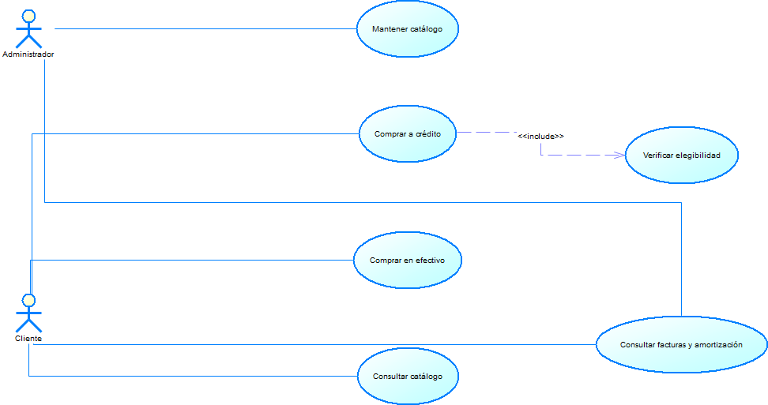
## Diagrama: Actividad de venta a crédito
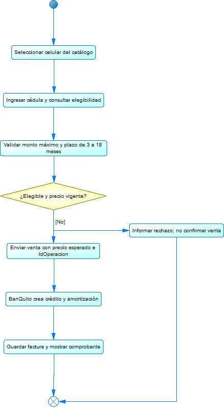
## Diagrama: Secuencia de venta a crédito
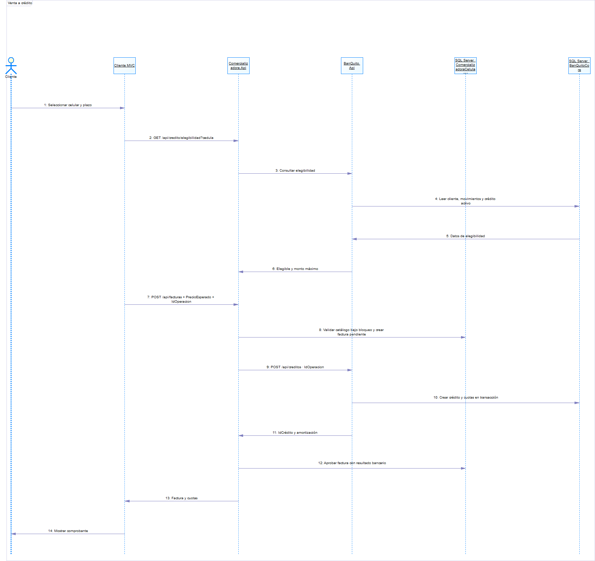
## Diagrama: Clases del servicio y cliente
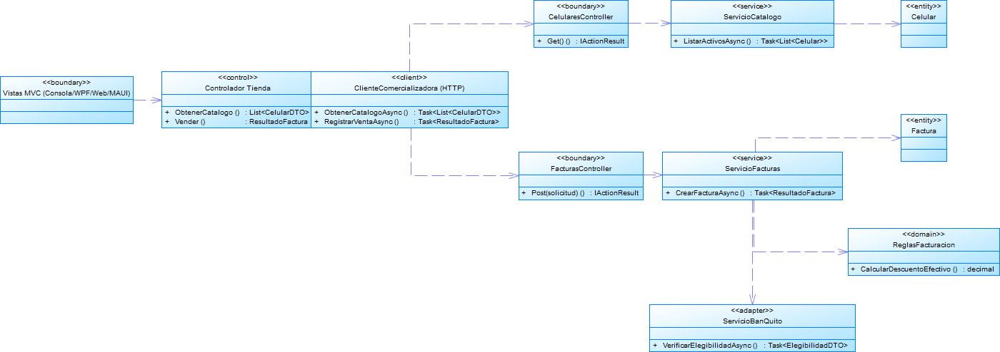
## Diagrama: Arquitectura cliente-servidor
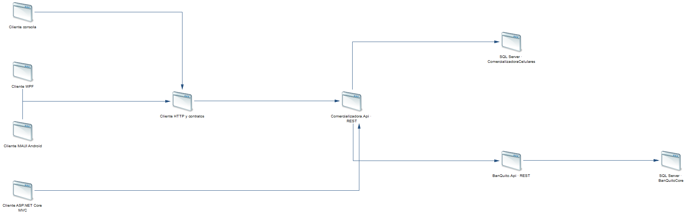
## Diagrama: Modelo físico comercializadora
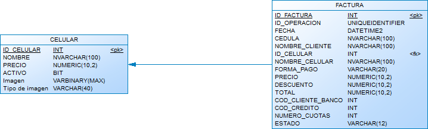
## Comprobación QA: Catálogo, consulta, alta y edición
Resultado observado: APROBADO.
Fuente: EVIDENCIA_API_QA.json. Ejecución aislada; no acredita por sí sola interacción visual.

### Comprobación QA: Catálogo: alta y edición

Resultado observado: APROBADO.
Fuente: EVIDENCIA_API_QA.json. Ejecución aislada; no acredita por sí sola interacción visual.

La interfaz móvil registra además las vistas reales del catálogo inicial y de un producto editado.

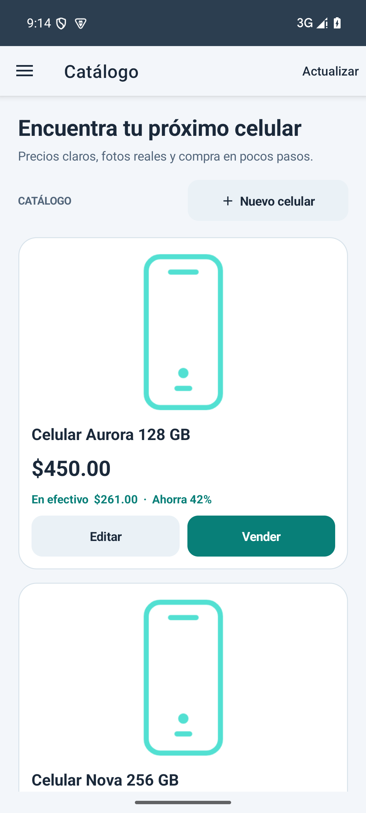

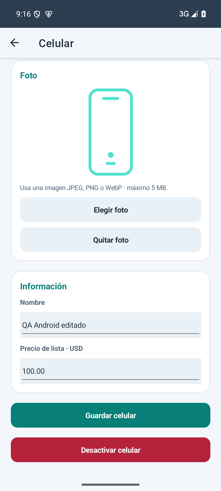
## Comprobación QA: Catálogo: desactivación
Resultado observado: APROBADO.
Fuente: EVIDENCIA_API_QA.json. Ejecución aislada; no acredita por sí sola interacción visual.
## Comprobación QA: Elegibilidad 0000000000
Resultado observado: APROBADO.
Fuente: EVIDENCIA_API_QA.json. Ejecución aislada; no acredita por sí sola interacción visual.
## Comprobación QA: Elegibilidad 0203040506
Resultado observado: APROBADO.
Fuente: EVIDENCIA_API_QA.json. Ejecución aislada; no acredita por sí sola interacción visual.
## Comprobación QA: Elegibilidad 0405060708
Resultado observado: APROBADO.
Fuente: EVIDENCIA_API_QA.json. Ejecución aislada; no acredita por sí sola interacción visual.
## Comprobación QA: Elegibilidad 0304050607
Resultado observado: APROBADO.
Fuente: EVIDENCIA_API_QA.json. Ejecución aislada; no acredita por sí sola interacción visual.
## Comprobación QA: Máximo 35% de diferencia por seis
Resultado observado: APROBADO.
Fuente: EVIDENCIA_API_QA.json. Ejecución aislada; no acredita por sí sola interacción visual.
## Comprobación QA: Rechazo plazo 2
Resultado observado: APROBADO.
Fuente: EVIDENCIA_API_QA.json. Ejecución aislada; no acredita por sí sola interacción visual.
## Comprobación QA: Rechazo plazo 19
Resultado observado: APROBADO.
Fuente: EVIDENCIA_API_QA.json. Ejecución aislada; no acredita por sí sola interacción visual.
## Comprobación QA: Rechazo monto superior al máximo
Resultado observado: APROBADO.
Fuente: EVIDENCIA_API_QA.json. Ejecución aislada; no acredita por sí sola interacción visual.
## Comprobación QA: Otorgamiento rechaza menor masculino
Resultado observado: APROBADO.
Fuente: EVIDENCIA_API_QA.json. Ejecución aislada; no acredita por sí sola interacción visual.
## Comprobación QA: Factura rechaza plazo 2
Resultado observado: APROBADO.
Fuente: EVIDENCIA_API_QA.json. Ejecución aislada; no acredita por sí sola interacción visual.
## Comprobación QA: Factura rechaza plazo 19
Resultado observado: APROBADO.
Fuente: EVIDENCIA_API_QA.json. Ejecución aislada; no acredita por sí sola interacción visual.
## Comprobación QA: Efectivo: descuento 189 y total 261
Resultado observado: APROBADO.
Fuente: EVIDENCIA_API_QA.json. Ejecución aislada; no acredita por sí sola interacción visual.

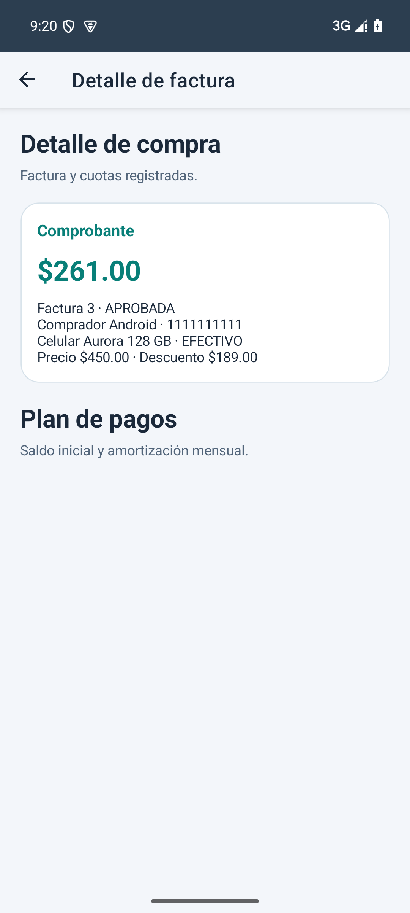
## Comprobación QA: Reintento efectivo sin duplicado
Resultado observado: APROBADO.
Fuente: EVIDENCIA_API_QA.json. Ejecución aislada; no acredita por sí sola interacción visual.
## Comprobación QA: Crédito 450 aprobado sin descuento
Resultado observado: APROBADO.
Fuente: EVIDENCIA_API_QA.json. Ejecución aislada; no acredita por sí sola interacción visual.

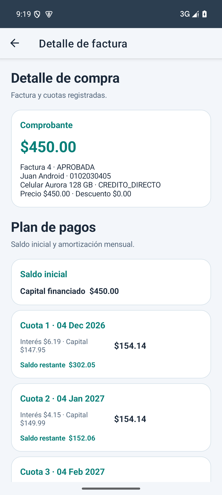
## Comprobación QA: Amortización a 3 meses: filas, capital y saldo
Resultado observado: APROBADO.
Fuente: EVIDENCIA_API_QA.json. Ejecución aislada; no acredita por sí sola interacción visual.

### Comprobación QA: Amortización 3: capital completo

Resultado observado: APROBADO.
Fuente: EVIDENCIA_API_QA.json. Ejecución aislada; no acredita por sí sola interacción visual.

La consulta móvil muestra la amortización real del escenario de tres cuotas.

## Comprobación QA: Amortización 3: interés 16,5% anual
Resultado observado: APROBADO.
Fuente: EVIDENCIA_API_QA.json. Ejecución aislada; no acredita por sí sola interacción visual.
## Comprobación QA: Fechas y saldos de las tres cuotas
Resultado observado: APROBADO.
Fuente: EVIDENCIA_API_QA.json. Ejecución aislada; no acredita por sí sola interacción visual.

### Comprobación QA: Cuota 3/2: fecha mensual y balance

Resultado observado: APROBADO.
Fuente: EVIDENCIA_API_QA.json. Ejecución aislada; no acredita por sí sola interacción visual.

### Comprobación QA: Cuota 3/3: fecha mensual y balance

Resultado observado: APROBADO.
Fuente: EVIDENCIA_API_QA.json. Ejecución aislada; no acredita por sí sola interacción visual.
## Comprobación QA: Amortización 3: cuota fija salvo ajuste final
Resultado observado: APROBADO.
Fuente: EVIDENCIA_API_QA.json. Ejecución aislada; no acredita por sí sola interacción visual.
## Comprobación QA: Tabla bancaria coincide con pasarela
Resultado observado: APROBADO.
Fuente: EVIDENCIA_API_QA.json. Ejecución aislada; no acredita por sí sola interacción visual.

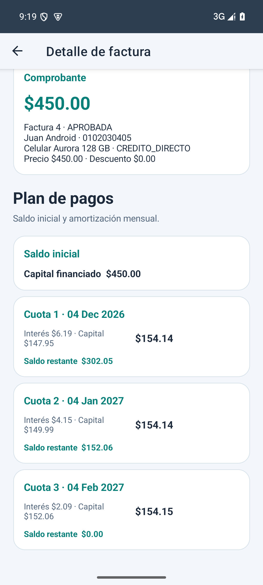
## Comprobación QA: Reintento crédito sin duplicado
Resultado observado: APROBADO.
Fuente: EVIDENCIA_API_QA.json. Ejecución aislada; no acredita por sí sola interacción visual.
## Comprobación QA: Reintento con datos diferentes rechazado
Resultado observado: APROBADO.
Fuente: EVIDENCIA_API_QA.json. Ejecución aislada; no acredita por sí sola interacción visual.
## Comprobación QA: Cliente con crédito activo no elegible
Resultado observado: APROBADO.
Fuente: EVIDENCIA_API_QA.json. Ejecución aislada; no acredita por sí sola interacción visual.
## Comprobación QA: Segundo crédito activo rechazado
Resultado observado: APROBADO.
Fuente: EVIDENCIA_API_QA.json. Ejecución aislada; no acredita por sí sola interacción visual.
## Comprobación QA: Monto igual al máximo aprobado
Resultado observado: APROBADO.
Fuente: EVIDENCIA_API_QA.json. Ejecución aislada; no acredita por sí sola interacción visual.
## Comprobación QA: Amortización a 18 meses: filas, capital y saldo
Resultado observado: APROBADO.
Fuente: EVIDENCIA_API_QA.json. Ejecución aislada; no acredita por sí sola interacción visual.

### Comprobación QA: Amortización 18: capital completo

Resultado observado: APROBADO.
Fuente: EVIDENCIA_API_QA.json. Ejecución aislada; no acredita por sí sola interacción visual.
## Comprobación QA: Amortización 18: interés 16,5% anual
Resultado observado: APROBADO.
Fuente: EVIDENCIA_API_QA.json. Ejecución aislada; no acredita por sí sola interacción visual.
## Comprobación QA: Fechas y saldos de cuotas 1 a 3 de 18
Resultado observado: APROBADO.
Fuente: EVIDENCIA_API_QA.json. Ejecución aislada; no acredita por sí sola interacción visual.

### Comprobación QA: Cuota 18/2: fecha mensual y balance

Resultado observado: APROBADO.
Fuente: EVIDENCIA_API_QA.json. Ejecución aislada; no acredita por sí sola interacción visual.

### Comprobación QA: Cuota 18/3: fecha mensual y balance

Resultado observado: APROBADO.
Fuente: EVIDENCIA_API_QA.json. Ejecución aislada; no acredita por sí sola interacción visual.
## Comprobación QA: Fechas y saldos de cuotas 4 y 5 de 18
Resultado observado: APROBADO.
Fuente: EVIDENCIA_API_QA.json. Ejecución aislada; no acredita por sí sola interacción visual.

### Comprobación QA: Cuota 18/5: fecha mensual y balance

Resultado observado: APROBADO.
Fuente: EVIDENCIA_API_QA.json. Ejecución aislada; no acredita por sí sola interacción visual.
## Comprobación QA: Cuota 18/6: fecha mensual y balance
Resultado observado: APROBADO.
Fuente: EVIDENCIA_API_QA.json. Ejecución aislada; no acredita por sí sola interacción visual.
## Comprobación QA: Cuota 18/7: fecha mensual y balance
Resultado observado: APROBADO.
Fuente: EVIDENCIA_API_QA.json. Ejecución aislada; no acredita por sí sola interacción visual.
## Comprobación QA: Cuota 18/8: fecha mensual y balance
Resultado observado: APROBADO.
Fuente: EVIDENCIA_API_QA.json. Ejecución aislada; no acredita por sí sola interacción visual.
## Comprobación QA: Cuota 18/9: fecha mensual y balance
Resultado observado: APROBADO.
Fuente: EVIDENCIA_API_QA.json. Ejecución aislada; no acredita por sí sola interacción visual.
## Comprobación QA: Cuota 18/10: fecha mensual y balance
Resultado observado: APROBADO.
Fuente: EVIDENCIA_API_QA.json. Ejecución aislada; no acredita por sí sola interacción visual.
## Comprobación QA: Cuota 18/11: fecha mensual y balance
Resultado observado: APROBADO.
Fuente: EVIDENCIA_API_QA.json. Ejecución aislada; no acredita por sí sola interacción visual.
## Comprobación QA: Cuota 18/12: fecha mensual y balance
Resultado observado: APROBADO.
Fuente: EVIDENCIA_API_QA.json. Ejecución aislada; no acredita por sí sola interacción visual.
## Comprobación QA: Cuota 18/13: fecha mensual y balance
Resultado observado: APROBADO.
Fuente: EVIDENCIA_API_QA.json. Ejecución aislada; no acredita por sí sola interacción visual.
## Comprobación QA: Cuota 18/14: fecha mensual y balance
Resultado observado: APROBADO.
Fuente: EVIDENCIA_API_QA.json. Ejecución aislada; no acredita por sí sola interacción visual.
## Comprobación QA: Cuota 18/15: fecha mensual y balance
Resultado observado: APROBADO.
Fuente: EVIDENCIA_API_QA.json. Ejecución aislada; no acredita por sí sola interacción visual.
## Comprobación QA: Cuota 18/16: fecha mensual y balance
Resultado observado: APROBADO.
Fuente: EVIDENCIA_API_QA.json. Ejecución aislada; no acredita por sí sola interacción visual.
## Comprobación QA: Cuota 18/17: fecha mensual y balance
Resultado observado: APROBADO.
Fuente: EVIDENCIA_API_QA.json. Ejecución aislada; no acredita por sí sola interacción visual.
## Comprobación QA: Cuota 18/18: fecha mensual y balance
Resultado observado: APROBADO.
Fuente: EVIDENCIA_API_QA.json. Ejecución aislada; no acredita por sí sola interacción visual.
## Comprobación QA: Amortización 18: cuota fija salvo ajuste final
Resultado observado: APROBADO.
Fuente: EVIDENCIA_API_QA.json. Ejecución aislada; no acredita por sí sola interacción visual.
## Comprobación QA: Consulta factura y búsqueda por cédula
Resultado observado: APROBADO.
Fuente: EVIDENCIA_API_QA.json. Ejecución aislada; no acredita por sí sola interacción visual.

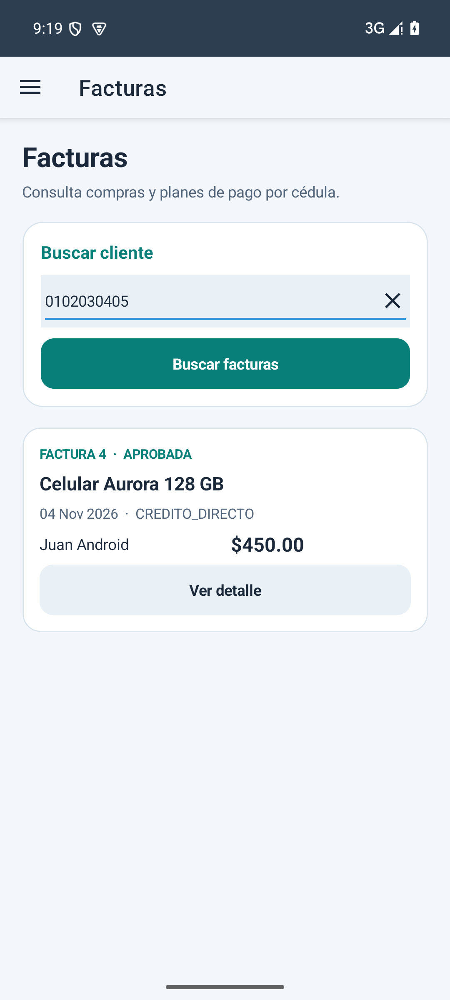
## Consola termina correctamente
Evidencia ejecutada: EVIDENCIA_CLIENTES_QA.json
Resultado: APROBADO
## Consola catálogo alta y edición
Evidencia ejecutada: EVIDENCIA_CLIENTES_QA.json
Resultado: APROBADO
## Consola efectivo y crédito aprobados
Evidencia ejecutada: EVIDENCIA_CLIENTES_QA.json
Resultado: APROBADO
## Consola consulta amortización
Evidencia ejecutada: EVIDENCIA_CLIENTES_QA.json
Resultado: APROBADO
## Consola sin errores de operación
Evidencia ejecutada: EVIDENCIA_CLIENTES_QA.json
Resultado: APROBADO
## Web catálogo renderizado
Evidencia ejecutada: EVIDENCIA_CLIENTES_QA.json
Resultado: APROBADO

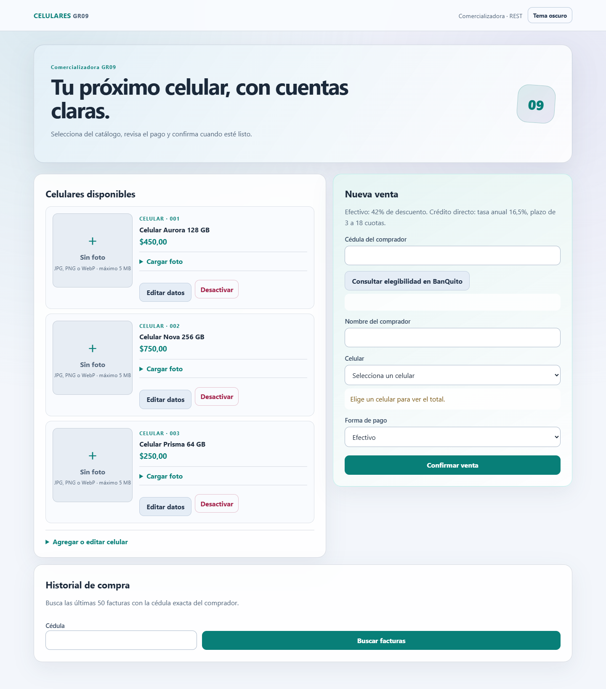
## Web alta y edición catálogo
Evidencia ejecutada: EVIDENCIA_CLIENTES_QA.json
Resultado: APROBADO

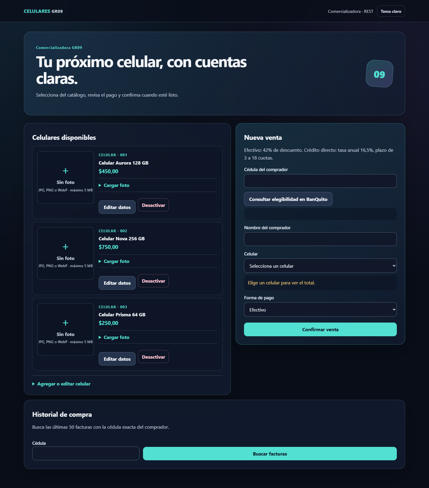
## Web desactivación
Evidencia ejecutada: EVIDENCIA_CLIENTES_QA.json
Resultado: APROBADO
## Web factura EFECTIVO
Evidencia ejecutada: EVIDENCIA_CLIENTES_QA.json
Resultado: APROBADO

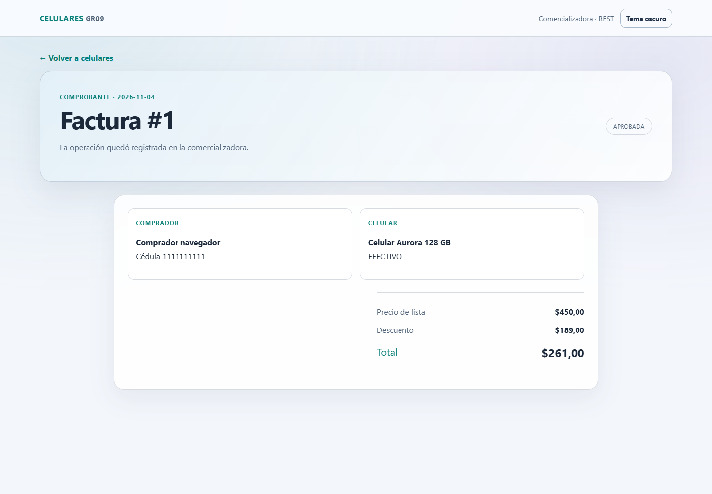
## Web total EFECTIVO
Evidencia ejecutada: EVIDENCIA_CLIENTES_QA.json
Resultado: APROBADO
## Web factura CREDITO_DIRECTO
Evidencia ejecutada: EVIDENCIA_CLIENTES_QA.json
Resultado: APROBADO

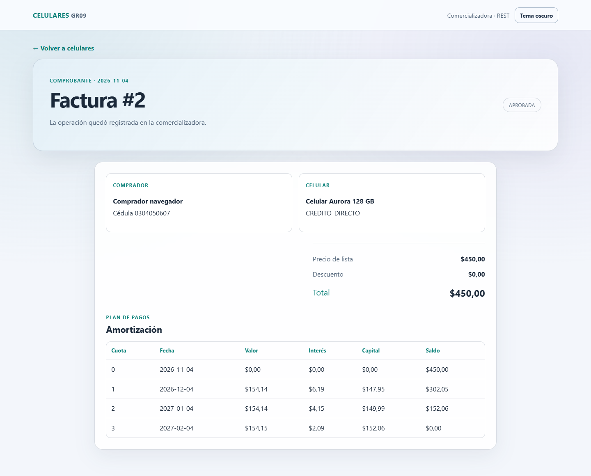
## Diseño web adaptable y validación visual
Chrome verificó el cambio de tema, los formularios y la ausencia de desbordamiento horizontal a 390 píxeles. El registro de navegador informa cero excepciones JavaScript.

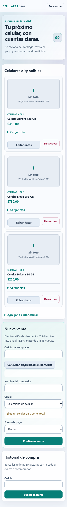
## Web total CREDITO_DIRECTO
Evidencia ejecutada: EVIDENCIA_CLIENTES_QA.json
Resultado: APROBADO
## Web amortización renderizada
Evidencia ejecutada: EVIDENCIA_CLIENTES_QA.json
Resultado: APROBADO
## Web búsqueda por cédula
Evidencia ejecutada: EVIDENCIA_CLIENTES_QA.json
Resultado: APROBADO
## Catálogo cargado
Evidencia ejecutada: EVIDENCIA_WPF_QA.json
Comprobación registrada por el arnés QA.
## Conclusiones
El sistema centraliza el catálogo y la facturación en una API REST de tienda; BanQuito valida y persiste los créditos en una API y una base independientes. Los cuatro clientes consumen el mismo contrato comercial. Las pruebas QA registradas verifican los escenarios funcionales indicados en este manual.

La evidencia no representa una certificación productiva. Se conserva la discrepancia de 35%/30% del enunciado y se explica el ajuste de redondeo al cierre de la amortización.
## Recomendaciones
Mantener secretos en configuración local fuera del repositorio y ejecutar pruebas con bases QA nuevas. Antes de una entrega, compilar los proyectos, repetir los recorridos de cuatro clientes y revisar los registros de evidencia correspondientes.

Acordar con el docente si prevalece el texto de 35% o la fórmula impresa de 30%; documentar la decisión y regenerar las pruebas de monto máximo si cambia.
## Bibliografía y fuentes de verificación
1. `ExamenComplexivoPractivo_CELULARES.docx`, enunciado y rúbrica entregados para el proyecto.
2. Código, proyectos, scripts SQL y pruebas del repositorio GR09.
3. Registros `EVIDENCIA_*.json` y capturas originales de `05. DOCUMENTACION/evidencias/`.
4. Plantillas oficiales del proyecto en `examples/`.
