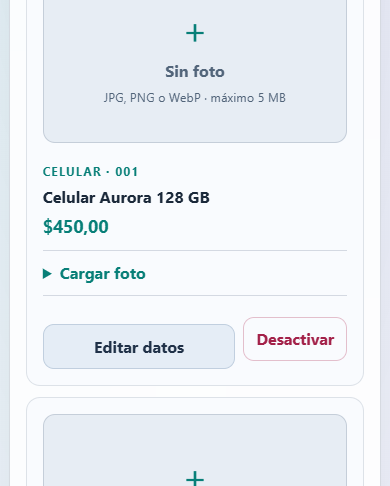
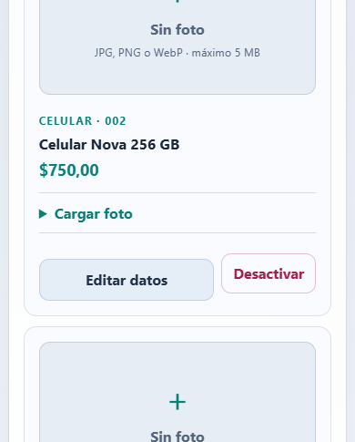
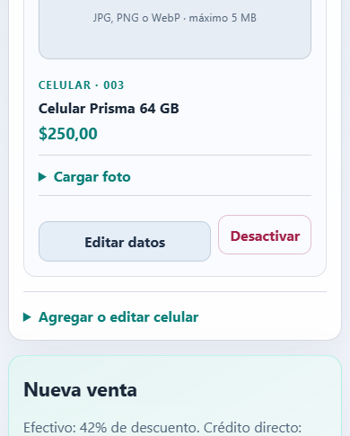
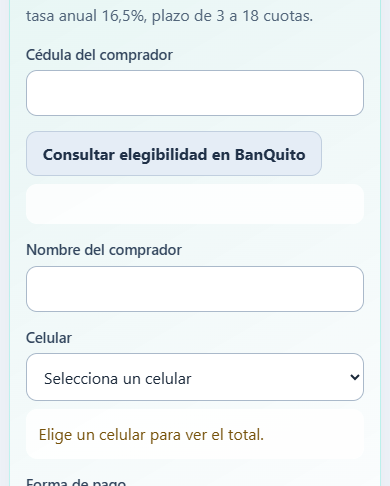
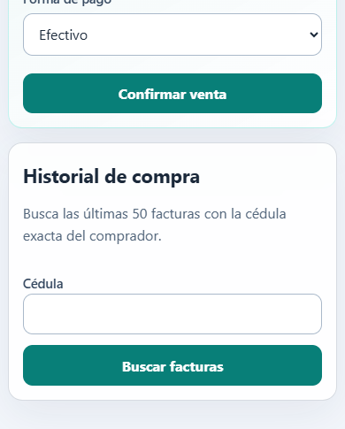

# Manual técnico: comercializadora de celulares y BanQuito

Autores: Gabriel Omar Murillo Medina; Julio Enrique Viche Castillo. Grupo 09 · NRC 36884. Tutor: Ing. Eduardo Mauricio Campaña Ortega. Arquitectura .NET REST.

Este es el contenido canónico del manual. El DOCX y el PPTX se generan de estos mismos capítulos, pruebas y figuras.

## Problema y alcance
Catálogo sin inventario y facturación de un celular por compra.
Pago en efectivo o crédito directo autorizado por BanQuito.
No se implementa la programación del Core bancario completo.
## Arquitectura
Consola, WPF, web MVC y Android MAUI consumen la API comercializadora.
Comercializadora y BanQuito se comunican por REST/JSON.
Dos bases independientes en SQL Server Docker; las aplicaciones corren en host.

BanQuito escucha en 19101, la tienda en 19102 y MVC en 19103 durante la ejecución local. Las API exponen comprobación de salud; las aplicaciones cliente no conectan directamente a SQL Server. Las cadenas se pasan mediante configuración local, por ejemplo `ConnectionStrings__BaseDatos` y `Servicios__BanQuitoUrl`.
## Contrato REST implementado
| API | Métodos y recursos | Uso verificado |
| BanQuito | GET `/api/credito/elegibilidad?cedula=...`; GET `/api/credito/clientes/{codigo}/monto-maximo`; POST `/api/creditos`; GET `/api/creditos/{id}/amortizacion` | Evaluar, autorizar y consultar el plan bancario |
| Comercializadora | GET/POST `/api/celulares`; PUT/DELETE `/api/celulares/{id}`; POST `/api/facturas`; GET `/api/facturas?cedula=...`; GET `/api/facturas/{id}/amortizacion` | Administrar catálogo, registrar venta y consultar factura/amortización |
| Imágenes | GET; PUT multipart/form-data; DELETE `/api/celulares/{id}/imagen` | Consultar, cargar o retirar la imagen opcional |

La factura envía `IdOperacion`, comprador, celular, `FormaPago`, número de cuotas y `PrecioEsperado`. La referencia idempotente resuelve reintentos sin duplicar facturas o créditos. Las rutas completas comprobadas están en los controladores REST de ambas API.
## Preparación del entorno y configuración local
El backend está dirigido a .NET 10 (`net10.0`). La configuración local usa Docker Desktop en modo de contenedores Linux para SQL Server 2022 Developer. Comercializadora.Api y BanQuito.Api, junto con los cuatro clientes, se ejecutan en Windows host. WPF requiere Windows; MAUI requiere el SDK Android y un emulador o dispositivo. El repositorio no incluye una solución `.sln`: cada proyecto se abre desde su archivo `.csproj`.

Desde PowerShell, situado en la raíz del repositorio, copiar `.env.example` a `.env` si aún no existe y asignar una contraseña local a `MSSQL_SA_PASSWORD`. No compartir ni incluir `.env` en capturas. El archivo está excluido de Git. Ejecutar `./PrepararEntorno.ps1 -IniciarApis` para levantar SQL Server, aplicar los cinco scripts de base de datos e iniciar las dos API con la cadena local cargada desde el entorno. Para iniciar solo SQL Server y las bases, ejecutar `./PrepararEntorno.ps1` sin el modificador.

En Android Emulator, la aplicación llega a la API del host mediante `http://10.0.2.2:19102/`; `127.0.0.1` dentro del emulador apunta al propio emulador. Los otros clientes usan las direcciones locales del host indicadas en la configuración de servicios.
## Configuración de SQL Server
El servicio `sqlserver` de `compose.yaml` utiliza `mcr.microsoft.com/mssql/server:2022-latest` con edición Developer. Docker publica el puerto interno `1433` únicamente en `127.0.0.1:19433`, conserva los datos en el volumen `celulares_sql` y espera el resultado correcto del `sqlcmd` de SQL Server antes de continuar. No es una instancia compartida por los clientes: las aplicaciones acceden a sus API y solo las API se conectan a las bases.

| Parámetro | Valor del proyecto | Uso |
|---|---|---|
| Contenedor | `sqlserver` | Servicio SQL Server de Docker Compose |
| Imagen | `mcr.microsoft.com/mssql/server:2022-latest` | Motor SQL Server 2022 |
| Edición | Developer | Entorno de desarrollo académico |
| Dirección del host | `127.0.0.1,19433` | Conexión desde Windows host |
| Puerto dentro del contenedor | `1433` | Puerto predeterminado del motor |
| Volumen | `celulares_sql:/var/opt/mssql` | Persistencia de las dos bases |
| Credencial | Variable `MSSQL_SA_PASSWORD` en `.env` | Se define localmente; no se documenta ni captura su valor |

El puerto `19433` está enlazado solo a loopback, por lo que no se publica en la red local. Si ya está ocupado, detener el servicio que lo usa antes de iniciar el proyecto; cualquier cambio del puerto también requiere actualizar las cadenas de conexión de las API. No eliminar el volumen para resolver errores: primero revisar el estado y los registros del contenedor.
## Configuración de los proyectos en Visual Studio
Abrir cada API desde Archivo > Abrir > Proyecto o solución y seleccionar su proyecto web: `04. SERVIDOR/Comercializadora.Api/Comercializadora.Api.csproj` o `04. SERVIDOR/BanQuito.Api/BanQuito.Api.csproj`. El marco objetivo de ambos proyectos es `net10.0`. Las dependencias de dominio y contratos se cargan mediante referencias relativas declaradas en el `.csproj`.

Los valores no sensibles visibles en `appsettings.json` identifican puertos, bases y la dirección REST entre API. La contraseña no está escrita ahí: `PrepararEntorno.ps1 -IniciarApis` la obtiene de `.env` y la pasa a cada proceso como `ConnectionStrings__BaseDatos`. Por eso el modo de inicio documentado es el script de preparación; abrir el `.csproj` en Visual Studio permite revisar, editar y compilar el proyecto, pero una ejecución directa sin las variables locales no obtiene la contraseña de SQL Server.

| Archivo revisado en el proyecto | Configuración que contiene |
|---|---|
| `compose.yaml` | Imagen, edición, puerto, volumen y comprobación de salud de SQL Server |
| `.env.example` / `.env` | Nombre de la variable para la contraseña local; el valor real solo vive en `.env` |
| `04. SERVIDOR/Comercializadora.Api/appsettings.json` | API de tienda en `19102`, base `ComercializadoraCelulares` y URL de BanQuito en `19101` |
| `04. SERVIDOR/BanQuito.Api/appsettings.json` | API bancaria en `19101` y base `BanQuitoCore` |
| `04. SERVIDOR/*/*.csproj` | Marco .NET y referencias entre proyectos |
| `PrepararEntorno.ps1` | Carga local de la conexión y orden de arranque de API |

La cadena local usa `Server=127.0.0.1,19433`, `Encrypt=True` y `TrustServerCertificate=True`. Comercializadora.Api selecciona `ComercializadoraCelulares`; BanQuito.Api selecciona `BanQuitoCore`. La opción de confianza del certificado corresponde al entorno local del contenedor. No cambiar el nombre de las bases sin ajustar los scripts y la configuración de ambos servicios.
## Secuencia de scripts de las bases de datos
`PrepararEntorno.ps1` aplica los scripts en este orden para que las tablas existan antes de cargar los datos:

| Orden | Archivo | Base y resultado |
|---|---|---|
| 1 | `03. BDD/01_CrearBases.sql` | Crea `ComercializadoraCelulares` y las tablas `CELULAR` y `FACTURA`, con claves, relaciones y restricciones de pago. |
| 2 | `03. BDD/03_MigrarImagenes.sql` | Añade `IMAGEN` e `IMAGEN_TIPO` a `CELULAR` si faltan; sirve para actualizar una base previa. |
| 3 | `03. BDD/02_DatosPrueba.sql` | Inserta de forma condicional tres celulares iniciales con precios de USD 450, 750 y 250. |
| 4 | `03. BDD/BanQuito/BanQuito_01_CrearBase.sql` | Crea `BanQuitoCore`, sus cinco tablas, relaciones e índices; incluye el índice único filtrado para un crédito activo por cliente. |
| 5 | `03. BDD/BanQuito/BanQuito_02_DatosPrueba.sql` | Carga condicionalmente cinco clientes, cinco cuentas y cincuenta movimientos en una transacción. |

Los scripts son idempotentes para los objetos y datos que validan con `IF NOT EXISTS` o `COL_LENGTH`: pueden volver a ejecutarse para completar una inicialización interrumpida. La migración de imágenes no reemplaza datos. Para revisar el SQL se puede abrir cada archivo `.sql` en el editor de Visual Studio; para inicializar el entorno se recomienda ejecutar `./PrepararEntorno.ps1`, que respeta el orden establecido y detiene el proceso ante el primer error.

Para ejecutar manualmente un archivo desde PowerShell, asignar a `$script` una de las rutas de la tabla y enviar su contenido al `sqlcmd` del contenedor. Esta es la misma conexión local que usa la preparación automatizada y no requiere escribir la contraseña en el historial:

```powershell
$script = '03. BDD/01_CrearBases.sql'
Get-Content -Raw -LiteralPath $script |
    docker compose exec -T sqlserver bash -c '/opt/mssql-tools18/bin/sqlcmd -S localhost -U sa -P "$MSSQL_SA_PASSWORD" -C -b'
```

En la ejecución automatizada se aplica este patrón a cada ruta en el orden anterior. `-b` hace que `sqlcmd` devuelva error si la instrucción SQL falla; el script PowerShell detiene la inicialización en ese caso.

La estructura relacional queda resumida así: `FACTURA` referencia al celular vendido y guarda una copia de sus datos y el resultado de pago; `CUENTA` referencia a `CLIENTE`; `MOVIMIENTO` referencia a `CUENTA`; `CREDITO` referencia a `CLIENTE`; y `AMORTIZACION` referencia a `CREDITO`. La clave `ID_OPERACION` de la factura y `REFERENCIA_VENTA` del crédito evitan duplicados por reintentos. La base de tienda no implementa existencias.

## Archivos de configuración visibles en Visual Studio
Los listados siguientes se copian de los archivos versionados del proyecto. El `.env` real no se muestra: contiene la contraseña local y no debe agregarse al manual ni a una captura. `appsettings.json` conserva las direcciones y nombres de bases; `PrepararEntorno.ps1` suministra la contraseña al proceso en tiempo de ejecución.

### Archivo `compose.yaml`

```yaml
services:
  sqlserver:
    image: mcr.microsoft.com/mssql/server:2022-latest
    environment:
      ACCEPT_EULA: "Y"
      MSSQL_PID: Developer
      MSSQL_SA_PASSWORD: ${MSSQL_SA_PASSWORD:?Configure .env desde .env.example}
    ports:
      - "127.0.0.1:19433:1433"
    volumes:
      - celulares_sql:/var/opt/mssql
    healthcheck:
      test: ["CMD-SHELL", '/opt/mssql-tools18/bin/sqlcmd -S localhost -U sa -P "$$MSSQL_SA_PASSWORD" -C -Q "SELECT 1" -b -o /dev/null']
      interval: 5s
      timeout: 5s
      retries: 30
volumes:
  celulares_sql:
```

### Comercializadora.Api/appsettings.json

```json
{
  "Urls": "http://127.0.0.1:19102",
  "ConnectionStrings": {
    "BaseDatos": "Server=127.0.0.1,19433;Database=ComercializadoraCelulares;User Id=sa;Encrypt=True;TrustServerCertificate=True;Connect Timeout=8"
  },
  "Servicios": {
    "BanQuitoUrl": "http://127.0.0.1:19101/"
  },
  "Logging": {
    "LogLevel": {
      "Default": "Information",
      "Microsoft.AspNetCore": "Warning"
    }
  }
}
```

### BanQuito.Api/appsettings.json

```json
{
  "Urls": "http://127.0.0.1:19101",
  "ConnectionStrings": {
    "BaseDatos": "Server=127.0.0.1,19433;Database=BanQuitoCore;User Id=sa;Encrypt=True;TrustServerCertificate=True;Connect Timeout=8"
  },
  "Logging": {
    "LogLevel": {
      "Default": "Information",
      "Microsoft.AspNetCore": "Warning"
    }
  }
}
```

### Comercializadora.Api.csproj

```xml
<Project Sdk="Microsoft.NET.Sdk.Web">
  <PropertyGroup>
    <TargetFramework>net10.0</TargetFramework>
  </PropertyGroup>
  <ItemGroup>
    <PackageReference Include="Microsoft.Data.SqlClient" Version="7.1.1" />
    <PackageReference Include="System.Security.Cryptography.Pkcs" Version="10.0.13" />
    <ProjectReference Include="..\Comercializadora.Dominio\Comercializadora.Dominio.csproj" />
    <ProjectReference Include="..\Contratos\Celulares.Contratos.csproj" />
  </ItemGroup>
</Project>
```

### BanQuito.Api.csproj

```xml
<Project Sdk="Microsoft.NET.Sdk.Web">
<PropertyGroup><TargetFramework>net10.0</TargetFramework></PropertyGroup>
<ItemGroup><PackageReference Include="Microsoft.Data.SqlClient" Version="7.1.1" /><PackageReference Include="System.Security.Cryptography.Pkcs" Version="10.0.13" />
<ProjectReference Include="..\BanQuito.Dominio\BanQuito.Dominio.csproj" />
<ProjectReference Include="..\BanQuito.Contratos\BanQuito.Contratos.csproj" /></ItemGroup>
</Project>

```

## Anexo: scripts SQL completos del proyecto
Los listados corresponden a los cinco archivos que ejecuta `PrepararEntorno.ps1`, en el mismo orden documentado. Se incluyen para consultar las definiciones reales de tablas, restricciones, migración y semillas. No se modifican bases al leer este anexo.

### 03. BDD/01_CrearBases.sql

```sql
SET QUOTED_IDENTIFIER ON;
GO
SET ANSI_NULLS ON;
SET ANSI_PADDING ON;
SET ANSI_WARNINGS ON;
SET ARITHABORT ON;
SET CONCAT_NULL_YIELDS_NULL ON;
SET NUMERIC_ROUNDABORT OFF;
GO
USE master;
GO
IF DB_ID(N'ComercializadoraCelulares') IS NULL CREATE DATABASE ComercializadoraCelulares;
GO
USE ComercializadoraCelulares;
GO
IF OBJECT_ID(N'dbo.CELULAR') IS NULL
CREATE TABLE dbo.CELULAR (
 ID_CELULAR int IDENTITY PRIMARY KEY, NOMBRE nvarchar(100) NOT NULL,
 PRECIO numeric(10,2) NOT NULL CHECK(PRECIO>0), ACTIVO bit NOT NULL DEFAULT 1,
 IMAGEN varbinary(max) NULL, IMAGEN_TIPO varchar(40) NULL
);
IF OBJECT_ID(N'dbo.FACTURA') IS NULL
CREATE TABLE dbo.FACTURA (
 ID_FACTURA int IDENTITY PRIMARY KEY, ID_OPERACION uniqueidentifier NOT NULL UNIQUE,
 FECHA datetime2 NOT NULL DEFAULT SYSDATETIME(), CEDULA nvarchar(100) NOT NULL, NOMBRE_CLIENTE nvarchar(100) NOT NULL,
 ID_CELULAR int NOT NULL REFERENCES dbo.CELULAR(ID_CELULAR), NOMBRE_CELULAR nvarchar(100) NOT NULL,
 FORMA_PAGO varchar(20) NOT NULL CHECK(FORMA_PAGO IN ('EFECTIVO','CREDITO_DIRECTO')),
 PRECIO numeric(10,2) NOT NULL CHECK(PRECIO>0), DESCUENTO numeric(10,2) NOT NULL, TOTAL numeric(10,2) NOT NULL CHECK(TOTAL>0),
 COD_CLIENTE_BANCO int NULL, COD_CREDITO int NULL,
 NUMERO_CUOTAS int NULL CHECK(NUMERO_CUOTAS BETWEEN 3 AND 18),
 ESTADO varchar(12) NOT NULL CHECK(ESTADO IN ('PENDIENTE','APROBADA','RECHAZADA')),
 CONSTRAINT CK_FACTURA_PAGO CHECK(
  (FORMA_PAGO='EFECTIVO' AND COD_CREDITO IS NULL AND NUMERO_CUOTAS IS NULL) OR
  (FORMA_PAGO='CREDITO_DIRECTO' AND NUMERO_CUOTAS IS NOT NULL))
);
GO
```

### 03. BDD/03_MigrarImagenes.sql

```sql
USE ComercializadoraCelulares;
GO
IF COL_LENGTH(N'dbo.CELULAR', N'IMAGEN') IS NULL
    ALTER TABLE dbo.CELULAR ADD IMAGEN varbinary(max) NULL;
IF COL_LENGTH(N'dbo.CELULAR', N'IMAGEN_TIPO') IS NULL
    ALTER TABLE dbo.CELULAR ADD IMAGEN_TIPO varchar(40) NULL;
GO
```

### 03. BDD/02_DatosPrueba.sql

```sql
USE ComercializadoraCelulares;
GO
IF NOT EXISTS(SELECT 1 FROM dbo.CELULAR WHERE NOMBRE=N'Celular Aurora 128 GB')
 INSERT dbo.CELULAR(NOMBRE,PRECIO) VALUES(N'Celular Aurora 128 GB',450.00);
IF NOT EXISTS(SELECT 1 FROM dbo.CELULAR WHERE NOMBRE=N'Celular Nova 256 GB')
 INSERT dbo.CELULAR(NOMBRE,PRECIO) VALUES(N'Celular Nova 256 GB',750.00);
IF NOT EXISTS(SELECT 1 FROM dbo.CELULAR WHERE NOMBRE=N'Celular Prisma 64 GB')
 INSERT dbo.CELULAR(NOMBRE,PRECIO) VALUES(N'Celular Prisma 64 GB',250.00);
GO
```

### 03. BDD/BanQuito/BanQuito_01_CrearBase.sql

```sql
SET QUOTED_IDENTIFIER ON;
GO
SET ANSI_NULLS ON;
SET ANSI_PADDING ON;
SET ANSI_WARNINGS ON;
SET ARITHABORT ON;
SET CONCAT_NULL_YIELDS_NULL ON;
SET NUMERIC_ROUNDABORT OFF;
GO
USE master;
GO
IF DB_ID(N'BanQuitoCore') IS NULL CREATE DATABASE BanQuitoCore;
GO
USE BanQuitoCore;
GO
IF OBJECT_ID(N'dbo.CLIENTE') IS NULL
CREATE TABLE dbo.CLIENTE (
 COD_CLIENTE int NOT NULL PRIMARY KEY, CEDULA varchar(100) NOT NULL UNIQUE,
 NOMBRE varchar(100) NOT NULL, GENERO varchar(1) NOT NULL CHECK (GENERO IN ('M','F')),
 FECHA_NACIMIENTO date NOT NULL
);
IF OBJECT_ID(N'dbo.CUENTA') IS NULL
CREATE TABLE dbo.CUENTA (
 NUM_CUENTA varchar(8) NOT NULL PRIMARY KEY,
 COD_CLIENTE int NOT NULL REFERENCES dbo.CLIENTE(COD_CLIENTE), SALDO numeric(10,2) NOT NULL
);
IF OBJECT_ID(N'dbo.MOVIMIENTO') IS NULL
CREATE TABLE dbo.MOVIMIENTO (
 COD_MOVIMIENTO int NOT NULL PRIMARY KEY, NUM_CUENTA varchar(8) NOT NULL REFERENCES dbo.CUENTA(NUM_CUENTA),
 TIPO varchar(3) NOT NULL CHECK (TIPO IN ('DEP','RET')), VALOR numeric(10,2) NOT NULL CHECK (VALOR>0), FECHA date NOT NULL
);
IF OBJECT_ID(N'dbo.CREDITO') IS NULL
CREATE TABLE dbo.CREDITO (
 COD_CREDITO int IDENTITY PRIMARY KEY, COD_CLIENTE int NOT NULL REFERENCES dbo.CLIENTE(COD_CLIENTE),
 REFERENCIA_VENTA uniqueidentifier NOT NULL UNIQUE, MONTO numeric(10,2) NOT NULL CHECK (MONTO>0),
 NUMERO_CUOTAS int NOT NULL CHECK (NUMERO_CUOTAS BETWEEN 3 AND 18),
 TASA_ANUAL decimal(7,5) NOT NULL DEFAULT 0.165, FECHA date NOT NULL,
 ESTADO varchar(10) NOT NULL CHECK (ESTADO IN ('ACTIVO','CANCELADO'))
);
IF NOT EXISTS (SELECT 1 FROM sys.indexes WHERE name='UX_CREDITO_ACTIVO' AND object_id=OBJECT_ID('dbo.CREDITO'))
CREATE UNIQUE INDEX UX_CREDITO_ACTIVO ON dbo.CREDITO(COD_CLIENTE) WHERE ESTADO='ACTIVO';
IF OBJECT_ID(N'dbo.AMORTIZACION') IS NULL
CREATE TABLE dbo.AMORTIZACION (
 COD_CREDITO int NOT NULL REFERENCES dbo.CREDITO(COD_CREDITO),
 NUMERO_CUOTA int NOT NULL CHECK (NUMERO_CUOTA BETWEEN 0 AND 18), FECHA_PAGO date NOT NULL,
 VALOR_CUOTA numeric(10,2) NOT NULL, INTERES_PAGADO numeric(10,2) NOT NULL,
 CAPITAL_PAGADO numeric(10,2) NOT NULL, SALDO numeric(10,2) NOT NULL CHECK (SALDO>=0),
 CONSTRAINT PK_AMORTIZACION PRIMARY KEY(COD_CREDITO,NUMERO_CUOTA)
);
IF NOT EXISTS (SELECT 1 FROM sys.indexes WHERE name='IX_MOVIMIENTO_CUENTA_FECHA' AND object_id=OBJECT_ID('dbo.MOVIMIENTO'))
CREATE INDEX IX_MOVIMIENTO_CUENTA_FECHA ON dbo.MOVIMIENTO(NUM_CUENTA,FECHA) INCLUDE(TIPO,VALOR);
GO
```

### 03. BDD/BanQuito/BanQuito_02_DatosPrueba.sql

```sql
USE BanQuitoCore;
GO
SET XACT_ABORT ON;
BEGIN TRANSACTION;
DECLARE @hoy date=CAST(GETDATE() AS date);
IF NOT EXISTS(SELECT 1 FROM dbo.CLIENTE WHERE COD_CLIENTE=1)
 INSERT dbo.CLIENTE VALUES(1,'0102030405','Juan Perez','M',DATEADD(YEAR,-35,@hoy));
IF NOT EXISTS(SELECT 1 FROM dbo.CLIENTE WHERE COD_CLIENTE=2)
 INSERT dbo.CLIENTE VALUES(2,'0203040506','Carlos Gomez','M',DATEADD(YEAR,-24,@hoy));
IF NOT EXISTS(SELECT 1 FROM dbo.CLIENTE WHERE COD_CLIENTE=3)
 INSERT dbo.CLIENTE VALUES(3,'0304050607','Ana Lopez','F',DATEADD(YEAR,-23,@hoy));
IF NOT EXISTS(SELECT 1 FROM dbo.CLIENTE WHERE COD_CLIENTE=4)
 INSERT dbo.CLIENTE VALUES(4,'0405060708','Maria Torres','F',DATEADD(YEAR,-32,@hoy));
IF NOT EXISTS(SELECT 1 FROM dbo.CLIENTE WHERE COD_CLIENTE=5)
 INSERT dbo.CLIENTE VALUES(5,'0506070809','Luis Sanchez','M',DATEADD(YEAR,-30,@hoy));
DECLARE @cliente int=1;
WHILE @cliente<=5
BEGIN
 DECLARE @cuenta varchar(8)=CAST(10000000+@cliente AS varchar(8));
 IF NOT EXISTS(SELECT 1 FROM dbo.CUENTA WHERE NUM_CUENTA=@cuenta) INSERT dbo.CUENTA VALUES(@cuenta,@cliente,2000.00);
 DECLARE @numero int=1;
 WHILE @numero<=10
 BEGIN
  DECLARE @id int=(@cliente-1)*10+@numero;
  DECLARE @tipo varchar(3)=CASE WHEN @numero%2=1 THEN 'DEP' ELSE 'RET' END;
  DECLARE @dias int=@numero*6+CASE WHEN @cliente=4 THEN 40 ELSE 0 END;
  DECLARE @valor numeric(10,2)=CASE WHEN @tipo='DEP' THEN 1000+@cliente*50 ELSE 100+@cliente*10 END;
  IF NOT EXISTS(SELECT 1 FROM dbo.MOVIMIENTO WHERE COD_MOVIMIENTO=@id)
   INSERT dbo.MOVIMIENTO VALUES(@id,@cuenta,@tipo,@valor,DATEADD(DAY,-@dias,@hoy));
  SET @numero+=1;
 END
 SET @cliente+=1;
END
COMMIT;
SELECT 'CLIENTES' AS ENTIDAD,COUNT(*) AS TOTAL FROM dbo.CLIENTE
UNION ALL SELECT 'CUENTAS',COUNT(*) FROM dbo.CUENTA
UNION ALL SELECT 'MOVIMIENTOS',COUNT(*) FROM dbo.MOVIMIENTO;
GO
```

## Verificación y solución de problemas de SQL Server
Al terminar la preparación, comprobar que el servicio está saludable con `docker compose ps`. Si no aparece como iniciado o saludable, consultar `docker compose logs --tail 80 sqlserver`. La comprobación interna del contenedor ejecuta `sqlcmd` y la preparación solo pasa a los scripts cuando Docker marca el servicio como listo.

La cadena que las API usan en el host apunta a `127.0.0.1,19433`; dentro de Docker, las herramientas del propio contenedor conectan a `localhost`. En una ejecución limpia, los datos semilla dejan tres celulares en la base de tienda y cinco clientes, cinco cuentas y cincuenta movimientos en BanQuitoCore. Una ejecución posterior no debe duplicar las filas que el script ya reconoce.

| Síntoma | Revisión respaldada por el proyecto |
|---|---|
| Docker no inicia el motor | Confirmar Docker Desktop con contenedores Linux activos y revisar `docker compose ps` y los registros del servicio. |
| Puerto local ocupado | Liberar `127.0.0.1:19433` o coordinar el cambio en `compose.yaml` y en las dos cadenas `ConnectionStrings:BaseDatos`. |
| Error de autenticación | Verificar localmente que `.env` define `MSSQL_SA_PASSWORD`; no imprimirla ni copiarla a `appsettings.json`. |
| Falta una base u objeto | Volver a ejecutar `./PrepararEntorno.ps1`; los scripts no requieren borrar volúmenes para completar objetos faltantes. |
| API no conecta al iniciar desde el IDE | Iniciar con `./PrepararEntorno.ps1 -IniciarApis`, que inyecta la variable protegida de conexión en cada proceso. |
| Android no alcanza la tienda | Usar `10.0.2.2:19102` desde el emulador y comprobar que Comercializadora.Api está activa en el host. |
## Modelo de datos
La persistencia se divide en dos bases SQL Server independientes; Comercializadora.Api solo usa la base de tienda y BanQuito.Api solo usa `BanQuitoCore`.

| Base / tabla | Campos y reglas definidos en el script |
|---|---|
| `ComercializadoraCelulares.dbo.CELULAR` | `ID_CELULAR` PK identity; nombre; precio positivo; estado activo; imagen binaria y tipo MIME opcionales. |
| `ComercializadoraCelulares.dbo.FACTURA` | `ID_FACTURA` PK; `ID_OPERACION` único; referencia al celular; datos del comprador y producto; forma de pago, precio, descuento, total, estado, crédito y cuotas. La forma de pago debe ser efectivo o crédito directo; las cuotas son de 3 a 18. |
| `BanQuitoCore.dbo.CLIENTE` | `COD_CLIENTE` PK; cédula única; nombre, género y fecha de nacimiento. |
| `BanQuitoCore.dbo.CUENTA` | `NUM_CUENTA` PK y FK a cliente; saldo. |
| `BanQuitoCore.dbo.MOVIMIENTO` | `COD_MOVIMIENTO` PK y FK a cuenta; depósitos o retiros positivos con fecha. Índice por cuenta y fecha. |
| `BanQuitoCore.dbo.CREDITO` | `COD_CREDITO` PK y FK a cliente; referencia de venta única; monto positivo; plazo de 3–18; tasa anual predeterminada `0.165`; estado. Índice único filtrado para impedir dos créditos activos por cliente. |
| `BanQuitoCore.dbo.AMORTIZACION` | FK a crédito; cuota de 0 a 18; fecha, valor, interés, capital y saldo no negativo. Clave compuesta crédito/cuota. |

Las fotos JPEG, PNG o WebP son opcionales, con límite de 5 MiB en la API; sus bytes y tipo MIME se almacenan en `CELULAR`. Las facturas conservan una copia de los datos comerciales y una referencia remota del crédito. No se descuentan existencias porque el enunciado no define inventario. En una inicialización limpia se cargan tres celulares y, en BanQuitoCore, cinco clientes, cinco cuentas y cincuenta movimientos.
## Creación, semillas y migración de las bases
El flujo automatizado aplica, en orden, `03. BDD/01_CrearBases.sql`, `03_MigrarImagenes.sql`, `02_DatosPrueba.sql` y los dos scripts de `03. BDD/BanQuito`. La migración agrega las columnas de imagen cuando la base ya existía. Los datos iniciales bancarios registran cinco clientes, cinco cuentas y cincuenta movimientos.

Las pruebas se ejecutan en bases de prueba con nombres únicos. No se reinician ni eliminan las bases principales o los volúmenes persistentes para demostrar el sistema.
## Elegibilidad bancaria
Ser cliente, tener depósito en último mes y no tener crédito activo.
Hombres con 25 años cumplidos.
La consulta no garantiza aprobación posterior: el otorgamiento revalida.
## Monto máximo
Promedios de depósitos y retiros de los últimos tres meses.
Máximo = max(0, diferencia × 35% × 6).
Enunciado contradictorio: texto 35%, fórmula 30%; decisión explícita al 35%.
## Otorgamiento y amortización
Código de cliente, precio del teléfono y número de cuotas.
Plazo 3–18 meses; interés anual 16,5%, pagos mensuales.
Transacción bancaria y referencia idempotente; última cuota ajusta centavos.
## Efectivo y crédito
Efectivo: precio 450, descuento 189, total 261.
Crédito: factura aprobada solo después de autorización bancaria.
No duplicar operaciones al reintentar; resolver estados pendientes.
## Cuatro clientes comprobados
Consola: entradas del menú real y transcripción.
Web: formularios MVC y Chrome con JavaScript; decimales corregidos.
WPF: eventos de controles reales; Android: emulador y capturas ADB.
## Evidencia de pruebas
Se registraron 39 pruebas unitarias, 53 verificaciones de API, 14 comprobaciones de consola y MVC, 10 de WPF, 9 recorridos Android y 13 verificaciones posteriores del navegador. Los registros y las capturas se conservan en `05. DOCUMENTACION/evidencias/`; las pruebas funcionales usan bases de datos aisladas.
## Compilación y pruebas reproducibles
Desde la raíz del repositorio se ejecutan `dotnet test "04. SERVIDOR/Pruebas/Comercializadora.Pruebas.csproj"` y `dotnet test "04. SERVIDOR/BanQuito.Pruebas/BanQuito.Pruebas.csproj"`. La verificación API se ejecuta con `python scripts/VerificarApiQA.py`; las pruebas de consola y MVC con `python scripts/VerificarClientesQA.py`.

Para los recorridos visuales se inicia `python scripts/IniciarQAVisual.py`; los arneses WPF y Android operan con sus controles y emulador reales. Chrome/Playwright utiliza `python scripts/VerificarWebNavegador.py`. Los registros JSON y las capturas indican el alcance observado; no equivalen a certificación de producción.
## Diagramas PowerDesigner del sistema
Los diagramas que documentan el sistema se elaboraron en PowerDesigner. Se conservan los modelos editables y se insertan sus exportaciones PNG originales en el manual y la presentación.
La arquitectura representa los clientes, las API REST y las bases independientes. En la ejecución local, SQL Server corre en Docker y las aplicaciones en el host.
La licencia de evaluación de PowerDesigner venció en este equipo; se reutilizan las exportaciones existentes y no se afirma que los modelos nativos se hayan regenerado durante esta revisión.
## Diagrama: Casos de uso de ventas

## Diagrama: Actividad de venta a crédito

## Diagrama: Secuencia de venta a crédito

## Diagrama: Clases del servicio y cliente

## Diagrama: Arquitectura cliente-servidor

## Diagrama: Modelo físico comercializadora

## Prueba: Catálogo, consulta, alta y edición
Resultado observado: APROBADO.


### Prueba: Catálogo: alta y edición

Resultado observado: APROBADO.


La interfaz móvil registra además las vistas reales del catálogo inicial y de un producto editado.


## Prueba: Catálogo: desactivación
Resultado observado: APROBADO.

## Prueba: Elegibilidad 0000000000
Resultado observado: APROBADO.

## Prueba: Elegibilidad 0203040506
Resultado observado: APROBADO.

## Prueba: Elegibilidad 0405060708
Resultado observado: APROBADO.

## Prueba: Elegibilidad 0304050607
Resultado observado: APROBADO.

## Prueba: Máximo 35% de diferencia por seis
Resultado observado: APROBADO.

## Prueba: Rechazo plazo 2
Resultado observado: APROBADO.

## Prueba: Rechazo plazo 19
Resultado observado: APROBADO.

## Prueba: Rechazo monto superior al máximo
Resultado observado: APROBADO.

## Prueba: Otorgamiento rechaza menor masculino
Resultado observado: APROBADO.

## Prueba: Factura rechaza plazo 2
Resultado observado: APROBADO.

## Prueba: Factura rechaza plazo 19
Resultado observado: APROBADO.

## Prueba: Efectivo: descuento 189 y total 261
Resultado observado: APROBADO.


## Prueba: Reintento efectivo sin duplicado
Resultado observado: APROBADO.

## Prueba: Crédito 450 aprobado sin descuento
Resultado observado: APROBADO.


## Prueba: Amortización a 3 meses: filas, capital y saldo
Resultado observado: APROBADO.


### Prueba: Amortización 3: capital completo

Resultado observado: APROBADO.


La consulta móvil muestra la amortización real del escenario de tres cuotas.


## Prueba: Amortización 3: interés 16,5% anual
Resultado observado: APROBADO.

## Prueba: Fechas y saldos de las tres cuotas
Resultado observado: APROBADO.


### Prueba: Cuota 3/2: fecha mensual y balance

Resultado observado: APROBADO.


### Prueba: Cuota 3/3: fecha mensual y balance

Resultado observado: APROBADO.

## Prueba: Amortización 3: cuota fija salvo ajuste final
Resultado observado: APROBADO.

## Prueba: Tabla bancaria coincide con pasarela
Resultado observado: APROBADO.


## Prueba: Reintento crédito sin duplicado
Resultado observado: APROBADO.

## Prueba: Reintento con datos diferentes rechazado
Resultado observado: APROBADO.

## Prueba: Cliente con crédito activo no elegible
Resultado observado: APROBADO.

## Prueba: Segundo crédito activo rechazado
Resultado observado: APROBADO.

## Prueba: Monto igual al máximo aprobado
Resultado observado: APROBADO.

## Prueba: Amortización a 18 meses: filas, capital y saldo
Resultado observado: APROBADO.


### Prueba: Amortización 18: capital completo

Resultado observado: APROBADO.

## Prueba: Amortización 18: interés 16,5% anual
Resultado observado: APROBADO.

## Prueba: Fechas y saldos de cuotas 1 a 3 de 18
Resultado observado: APROBADO.


### Prueba: Cuota 18/2: fecha mensual y balance

Resultado observado: APROBADO.


### Prueba: Cuota 18/3: fecha mensual y balance

Resultado observado: APROBADO.

## Prueba: Fechas y saldos de cuotas 4 y 5 de 18
Resultado observado: APROBADO.


### Prueba: Cuota 18/5: fecha mensual y balance

Resultado observado: APROBADO.

## Prueba: Cuota 18/6: fecha mensual y balance
Resultado observado: APROBADO.

## Prueba: Cuota 18/7: fecha mensual y balance
Resultado observado: APROBADO.

## Prueba: Cuota 18/8: fecha mensual y balance
Resultado observado: APROBADO.

## Prueba: Cuota 18/9: fecha mensual y balance
Resultado observado: APROBADO.

## Prueba: Cuota 18/10: fecha mensual y balance
Resultado observado: APROBADO.

## Prueba: Cuota 18/11: fecha mensual y balance
Resultado observado: APROBADO.

## Prueba: Cuota 18/12: fecha mensual y balance
Resultado observado: APROBADO.

## Prueba: Cuota 18/13: fecha mensual y balance
Resultado observado: APROBADO.

## Prueba: Cuota 18/14: fecha mensual y balance
Resultado observado: APROBADO.

## Prueba: Cuota 18/15: fecha mensual y balance
Resultado observado: APROBADO.

## Prueba: Cuota 18/16: fecha mensual y balance
Resultado observado: APROBADO.

## Prueba: Cuota 18/17: fecha mensual y balance
Resultado observado: APROBADO.

## Prueba: Cuota 18/18: fecha mensual y balance
Resultado observado: APROBADO.

## Prueba: Amortización 18: cuota fija salvo ajuste final
Resultado observado: APROBADO.

## Prueba: Consulta factura y búsqueda por cédula
Resultado observado: APROBADO.


## Consola termina correctamente

Resultado: APROBADO
## Consola catálogo alta y edición

Resultado: APROBADO
## Consola efectivo y crédito aprobados

Resultado: APROBADO
## Consola consulta amortización

Resultado: APROBADO
## Consola sin errores de operación

Resultado: APROBADO
## Web catálogo renderizado

Resultado: APROBADO


## Web alta y edición catálogo

Resultado: APROBADO


## Web desactivación

Resultado: APROBADO
## Web factura EFECTIVO

Resultado: APROBADO


## Web total EFECTIVO

Resultado: APROBADO
## Web factura CREDITO_DIRECTO

Resultado: APROBADO


## Diseño web adaptable y validación visual
Chrome verificó el cambio de tema, los formularios y la ausencia de desbordamiento horizontal a 390 píxeles. El registro de navegador informa cero excepciones JavaScript.







## Web total CREDITO_DIRECTO

Resultado: APROBADO
## Web amortización renderizada

Resultado: APROBADO
## Web búsqueda por cédula

Resultado: APROBADO
## Catálogo cargado

El catálogo inicial se comprobó en WPF.
## Conclusiones
El sistema centraliza el catálogo y la facturación en una API REST de tienda; BanQuito valida y persiste los créditos en una API y una base independientes. Los cuatro clientes consumen el mismo contrato comercial. Las pruebas registradas verifican los escenarios funcionales indicados en este manual.

La evidencia no representa una certificación productiva. Se conserva la discrepancia de 35%/30% del enunciado y se explica el ajuste de redondeo al cierre de la amortización.
## Recomendaciones
Mantener secretos en configuración local fuera del repositorio y ejecutar pruebas con bases de prueba nuevas. Antes de una entrega, compilar los proyectos, repetir los recorridos de cuatro clientes y revisar los registros de evidencia correspondientes.

Acordar con el docente si prevalece el texto de 35% o la fórmula impresa de 30%; documentar la decisión y regenerar las pruebas de monto máximo si cambia.
## Bibliografía y fuentes de verificación
1. `ExamenComplexivoPractivo_CELULARES.docx`, enunciado y rúbrica entregados para el proyecto.
2. Código, proyectos, scripts SQL y pruebas del repositorio GR09.
3. Registros `EVIDENCIA_*.json` y capturas originales de `05. DOCUMENTACION/evidencias/`.
4. Plantillas oficiales del proyecto en `examples/`.
