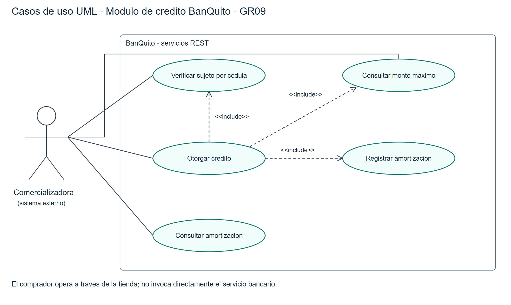
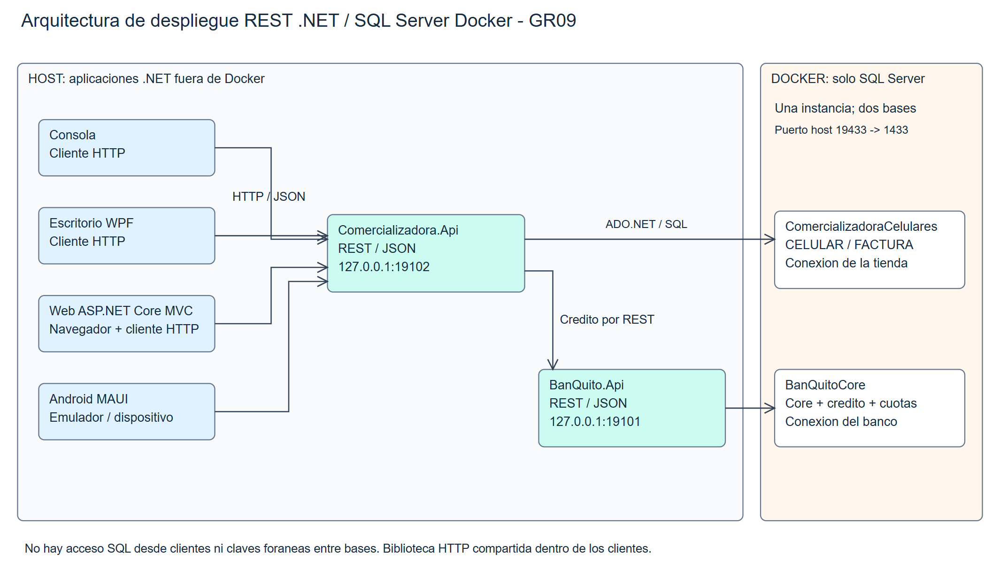
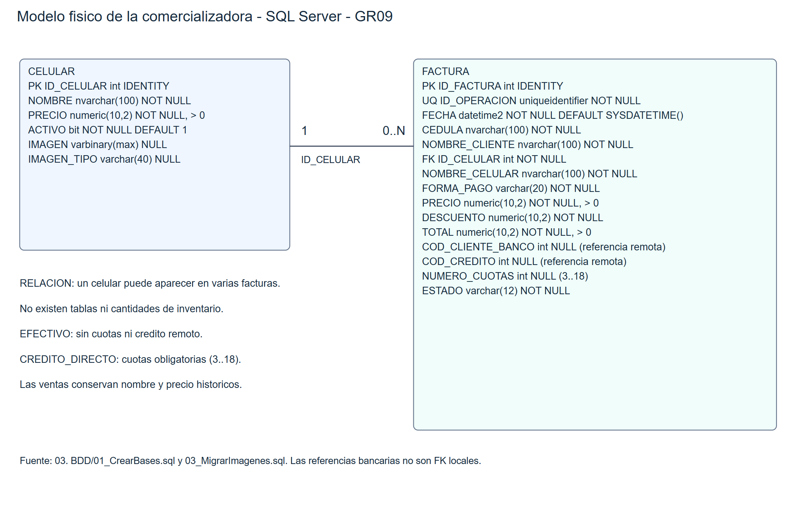

# Comercializadora de celulares y BanQuito
.NET REST · Grupo 09 · NRC 36884
Dos API independientes, cuatro clientes y SQL Server en Docker.

## Problema y alcance
Catálogo sin inventario y facturación de un celular por compra.
Pago en efectivo o crédito directo autorizado por BanQuito.
No se implementa la programación del Core bancario completo.

## Arquitectura
Consola, WPF, web MVC y Android MAUI consumen la API comercializadora.
Comercializadora y BanQuito se comunican por REST/JSON.
Dos bases independientes en SQL Server Docker; las aplicaciones corren en host.

## Modelo de datos
Tienda: CELULAR y FACTURA; fotos opcionales y referencia remota del crédito.
Banco: CLIENTE, CUENTA, MOVIMIENTO, CREDITO y AMORTIZACION.
Semillas verificadas: 5 clientes, 5 cuentas, 50 movimientos.

## Elegibilidad bancaria
Ser cliente, tener depósito en último mes y no tener crédito activo.
Hombres con 25 años cumplidos.
La consulta no garantiza aprobación posterior: el otorgamiento revalida.

## Monto máximo
Promedios de depósitos y retiros de los últimos tres meses.
Máximo = max(0, diferencia × 35% × 6).
Enunciado contradictorio: texto 35%, fórmula 30%; decisión explícita al 35%.

## Otorgamiento y amortización
Código de cliente, precio del teléfono y número de cuotas.
Plazo 3–18 meses; interés anual 16,5%, pagos mensuales.
Transacción bancaria y referencia idempotente; última cuota ajusta centavos.

## Efectivo y crédito
Efectivo: precio 450, descuento 189, total 261.
Crédito: factura aprobada solo después de autorización bancaria.
No duplicar operaciones al reintentar; resolver estados pendientes.

## Cuatro clientes comprobados
Consola: entradas del menú real y transcripción.
Web: formularios MVC y Chrome con JavaScript; decimales corregidos.
WPF: eventos de controles reales; Android: emulador y capturas ADB.

## Evidencia de pruebas
39 pruebas unitarias y 53 comprobaciones HTTP QA.
14 comprobaciones consola/MVC; 10 WPF; 9 recorridos Android.
13 comprobaciones posteriores de navegador; consultar registros para alcance.

## Entrega y diagramas
Plantillas locales, fuentes revisadas y generación por scripts.
Conservar modelos y exportaciones; comparar MER con SQL.
VBS sin COM genera SVG editables y PNG actuales; PowerDesigner conserva sus fuentes previas.

## Defensa y pendientes
Demostrar servicios bancarios y ventas en los cuatro clientes sobre QA.
Explicar máximo 35%/30% y ajuste de la última cuota.
Defender con los diagramas y evidencias verificadas; la calificación corresponde al tribunal.

## Figura: Casos de uso bancarios

## Figura: Arquitectura REST y Docker

## Figura: Modelo físico comercializadora

## Comprobación QA: Catálogo inicial: tres celulares
APROBADO
Fuente: EVIDENCIA_API_QA.json. Ejecución aislada; no acredita por sí sola interacción visual.

## Comprobación QA: Catálogo: alta y edición
APROBADO
Fuente: EVIDENCIA_API_QA.json. Ejecución aislada; no acredita por sí sola interacción visual.

## Comprobación QA: Catálogo: desactivación
APROBADO
Fuente: EVIDENCIA_API_QA.json. Ejecución aislada; no acredita por sí sola interacción visual.

## Comprobación QA: Elegibilidad 0000000000
APROBADO
Fuente: EVIDENCIA_API_QA.json. Ejecución aislada; no acredita por sí sola interacción visual.

## Comprobación QA: Elegibilidad 0203040506
APROBADO
Fuente: EVIDENCIA_API_QA.json. Ejecución aislada; no acredita por sí sola interacción visual.

## Comprobación QA: Elegibilidad 0405060708
APROBADO
Fuente: EVIDENCIA_API_QA.json. Ejecución aislada; no acredita por sí sola interacción visual.

## Comprobación QA: Elegibilidad 0304050607
APROBADO
Fuente: EVIDENCIA_API_QA.json. Ejecución aislada; no acredita por sí sola interacción visual.

## Comprobación QA: Máximo 35% de diferencia por seis
APROBADO
Fuente: EVIDENCIA_API_QA.json. Ejecución aislada; no acredita por sí sola interacción visual.

## Comprobación QA: Rechazo plazo 2
APROBADO
Fuente: EVIDENCIA_API_QA.json. Ejecución aislada; no acredita por sí sola interacción visual.

## Comprobación QA: Rechazo plazo 19
APROBADO
Fuente: EVIDENCIA_API_QA.json. Ejecución aislada; no acredita por sí sola interacción visual.

## Comprobación QA: Rechazo monto superior al máximo
APROBADO
Fuente: EVIDENCIA_API_QA.json. Ejecución aislada; no acredita por sí sola interacción visual.

## Comprobación QA: Otorgamiento rechaza menor masculino
APROBADO
Fuente: EVIDENCIA_API_QA.json. Ejecución aislada; no acredita por sí sola interacción visual.

## Comprobación QA: Factura rechaza plazo 2
APROBADO
Fuente: EVIDENCIA_API_QA.json. Ejecución aislada; no acredita por sí sola interacción visual.

## Comprobación QA: Factura rechaza plazo 19
APROBADO
Fuente: EVIDENCIA_API_QA.json. Ejecución aislada; no acredita por sí sola interacción visual.

## Comprobación QA: Efectivo: descuento 189 y total 261
APROBADO
Fuente: EVIDENCIA_API_QA.json. Ejecución aislada; no acredita por sí sola interacción visual.

## Comprobación QA: Reintento efectivo sin duplicado
APROBADO
Fuente: EVIDENCIA_API_QA.json. Ejecución aislada; no acredita por sí sola interacción visual.

## Comprobación QA: Crédito 450 aprobado sin descuento
APROBADO
Fuente: EVIDENCIA_API_QA.json. Ejecución aislada; no acredita por sí sola interacción visual.

## Comprobación QA: Amortización 3: filas y saldo final
APROBADO
Fuente: EVIDENCIA_API_QA.json. Ejecución aislada; no acredita por sí sola interacción visual.

## Comprobación QA: Amortización 3: capital completo
APROBADO
Fuente: EVIDENCIA_API_QA.json. Ejecución aislada; no acredita por sí sola interacción visual.

## Comprobación QA: Amortización 3: interés 16,5% anual
APROBADO
Fuente: EVIDENCIA_API_QA.json. Ejecución aislada; no acredita por sí sola interacción visual.

## Comprobación QA: Cuota 3/1: fecha mensual y balance
APROBADO
Fuente: EVIDENCIA_API_QA.json. Ejecución aislada; no acredita por sí sola interacción visual.

## Comprobación QA: Cuota 3/2: fecha mensual y balance
APROBADO
Fuente: EVIDENCIA_API_QA.json. Ejecución aislada; no acredita por sí sola interacción visual.

## Comprobación QA: Cuota 3/3: fecha mensual y balance
APROBADO
Fuente: EVIDENCIA_API_QA.json. Ejecución aislada; no acredita por sí sola interacción visual.

## Comprobación QA: Amortización 3: cuota fija salvo ajuste final
APROBADO
Fuente: EVIDENCIA_API_QA.json. Ejecución aislada; no acredita por sí sola interacción visual.

## Comprobación QA: Tabla bancaria coincide con pasarela
APROBADO
Fuente: EVIDENCIA_API_QA.json. Ejecución aislada; no acredita por sí sola interacción visual.

## Comprobación QA: Reintento crédito sin duplicado
APROBADO
Fuente: EVIDENCIA_API_QA.json. Ejecución aislada; no acredita por sí sola interacción visual.

## Comprobación QA: Reintento con datos diferentes rechazado
APROBADO
Fuente: EVIDENCIA_API_QA.json. Ejecución aislada; no acredita por sí sola interacción visual.

## Comprobación QA: Cliente con crédito activo no elegible
APROBADO
Fuente: EVIDENCIA_API_QA.json. Ejecución aislada; no acredita por sí sola interacción visual.

## Comprobación QA: Segundo crédito activo rechazado
APROBADO
Fuente: EVIDENCIA_API_QA.json. Ejecución aislada; no acredita por sí sola interacción visual.

## Comprobación QA: Monto igual al máximo aprobado
APROBADO
Fuente: EVIDENCIA_API_QA.json. Ejecución aislada; no acredita por sí sola interacción visual.

## Comprobación QA: Amortización 18: filas y saldo final
APROBADO
Fuente: EVIDENCIA_API_QA.json. Ejecución aislada; no acredita por sí sola interacción visual.

## Comprobación QA: Amortización 18: capital completo
APROBADO
Fuente: EVIDENCIA_API_QA.json. Ejecución aislada; no acredita por sí sola interacción visual.

## Comprobación QA: Amortización 18: interés 16,5% anual
APROBADO
Fuente: EVIDENCIA_API_QA.json. Ejecución aislada; no acredita por sí sola interacción visual.

## Comprobación QA: Cuota 18/1: fecha mensual y balance
APROBADO
Fuente: EVIDENCIA_API_QA.json. Ejecución aislada; no acredita por sí sola interacción visual.

## Comprobación QA: Cuota 18/2: fecha mensual y balance
APROBADO
Fuente: EVIDENCIA_API_QA.json. Ejecución aislada; no acredita por sí sola interacción visual.

## Comprobación QA: Cuota 18/3: fecha mensual y balance
APROBADO
Fuente: EVIDENCIA_API_QA.json. Ejecución aislada; no acredita por sí sola interacción visual.

## Comprobación QA: Cuota 18/4: fecha mensual y balance
APROBADO
Fuente: EVIDENCIA_API_QA.json. Ejecución aislada; no acredita por sí sola interacción visual.

## Comprobación QA: Cuota 18/5: fecha mensual y balance
APROBADO
Fuente: EVIDENCIA_API_QA.json. Ejecución aislada; no acredita por sí sola interacción visual.

## Comprobación QA: Cuota 18/6: fecha mensual y balance
APROBADO
Fuente: EVIDENCIA_API_QA.json. Ejecución aislada; no acredita por sí sola interacción visual.

## Comprobación QA: Cuota 18/7: fecha mensual y balance
APROBADO
Fuente: EVIDENCIA_API_QA.json. Ejecución aislada; no acredita por sí sola interacción visual.

## Comprobación QA: Cuota 18/8: fecha mensual y balance
APROBADO
Fuente: EVIDENCIA_API_QA.json. Ejecución aislada; no acredita por sí sola interacción visual.

## Comprobación QA: Cuota 18/9: fecha mensual y balance
APROBADO
Fuente: EVIDENCIA_API_QA.json. Ejecución aislada; no acredita por sí sola interacción visual.

## Comprobación QA: Cuota 18/10: fecha mensual y balance
APROBADO
Fuente: EVIDENCIA_API_QA.json. Ejecución aislada; no acredita por sí sola interacción visual.

## Comprobación QA: Cuota 18/11: fecha mensual y balance
APROBADO
Fuente: EVIDENCIA_API_QA.json. Ejecución aislada; no acredita por sí sola interacción visual.

## Comprobación QA: Cuota 18/12: fecha mensual y balance
APROBADO
Fuente: EVIDENCIA_API_QA.json. Ejecución aislada; no acredita por sí sola interacción visual.

## Comprobación QA: Cuota 18/13: fecha mensual y balance
APROBADO
Fuente: EVIDENCIA_API_QA.json. Ejecución aislada; no acredita por sí sola interacción visual.

## Comprobación QA: Cuota 18/14: fecha mensual y balance
APROBADO
Fuente: EVIDENCIA_API_QA.json. Ejecución aislada; no acredita por sí sola interacción visual.

## Comprobación QA: Cuota 18/15: fecha mensual y balance
APROBADO
Fuente: EVIDENCIA_API_QA.json. Ejecución aislada; no acredita por sí sola interacción visual.

## Comprobación QA: Cuota 18/16: fecha mensual y balance
APROBADO
Fuente: EVIDENCIA_API_QA.json. Ejecución aislada; no acredita por sí sola interacción visual.

## Comprobación QA: Cuota 18/17: fecha mensual y balance
APROBADO
Fuente: EVIDENCIA_API_QA.json. Ejecución aislada; no acredita por sí sola interacción visual.

## Comprobación QA: Cuota 18/18: fecha mensual y balance
APROBADO
Fuente: EVIDENCIA_API_QA.json. Ejecución aislada; no acredita por sí sola interacción visual.

## Comprobación QA: Amortización 18: cuota fija salvo ajuste final
APROBADO
Fuente: EVIDENCIA_API_QA.json. Ejecución aislada; no acredita por sí sola interacción visual.

## Comprobación QA: Consulta factura y búsqueda por cédula
APROBADO
Fuente: EVIDENCIA_API_QA.json. Ejecución aislada; no acredita por sí sola interacción visual.

## Consola termina correctamente
Evidencia ejecutada: EVIDENCIA_CLIENTES_QA.json
Resultado: APROBADO

## Consola catálogo alta y edición
Evidencia ejecutada: EVIDENCIA_CLIENTES_QA.json
Resultado: APROBADO

## Consola efectivo y crédito aprobados
Evidencia ejecutada: EVIDENCIA_CLIENTES_QA.json
Resultado: APROBADO

## Consola consulta amortización
Evidencia ejecutada: EVIDENCIA_CLIENTES_QA.json
Resultado: APROBADO

## Consola sin errores de operación
Evidencia ejecutada: EVIDENCIA_CLIENTES_QA.json
Resultado: APROBADO

## Web catálogo renderizado
Evidencia ejecutada: EVIDENCIA_CLIENTES_QA.json
Resultado: APROBADO

## Web alta y edición catálogo
Evidencia ejecutada: EVIDENCIA_CLIENTES_QA.json
Resultado: APROBADO

## Web desactivación
Evidencia ejecutada: EVIDENCIA_CLIENTES_QA.json
Resultado: APROBADO

## Web factura EFECTIVO
Evidencia ejecutada: EVIDENCIA_CLIENTES_QA.json
Resultado: APROBADO

## Web total EFECTIVO
Evidencia ejecutada: EVIDENCIA_CLIENTES_QA.json
Resultado: APROBADO

## Web factura CREDITO_DIRECTO
Evidencia ejecutada: EVIDENCIA_CLIENTES_QA.json
Resultado: APROBADO

## Web total CREDITO_DIRECTO
Evidencia ejecutada: EVIDENCIA_CLIENTES_QA.json
Resultado: APROBADO

## Web amortización renderizada
Evidencia ejecutada: EVIDENCIA_CLIENTES_QA.json
Resultado: APROBADO

## Web búsqueda por cédula
Evidencia ejecutada: EVIDENCIA_CLIENTES_QA.json
Resultado: APROBADO

## Catálogo cargado
Evidencia ejecutada: EVIDENCIA_WPF_QA.json
Comprobación registrada por el arnés QA.
